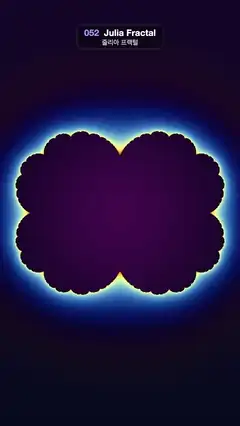

# 052 · Julia Fractal · 줄리아 프랙털



**EN** A glowing Julia set morphs from cauliflower to rabbit to basilica and back as its parameter circles the Mandelbrot cardioid.  
**KO** 매개변수 c가 만델브로 집합의 카디오이드를 따라 돌면서, 빛나는 줄리아 집합이 콜리플라워에서 토끼, 바실리카 모양으로 변했다가 돌아온다.

[Video (mp4)](https://sueun-dev.github.io/motion-effects/videos/052-julia-fractal.mp4) · [Code](../effects/052-julia-fractal.js) · Shaders & generative · 셰이더·제너러티브

## Prompt (English)

```text
Create a "Julia Fractal" motion effect: a glowing Julia set whose complex parameter goes once round just inside the edge of the Mandelbrot main cardioid, so the shape morphs from cauliflower to rabbit to basilica and back.

Look
- Coordinates: uv = (2 · fragCoord − resolution) / width × 1.22 (x −1.22 … 1.22, y about −2.17 … 2.17). Use z = (uv.y, −uv.x), i.e. turned 90°, so the set's real axis runs down the tall frame.
- Iterate z → z² + c up to 300 times; escape when |z|² > 256; smooth escape count n = i + 1 − log2(log2(|z|²) / 2).
- Inside the set (never escapes): deep purple, mixing #420D4D at the centre to #0D0521 by smoothstep(0, 1.6, |uv|).
- Outside: k = ln(n + 1) (a log scale, so deep counts change colour slowly). A night-blue background mixed from #080A1F to #140829 (by 0.5 + 0.25 · uv.y), blended towards a cosine palette 0.5 + 0.5 · cos(2π · (0.38k + 0.1 + (0, 0.12, 0.30))) by smoothstep(0, 2.4, k). This gives a deep blue halo that turns cream-yellow and orange right at the edge.
- Late escapers (n from 24 to 80, the thin filaments) blend into the inside colour, so the boundary reads as one clean glowing edge.

Motion (0–5 s), a = 2π · t / 5
- c = 0.975 · (e^(ia) / 2 − e^(2ia) / 4): one full round just inside the main cardioid of the Mandelbrot set. At 0 s c ≈ 0.244 (cauliflower), near 1.67 s the three-lobed rabbit, at 2.5 s c ≈ −0.73 (basilica, a vertical chain of bulbs), near 3.33 s the mirrored rabbit, and back to the cauliflower at 5 s.
- Staying just inside the cardioid keeps the set connected and solid, so it morphs smoothly instead of breaking into dust.

Technique
- A WebGL2 full-screen fragment shader with 2 × 2 supersampling per pixel (offsets ±0.25 px). The smooth escape count, the log-scale colouring and the fade of the thin filaments into the inside colour keep the fine edges from sparkling as the shape changes.

Output and rules
- One self-contained HTML file with no external assets (three.js from a CDN is fine if you use it), drawing on a 1080 × 1920 canvas (9:16) scaled to fit the window.
- Write a function renderFrame(t) that draws the frame for time t in seconds, and preview it with requestAnimationFrame. Everything must be a pure function of t and fixed seeds: no Math.random(), Date or state carried between frames, so frame i = renderFrame(i / 30) can be exported to a 30 fps video.
- Loop seamlessly every 5 seconds: renderFrame(5) must look exactly like renderFrame(0).
- No flicker of any kind: no noise or grain that changes from frame to frame, no strobing or blinking, no z-fighting, no shimmering 1 px lines. Any grain or texture stays fixed to the screen or to the object.
- Keep the top 280 px free of important content (a title label goes there) and fill the whole frame with a designed background.
```

## 프롬프트 (한국어)

```text
"줄리아 프랙털" 모션 효과를 만들어 줘: 복소수 매개변수가 만델브로 집합의 주 카디오이드 가장자리 바로 안쪽을 한 바퀴 돌아서, 빛나는 줄리아 집합이 콜리플라워에서 토끼, 바실리카 모양으로 변했다가 돌아오는 효과.

모양
- 좌표: uv = (2 · fragCoord − 해상도) / 너비 × 1.22(x −1.22 … 1.22, y 약 −2.17 … 2.17). z = (uv.y, −uv.x)로 90° 돌려서 집합의 실수축이 세로로 긴 화면을 따라 내려가게 한다.
- z → z² + c를 최대 300번 반복, |z|² > 256이면 탈출. 부드러운 탈출 횟수 n = i + 1 − log2(log2(|z|²) / 2).
- 집합 안(끝내 탈출하지 않음): 짙은 보라. smoothstep(0, 1.6, |uv|)로 가운데 #420D4D → #0D0521.
- 바깥: k = ln(n + 1)(로그 척도라서 깊은 횟수일수록 색이 천천히 변한다). #080A1F에서 #140829로 섞은 밤하늘색 바탕(0.5 + 0.25 · uv.y 기준)을, smoothstep(0, 2.4, k)만큼 코사인 팔레트 0.5 + 0.5 · cos(2π · (0.38k + 0.1 + (0, 0.12, 0.30))) 쪽으로 섞는다. 그래서 짙은 파란 후광이 가장자리 바로 앞에서 크림빛 노랑과 주황으로 바뀐다.
- 늦게 탈출하는 점(n 24에서 80, 가는 실 같은 부분)은 안쪽 색으로 섞여, 경계가 하나의 깔끔한 빛나는 테두리로 보인다.

움직임 (0–5초), a = 2π · t / 5
- c = 0.975 · (e^(ia) / 2 − e^(2ia) / 4): 만델브로 집합의 주 카디오이드 바로 안쪽을 한 바퀴. 0초에 c ≈ 0.244(콜리플라워), 1.67초 무렵 세 갈래 토끼, 2.5초에 c ≈ −0.73(바실리카, 세로로 이어진 구슬 사슬), 3.33초 무렵 좌우가 뒤집힌 토끼, 5초에 다시 콜리플라워.
- 카디오이드 바로 안쪽에 머물러서 집합이 끊어지지 않고 속이 찬 모양을 유지하므로, 먼지처럼 부서지지 않고 부드럽게 변한다.

기법
- WebGL2 전체 화면 프래그먼트 셰이더, 픽셀마다 2 × 2 슈퍼샘플링(오프셋 ±0.25 px). 부드러운 탈출 횟수, 로그 척도 색칠, 가는 실 부분을 안쪽 색으로 녹이는 처리 덕분에 모양이 바뀌어도 가는 경계가 반짝이며 떨리지 않는다.

출력과 규칙
- 외부 파일 없는 HTML 파일 하나(three.js를 쓴다면 CDN은 괜찮다). 1080 × 1920(9:16) 캔버스에 그리고 창 크기에 맞춰 보이게 한다.
- 시간 t(초)의 프레임을 그리는 renderFrame(t) 함수를 만들고, 미리보기는 requestAnimationFrame으로 돌린다. 모든 것은 t와 고정 시드만으로 정해진다: Math.random(), Date, 프레임 사이에 쌓이는 상태 금지. 그래야 i번째 프레임 = renderFrame(i / 30)으로 30fps 영상을 뽑을 수 있다.
- 5초마다 끊김 없이 반복: renderFrame(5)는 renderFrame(0)과 똑같아 보여야 한다.
- 어떤 깜빡임도 금지: 프레임마다 바뀌는 노이즈·그레인, 번쩍임·깜빡임, z-fighting, 반짝이며 떨리는 1px 선 모두 금지. 그레인·질감은 화면이나 물체에 고정한다.
- 위쪽 280px에는 중요한 내용을 두지 않고(제목 라벨 자리), 화면 전체를 디자인된 배경으로 채운다.
```
