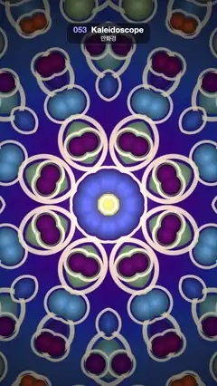

# 053 · Kaleidoscope · 만화경



**EN** Jewel-like dots and cream rings fold into an 8-fold mirrored mandala that slowly turns and keeps changing shape.  
**KO** 보석 같은 점과 크림색 고리가 8방향 거울 대칭 만다라로 접혀 천천히 돌며 계속 모양을 바꾼다.

[Video (mp4)](../videos/053-kaleidoscope.mp4) · [Code](../effects/053-kaleidoscope.js) · Shaders & generative · 셰이더·제너러티브

## Prompt (English)

```text
Create a "Kaleidoscope" motion effect: a field of jewel dots and rings folded by polar mirror symmetry into an 8-fold mandala that turns and blooms as the field drifts.

Look
- Work in units of the frame width (1 unit = 1080 px). The kaleidoscope centre is at (540, 1018) px (y from the top).
- Fold: take each pixel's polar coordinates (r, angle). With a wedge of 360° / 8 = 45°, set a = |mod(angle, 45°) − 22.5°| and rebuild q = r · (cos a, sin a). That gives 8 wedges, each mirrored (16 mirror slices).
- Source field coordinate: s = 2q + (0.9, 0.4) + drift.
- Field background: a cosine palette pal(x) = A + B · cos(2π(x + D)) with A = (0.32, 0.16, 0.36), B = (0.22, 0.14, 0.24), D = (0.85, 0.15, 0.35), indexed by 0.55 + 0.35 × simplex noise of 0.45·s. Mostly deep blue-violet #241E8D with muted mauve patches.
- Two square lattices of dots on top: cell size 1/1.5 and 1/2.5 s-units (about 360 px and 216 px on screen), the second shifted by 0.37 cells. Each cell gets a hash value h; a centred dot of radius 0.16 + 0.22·h cells, coloured from pal(h) with A = (0.62, 0.5, 0.55), B = (0.38, 0.4, 0.42), D = (0, 0.18, 0.4) (orange #FFAB36, brick red #BC3536, violet #5026AD, sky blue #5093F7, mint #BCE5AD). Shade each dot ×1.05 at its centre down to ×0.45 at its rim so it looks domed.
- Around every dot a cream ring #FFEDC7 at 85 % opacity: centred 0.075 cells outside the dot edge, 0.064 cells thick. Anti-alias all edges with fwidth.
- Vignette: multiply by 0.35 + 0.75 × smoothstep(1.15, 0.15, r). Add a soft warm light #FFD9B2 × 0.25 × exp(−40 r²) in the middle.

Motion (0–5 s)
- Rotate the fold: add (t / 5) × 45° to the angle before folding. One wedge per loop looks identical, so it loops.
- Drift the source field around a circle of radius 0.15 s-units, once per loop, so dots slide through the mirrors and the mandala keeps blooming into new shapes.
- Slow and hypnotic; no cuts or jumps.

Technique
- A WebGL2 full-screen fragment shader (one triangle) with time and resolution uniforms; 3D simplex noise for the background, a hash for per-cell values.

Output and rules
- One self-contained HTML file with no external assets (three.js from a CDN is fine if you use it), drawing on a 1080 × 1920 canvas (9:16) scaled to fit the window.
- Write a function renderFrame(t) that draws the frame for time t in seconds, and preview it with requestAnimationFrame. Everything must be a pure function of t and fixed seeds: no Math.random(), Date or state carried between frames, so frame i = renderFrame(i / 30) can be exported to a 30 fps video.
- Loop seamlessly every 5 seconds: renderFrame(5) must look exactly like renderFrame(0).
- No flicker of any kind: no noise or grain that changes from frame to frame, no strobing or blinking, no z-fighting, no shimmering 1 px lines. Any grain or texture stays fixed to the screen or to the object.
- Keep the top 280 px free of important content (a title label goes there) and fill the whole frame with a designed background.
```

## 프롬프트 (한국어)

```text
"만화경" 모션 효과를 만들어 줘: 보석 같은 점과 고리로 된 무늬를 극좌표 거울 대칭으로 접어 8방향 만다라를 만들고, 무늬가 흐르면서 만다라가 돌고 피어나는 효과.

모양
- 단위는 화면 너비(1 = 1080px). 만화경 중심은 (540, 1018)px(y는 위에서부터).
- 접기: 픽셀마다 극좌표 (r, 각도)를 구한다. 쐐기 하나가 360° / 8 = 45°일 때 a = |mod(각도, 45°) − 22.5°|로 접고 q = r · (cos a, sin a)로 다시 만든다. 쐐기 8개가 각각 거울처럼 뒤집혀 거울 조각 16개가 된다.
- 원본 무늬 좌표: s = 2q + (0.9, 0.4) + 이동량.
- 무늬 바탕: 코사인 팔레트 pal(x) = A + B · cos(2π(x + D)), A = (0.32, 0.16, 0.36), B = (0.22, 0.14, 0.24), D = (0.85, 0.15, 0.35). 인덱스는 0.55 + 0.35 × (0.45·s의 심플렉스 노이즈). 대부분 짙은 청보라 #241E8D에 탁한 연보라 얼룩이 섞인다.
- 그 위에 점 격자 두 겹: 칸 크기 1/1.5, 1/2.5 s단위(화면에서 약 360px, 216px), 두 번째 격자는 0.37칸 어긋나게. 칸마다 해시값 h를 정하고, 칸 가운데 반지름 0.16 + 0.22·h칸의 점을 pal(h)(A = (0.62, 0.5, 0.55), B = (0.38, 0.4, 0.42), D = (0, 0.18, 0.4))로 칠한다(주황 #FFAB36, 벽돌색 #BC3536, 보라 #5026AD, 하늘색 #5093F7, 민트 #BCE5AD). 점은 가운데 ×1.05에서 가장자리 ×0.45로 어두워져 볼록해 보이게.
- 모든 점 둘레에 크림색 고리 #FFEDC7(불투명도 85 %): 점 가장자리에서 0.075칸 바깥이 중심, 두께 0.064칸. 모든 경계는 fwidth로 안티에일리어싱.
- 비네트: 0.35 + 0.75 × smoothstep(1.15, 0.15, r)를 곱한다. 가운데에 부드럽고 따뜻한 빛 #FFD9B2 × 0.25 × exp(−40 r²)를 더한다.

움직임 (0–5초)
- 접는 각도를 돌린다: 접기 전에 각도에 (t / 5) × 45°를 더한다. 루프마다 쐐기 하나만큼 돌면 똑같아 보이므로 반복된다.
- 원본 무늬를 반지름 0.15 s단위 원을 따라 루프마다 한 바퀴 옮긴다. 점들이 거울 사이로 미끄러지며 만다라가 계속 새 모양으로 피어난다.
- 느리고 최면 같은 움직임. 끊기거나 튀는 순간 없이.

기법
- WebGL2 전체 화면 프래그먼트 셰이더(삼각형 하나), 시간·해상도 유니폼. 바탕은 3D 심플렉스 노이즈, 칸별 값은 해시.

출력과 규칙
- 외부 파일 없는 HTML 파일 하나(three.js를 쓴다면 CDN은 괜찮다). 1080 × 1920(9:16) 캔버스에 그리고 창 크기에 맞춰 보이게 한다.
- 시간 t(초)의 프레임을 그리는 renderFrame(t) 함수를 만들고, 미리보기는 requestAnimationFrame으로 돌린다. 모든 것은 t와 고정 시드만으로 정해진다: Math.random(), Date, 프레임 사이에 쌓이는 상태 금지. 그래야 i번째 프레임 = renderFrame(i / 30)으로 30fps 영상을 뽑을 수 있다.
- 5초마다 끊김 없이 반복: renderFrame(5)는 renderFrame(0)과 똑같아 보여야 한다.
- 어떤 깜빡임도 금지: 프레임마다 바뀌는 노이즈·그레인, 번쩍임·깜빡임, z-fighting, 반짝이며 떨리는 1px 선 모두 금지. 그레인·질감은 화면이나 물체에 고정한다.
- 위쪽 280px에는 중요한 내용을 두지 않고(제목 라벨 자리), 화면 전체를 디자인된 배경으로 채운다.
```
