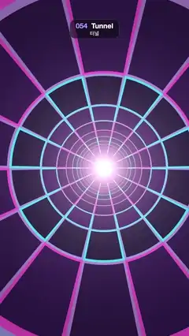

# 054 · Tunnel · 터널



**EN** An endless flight down a tiled tunnel lined with cyan and magenta neon, slowly spinning toward a white glow.  
**KO** 청록·자홍 네온 선이 그어진 타일 터널 속으로 끝없이 날아가고, 터널은 천천히 돌며 끝이 하얗게 빛난다.

[Video (mp4)](../videos/054-tunnel.mp4) · [Code](../effects/054-tunnel.js) · Shaders & generative · 셰이더·제너러티브

## Prompt (English)

```text
Create a "Tunnel" motion effect: the classic demoscene tunnel, flying forever down a cylinder of dark tiles outlined in neon lines.

Look
- Units: frame widths (1 = 1080 px). The tunnel centre is near the middle of the frame (540, 960) and wobbles on a small figure-8: x offset 54 px · cos(2πφ), y offset 43 px · sin(4πφ), with φ = t / 5.
- Map every pixel to tunnel coordinates: r = distance to the centre, u = (angle / 2π + 0.5) × 14 (14 tiles around), v = 1 / r (depth).
- Tile colour index = (floor(u) mod 2, floor(v) mod 4). Tile fill: a dark violet between #0D0829 and #290D4C, chosen by a hash of that index.
- Neon lines on every tile border, half width 0.05 tile (lines are 10 % of a tile). Line colour between cyan #33F2FF and magenta #FF4CD9 by 0.5 + 0.5 · sin(2π · row / 4 + 1.3 · column), so the rings alternate cyan and pink.
- Anti-aliasing is essential: compute how many tile units one pixel covers, du = 14 / (2π · r · 1080) around and dv = 1 / (r² · 1080) in depth, soften each line edge by that amount, and fade a line family out (× clamp(1.5 − 6 · du, 0, 1), same for dv) where tiles get smaller than a few pixels. This keeps the far rings and the vanishing point from shimmering.
- Depth fog: fog = exp(−0.09 / r) (unscrolled depth); mix toward pale pink-white #FFD1F2 × 0.9 as fog drops. Add #FFD1F2 × 0.55 · exp(−9r) as a hot light at the far end. Multiply by 0.75 + 0.25 · smoothstep(0.9, 0.3, r) to darken the outer edge.

Motion (0–5 s)
- Fly forward: v += 4φ (4 tiles of depth per loop), so rings stream outward from the centre.
- Spin: u += 2φ (two tiles around per loop).
- Colours repeat every 2 tiles around and every 4 tiles deep, so both moves are exact loops. Constant speed, no easing.

Technique
- A WebGL2 full-screen fragment shader; the tiles and lines are procedural (no textures).

Output and rules
- One self-contained HTML file with no external assets (three.js from a CDN is fine if you use it), drawing on a 1080 × 1920 canvas (9:16) scaled to fit the window.
- Write a function renderFrame(t) that draws the frame for time t in seconds, and preview it with requestAnimationFrame. Everything must be a pure function of t and fixed seeds: no Math.random(), Date or state carried between frames, so frame i = renderFrame(i / 30) can be exported to a 30 fps video.
- Loop seamlessly every 5 seconds: renderFrame(5) must look exactly like renderFrame(0).
- No flicker of any kind: no noise or grain that changes from frame to frame, no strobing or blinking, no z-fighting, no shimmering 1 px lines. Any grain or texture stays fixed to the screen or to the object.
- Keep the top 280 px free of important content (a title label goes there) and fill the whole frame with a designed background.
```

## 프롬프트 (한국어)

```text
"터널" 모션 효과를 만들어 줘: 고전 데모신 터널처럼, 네온 선으로 테두리를 두른 어두운 타일 원통 속으로 끝없이 날아가는 효과.

모양
- 단위는 화면 너비(1 = 1080px). 터널 중심은 화면 한가운데 (540, 960) 근처이고 작은 8자를 그리며 흔들린다: x 오프셋 54px · cos(2πφ), y 오프셋 43px · sin(4πφ), φ = t / 5.
- 픽셀마다 터널 좌표로 바꾼다: r = 중심까지 거리, u = (각도 / 2π + 0.5) × 14(둘레에 타일 14개), v = 1 / r(깊이).
- 타일 색 인덱스 = (floor(u) mod 2, floor(v) mod 4). 타일은 그 인덱스의 해시로 #0D0829와 #290D4C 사이의 어두운 보라로 칠한다.
- 모든 타일 경계에 네온 선, 반폭 0.05타일(선이 타일의 10 %). 선 색은 0.5 + 0.5 · sin(2π · 행 / 4 + 1.3 · 열)로 청록 #33F2FF와 자홍 #FF4CD9 사이. 그래서 고리가 청록과 분홍으로 번갈아 보인다.
- 안티에일리어싱이 핵심: 픽셀 하나가 덮는 타일 단위 du = 14 / (2π · r · 1080)(둘레 방향), dv = 1 / (r² · 1080)(깊이 방향)을 구해 그만큼 선 경계를 부드럽게 하고, 타일이 몇 픽셀보다 작아지는 곳에서는 그 방향 선을 × clamp(1.5 − 6 · du, 0, 1)(dv도 같게)로 지운다. 그래야 먼 고리와 소실점이 반짝이며 떨리지 않는다.
- 깊이 안개: fog = exp(−0.09 / r)(흐름을 더하지 않은 깊이), fog가 줄수록 옅은 분홍빛 흰색 #FFD1F2 × 0.9 쪽으로 섞는다. 터널 끝에 #FFD1F2 × 0.55 · exp(−9r)를 더해 뜨거운 빛을 만든다. 0.75 + 0.25 · smoothstep(0.9, 0.3, r)를 곱해 바깥쪽을 어둡게.

움직임 (0–5초)
- 앞으로 날아간다: v += 4φ(루프마다 깊이 타일 4칸). 고리가 중심에서 바깥으로 흘러나온다.
- 회전: u += 2φ(루프마다 둘레 타일 2칸).
- 색이 둘레 2칸, 깊이 4칸마다 반복되므로 두 움직임 모두 정확히 반복된다. 일정한 속도, 이징 없음.

기법
- WebGL2 전체 화면 프래그먼트 셰이더. 타일과 선은 절차적으로 계산(텍스처 없음).

출력과 규칙
- 외부 파일 없는 HTML 파일 하나(three.js를 쓴다면 CDN은 괜찮다). 1080 × 1920(9:16) 캔버스에 그리고 창 크기에 맞춰 보이게 한다.
- 시간 t(초)의 프레임을 그리는 renderFrame(t) 함수를 만들고, 미리보기는 requestAnimationFrame으로 돌린다. 모든 것은 t와 고정 시드만으로 정해진다: Math.random(), Date, 프레임 사이에 쌓이는 상태 금지. 그래야 i번째 프레임 = renderFrame(i / 30)으로 30fps 영상을 뽑을 수 있다.
- 5초마다 끊김 없이 반복: renderFrame(5)는 renderFrame(0)과 똑같아 보여야 한다.
- 어떤 깜빡임도 금지: 프레임마다 바뀌는 노이즈·그레인, 번쩍임·깜빡임, z-fighting, 반짝이며 떨리는 1px 선 모두 금지. 그레인·질감은 화면이나 물체에 고정한다.
- 위쪽 280px에는 중요한 내용을 두지 않고(제목 라벨 자리), 화면 전체를 디자인된 배경으로 채운다.
```
