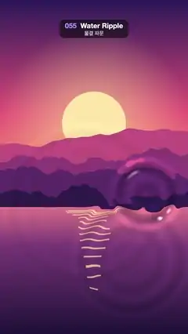

# 055 · Water Ripple · 물결 파문



**EN** Drop rings spread across a sunset-over-the-lake picture, bending it like water and catching bright glints on their crests.  
**KO** 물방울 파문이 노을 진 호수 그림 위로 퍼지며 그림을 물처럼 휘게 하고, 물결 마루에 반짝이는 빛이 맺힌다.

[Video (mp4)](https://sueun-dev.github.io/motion-effects/videos/055-water-ripple.mp4) · [Code](../effects/055-water-ripple.js) · Shaders & generative · 셰이더·제너러티브

## Prompt (English)

```text
Create a "Water Ripple" motion effect: ring waves from drops spread over a picture and refract it, with specular glints on the crests.

Look
- The picture underneath, painted on a 2D canvas that fills the frame:
  - sky gradient #2B1B5A (top) → #E8577A (55 %) → #FFB36B at y = 1190 (62 % of the height);
  - a pale sun disc #FFE6A8, radius 184 px, at (540, 710), inside a soft glow rgba(255, 220, 150, 0.55 → 0) out to 3× its radius;
  - four layers of soft noise mountain ridges, back to front #C2507E, #8E3B78, #5A2A68, #2E1A4A, their bases at 47, 52, 57 and 62 % of the height, rising 8–12 % of the height;
  - a lake below y = 1190, gradient #E0748A → #7A3B78 (30 %) → #1E1238, with 14 horizontal sun-glint bars rgba(255, 226, 160, 0.7) under the sun that get narrower and further apart downward.
- Ripples: a height field summed from 5 drop sources (units: frame widths, 1 = 1080 px). Source i has k = 2φ + i/5 (φ = t / 5), age a = fract(k), and alternates between two fixed hashed spots (x 0.16–0.84, y 0.35–1.5 from the bottom) using floor(k) mod 2. So a new drop lands every 0.5 s, 10 per loop at 10 places.
- One drop: ring front R = 0.04 + 0.62a. With x = r − R, wave = sin(60x) · exp(−x² · 700) ahead of the front and exp(−x² · 40) behind it (a sharp leading ring, softer rings trailing), times smoothstep(0, 0.08, a) · (1 − a)² / (0.6 + 4R).
- Refraction: gradient of the height by central differences (step 0.0015); offset the picture lookup by gradient × 0.0011 in UV units (correct for the aspect ratio).
- Light: normal = normalize(−0.012 · gradient, 1); specular from light direction (−0.4, 0.6, 0.7), power 60, cream #FFF2D9 × 0.9. Also multiply the colour by 1 + 0.006 · dot(gradient, (−0.5, 0.8)) + 0.35 · height, so crests and slopes facing the light are brighter.

Motion (0–5 s)
- A drop every 0.5 s; each ring expands to about 700 px over 2.5 s while fading out.
- The sun bobs ±19 px once per loop and the glint bars sway in width (sine of the loop phase plus the bar index).

Technique
- Draw the picture with Canvas 2D each frame (it depends on t), upload it as a texture, and do heights, refraction and the highlight in a WebGL2 full-screen fragment shader.

Output and rules
- One self-contained HTML file with no external assets (three.js from a CDN is fine if you use it), drawing on a 1080 × 1920 canvas (9:16) scaled to fit the window.
- Write a function renderFrame(t) that draws the frame for time t in seconds, and preview it with requestAnimationFrame. Everything must be a pure function of t and fixed seeds: no Math.random(), Date or state carried between frames, so frame i = renderFrame(i / 30) can be exported to a 30 fps video.
- Loop seamlessly every 5 seconds: renderFrame(5) must look exactly like renderFrame(0).
- No flicker of any kind: no noise or grain that changes from frame to frame, no strobing or blinking, no z-fighting, no shimmering 1 px lines. Any grain or texture stays fixed to the screen or to the object.
- Keep the top 280 px free of important content (a title label goes there) and fill the whole frame with a designed background.
```

## 프롬프트 (한국어)

```text
"물결 파문" 모션 효과를 만들어 줘: 물방울이 만든 고리 물결이 그림 위로 퍼지며 그림을 굴절시키고, 물결 마루에 반사광이 반짝이는 효과.

모양
- 아래 그림은 화면을 꽉 채우는 2D 캔버스에 그린다:
  - 하늘 그라디언트 #2B1B5A(위) → #E8577A(55 %) → y = 1190(높이의 62 %)에서 #FFB36B;
  - 반지름 184px의 옅은 해 #FFE6A8을 (540, 710)에, 그 둘레에 반지름 3배까지 퍼지는 부드러운 빛 rgba(255, 220, 150, 0.55 → 0);
  - 부드러운 노이즈 산 능선 네 겹, 뒤에서 앞으로 #C2507E, #8E3B78, #5A2A68, #2E1A4A. 밑변은 높이의 47, 52, 57, 62 %, 높이의 8–12 %만큼 솟는다;
  - y = 1190 아래는 호수: 그라디언트 #E0748A → #7A3B78(30 %) → #1E1238, 해 아래에 가로 햇빛 막대 14개 rgba(255, 226, 160, 0.7). 아래로 갈수록 좁아지고 간격이 벌어진다.
- 파문: 물방울 5곳의 높이를 더한 높이장(단위 화면 너비, 1 = 1080px). i번 물방울은 k = 2φ + i/5(φ = t / 5), 나이 a = fract(k), floor(k) mod 2로 해시로 정한 두 고정 위치(x 0.16–0.84, 아래에서 y 0.35–1.5)를 번갈아 쓴다. 그래서 0.5초마다 새 물방울이 떨어지고, 루프마다 10곳에 10개.
- 물방울 하나: 고리 앞머리 R = 0.04 + 0.62a. x = r − R일 때 wave = sin(60x) · 앞쪽은 exp(−x² · 700), 뒤쪽은 exp(−x² · 40)(앞 고리는 날카롭고 뒤따르는 고리는 부드럽게). 여기에 smoothstep(0, 0.08, a) · (1 − a)² / (0.6 + 4R)를 곱한다.
- 굴절: 높이의 기울기를 중앙 차분(간격 0.0015)으로 구하고, 그림을 읽는 위치를 기울기 × 0.0011(UV 단위, 화면비 보정)만큼 옮긴다.
- 빛: 법선 = normalize(−0.012 · 기울기, 1). 빛 방향 (−0.4, 0.6, 0.7)의 반사광, 거듭제곱 60, 크림색 #FFF2D9 × 0.9. 색에 1 + 0.006 · dot(기울기, (−0.5, 0.8)) + 0.35 · 높이를 곱해 마루와 빛을 향한 비탈을 밝게.

움직임 (0–5초)
- 0.5초마다 물방울 하나. 고리는 2.5초 동안 약 700px까지 퍼지며 사라진다.
- 해는 루프마다 한 번 ±19px 오르내리고, 햇빛 막대는 폭이 출렁인다(루프 위상 + 막대 번호의 사인).

기법
- 그림은 매 프레임 Canvas 2D로 그리고(t에 따라 바뀜) 텍스처로 올린다. 높이·굴절·반사광은 WebGL2 전체 화면 프래그먼트 셰이더에서.

출력과 규칙
- 외부 파일 없는 HTML 파일 하나(three.js를 쓴다면 CDN은 괜찮다). 1080 × 1920(9:16) 캔버스에 그리고 창 크기에 맞춰 보이게 한다.
- 시간 t(초)의 프레임을 그리는 renderFrame(t) 함수를 만들고, 미리보기는 requestAnimationFrame으로 돌린다. 모든 것은 t와 고정 시드만으로 정해진다: Math.random(), Date, 프레임 사이에 쌓이는 상태 금지. 그래야 i번째 프레임 = renderFrame(i / 30)으로 30fps 영상을 뽑을 수 있다.
- 5초마다 끊김 없이 반복: renderFrame(5)는 renderFrame(0)과 똑같아 보여야 한다.
- 어떤 깜빡임도 금지: 프레임마다 바뀌는 노이즈·그레인, 번쩍임·깜빡임, z-fighting, 반짝이며 떨리는 1px 선 모두 금지. 그레인·질감은 화면이나 물체에 고정한다.
- 위쪽 280px에는 중요한 내용을 두지 않고(제목 라벨 자리), 화면 전체를 디자인된 배경으로 채운다.
```
