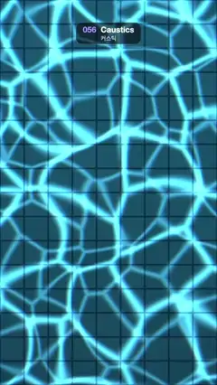

# 056 · Caustics · 커스틱



**EN** A net of bright, softly rainbow-fringed light lines wavers over a tiled blue pool floor.  
**KO** 파란 타일 수영장 바닥 위로 가장자리에 옅은 무지개가 번진 밝은 빛 그물 무늬가 일렁인다.

[Video (mp4)](../videos/056-caustics.mp4) · [Code](../effects/056-caustics.js) · Shaders & generative · 셰이더·제너러티브

## Prompt (English)

```text
Create a "Caustics" motion effect: the wobbling net of light you see on the floor of a swimming pool.

Look
- Pool floor: square tiles of 120 px (9 across), colour #298CB8, with darker grout #145280 about 8 px wide along the joints. Multiply by 0.8 + 0.25 × (height from the bottom / frame height) so it gets brighter toward the top, and give each tile a fixed ±1.5 % brightness from a hash.
- Caustic light, at p = pixel / 1080 × 3.4 (about 3.4 cells per frame width):
  - cells(p): Voronoi with a 3 × 3 neighbour search. Every feature point circles its cell's middle (0.5, 0.5) at radius 0.3 cells, with a hashed start angle and a random direction (clockwise or anticlockwise). Return F2 − F1 (second nearest minus nearest distance), which is small along the cell borders.
  - Before that, warp p by 0.25 × 2D simplex noise (frequency 0.5).
  - Two layers: A = cells(p) and B = cells(rotate(0.6 rad) · 1.35p + 4) with another seed. light = (1 − smoothstep(0, 0.3, A))³ + 0.5 × (1 − smoothstep(0, 0.26, B))³: soft bright lines plus a dimmer, finer second net.
  - Chromatic split: red from p + (0.012, 0), green from p, blue from p − (0.012, 0) (about 4 px), for faint rainbow edges.
- Combine: colour = floor × (0.6 + 0.9 × light) + #8CD9FF × 0.35 × light.
- Vignette: mix toward deep blue #082E52 by 0.35 × smoothstep(0.4, 1.0, distance from the centre in UV units).

Motion (0–5 s)
- Each feature point makes exactly one turn around its circle per loop.
- The warp noise lookup moves round a circle of radius 0.3 once per loop.
- The net wobbles like liquid: cells stretch, merge and split smoothly. The floor stays still.

Technique
- A WebGL2 full-screen fragment shader with time and resolution uniforms.

Output and rules
- One self-contained HTML file with no external assets (three.js from a CDN is fine if you use it), drawing on a 1080 × 1920 canvas (9:16) scaled to fit the window.
- Write a function renderFrame(t) that draws the frame for time t in seconds, and preview it with requestAnimationFrame. Everything must be a pure function of t and fixed seeds: no Math.random(), Date or state carried between frames, so frame i = renderFrame(i / 30) can be exported to a 30 fps video.
- Loop seamlessly every 5 seconds: renderFrame(5) must look exactly like renderFrame(0).
- No flicker of any kind: no noise or grain that changes from frame to frame, no strobing or blinking, no z-fighting, no shimmering 1 px lines. Any grain or texture stays fixed to the screen or to the object.
- Keep the top 280 px free of important content (a title label goes there) and fill the whole frame with a designed background.
```

## 프롬프트 (한국어)

```text
"커스틱" 모션 효과를 만들어 줘: 수영장 바닥에 비치는, 일렁이는 빛 그물 무늬.

모양
- 수영장 바닥: 120px 정사각 타일(가로 9개), 색 #298CB8, 이음새를 따라 폭 약 8px의 더 어두운 줄눈 #145280. 0.8 + 0.25 × (아래에서부터 높이 / 화면 높이)를 곱해 위로 갈수록 밝게, 타일마다 해시로 고정된 ±1.5 % 밝기 차이.
- 커스틱 빛, 좌표 p = 픽셀 / 1080 × 3.4(화면 너비당 약 3.4칸):
  - cells(p): 주변 3 × 3칸을 보는 보로노이. 특징점마다 칸 가운데 (0.5, 0.5)를 반지름 0.3칸으로 돈다. 시작 각도는 해시, 방향(시계/반시계)은 무작위. F2 − F1(두 번째로 가까운 거리 − 가장 가까운 거리)을 돌려주면 칸 경계에서 작아진다.
  - 그 전에 p를 0.25 × 2D 심플렉스 노이즈(주파수 0.5)로 비튼다.
  - 두 겹: A = cells(p), B = cells(rotate(0.6 rad) · 1.35p + 4)(다른 시드). light = (1 − smoothstep(0, 0.3, A))³ + 0.5 × (1 − smoothstep(0, 0.26, B))³. 부드럽고 밝은 선에 더 가늘고 흐린 두 번째 그물이 겹친다.
  - 색 분리: 빨강은 p + (0.012, 0), 초록은 p, 파랑은 p − (0.012, 0)에서 읽어(약 4px) 가장자리에 옅은 무지개.
- 합치기: 색 = 바닥 × (0.6 + 0.9 × light) + #8CD9FF × 0.35 × light.
- 비네트: 중심에서의 거리(UV 단위)로 0.35 × smoothstep(0.4, 1.0, 거리)만큼 짙은 파랑 #082E52 쪽으로 섞는다.

움직임 (0–5초)
- 특징점마다 루프당 정확히 한 바퀴 돈다.
- 비틀기 노이즈를 읽는 위치는 반지름 0.3 원을 따라 루프마다 한 바퀴.
- 그물이 액체처럼 일렁인다: 칸이 늘어나고 합쳐지고 갈라지며 부드럽게 변한다. 바닥은 움직이지 않는다.

기법
- WebGL2 전체 화면 프래그먼트 셰이더, 시간·해상도 유니폼.

출력과 규칙
- 외부 파일 없는 HTML 파일 하나(three.js를 쓴다면 CDN은 괜찮다). 1080 × 1920(9:16) 캔버스에 그리고 창 크기에 맞춰 보이게 한다.
- 시간 t(초)의 프레임을 그리는 renderFrame(t) 함수를 만들고, 미리보기는 requestAnimationFrame으로 돌린다. 모든 것은 t와 고정 시드만으로 정해진다: Math.random(), Date, 프레임 사이에 쌓이는 상태 금지. 그래야 i번째 프레임 = renderFrame(i / 30)으로 30fps 영상을 뽑을 수 있다.
- 5초마다 끊김 없이 반복: renderFrame(5)는 renderFrame(0)과 똑같아 보여야 한다.
- 어떤 깜빡임도 금지: 프레임마다 바뀌는 노이즈·그레인, 번쩍임·깜빡임, z-fighting, 반짝이며 떨리는 1px 선 모두 금지. 그레인·질감은 화면이나 물체에 고정한다.
- 위쪽 280px에는 중요한 내용을 두지 않고(제목 라벨 자리), 화면 전체를 디자인된 배경으로 채운다.
```
