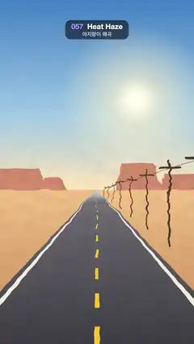

# 057 · Heat Haze · 아지랑이 왜곡



**EN** A desert road shimmers in rising heat: the picture wobbles sideways in waves that climb the screen, strongest at the horizon.  
**KO** 사막 도로 그림이 올라오는 열기에 일렁인다. 옆으로 흔들리는 물결이 화면 위로 흐르고 지평선에서 가장 세다.

[Video (mp4)](../videos/057-heat-haze.mp4) · [Code](../effects/057-heat-haze.js) · Shaders & generative · 셰이더·제너러티브

## Prompt (English)

```text
Create a "Heat Haze" motion effect: a still desert-road picture seen through hot air, displaced by noise that keeps rising up the screen.

Look
- The picture, painted once on a 2D canvas (it never changes); horizon at y = 1060:
  - sky gradient #3F7FC4 (top) → #9CC6E4 (60 %) → #F7DDB2 at the horizon; a sun glow at (756, 560): radial gradient from white-cream at radius 40 through rgba(255, 240, 200, 0.6) at 25 % to transparent at radius 420;
  - four flat-topped mesas #C98466 standing on the horizon (trapezoids with 40 px slanted sides), x / width / height = (−40, 300, 120), (210, 160, 70), (640, 260, 150), (880, 240, 90);
  - sand below, gradient #E9B982 → #C98A55;
  - the road: a trapezoid from 8 px wide at the horizon (centre x 540) to x 540 ± 820 at the bottom, asphalt gradient #B9C9D6 at the horizon (pale, like a mirage) → #6A6870 (8 %) → #3B3A42; cream edge lines #F1E9D8 as thin wedges from (540 ± 3, 1060) to between x 540 ± 715 and 540 ± 760 at the bottom;
  - yellow centre dashes #F2C230 in perspective: screen y = 1060 + 860 / z, each dash from z to 1.14z, half width 16 / z px, z starting at 0.75 and growing ×1.32 per dash;
  - telephone poles #4A3328 on the right at z = 1.3, ×1.45 … up to 30: x = 540 + 1100 / z, standing on y(z), height 1300 / z, width max(2, 28 / z) px, a cross-arm 320 / z wide at 92 % height, round caps, and 2 px wires sagging 30 / z px between neighbouring cross-arms.
- Haze = a sideways (and slight vertical) offset of the texture lookup. Units: frame widths (1 = 1080 px), y from the bottom.
  - Rising noise, periodic in y with period P and scrolling up n periods per loop: θ = 2π(y / P − n · t / 5), R = ky · P / 2π, value = simplex3(x · kx, R cos θ, R sin θ).
  - dx = rising(kx 9, ky 16, P 0.8, n 1) + 0.5 · rising(20, 32, 0.4, 3); dy = 0.6 · rising(9, 14, 0.8, 1), each with a different offset.
  - Strength amp = 0.35 + exp(−((y − horizon) / 0.18)²), strongest within ±190 px of the horizon, faded to 0 toward the top (from about 730 px down to 30 px from the top).
  - Offset = (dx, dy) × amp × (0.008, 0.0045) in UV units: up to about 9–13 px at the horizon.
  - Add a faint warm shimmer #FFD999 × 0.05 × amp × (0.5 + 0.5 · dx).

Motion (0–5 s)
- The main ripples climb at about 170 px/s, the fine ones at about 260 px/s. Poles bend and wriggle, road edges and dashes waver, mesas melt at their base.
- Because the noise is periodic vertically and moves whole periods per loop, it loops exactly.

Technique
- Picture on a 2D canvas used as a texture in a WebGL2 full-screen fragment shader.

Output and rules
- One self-contained HTML file with no external assets (three.js from a CDN is fine if you use it), drawing on a 1080 × 1920 canvas (9:16) scaled to fit the window.
- Write a function renderFrame(t) that draws the frame for time t in seconds, and preview it with requestAnimationFrame. Everything must be a pure function of t and fixed seeds: no Math.random(), Date or state carried between frames, so frame i = renderFrame(i / 30) can be exported to a 30 fps video.
- Loop seamlessly every 5 seconds: renderFrame(5) must look exactly like renderFrame(0).
- No flicker of any kind: no noise or grain that changes from frame to frame, no strobing or blinking, no z-fighting, no shimmering 1 px lines. Any grain or texture stays fixed to the screen or to the object.
- Keep the top 280 px free of important content (a title label goes there) and fill the whole frame with a designed background.
```

## 프롬프트 (한국어)

```text
"아지랑이 왜곡" 모션 효과를 만들어 줘: 멈춰 있는 사막 도로 그림을 뜨거운 공기 너머로 보는 듯, 화면 위로 계속 올라가는 노이즈로 그림을 밀어 일렁이게 하는 효과.

모양
- 그림은 2D 캔버스에 한 번만 그린다(바뀌지 않음). 지평선은 y = 1060:
  - 하늘 그라디언트 #3F7FC4(위) → #9CC6E4(60 %) → 지평선에서 #F7DDB2. 해의 빛 (756, 560): 반지름 40의 흰 크림색 → 25 %에서 rgba(255, 240, 200, 0.6) → 반지름 420에서 투명한 원형 그라디언트;
  - 지평선 위에 꼭대기가 평평한 메사 넷 #C98466(옆면이 40px 기울어진 사다리꼴), x / 폭 / 높이 = (−40, 300, 120), (210, 160, 70), (640, 260, 150), (880, 240, 90);
  - 아래는 모래, 그라디언트 #E9B982 → #C98A55;
  - 도로: 지평선에서 폭 8px(중심 x 540)로 시작해 맨 아래에서 x 540 ± 820이 되는 사다리꼴. 아스팔트 그라디언트는 지평선의 #B9C9D6(신기루처럼 옅게) → #6A6870(8 %) → #3B3A42. 크림색 가장자리 선 #F1E9D8은 (540 ± 3, 1060)에서 맨 아래 x 540 ± 715 ~ 540 ± 760 사이로 가는 가느다란 쐐기;
  - 원근이 있는 노란 중앙 점선 #F2C230: 화면 y = 1060 + 860 / z, 점선 하나는 z에서 1.14z까지, 반폭 16 / z px, z는 0.75에서 시작해 점선마다 ×1.32;
  - 오른쪽 전봇대 #4A3328, z = 1.3에서 ×1.45씩 30까지: x = 540 + 1100 / z, y(z)에 서 있고 높이 1300 / z, 굵기 max(2, 28 / z)px, 높이 92 %에 폭 320 / z의 가로대, 둥근 끝. 이웃 가로대 사이에 30 / z px 처지는 2px 전선.
- 아지랑이 = 텍스처를 읽는 위치를 옆으로(조금은 위아래로) 미는 것. 단위는 화면 너비(1 = 1080px), y는 아래에서부터.
  - 올라가는 노이즈: y 방향 주기 P로 반복되고 루프마다 n주기 위로 흐른다. θ = 2π(y / P − n · t / 5), R = ky · P / 2π, 값 = simplex3(x · kx, R cos θ, R sin θ).
  - dx = rising(kx 9, ky 16, P 0.8, n 1) + 0.5 · rising(20, 32, 0.4, 3), dy = 0.6 · rising(9, 14, 0.8, 1). 각각 다른 오프셋.
  - 세기 amp = 0.35 + exp(−((y − 지평선) / 0.18)²). 지평선 ±190px 안이 가장 세고, 위쪽으로 가며 0이 된다(위에서 약 730px부터 30px까지).
  - 이동량 = (dx, dy) × amp × (0.008, 0.0045)(UV 단위). 지평선에서 최대 약 9–13px.
  - 옅고 따뜻한 일렁임 #FFD999 × 0.05 × amp × (0.5 + 0.5 · dx)를 더한다.

움직임 (0–5초)
- 큰 물결은 약 170px/s, 잔물결은 약 260px/s로 올라간다. 전봇대가 휘며 꿈틀대고, 도로 가장자리와 점선이 떨리고, 메사 밑동이 녹아내리듯 흔들린다.
- 노이즈가 세로로 주기적이고 루프마다 정수 주기만큼 움직이므로 정확히 반복된다.

기법
- 2D 캔버스 그림을 텍스처로 써서 WebGL2 전체 화면 프래그먼트 셰이더로 왜곡.

출력과 규칙
- 외부 파일 없는 HTML 파일 하나(three.js를 쓴다면 CDN은 괜찮다). 1080 × 1920(9:16) 캔버스에 그리고 창 크기에 맞춰 보이게 한다.
- 시간 t(초)의 프레임을 그리는 renderFrame(t) 함수를 만들고, 미리보기는 requestAnimationFrame으로 돌린다. 모든 것은 t와 고정 시드만으로 정해진다: Math.random(), Date, 프레임 사이에 쌓이는 상태 금지. 그래야 i번째 프레임 = renderFrame(i / 30)으로 30fps 영상을 뽑을 수 있다.
- 5초마다 끊김 없이 반복: renderFrame(5)는 renderFrame(0)과 똑같아 보여야 한다.
- 어떤 깜빡임도 금지: 프레임마다 바뀌는 노이즈·그레인, 번쩍임·깜빡임, z-fighting, 반짝이며 떨리는 1px 선 모두 금지. 그레인·질감은 화면이나 물체에 고정한다.
- 위쪽 280px에는 중요한 내용을 두지 않고(제목 라벨 자리), 화면 전체를 디자인된 배경으로 채운다.
```
