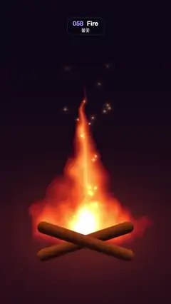

# 058 · Fire · 불꽃



**EN** A campfire on two crossed logs: noise flames lick upward in a tapering column while glowing sparks drift up and fade.  
**KO** 엇갈린 통나무 두 개 위의 모닥불. 노이즈 불길이 가늘어지며 위로 넘실대고 불티가 떠올라 사라진다.

[Video (mp4)](../videos/058-fire.mp4) · [Code](../effects/058-fire.js) · Shaders & generative · 셰이더·제너러티브

## Prompt (English)

```text
Create a "Fire" motion effect: a procedural campfire whose flames are rising noise shaped into a tapering column, on crossed logs, with sparks.

Look
- Units: frame widths (1 = 1080 px), y up. The flame base (origin) is at (540, 1459) px from the top, i.e. 24 % of the height above the bottom.
- Background: dark #0D0817 at the top to warm #290F1A lower down (smoothstep over y 1.3 → −0.3), plus a warm glow #99330D × 0.5 × exp(−3 · |(1.4x, 2.2y)|²) around the fire.
- Flame noise n = 0.55·N1 + 0.3·N2 + 0.15·N3, three "rising" octaves. Rising noise is periodic in y and read on a cylinder: θ = 2π(y / P − k · t / 5), R = ky · P / 2π, value = simplex3(x · kx, R cos θ, R sin θ). Octaves (kx, ky, P, k) = (3, 2.6, 1.2, 2), (6, 5, 0.6, 5), (12, 10, 0.3, 12), each with its own offset.
- Shape: qx = x + 0.07 · n · smoothstep(0, 0.8, y) (licks sway as they rise); half width w = 0.25 · (1 − smoothstep(−0.15, 0.85, y)) + 0.01 (270 px at the base, tapering to a point); body = 1 − |qx| / w; heat = 0.75 · body + 0.55 · n − 0.8 · max(y, 0) + 0.3, multiplied by smoothstep(−0.12, 0.02, y) · (1 − smoothstep(0.55, 1.0, y)).
- Black-body ramp added to the background: rgb = (1.6h, 1.25h², 1.1h⁵) × smoothstep(0, 0.12, h), h = clamp(heat): dark red edges, orange body, white-yellow core.
- Logs: two capsules (half length 0.26, radius 0.035, so about 640 × 76 px) crossed at ±0.32 rad, centred 65 px below the origin. Colour from dark #1F0D08 underneath to ember-lit #BF4C14 on top (mix by 0.8 × smoothstep(−0.03, 0.035, local y)); edges anti-aliased over ±3 px. Draw them over the flame.
- 22 sparks, each a tiny glow exp(−d² / 0.00003) + 0.3 · exp(−d² / 0.0003) (about 4 px core, 13 px halo) in #FF9E40 × 1.4.

Motion (0–5 s)
- The noise octaves rise at 2.4, 3.0 and 3.6 frame widths per loop: quick licking flames.
- Each spark follows a fixed path: progress k = fract((t / 5) × (1 or 2) + random offset); y = 0.05 + 1.1k; x = a random start within ±0.09 + 0.06 · sin(7k + i) wiggle + a random drift up to ±0.06 · k. Fade in over the first 10 % of k and out linearly (× (1 − k)).
- Everything is periodic, so it loops exactly.

Technique
- A WebGL2 full-screen fragment shader with time and resolution uniforms.

Output and rules
- One self-contained HTML file with no external assets (three.js from a CDN is fine if you use it), drawing on a 1080 × 1920 canvas (9:16) scaled to fit the window.
- Write a function renderFrame(t) that draws the frame for time t in seconds, and preview it with requestAnimationFrame. Everything must be a pure function of t and fixed seeds: no Math.random(), Date or state carried between frames, so frame i = renderFrame(i / 30) can be exported to a 30 fps video.
- Loop seamlessly every 5 seconds: renderFrame(5) must look exactly like renderFrame(0).
- No flicker of any kind: no noise or grain that changes from frame to frame, no strobing or blinking, no z-fighting, no shimmering 1 px lines. Any grain or texture stays fixed to the screen or to the object.
- Keep the top 280 px free of important content (a title label goes there) and fill the whole frame with a designed background.
```

## 프롬프트 (한국어)

```text
"불꽃" 모션 효과를 만들어 줘: 위로 흐르는 노이즈를 가늘어지는 기둥 모양으로 깎아 만든 절차적 모닥불. 엇갈린 통나무와 불티까지.

모양
- 단위는 화면 너비(1 = 1080px), y는 위쪽이 +. 불길 밑점(원점)은 위에서 (540, 1459)px, 즉 아래에서 높이의 24 %.
- 배경: 위쪽 어두운 #0D0817에서 아래쪽 따뜻한 #290F1A로(y 1.3 → −0.3 smoothstep). 불 둘레에 따뜻한 빛 #99330D × 0.5 × exp(−3 · |(1.4x, 2.2y)|²).
- 불길 노이즈 n = 0.55·N1 + 0.3·N2 + 0.15·N3, "올라가는" 옥타브 셋. 올라가는 노이즈는 y로 주기적이고 원통 위에서 읽는다: θ = 2π(y / P − k · t / 5), R = ky · P / 2π, 값 = simplex3(x · kx, R cos θ, R sin θ). 옥타브 (kx, ky, P, k) = (3, 2.6, 1.2, 2), (6, 5, 0.6, 5), (12, 10, 0.3, 12), 각각 다른 오프셋.
- 모양: qx = x + 0.07 · n · smoothstep(0, 0.8, y)(올라갈수록 혀가 옆으로 흔들림). 반폭 w = 0.25 · (1 − smoothstep(−0.15, 0.85, y)) + 0.01(밑에서 270px, 위로 뾰족하게). body = 1 − |qx| / w. heat = 0.75 · body + 0.55 · n − 0.8 · max(y, 0) + 0.3에 smoothstep(−0.12, 0.02, y) · (1 − smoothstep(0.55, 1.0, y))를 곱한다.
- 흑체 색 램프를 배경에 더한다: rgb = (1.6h, 1.25h², 1.1h⁵) × smoothstep(0, 0.12, h), h = clamp(heat). 가장자리는 검붉고, 몸통은 주황, 속은 흰 노랑.
- 통나무: 캡슐 두 개(반길이 0.26, 반지름 0.035 → 약 640 × 76px)를 ±0.32 rad로 엇갈려 원점 65px 아래에 둔다. 아랫면 어두운 #1F0D08에서 윗면 불빛 받은 #BF4C14로(0.8 × smoothstep(−0.03, 0.035, 로컬 y)로 섞기). 경계는 ±3px 안티에일리어싱. 불길 위에 그린다.
- 불티 22개, 각각 작은 빛 exp(−d² / 0.00003) + 0.3 · exp(−d² / 0.0003)(심 약 4px, 번짐 13px), 색 #FF9E40 × 1.4.

움직임 (0–5초)
- 노이즈 옥타브는 루프마다 화면 너비의 2.4, 3.0, 3.6배만큼 올라간다: 빠르게 넘실대는 불길.
- 불티마다 고정된 길: 진행도 k = fract((t / 5) × (1 또는 2) + 무작위 오프셋). y = 0.05 + 1.1k, x = ±0.09 안의 무작위 시작점 + 0.06 · sin(7k + i) 흔들림 + 최대 ±0.06 · k의 무작위 표류. k의 처음 10 %에 나타나고 (1 − k)로 직선적으로 사라진다.
- 모두 주기적이어서 정확히 반복된다.

기법
- WebGL2 전체 화면 프래그먼트 셰이더, 시간·해상도 유니폼.

출력과 규칙
- 외부 파일 없는 HTML 파일 하나(three.js를 쓴다면 CDN은 괜찮다). 1080 × 1920(9:16) 캔버스에 그리고 창 크기에 맞춰 보이게 한다.
- 시간 t(초)의 프레임을 그리는 renderFrame(t) 함수를 만들고, 미리보기는 requestAnimationFrame으로 돌린다. 모든 것은 t와 고정 시드만으로 정해진다: Math.random(), Date, 프레임 사이에 쌓이는 상태 금지. 그래야 i번째 프레임 = renderFrame(i / 30)으로 30fps 영상을 뽑을 수 있다.
- 5초마다 끊김 없이 반복: renderFrame(5)는 renderFrame(0)과 똑같아 보여야 한다.
- 어떤 깜빡임도 금지: 프레임마다 바뀌는 노이즈·그레인, 번쩍임·깜빡임, z-fighting, 반짝이며 떨리는 1px 선 모두 금지. 그레인·질감은 화면이나 물체에 고정한다.
- 위쪽 280px에는 중요한 내용을 두지 않고(제목 라벨 자리), 화면 전체를 디자인된 배경으로 채운다.
```
