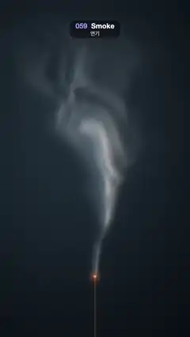

# 059 · Smoke · 연기



**EN** A thin ribbon of smoke rises from a glowing incense tip, curling and widening into soft wisps lit from the upper left.  
**KO** 빛나는 향 끝에서 가는 연기 줄기가 피어올라, 말리고 넓어지며 왼쪽 위에서 빛을 받은 부드러운 연기로 흩어진다.

[Video (mp4)](https://sueun-dev.github.io/motion-effects/videos/059-smoke.mp4) · [Code](../effects/059-smoke.js) · Shaders & generative · 셰이더·제너러티브

## Prompt (English)

```text
Create a "Smoke" motion effect: a column of incense smoke rising, curling and spreading over a dark studio backdrop, shaded by its own density gradient.

Look
- Units: frame widths (1 = 1080 px), y up. The origin is the incense tip at (540, 1574) px from the top.
- Backdrop: from #080D12 to #1F2B36 in a soft oval spot centred at (378, 768) px from the top (smoothstep over distance 1.2 → 0 in UV units, y squashed ×1.4).
- Rising noise (periodic in y, read on a cylinder so the upward scroll loops): θ = 2π(y / P − k · t / 5), R = ky · P / 2π, value = simplex3(x · kx, R cos θ, R sin θ).
- Density:
  - warp: w = two rising noises (kx 2.2, ky 2, P 1.4, k 1) with different offsets; q = p + 0.18 · w · smoothstep(0, 0.6, y), so the curls grow as it rises;
  - n = 0.6 · rising(q; 4, 3.2, 0.7, 2) + 0.4 · rising(q; 8, 6, 0.35, 4);
  - sway = 0.1 · sin(4y − 2π · t / 5) · smoothstep(0.1, 0.9, y);
  - width = 0.012 + 0.2 · smoothstep(0, 1.2, y)² + 0.08y (13 px at the tip, broad near the top);
  - density = exp(−((q.x − sway) / width)²) · (0.55 + 0.7n) · smoothstep(−0.02, 0.06, y) · (1 − smoothstep(0.7, 1.45, y)), clamped to 0–1.
- Lighting from the density gradient: lit = clamp(0.5 + 6 · (density(p + (−0.01, 0.005)) − density(p)), 0, 1), brighter where the smoke thickens toward the upper left. Smoke colour = mix(shadow #6B8094, lit #F2EDE6, lit); final = mix(backdrop, smoke, 0.85 · density).
- Incense stick: a 9 px wide vertical bar #522E1F from just below the tip down out of the frame. The tip glows #FF7326 × (exp(−r² / 0.00004) + 0.3 · exp(−r² / 0.0008)).

Motion (0–5 s)
- All noise layers rise at the same speed, 1.4 frame widths per loop (about 300 px/s), so the smoke moves as one body instead of sliding apart.
- The column sways in a travelling sine wave; the wisps curl and spread near the top and fade out above about 1.45 frame widths.
- Slow, soft, continuous; loops exactly.

Technique
- A WebGL2 full-screen fragment shader with time and resolution uniforms.

Output and rules
- One self-contained HTML file with no external assets (three.js from a CDN is fine if you use it), drawing on a 1080 × 1920 canvas (9:16) scaled to fit the window.
- Write a function renderFrame(t) that draws the frame for time t in seconds, and preview it with requestAnimationFrame. Everything must be a pure function of t and fixed seeds: no Math.random(), Date or state carried between frames, so frame i = renderFrame(i / 30) can be exported to a 30 fps video.
- Loop seamlessly every 5 seconds: renderFrame(5) must look exactly like renderFrame(0).
- No flicker of any kind: no noise or grain that changes from frame to frame, no strobing or blinking, no z-fighting, no shimmering 1 px lines. Any grain or texture stays fixed to the screen or to the object.
- Keep the top 280 px free of important content (a title label goes there) and fill the whole frame with a designed background.
```

## 프롬프트 (한국어)

```text
"연기" 모션 효과를 만들어 줘: 어두운 스튜디오 배경 위로 향 연기 기둥이 피어올라 말리고 퍼지며, 자기 밀도의 기울기로 음영이 지는 효과.

모양
- 단위는 화면 너비(1 = 1080px), y는 위쪽이 +. 원점은 향 끝, 위에서 (540, 1574)px.
- 배경: 위에서 (378, 768)px을 중심으로 한 부드러운 타원형 조명. #080D12에서 #1F2B36으로(UV 거리 1.2 → 0 smoothstep, y는 ×1.4로 눌러서).
- 올라가는 노이즈(y로 주기적이고 원통 위에서 읽어 위로 흐르는 움직임이 반복됨): θ = 2π(y / P − k · t / 5), R = ky · P / 2π, 값 = simplex3(x · kx, R cos θ, R sin θ).
- 밀도:
  - 비틀기: w = 올라가는 노이즈 둘(kx 2.2, ky 2, P 1.4, k 1, 서로 다른 오프셋). q = p + 0.18 · w · smoothstep(0, 0.6, y), 올라갈수록 소용돌이가 커진다;
  - n = 0.6 · rising(q; 4, 3.2, 0.7, 2) + 0.4 · rising(q; 8, 6, 0.35, 4);
  - sway = 0.1 · sin(4y − 2π · t / 5) · smoothstep(0.1, 0.9, y);
  - width = 0.012 + 0.2 · smoothstep(0, 1.2, y)² + 0.08y(끝에서 13px, 위로 갈수록 넓게);
  - 밀도 = exp(−((q.x − sway) / width)²) · (0.55 + 0.7n) · smoothstep(−0.02, 0.06, y) · (1 − smoothstep(0.7, 1.45, y)), 0–1로 자른다.
- 밀도 기울기로 조명: lit = clamp(0.5 + 6 · (밀도(p + (−0.01, 0.005)) − 밀도(p)), 0, 1). 왼쪽 위로 갈수록 짙어지는 곳이 밝다. 연기 색 = mix(그늘 #6B8094, 빛 #F2EDE6, lit), 최종 = mix(배경, 연기, 0.85 · 밀도).
- 향: 폭 9px의 세로 막대 #522E1F, 끝 바로 아래에서 화면 밖까지. 끝은 #FF7326 × (exp(−r² / 0.00004) + 0.3 · exp(−r² / 0.0008))로 빛난다.

움직임 (0–5초)
- 모든 노이즈 층이 같은 속도(루프마다 화면 너비 1.4배, 약 300px/s)로 올라가서, 연기가 따로 미끄러지지 않고 한 덩어리로 움직인다.
- 기둥은 위로 흐르는 사인파로 흔들리고, 위쪽에서 소용돌이치며 퍼지다가 화면 너비 1.45배 높이쯤에서 사라진다.
- 느리고 부드럽게 이어진다. 정확히 반복.

기법
- WebGL2 전체 화면 프래그먼트 셰이더, 시간·해상도 유니폼.

출력과 규칙
- 외부 파일 없는 HTML 파일 하나(three.js를 쓴다면 CDN은 괜찮다). 1080 × 1920(9:16) 캔버스에 그리고 창 크기에 맞춰 보이게 한다.
- 시간 t(초)의 프레임을 그리는 renderFrame(t) 함수를 만들고, 미리보기는 requestAnimationFrame으로 돌린다. 모든 것은 t와 고정 시드만으로 정해진다: Math.random(), Date, 프레임 사이에 쌓이는 상태 금지. 그래야 i번째 프레임 = renderFrame(i / 30)으로 30fps 영상을 뽑을 수 있다.
- 5초마다 끊김 없이 반복: renderFrame(5)는 renderFrame(0)과 똑같아 보여야 한다.
- 어떤 깜빡임도 금지: 프레임마다 바뀌는 노이즈·그레인, 번쩍임·깜빡임, z-fighting, 반짝이며 떨리는 1px 선 모두 금지. 그레인·질감은 화면이나 물체에 고정한다.
- 위쪽 280px에는 중요한 내용을 두지 않고(제목 라벨 자리), 화면 전체를 디자인된 배경으로 채운다.
```
