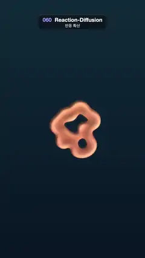

# 060 · Reaction-Diffusion · 반응 확산



**EN** A small coral blob grows into a frame-filling maze of fingerprint stripes and spots, then shrinks back to its seed shape.  
**KO** 작은 산호 덩어리가 지문 같은 줄무늬·점 미로로 자라 화면을 채운 뒤, 처음의 씨앗 모양으로 다시 줄어든다.

[Video (mp4)](https://sueun-dev.github.io/motion-effects/videos/060-reaction-diffusion.mp4) · [Code](../effects/060-reaction-diffusion.js) · Shaders & generative · 셰이더·제너러티브

## Prompt (English)

```text
Create a "Reaction-Diffusion" motion effect: a Gray-Scott simulation that grows coral and fingerprint patterns from a few seeds, rendered as smooth embossed shapes.

Look
- Simulation grid 180 × 320 cells covering the whole frame (6 px per cell).
- Background vertical gradient #081424 (bottom) → #0F2938 (top). Coral colour #FF6B61 at the bottom → #FFB86B at the top, turning pink #F25999 toward the edges (mix by smoothstep(0.3, 0.9, 1.6 × distance from the centre in UV units)).
- Field value v = min(1, B × 600 / 255). Upsample it smoothly with a cubic B-spline (4 × 4 taps), so the cell grid never shows.
- Threshold at v = 0.37 (B ≈ 0.157) with an anti-aliased edge (fwidth + 0.004). Inside: coral × emboss light, light = clamp(0.75 + 2.2 · dot(gradient, (−0.6, −0.8)), 0.4, 1.3), gradient = central difference over ±0.6 cells, so the stripes look like rounded tubes. Outside: background + coral × 0.12 × smoothstep(0.1, 0.34, v) as a faint halo. Add a cream #FFE6CC × 0.25 × smoothstep(0.42, 0.9, v)² highlight on the thickest parts.

Simulation (Gray-Scott)
- Start with A = 1, B = 0. Seeded RNG: 14 seed discs of radius 2–4 cells scattered within ±15 × ±20 cells of the centre, set to A = 0.5, B = 0.25.
- A' = A + 1.0 · ∇²A − AB² + F(1 − A); B' = B + 0.5 · ∇²B + AB² − (K + F)B, with F = 0.042, K = 0.059, dt = 1. Laplacian 3 × 3 kernel: 0.2 on the four sides, 0.05 on the diagonals, −1 in the centre. At the grid edge reuse the edge cell.
- Run 400 steps before frame 0, then 36 steps per frame.

Motion (0–5 s)
- 0–4 s: the colony spreads from a small ring-like blob (about 400 px across) into a labyrinth of stripes and dots that fills the frame.
- Last second (frames 120–150): w = smoothstep(120, 150, frame). Multiply B by a circular mask of radius 190 − 150w cells (soft over ±5 cells) so the pattern recedes into the middle; over the second half (melt = smoothstep(0.55, 1, w)) crossfade to the B field saved at frame 0, so the last frame melts into the first.

Technique
- Simulate on the CPU in Float32Arrays, write the B field into an image, upload it as a texture, and do the B-spline upsample, threshold and emboss in a WebGL2 full-screen fragment shader.
- The simulation is stepped a fixed number of steps per frame (36) from a fixed seed, and renderFrame(0) re-initialises it, so rendering frames 0, 1, 2 … in order is still fully deterministic even though it carries state between frames.

Output and rules
- One self-contained HTML file with no external assets (three.js from a CDN is fine if you use it), drawing on a 1080 × 1920 canvas (9:16) scaled to fit the window.
- Write a function renderFrame(t) that draws the frame for time t in seconds, and preview it with requestAnimationFrame. Everything must be a pure function of t and fixed seeds: no Math.random(), Date or state carried between frames, so frame i = renderFrame(i / 30) can be exported to a 30 fps video.
- Loop seamlessly every 5 seconds: renderFrame(5) must look exactly like renderFrame(0).
- No flicker of any kind: no noise or grain that changes from frame to frame, no strobing or blinking, no z-fighting, no shimmering 1 px lines. Any grain or texture stays fixed to the screen or to the object.
- Keep the top 280 px free of important content (a title label goes there) and fill the whole frame with a designed background.
```

## 프롬프트 (한국어)

```text
"반응 확산" 모션 효과를 만들어 줘: 몇 개의 씨앗에서 산호·지문 무늬를 키워 내는 Gray-Scott 시뮬레이션을, 매끈하게 돋을새김한 모양으로 그리는 효과.

모양
- 시뮬레이션 격자 180 × 320칸이 화면 전체를 덮는다(칸당 6px).
- 배경 세로 그라디언트 #081424(아래) → #0F2938(위). 산호색은 아래 #FF6B61 → 위 #FFB86B, 가장자리로 갈수록 분홍 #F25999(UV 단위로 중심에서의 거리 × 1.6에 smoothstep(0.3, 0.9)로 섞기).
- 값 v = min(1, B × 600 / 255). 3차 B-스플라인(4 × 4 샘플)으로 부드럽게 늘려서 격자가 보이지 않게.
- v = 0.37(B ≈ 0.157)에서 경계를 나누고 경계는 안티에일리어싱(fwidth + 0.004). 안쪽: 산호색 × 돋을새김 빛, 빛 = clamp(0.75 + 2.2 · dot(기울기, (−0.6, −0.8)), 0.4, 1.3), 기울기는 ±0.6칸 중앙 차분. 그래서 줄무늬가 둥근 관처럼 보인다. 바깥: 배경 + 산호색 × 0.12 × smoothstep(0.1, 0.34, v)로 옅은 번짐. 가장 두꺼운 부분에 크림색 #FFE6CC × 0.25 × smoothstep(0.42, 0.9, v)² 하이라이트.

시뮬레이션 (Gray-Scott)
- 처음엔 A = 1, B = 0. 시드 난수로 반지름 2–4칸의 씨앗 원 14개를 중심에서 ±15 × ±20칸 안에 흩고, 거기는 A = 0.5, B = 0.25.
- A' = A + 1.0 · ∇²A − AB² + F(1 − A), B' = B + 0.5 · ∇²B + AB² − (K + F)B, F = 0.042, K = 0.059, dt = 1. 라플라시안 3 × 3 커널: 상하좌우 0.2, 대각 0.05, 가운데 −1. 격자 끝에서는 끝 칸을 다시 쓴다.
- 0번 프레임 전에 400스텝, 그 뒤 프레임마다 36스텝.

움직임 (0–5초)
- 0–4초: 작은 고리 모양 덩어리(지름 약 400px)에서 줄무늬와 점의 미로가 퍼져 화면을 채운다.
- 마지막 1초(120–150번 프레임): w = smoothstep(120, 150, 프레임). B에 반지름 190 − 150w칸(±5칸 부드럽게)의 원형 마스크를 곱해 무늬가 가운데로 줄어들게 하고, 후반(melt = smoothstep(0.55, 1, w))에는 0번 프레임에 저장해 둔 B로 크로스페이드해서 마지막 프레임이 첫 프레임으로 녹아든다.

기법
- CPU에서 Float32Array로 시뮬레이션하고 B를 이미지에 써서 텍스처로 올린다. B-스플라인 확대, 경계, 돋을새김은 WebGL2 전체 화면 프래그먼트 셰이더에서.
- 시뮬레이션은 고정 시드에서 시작해 프레임마다 정해진 스텝 수(36)만큼 돌리고 renderFrame(0)이 처음부터 다시 초기화하므로, 프레임 사이에 상태를 이어 가더라도 0, 1, 2 … 순서로 그리면 결과는 완전히 결정적이다.

출력과 규칙
- 외부 파일 없는 HTML 파일 하나(three.js를 쓴다면 CDN은 괜찮다). 1080 × 1920(9:16) 캔버스에 그리고 창 크기에 맞춰 보이게 한다.
- 시간 t(초)의 프레임을 그리는 renderFrame(t) 함수를 만들고, 미리보기는 requestAnimationFrame으로 돌린다. 모든 것은 t와 고정 시드만으로 정해진다: Math.random(), Date, 프레임 사이에 쌓이는 상태 금지. 그래야 i번째 프레임 = renderFrame(i / 30)으로 30fps 영상을 뽑을 수 있다.
- 5초마다 끊김 없이 반복: renderFrame(5)는 renderFrame(0)과 똑같아 보여야 한다.
- 어떤 깜빡임도 금지: 프레임마다 바뀌는 노이즈·그레인, 번쩍임·깜빡임, z-fighting, 반짝이며 떨리는 1px 선 모두 금지. 그레인·질감은 화면이나 물체에 고정한다.
- 위쪽 280px에는 중요한 내용을 두지 않고(제목 라벨 자리), 화면 전체를 디자인된 배경으로 채운다.
```
