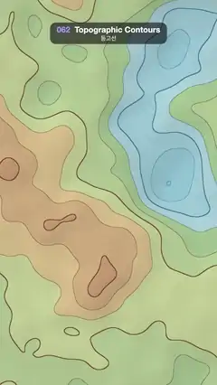

# 062 · Topographic Contours · 등고선



**EN** A pastel relief map whose contour lines flow and reshape as the lakes, hills and peaks underneath slowly morph.  
**KO** 파스텔 지형도의 등고선이 아래의 호수·언덕·봉우리가 천천히 모양을 바꾸면서 흐르듯 움직인다.

[Video (mp4)](https://sueun-dev.github.io/motion-effects/videos/062-topographic-contours.mp4) · [Code](../effects/062-topographic-contours.js) · Shaders & generative · 셰이더·제너러티브

## Prompt (English)

```text
Create a "Topographic Contours" motion effect: a full-screen topographic map of a noise terrain whose contour lines drift and reshape.

Look
- Height field, with p = pixel / 1080 and S = 3D simplex noise: q = 1.1p + L; h = 0.5 + 0.6 · (0.5 · S(q) + 0.22 · S(2.1q + 3) + 0.08 · S(4.3q + 7)) + 0.22 · S(0.7p − 1.3L, z = 4). Only three smooth octaves, so the lines stay long and calm.
- 12 levels: f = 12h, band = floor(f) / 12. Tint each band (blend within each range):
  - band < 0.3, water: #8CC7DB → #B8DEE6
  - 0.3–0.55, lowland: #A8CC99 → #DBE0A3
  - 0.55–0.8, upland: #EBD199 → #CC9973
  - ≥ 0.8, peaks: #D1AD99 → #FAF5F0
- Soft hillshade: normal = normalize(−gradient, 2.5), light from (−1, 1, 1.2) (upper left); shade = clamp(0.84 + 0.128 · dot(normal, light), 0.75, 1.08). Subtle.
- Contour lines at every integer of f with constant pixel width: d = |fract(f + 0.5) − 0.5|, w = fwidth(f), line = 1 − smoothstep((lw − 0.6)w, (lw + 0.6)w, d). Normal lines lw = 1.1 px at 60 % opacity; every third line is a heavier index contour, lw = 1.9 px at 90 %. Ink: blue #336B99 in the water bands, brown #6B4229 on land.
- Gentle vignette: × (0.88 + 0.12 · smoothstep(1.2, 0.3, distance from the centre in UV units)).

Motion (0–5 s)
- L is a point on a circle of radius 0.12 that goes round once per loop. The detailed layers move along +L and the broad layer along −1.3L (the opposite way), so the terrain morphs instead of just sliding: lakes swell and shrink, ridges merge and split, and the contour lines flow smoothly.
- Slow and calm; loops exactly.

Technique
- A WebGL2 full-screen fragment shader with time and resolution uniforms; fwidth-based anti-aliasing keeps every line clean at any slope.

Output and rules
- One self-contained HTML file with no external assets (three.js from a CDN is fine if you use it), drawing on a 1080 × 1920 canvas (9:16) scaled to fit the window.
- Write a function renderFrame(t) that draws the frame for time t in seconds, and preview it with requestAnimationFrame. Everything must be a pure function of t and fixed seeds: no Math.random(), Date or state carried between frames, so frame i = renderFrame(i / 30) can be exported to a 30 fps video.
- Loop seamlessly every 5 seconds: renderFrame(5) must look exactly like renderFrame(0).
- No flicker of any kind: no noise or grain that changes from frame to frame, no strobing or blinking, no z-fighting, no shimmering 1 px lines. Any grain or texture stays fixed to the screen or to the object.
- Keep the top 280 px free of important content (a title label goes there) and fill the whole frame with a designed background.
```

## 프롬프트 (한국어)

```text
"등고선" 모션 효과를 만들어 줘: 노이즈 지형을 화면 가득 지형도로 그리고, 그 등고선이 흐르듯 모양을 바꾸는 효과.

모양
- 높이장, p = 픽셀 / 1080, S = 3D 심플렉스 노이즈: q = 1.1p + L, h = 0.5 + 0.6 · (0.5 · S(q) + 0.22 · S(2.1q + 3) + 0.08 · S(4.3q + 7)) + 0.22 · S(0.7p − 1.3L, z = 4). 부드러운 옥타브 셋만 써서 선이 길고 차분하다.
- 12단계: f = 12h, band = floor(f) / 12. 단계마다 색(각 구간 안에서 섞기):
  - band < 0.3, 물: #8CC7DB → #B8DEE6
  - 0.3–0.55, 저지대: #A8CC99 → #DBE0A3
  - 0.55–0.8, 고지대: #EBD199 → #CC9973
  - 0.8 이상, 봉우리: #D1AD99 → #FAF5F0
- 은은한 음영: 법선 = normalize(−기울기, 2.5), 빛은 (−1, 1, 1.2)(왼쪽 위). shade = clamp(0.84 + 0.128 · dot(법선, 빛), 0.75, 1.08). 아주 약하게.
- f의 모든 정수에 픽셀 폭이 일정한 등고선: d = |fract(f + 0.5) − 0.5|, w = fwidth(f), line = 1 − smoothstep((lw − 0.6)w, (lw + 0.6)w, d). 보통 선은 lw = 1.1px, 불투명도 60 %. 세 번째 선마다 굵은 계곡선(index contour) lw = 1.9px, 90 %. 잉크 색은 물 구간에서 파랑 #336B99, 땅에서 갈색 #6B4229.
- 약한 비네트: × (0.88 + 0.12 · smoothstep(1.2, 0.3, UV 단위로 중심에서의 거리)).

움직임 (0–5초)
- L은 반지름 0.12 원 위의 점으로 루프마다 한 바퀴 돈다. 세밀한 층은 +L로, 넓은 층은 −1.3L(반대 방향)로 움직여서 지형이 그냥 미끄러지지 않고 모양이 바뀐다: 호수가 불었다 줄고, 능선이 합쳐졌다 갈라지고, 등고선이 부드럽게 흐른다.
- 느리고 차분하게. 정확히 반복.

기법
- WebGL2 전체 화면 프래그먼트 셰이더, 시간·해상도 유니폼. fwidth 기반 안티에일리어싱으로 경사와 상관없이 선이 깨끗하다.

출력과 규칙
- 외부 파일 없는 HTML 파일 하나(three.js를 쓴다면 CDN은 괜찮다). 1080 × 1920(9:16) 캔버스에 그리고 창 크기에 맞춰 보이게 한다.
- 시간 t(초)의 프레임을 그리는 renderFrame(t) 함수를 만들고, 미리보기는 requestAnimationFrame으로 돌린다. 모든 것은 t와 고정 시드만으로 정해진다: Math.random(), Date, 프레임 사이에 쌓이는 상태 금지. 그래야 i번째 프레임 = renderFrame(i / 30)으로 30fps 영상을 뽑을 수 있다.
- 5초마다 끊김 없이 반복: renderFrame(5)는 renderFrame(0)과 똑같아 보여야 한다.
- 어떤 깜빡임도 금지: 프레임마다 바뀌는 노이즈·그레인, 번쩍임·깜빡임, z-fighting, 반짝이며 떨리는 1px 선 모두 금지. 그레인·질감은 화면이나 물체에 고정한다.
- 위쪽 280px에는 중요한 내용을 두지 않고(제목 라벨 자리), 화면 전체를 디자인된 배경으로 채운다.
```
