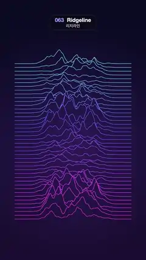

# 063 · Ridgeline · 리지라인



**EN** Forty-two stacked line profiles, cyan to magenta, form a mountain range while a wave rolls down lifting each line's peaks in turn.  
**KO** 청록에서 자홍으로 물드는 선 42개가 겹쳐 산맥을 이루고, 파동이 아래로 굴러가며 선마다 봉우리를 차례로 들어 올린다.

[Video (mp4)](../videos/063-ridgeline.mp4) · [Code](../effects/063-ridgeline.js) · Shaders & generative · 셰이더·제너러티브

## Prompt (English)

```text
Create a "Ridgeline" motion effect in the style of the famous stacked pulsar-plot album cover: dozens of noise profiles stacked like a mountain range, each hiding the ones behind it.

Look
- Background vertical gradient #0A0B22 (top) → #1B0F33 (bottom).
- 42 lines with baselines at y = 470 + 28i px (470 … 1618), running from x 110 to 970, sampled every 5 px.
- Height of line i at x: h = max(0, 0.42 + n)^1.7 × 330 px × window × lift, where n = 3-octave fbm of 3D gradient noise at (0.0095x, 0.33i + Lx, Ly), window = exp(−((x − 540) / 210)⁴) (flat at the sides, busy in the middle), and L is a point on a circle of radius 0.7 in noise space. The line is drawn at y = baseline − h.
- Occlusion: go from i = 0 (top, farthest) to 41. For each line first fill the polygon under it (the profile, then down to baseline + 60, then back) with the same background gradient, so it hides the lines behind; then stroke the profile: 3 px, round joins and caps, colour hsl(190 + 120k, 90 %, 68 − 8k %) with k = i / 41 (cyan at the top to magenta at the bottom). Each profile is one path, never overlapping strokes.
- On top, a soft additive glow: radial gradient at (540, 1050), radius 50 → 850, rgba(120, 70, 200, 0.2) → 0, with additive ('lighter') blending.

Motion (0–5 s)
- lift = 0.35 + 0.65 · (0.5 + 0.5 · sin(2π · t / 5 − 0.3i)): a wave rolls down the stack (about two crests across all 42 lines), so the peaks of each line swell and flatten in turn.
- L goes once around its circle per loop, so the peak shapes slowly morph as well.
- Smooth and continuous; loops exactly.

Technique
- Canvas 2D, redrawn from scratch every frame.

Output and rules
- One self-contained HTML file with no external assets (three.js from a CDN is fine if you use it), drawing on a 1080 × 1920 canvas (9:16) scaled to fit the window.
- Write a function renderFrame(t) that draws the frame for time t in seconds, and preview it with requestAnimationFrame. Everything must be a pure function of t and fixed seeds: no Math.random(), Date or state carried between frames, so frame i = renderFrame(i / 30) can be exported to a 30 fps video.
- Loop seamlessly every 5 seconds: renderFrame(5) must look exactly like renderFrame(0).
- No flicker of any kind: no noise or grain that changes from frame to frame, no strobing or blinking, no z-fighting, no shimmering 1 px lines. Any grain or texture stays fixed to the screen or to the object.
- Keep the top 280 px free of important content (a title label goes there) and fill the whole frame with a designed background.
```

## 프롬프트 (한국어)

```text
"리지라인" 모션 효과를 만들어 줘: 유명한 펄서 그래프 앨범 커버처럼, 노이즈 선 수십 개를 산맥처럼 쌓고 앞의 선이 뒤의 선을 가리는 효과.

모양
- 배경 세로 그라디언트 #0A0B22(위) → #1B0F33(아래).
- 선 42개, 기준선 y = 470 + 28i px(470 … 1618), x 110에서 970까지, 5px마다 샘플.
- i번 선의 x에서 높이: h = max(0, 0.42 + n)^1.7 × 330px × window × lift. n = (0.0095x, 0.33i + Lx, Ly)에서 읽은 3D 그라디언트 노이즈의 3옥타브 fbm, window = exp(−((x − 540) / 210)⁴)(양옆은 평평하고 가운데가 요란), L은 노이즈 공간에서 반지름 0.7 원 위의 점. 선은 y = 기준선 − h에 그린다.
- 가리기: i = 0(맨 위, 가장 먼 선)부터 41까지. 선마다 먼저 그 아래 다각형(선 모양 → 기준선 + 60까지 내려갔다가 되돌아옴)을 배경과 같은 그라디언트로 채워 뒤의 선을 가리고, 그다음 선을 긋는다: 3px, 둥근 이음·끝, 색 hsl(190 + 120k, 90 %, 68 − 8k %), k = i / 41(위는 청록, 아래는 자홍). 선 하나는 경로 하나로, 겹쳐 긋지 않는다.
- 맨 위에 부드러운 가산 빛: (540, 1050)의 원형 그라디언트, 반지름 50 → 850, rgba(120, 70, 200, 0.2) → 0, 가산('lighter') 합성.

움직임 (0–5초)
- lift = 0.35 + 0.65 · (0.5 + 0.5 · sin(2π · t / 5 − 0.3i)): 파동이 위에서 아래로 굴러가며(선 42개에 걸쳐 마루가 약 두 개) 선마다 봉우리가 차례로 솟았다 가라앉는다.
- L이 루프마다 원을 한 바퀴 돌아서 봉우리 모양도 천천히 바뀐다.
- 부드럽게 이어지고 정확히 반복된다.

기법
- Canvas 2D, 매 프레임 처음부터 다시 그린다.

출력과 규칙
- 외부 파일 없는 HTML 파일 하나(three.js를 쓴다면 CDN은 괜찮다). 1080 × 1920(9:16) 캔버스에 그리고 창 크기에 맞춰 보이게 한다.
- 시간 t(초)의 프레임을 그리는 renderFrame(t) 함수를 만들고, 미리보기는 requestAnimationFrame으로 돌린다. 모든 것은 t와 고정 시드만으로 정해진다: Math.random(), Date, 프레임 사이에 쌓이는 상태 금지. 그래야 i번째 프레임 = renderFrame(i / 30)으로 30fps 영상을 뽑을 수 있다.
- 5초마다 끊김 없이 반복: renderFrame(5)는 renderFrame(0)과 똑같아 보여야 한다.
- 어떤 깜빡임도 금지: 프레임마다 바뀌는 노이즈·그레인, 번쩍임·깜빡임, z-fighting, 반짝이며 떨리는 1px 선 모두 금지. 그레인·질감은 화면이나 물체에 고정한다.
- 위쪽 280px에는 중요한 내용을 두지 않고(제목 라벨 자리), 화면 전체를 디자인된 배경으로 채운다.
```
