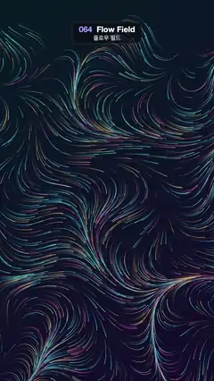

# 064 · Flow Field · 플로우 필드



**EN** Thousands of short glowing strands in teal, amber and pink stream along an invisible swirling flow, like combed hair.  
**KO** 청록·호박·분홍빛의 짧은 빛 가닥 수천 개가 보이지 않는 소용돌이 흐름을 따라 빗질한 머리카락처럼 흐른다.

[Video (mp4)](https://sueun-dev.github.io/motion-effects/videos/064-flow-field.mp4) · [Code](../effects/064-flow-field.js) · Shaders & generative · 셰이더·제너러티브

## Prompt (English)

```text
Create a "Flow Field" motion effect: 2400 particles follow a fixed noise flow field, each shown as a short fading trail that slides along its streamline.

Look
- Background diagonal gradient #071A24 (top left) → #140C2A (bottom right).
- Flow direction at (x, y) px: angle = noise(0.0017x, 0.0017y, 0.4) × 2π × 1.1 + 0.6 · sin(0.002y), using smooth 3D gradient (Perlin-style) noise. The field never changes.
- 2400 particles from a seeded RNG. Each particle has two precomputed streamlines ("lives"): start at random x −60 … 1140, y 240 … 2000, then take 50 steps of 6 px along the field angle (300 px long).
- Colour per particle: 50 % teal-cyan hsl(175–195, 85 %, 62 %), 30 % amber hsl(35, 90 %, 66 %), 20 % pink hsl(320, 90 %, 66 %).
- Each frame, for each particle draw one stretch of its current streamline: the head at distance u × 300 px along it, the tail 150 px behind (not before the start), as a single polyline 2.6 px wide with round caps and joins (interpolate the exact head and tail points between samples). Stroke it with a linear gradient from fully transparent at the tail to alpha 0.95 × fade at the head.

Motion (0–5 s)
- Each life lasts 2.5 s: life = t / 2.5 + a random offset per particle, u = fract(life), and the particle uses streamline number floor(life) mod 2. So there are exactly two lives per loop and the whole picture repeats every 5 s.
- fade = sin(πu)^1.5: each strand fades in, glides 120 px/s along its path, and fades out, all particles out of step with each other, so the field looks like steadily flowing hair.

Technique
- Canvas 2D. Trace the streamlines once at setup; each frame is computed from t only (head and tail positions along the stored paths). Nothing accumulates between frames (no semi-transparent trail buffer), so the lines never shimmer or smear.

Output and rules
- One self-contained HTML file with no external assets (three.js from a CDN is fine if you use it), drawing on a 1080 × 1920 canvas (9:16) scaled to fit the window.
- Write a function renderFrame(t) that draws the frame for time t in seconds, and preview it with requestAnimationFrame. Everything must be a pure function of t and fixed seeds: no Math.random(), Date or state carried between frames, so frame i = renderFrame(i / 30) can be exported to a 30 fps video.
- Loop seamlessly every 5 seconds: renderFrame(5) must look exactly like renderFrame(0).
- No flicker of any kind: no noise or grain that changes from frame to frame, no strobing or blinking, no z-fighting, no shimmering 1 px lines. Any grain or texture stays fixed to the screen or to the object.
- Keep the top 280 px free of important content (a title label goes there) and fill the whole frame with a designed background.
```

## 프롬프트 (한국어)

```text
"플로우 필드" 모션 효과를 만들어 줘: 입자 2400개가 고정된 노이즈 흐름장을 따라가며, 각각 자기 유선을 따라 미끄러지는 짧고 흐려지는 꼬리로 보이는 효과.

모양
- 배경 대각선 그라디언트 #071A24(왼쪽 위) → #140C2A(오른쪽 아래).
- (x, y)px에서의 흐름 방향: angle = noise(0.0017x, 0.0017y, 0.4) × 2π × 1.1 + 0.6 · sin(0.002y). 부드러운 3D 그라디언트(펄린식) 노이즈. 흐름장은 변하지 않는다.
- 시드 난수로 입자 2400개. 입자마다 미리 계산한 유선("생애") 두 개: x −60 … 1140, y 240 … 2000의 무작위 점에서 시작해 흐름 각도로 6px씩 50걸음(길이 300px).
- 입자 색: 50 % 청록 hsl(175–195, 85 %, 62 %), 30 % 호박색 hsl(35, 90 %, 66 %), 20 % 분홍 hsl(320, 90 %, 66 %).
- 매 프레임 입자마다 지금 유선의 한 구간을 그린다: 머리는 유선을 따라 u × 300px 지점, 꼬리는 150px 뒤(시작점보다 앞으로는 안 감). 폭 2.6px, 둥근 끝·이음의 선 하나로(머리·꼬리는 샘플 사이를 보간한 정확한 점). 꼬리는 완전히 투명하고 머리는 알파 0.95 × fade인 선형 그라디언트로 긋는다.

움직임 (0–5초)
- 생애 하나는 2.5초: life = t / 2.5 + 입자별 무작위 오프셋, u = fract(life), 입자는 floor(life) mod 2번 유선을 쓴다. 그래서 루프마다 정확히 생애 두 번, 전체 그림이 5초마다 반복된다.
- fade = sin(πu)^1.5: 가닥마다 나타나서 120px/s로 길을 따라 미끄러지다 사라진다. 입자마다 박자가 어긋나 있어 꾸준히 흐르는 머리카락처럼 보인다.

기법
- Canvas 2D. 유선은 처음에 한 번만 계산하고, 매 프레임은 t만으로 계산한다(저장한 경로 위의 머리·꼬리 위치). 프레임 사이에 쌓이는 것이 없어서(반투명 잔상 버퍼 없음) 선이 반짝이거나 번지지 않는다.

출력과 규칙
- 외부 파일 없는 HTML 파일 하나(three.js를 쓴다면 CDN은 괜찮다). 1080 × 1920(9:16) 캔버스에 그리고 창 크기에 맞춰 보이게 한다.
- 시간 t(초)의 프레임을 그리는 renderFrame(t) 함수를 만들고, 미리보기는 requestAnimationFrame으로 돌린다. 모든 것은 t와 고정 시드만으로 정해진다: Math.random(), Date, 프레임 사이에 쌓이는 상태 금지. 그래야 i번째 프레임 = renderFrame(i / 30)으로 30fps 영상을 뽑을 수 있다.
- 5초마다 끊김 없이 반복: renderFrame(5)는 renderFrame(0)과 똑같아 보여야 한다.
- 어떤 깜빡임도 금지: 프레임마다 바뀌는 노이즈·그레인, 번쩍임·깜빡임, z-fighting, 반짝이며 떨리는 1px 선 모두 금지. 그레인·질감은 화면이나 물체에 고정한다.
- 위쪽 280px에는 중요한 내용을 두지 않고(제목 라벨 자리), 화면 전체를 디자인된 배경으로 채운다.
```
