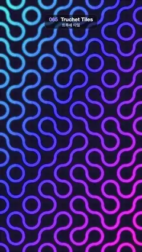

# 065 · Truchet Tiles · 트루셰 타일



**EN** A neon tube maze of quarter-circle tiles; diagonal waves of tiles flip a quarter turn, rewiring the winding paths.  
**KO** 사분원 타일로 된 네온 튜브 미로. 타일들이 대각선 물결처럼 4분의 1씩 돌며 구불구불한 길을 다시 잇는다.

[Video (mp4)](https://sueun-dev.github.io/motion-effects/videos/065-truchet-tiles.mp4) · [Code](../effects/065-truchet-tiles.js) · Shaders & generative · 셰이더·제너러티브

## Prompt (English)

```text
Create a "Truchet Tiles" motion effect: a grid of Smith tiles (two quarter-circle arcs each) forming a maze of glowing tubes, with waves of tiles turning to rewire it.

Look
- Background #14112B. A 9 × 16 grid of 120 px tiles that exactly covers the frame.
- Each tile: two quarter-circle arcs of radius 60 px, one centred on the tile's top-left corner (0°–90°) and one on its bottom-right corner (180°–270°), so they join the midpoints of the edges and neighbouring tiles link into long winding paths. Start orientation 0° or 90° at random (seeded).
- Tube look: draw each arc twice with butt ends: first 34 px wide in hsl(hue, 85 %, 30 %) (dark rim), then 20 px wide in hsl(hue, 85 %, 62 %) (bright core). hue = 190 + 130 × (column + 0.6 · row) / 18.6, so cyan at the top left shifts to violet-magenta at the bottom right.
- Under the arcs, a faint panel per tile: a rounded square 114 × 114 px (3 px inset), corner radius 14, white at alpha 0.025.

Motion (0–5 s)
- Each tile turns by 90° twice per loop. Each turn lasts 0.55 s with cubic ease-in-out. First turn starts at t1 = 0.15 + 1.55 × wave + a random 0–0.2 s, with wave = (column + row) / 23 (0 at the top left, 1 at the bottom right); the second turn starts at t1 + 2.5 s. So a diagonal wave sweeps the grid twice per loop.
- While a tile turns (turning = sin(π × fraction of the current turn), 0 when settled, 1 mid-turn): scale it by 1 − 0.12 · turning, raise its panel alpha to 0.025 + 0.05 · turning, and lighten both arc colours by 10 · turning %.
- Two quarter turns make 180°, which maps a Smith tile onto itself, so the maze changes in the middle of the loop and the loop is seamless.

Technique
- Canvas 2D: per tile save, translate to its centre, rotate, scale, draw, restore.

Output and rules
- One self-contained HTML file with no external assets (three.js from a CDN is fine if you use it), drawing on a 1080 × 1920 canvas (9:16) scaled to fit the window.
- Write a function renderFrame(t) that draws the frame for time t in seconds, and preview it with requestAnimationFrame. Everything must be a pure function of t and fixed seeds: no Math.random(), Date or state carried between frames, so frame i = renderFrame(i / 30) can be exported to a 30 fps video.
- Loop seamlessly every 5 seconds: renderFrame(5) must look exactly like renderFrame(0).
- No flicker of any kind: no noise or grain that changes from frame to frame, no strobing or blinking, no z-fighting, no shimmering 1 px lines. Any grain or texture stays fixed to the screen or to the object.
- Keep the top 280 px free of important content (a title label goes there) and fill the whole frame with a designed background.
```

## 프롬프트 (한국어)

```text
"트루셰 타일" 모션 효과를 만들어 줘: 사분원 호 두 개짜리 스미스 타일을 격자로 깔아 빛나는 튜브 미로를 만들고, 타일들이 물결처럼 돌며 미로를 다시 잇는 효과.

모양
- 배경 #14112B. 120px 타일 9 × 16개가 화면을 정확히 덮는다.
- 타일마다 반지름 60px 사분원 호 두 개: 하나는 왼쪽 위 모서리가 중심(0°–90°), 하나는 오른쪽 아래 모서리가 중심(180°–270°). 그래서 변의 가운데점끼리 이어지고, 이웃 타일과 연결되어 길고 구불구불한 길이 된다. 처음 방향은 0° 또는 90° 무작위(시드 고정).
- 튜브 느낌: 호마다 평평한 끝으로 두 번 긋는다. 먼저 폭 34px hsl(색상, 85 %, 30 %)(어두운 테두리), 그 위에 폭 20px hsl(색상, 85 %, 62 %)(밝은 심). 색상 = 190 + 130 × (열 + 0.6 · 행) / 18.6, 왼쪽 위 청록에서 오른쪽 아래 보라·자홍으로.
- 호 아래 타일마다 옅은 판: 114 × 114px(3px 안쪽) 둥근 사각형, 모서리 반지름 14, 흰색 알파 0.025.

움직임 (0–5초)
- 타일마다 루프당 두 번 90°씩 돈다. 한 번 도는 데 0.55초, 3차 ease-in-out. 첫 회전 시작 t1 = 0.15 + 1.55 × wave + 무작위 0–0.2초, wave = (열 + 행) / 23(왼쪽 위 0, 오른쪽 아래 1). 두 번째 회전은 t1 + 2.5초. 그래서 대각선 물결이 루프마다 두 번 격자를 훑고 지나간다.
- 도는 동안(turning = sin(π × 지금 회전의 진행 비율), 멈춰 있으면 0, 회전 한가운데서 1): 크기를 1 − 0.12 · turning배로, 판 알파를 0.025 + 0.05 · turning으로, 호 두 색의 밝기를 10 · turning %만큼 올린다.
- 4분의 1 회전 두 번 = 180°이고 스미스 타일은 180° 돌려도 같으므로, 루프 중간에 미로가 바뀌었다가 끊김 없이 처음으로 돌아온다.

기법
- Canvas 2D: 타일마다 save → 중심으로 translate → rotate → scale → 그리기 → restore.

출력과 규칙
- 외부 파일 없는 HTML 파일 하나(three.js를 쓴다면 CDN은 괜찮다). 1080 × 1920(9:16) 캔버스에 그리고 창 크기에 맞춰 보이게 한다.
- 시간 t(초)의 프레임을 그리는 renderFrame(t) 함수를 만들고, 미리보기는 requestAnimationFrame으로 돌린다. 모든 것은 t와 고정 시드만으로 정해진다: Math.random(), Date, 프레임 사이에 쌓이는 상태 금지. 그래야 i번째 프레임 = renderFrame(i / 30)으로 30fps 영상을 뽑을 수 있다.
- 5초마다 끊김 없이 반복: renderFrame(5)는 renderFrame(0)과 똑같아 보여야 한다.
- 어떤 깜빡임도 금지: 프레임마다 바뀌는 노이즈·그레인, 번쩍임·깜빡임, z-fighting, 반짝이며 떨리는 1px 선 모두 금지. 그레인·질감은 화면이나 물체에 고정한다.
- 위쪽 280px에는 중요한 내용을 두지 않고(제목 라벨 자리), 화면 전체를 디자인된 배경으로 채운다.
```
