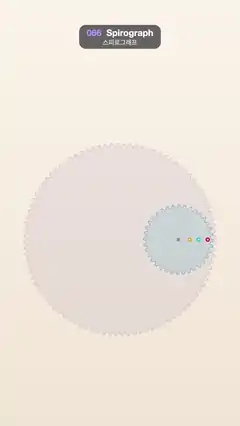

# 066 · Spirograph · 스피로그래프



**EN** A toothed wheel rolls inside a ring while three pens trace nested eight-pointed star curves in pink, cyan and orange.  
**KO** 톱니바퀴가 링 안을 구르며, 펜 세 개가 분홍·청록·주황의 여덟 꼭짓점 별 곡선을 겹겹이 그린다.

[Video (mp4)](../videos/066-spirograph.mp4) · [Code](../effects/066-spirograph.js) · Shaders & generative · 셰이더·제너러티브

## Prompt (English)

```text
Create a "Spirograph" motion effect: a toothed wheel rolls inside a fixed toothed ring and three pens draw hypotrochoid curves, then the drawing fades and starts again.

Look
- Cream paper background, vertical gradient #FBF4EA → #F1E4D4.
- Fixed ring centred at (540, 1080), rolling radius R = 420 px. Draw it as a toothed disc: 96 square-ish teeth alternating 7 px out and 7 px in around radius 427 (build the outline from 4 points per tooth: out, out, in, in), filled rgba(120, 100, 160, 0.10) and outlined 2 px rgba(120, 100, 160, 0.35).
- Rolling wheel radius r = R × 3/8 = 157.5 px, drawn the same way with 36 teeth around radius 150.5, filled rgba(90, 170, 200, 0.22), outlined 2 px rgba(40, 110, 150, 0.55), with a centre dot of radius 8 in rgba(40, 110, 150, 0.6).
- Hypotrochoid: for angle θ the wheel centre is (540, 1080) + (R − r)(cos θ, sin θ), its own rotation is φ = −θ (R − r) / r, and a pen at distance d is wheel centre + d (cos φ, sin φ).
- Three pens at d = 0.84r, 0.58r and 0.32r with hues 340 (pink-red), 190 (cyan) and 40 (orange). Curves: 5 px lines in hsl(hue, 75 %, 52 %), round caps and joins. Pen holes on the wheel: dots of radius 10 in hsl(hue, 75 %, 50 %) with a white 3.5 px centre.
- R : r = 8 : 3, so every curve has 8 points and closes after exactly 3 laps.

Motion (0–5 s)
- 0–4 s: θ = easeInOutCubic(t / 4) × 3 laps × 2π. Draw each pen's curve as one unbroken path: 1500 samples over the full 3 laps, up to the current sample, then a last segment to the exact current pen point. Never draw overlapping short segments.
- 4–4.35 s: hold the finished drawing (the wheel is back where it started).
- 4.35–4.95 s: fade only the curves out (alpha = 1 − smoothstep(4.35, 4.95, t)); the ring and wheel stay. At t = 5 nothing is drawn yet, matching t = 0.

Technique
- Canvas 2D.

Output and rules
- One self-contained HTML file with no external assets (three.js from a CDN is fine if you use it), drawing on a 1080 × 1920 canvas (9:16) scaled to fit the window.
- Write a function renderFrame(t) that draws the frame for time t in seconds, and preview it with requestAnimationFrame. Everything must be a pure function of t and fixed seeds: no Math.random(), Date or state carried between frames, so frame i = renderFrame(i / 30) can be exported to a 30 fps video.
- Loop seamlessly every 5 seconds: renderFrame(5) must look exactly like renderFrame(0).
- No flicker of any kind: no noise or grain that changes from frame to frame, no strobing or blinking, no z-fighting, no shimmering 1 px lines. Any grain or texture stays fixed to the screen or to the object.
- Keep the top 280 px free of important content (a title label goes there) and fill the whole frame with a designed background.
```

## 프롬프트 (한국어)

```text
"스피로그래프" 모션 효과를 만들어 줘: 고정된 톱니 링 안에서 톱니바퀴가 구르고 펜 세 개가 하이포트로코이드 곡선을 그린 뒤, 그림이 사라지고 다시 시작하는 효과.

모양
- 크림색 종이 배경, 세로 그라디언트 #FBF4EA → #F1E4D4.
- 고정 링: 중심 (540, 1080), 구르는 반지름 R = 420px. 톱니 원판으로 그린다: 반지름 427 둘레에 7px 나왔다 7px 들어가는 각진 톱니 96개(톱니마다 점 4개: 밖, 밖, 안, 안), 채우기 rgba(120, 100, 160, 0.10), 윤곽 2px rgba(120, 100, 160, 0.35).
- 구르는 바퀴 반지름 r = R × 3/8 = 157.5px, 같은 방식으로 반지름 150.5 둘레에 톱니 36개, 채우기 rgba(90, 170, 200, 0.22), 윤곽 2px rgba(40, 110, 150, 0.55), 중심에 반지름 8의 점 rgba(40, 110, 150, 0.6).
- 하이포트로코이드: 각도 θ일 때 바퀴 중심 = (540, 1080) + (R − r)(cos θ, sin θ), 바퀴 자체 회전 φ = −θ (R − r) / r, 거리 d의 펜 = 바퀴 중심 + d (cos φ, sin φ).
- 펜 셋: d = 0.84r, 0.58r, 0.32r, 색상 340(분홍빨강), 190(청록), 40(주황). 곡선은 폭 5px hsl(색상, 75 %, 52 %), 둥근 끝·이음. 바퀴 위 펜 구멍: 반지름 10의 점 hsl(색상, 75 %, 50 %)에 흰 가운데 3.5px.
- R : r = 8 : 3이라 곡선마다 꼭짓점이 8개이고 정확히 3바퀴 만에 닫힌다.

움직임 (0–5초)
- 0–4초: θ = easeInOutCubic(t / 4) × 3바퀴 × 2π. 펜마다 곡선을 끊기지 않는 경로 하나로 그린다: 3바퀴 전체를 1500개로 샘플링해 지금 샘플까지, 마지막으로 지금 펜 위치까지 한 번 더. 짧은 조각을 겹쳐 그리지 않는다.
- 4–4.35초: 완성된 그림을 잠시 멈춰 보여 준다(바퀴는 처음 자리로 돌아와 있다).
- 4.35–4.95초: 곡선만 사라진다(alpha = 1 − smoothstep(4.35, 4.95, t)). 링과 바퀴는 남는다. t = 5에서는 아직 아무것도 그려지지 않은 상태라 t = 0과 같다.

기법
- Canvas 2D.

출력과 규칙
- 외부 파일 없는 HTML 파일 하나(three.js를 쓴다면 CDN은 괜찮다). 1080 × 1920(9:16) 캔버스에 그리고 창 크기에 맞춰 보이게 한다.
- 시간 t(초)의 프레임을 그리는 renderFrame(t) 함수를 만들고, 미리보기는 requestAnimationFrame으로 돌린다. 모든 것은 t와 고정 시드만으로 정해진다: Math.random(), Date, 프레임 사이에 쌓이는 상태 금지. 그래야 i번째 프레임 = renderFrame(i / 30)으로 30fps 영상을 뽑을 수 있다.
- 5초마다 끊김 없이 반복: renderFrame(5)는 renderFrame(0)과 똑같아 보여야 한다.
- 어떤 깜빡임도 금지: 프레임마다 바뀌는 노이즈·그레인, 번쩍임·깜빡임, z-fighting, 반짝이며 떨리는 1px 선 모두 금지. 그레인·질감은 화면이나 물체에 고정한다.
- 위쪽 280px에는 중요한 내용을 두지 않고(제목 라벨 자리), 화면 전체를 디자인된 배경으로 채운다.
```
