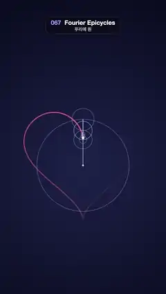

# 067 · Fourier Epicycles · 푸리에 원



**EN** A chain of nine spinning circles, tip to tail, draws a glowing pink heart whose trail fades behind the pen.  
**KO** 꼬리를 문 회전 원 아홉 개가 분홍빛 하트를 그리고, 그 선은 펜 뒤로 갈수록 희미해진다.

[Video (mp4)](https://sueun-dev.github.io/motion-effects/videos/067-fourier-epicycles.mp4) · [Code](../effects/067-fourier-epicycles.js) · Shaders & generative · 셰이더·제너러티브

## Prompt (English)

```text
Create a "Fourier Epicycles" motion effect: the discrete Fourier transform of a heart curve turned into a chain of rotating circles whose last tip redraws the heart once per loop.

Look
- Background radial gradient centred at (540, 1080): #1C2147 at radius 100 → #090B1E at radius 1200.
- Target curve, the classic heart, around (540, 1080) with y down: x = 384 sin³s, y = −24(13 cos s − 5 cos 2s − 2 cos 3s − cos 4s) − 60. It is 768 px wide, lobe tops near y 734, the tip at y 1428, the cleft at y 900.
- Sample it at 256 even steps of s, treat each point as a complex number z = x + iy, and compute c_k = (1/256) Σ z_n e^(−2πi k n / 256) for k = −12 … 12. Keep only terms with |c_k| > 0.8 px and sort them biggest first. Nine remain: k = 0, ±1, ±2, ±3, ±4 (radii 300 px for k = 1, 72 for k = 3, 60 for k = 0 and ±2, 24 for k = −3, 12 for k = −1 and ±4).
- Chain: start at (540, 1080); each term adds an arm |c_k| · (cos, sin)(arg c_k + 2π k u), u = t / 5. Draw each circle (radius |c_k|, if over 4 px) as a 3 px stroke rgba(160, 190, 255, 0.45), and each arm as a 3 px line rgba(220, 230, 255, 0.85). A 6 px dot rgba(220, 230, 255, 0.9) at the fixed centre; the pen tip is a 9 px dot #FFF3C4.
- Trail: the path of the tip over the last 80 % of the loop (u − 0.8 → u), 7 px wide with round caps, drawn as 240 short pieces under the circles. Piece s is opaque, coloured from the backdrop colour at that point blended toward head pink #FF6991 by (s / 240)^1.3. Using opaque blends instead of transparency keeps the overlapping round ends from forming bright beads.

Motion (0–5 s)
- The tip goes clockwise around the heart once per 5 s, starting at the cleft. Each circle spins k turns per loop (negative k the other way), so small circles whirl while the big one turns slowly.
- 80 % of the heart is always visible, its tail fading out right behind the pen. Loops exactly.

Technique
- Canvas 2D; compute the DFT once at setup.

Output and rules
- One self-contained HTML file with no external assets (three.js from a CDN is fine if you use it), drawing on a 1080 × 1920 canvas (9:16) scaled to fit the window.
- Write a function renderFrame(t) that draws the frame for time t in seconds, and preview it with requestAnimationFrame. Everything must be a pure function of t and fixed seeds: no Math.random(), Date or state carried between frames, so frame i = renderFrame(i / 30) can be exported to a 30 fps video.
- Loop seamlessly every 5 seconds: renderFrame(5) must look exactly like renderFrame(0).
- No flicker of any kind: no noise or grain that changes from frame to frame, no strobing or blinking, no z-fighting, no shimmering 1 px lines. Any grain or texture stays fixed to the screen or to the object.
- Keep the top 280 px free of important content (a title label goes there) and fill the whole frame with a designed background.
```

## 프롬프트 (한국어)

```text
"푸리에 원" 모션 효과를 만들어 줘: 하트 곡선의 이산 푸리에 변환을 회전하는 원의 사슬로 바꾸고, 사슬 끝이 루프마다 하트를 다시 그리는 효과.

모양
- 배경: (540, 1080)을 중심으로 한 원형 그라디언트, 반지름 100에서 #1C2147 → 반지름 1200에서 #090B1E.
- 목표 곡선은 고전 하트, (540, 1080) 기준, y는 아래가 +: x = 384 sin³s, y = −24(13 cos s − 5 cos 2s − 2 cos 3s − cos 4s) − 60. 폭 768px, 두 볼록한 윗부분 꼭대기는 y 734 근처, 뾰족한 끝은 y 1428, 가운데 오목한 곳은 y 900.
- s를 256등분해 샘플링하고, 점마다 복소수 z = x + iy로 보고 k = −12 … 12에 대해 c_k = (1/256) Σ z_n e^(−2πi k n / 256)를 구한다. |c_k| > 0.8px인 항만 남겨 큰 것부터 정렬한다. 9개가 남는다: k = 0, ±1, ±2, ±3, ±4(반지름 k = 1은 300px, k = 3은 72, k = 0과 ±2는 60, k = −3은 24, k = −1과 ±4는 12).
- 사슬: (540, 1080)에서 시작해 항마다 팔 |c_k| · (cos, sin)(arg c_k + 2π k u)를 더한다, u = t / 5. 원(반지름 |c_k|, 4px보다 클 때)은 3px 선 rgba(160, 190, 255, 0.45), 팔은 3px 선 rgba(220, 230, 255, 0.85). 고정된 중심에 6px 점 rgba(220, 230, 255, 0.9), 펜 끝은 9px 점 #FFF3C4.
- 꼬리: 루프의 마지막 80 %(u − 0.8 → u) 동안 펜 끝이 지나간 길, 폭 7px, 둥근 끝, 원들 아래에 짧은 조각 240개로. s번째 조각은 불투명하고, 그 지점의 배경색에서 머리 쪽 분홍 #FF6991로 (s / 240)^1.3만큼 섞은 색. 투명도 대신 불투명한 섞은 색을 써야 겹치는 둥근 끝이 밝은 구슬처럼 보이지 않는다.

움직임 (0–5초)
- 펜 끝은 오목한 곳에서 출발해 5초에 한 번 하트를 시계 방향으로 돈다. 원마다 루프당 k바퀴(k가 음수면 반대 방향) 돌아서, 큰 원은 천천히, 작은 원들은 빠르게 돈다.
- 하트의 80 %가 늘 보이고, 펜 바로 뒤에서 꼬리가 사라진다. 정확히 반복.

기법
- Canvas 2D. DFT는 처음에 한 번만 계산.

출력과 규칙
- 외부 파일 없는 HTML 파일 하나(three.js를 쓴다면 CDN은 괜찮다). 1080 × 1920(9:16) 캔버스에 그리고 창 크기에 맞춰 보이게 한다.
- 시간 t(초)의 프레임을 그리는 renderFrame(t) 함수를 만들고, 미리보기는 requestAnimationFrame으로 돌린다. 모든 것은 t와 고정 시드만으로 정해진다: Math.random(), Date, 프레임 사이에 쌓이는 상태 금지. 그래야 i번째 프레임 = renderFrame(i / 30)으로 30fps 영상을 뽑을 수 있다.
- 5초마다 끊김 없이 반복: renderFrame(5)는 renderFrame(0)과 똑같아 보여야 한다.
- 어떤 깜빡임도 금지: 프레임마다 바뀌는 노이즈·그레인, 번쩍임·깜빡임, z-fighting, 반짝이며 떨리는 1px 선 모두 금지. 그레인·질감은 화면이나 물체에 고정한다.
- 위쪽 280px에는 중요한 내용을 두지 않고(제목 라벨 자리), 화면 전체를 디자인된 배경으로 채운다.
```
