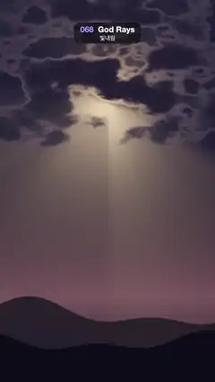

# 068 · God Rays · 빛내림



**EN** Warm shafts of light pour down through gaps in a drifting dark cloud layer over dusky rolling hills.  
**KO** 천천히 흐르는 어두운 구름층 틈으로 따뜻한 빛줄기가 쏟아져 내려 해 질 녘 언덕을 비춘다.

[Video (mp4)](https://sueun-dev.github.io/motion-effects/videos/068-god-rays.mp4) · [Code](../effects/068-god-rays.js) · Shaders & generative · 셰이더·제너러티브

## Prompt (English)

```text
Create a "God Rays" motion effect: volumetric light shafts from a sun hidden behind a broken, drifting cloud layer.

Look
- Units: frame widths (1 = 1080 px) from the bottom left, y up. The sun is at (0.5, 1.34), i.e. (540, 473) px from the top. sun(p) = exp(−9d) + 2 · exp(−40d), d = distance to the sun.
- Sky: #0D0D1C low → #17172E high (smoothstep over y 0.2 → 1.6), plus #FFB266 × 0.8 · sun(p), plus a warm horizon band #52292E × exp(−4 |y − 0.4|) around y 1488 px.
- Clouds: raw(p) = (fbm(q) + thick) · band − 0.3 · (1 − band), with q = (2.6x, 4.6y) + drift, fbm = 3D simplex octaves (lacunarity 2.03, gain 0.5; 5 octaves for the visible clouds, 3 for the light march), band = smoothstep(0.95, 1.25, y + 0.12 · fbm) (clouds fill the top, ragged lower edge between about 570 and 890 px from the top), thick = 0.16 + 0.22 · exp(−6 d) so only small holes open near the sun. Coverage c = smoothstep(−0.05, 0.1, raw).
- Cloud colour: mix(#332E45 thin, #1C1A2B thick, smoothstep(0, 0.5, raw)), plus gold rims #FFB866 × 2 × (1 − smoothstep(0, 0.3, raw)) × exp(−7d) near the sun.
- Shafts (screen-space light scattering, as in the classic GPU volumetric light technique): from each pixel march 40 steps toward the sun, step = (p − sun) × 0.97 / 40; at each step add (1 − smoothstep(−0.03, 0.05, raw)) × sun(q) × decay, decay × 0.97 per step; finally × 4.6 / 40. Start each march at a fixed per-pixel random offset (a hash of the pixel position, never of time) to hide step banding without any flicker.
- Add #FFCC80 × shafts × (1 − 0.8c) × (0.25 + 0.75 · below), below = smoothstep(−0.15, 0.2, sunY − y), so the shafts fall downward from the sun.
- Hills: a back hill under y = 0.32 + 0.05 sin(5x + 1) + 0.03 sin(11x), colour #141221 + #735226 × shafts (it catches the light); a front hill under y = 0.2 + 0.04 sin(4x + 3) + 0.02 sin(13x + 2), colour #0A0912. Edges anti-aliased over 1.5 px.
- Tone curve at the end: colour = 1 − exp(−1.3 × colour), so the sun never blows out.

Motion (0–5 s)
- The cloud noise offset moves around a circle of radius 0.2 noise units once per loop (about 80 px sideways and 45 px up and down on screen). Holes open and close, so the shafts swing, brighten and fade. Calm; loops exactly.

Technique
- A WebGL2 full-screen fragment shader with time and resolution uniforms.

Output and rules
- One self-contained HTML file with no external assets (three.js from a CDN is fine if you use it), drawing on a 1080 × 1920 canvas (9:16) scaled to fit the window.
- Write a function renderFrame(t) that draws the frame for time t in seconds, and preview it with requestAnimationFrame. Everything must be a pure function of t and fixed seeds: no Math.random(), Date or state carried between frames, so frame i = renderFrame(i / 30) can be exported to a 30 fps video.
- Loop seamlessly every 5 seconds: renderFrame(5) must look exactly like renderFrame(0).
- No flicker of any kind: no noise or grain that changes from frame to frame, no strobing or blinking, no z-fighting, no shimmering 1 px lines. Any grain or texture stays fixed to the screen or to the object.
- Keep the top 280 px free of important content (a title label goes there) and fill the whole frame with a designed background.
```

## 프롬프트 (한국어)

```text
"빛내림" 모션 효과를 만들어 줘: 군데군데 뚫린 채 흘러가는 구름층 뒤에 숨은 해에서 볼류메트릭 빛줄기가 쏟아지는 효과.

모양
- 단위는 화면 너비(1 = 1080px), 원점은 왼쪽 아래, y는 위쪽이 +. 해는 (0.5, 1.34), 즉 위에서 (540, 473)px. sun(p) = exp(−9d) + 2 · exp(−40d), d = 해까지 거리.
- 하늘: 아래 #0D0D1C → 위 #17172E(y 0.2 → 1.6 smoothstep), 여기에 #FFB266 × 0.8 · sun(p), 그리고 위에서 1488px 근처에 따뜻한 지평선 띠 #52292E × exp(−4 |y − 0.4|).
- 구름: raw(p) = (fbm(q) + thick) · band − 0.3 · (1 − band). q = (2.6x, 4.6y) + 이동량, fbm = 3D 심플렉스 옥타브 합(주파수 ×2.03, 진폭 ×0.5. 보이는 구름은 5옥타브, 빛 계산은 3옥타브), band = smoothstep(0.95, 1.25, y + 0.12 · fbm)(구름이 위쪽을 채우고, 들쭉날쭉한 아래 경계는 위에서 약 570–890px), thick = 0.16 + 0.22 · exp(−6 d)라 해 근처에는 작은 구멍만 난다. 덮임 c = smoothstep(−0.05, 0.1, raw).
- 구름 색: mix(얇은 곳 #332E45, 두꺼운 곳 #1C1A2B, smoothstep(0, 0.5, raw)). 해 근처에는 금빛 테두리 #FFB866 × 2 × (1 − smoothstep(0, 0.3, raw)) × exp(−7d).
- 빛줄기(화면 공간 빛 산란, 고전적인 GPU 볼류메트릭 라이트 기법): 픽셀마다 해 쪽으로 40걸음, 걸음 = (p − 해) × 0.97 / 40. 걸음마다 (1 − smoothstep(−0.03, 0.05, raw)) × sun(q) × decay를 더하고 decay는 걸음마다 × 0.97. 끝에 × 4.6 / 40. 출발점은 픽셀마다 고정된 무작위 오프셋(시간이 아니라 픽셀 위치의 해시)만큼 당겨서, 깜빡임 없이 걸음 줄무늬를 숨긴다.
- #FFCC80 × 빛줄기 × (1 − 0.8c) × (0.25 + 0.75 · below)를 더한다. below = smoothstep(−0.15, 0.2, 해의 y − y)라서 빛줄기는 해에서 아래로 떨어진다.
- 언덕: 뒤 언덕은 y = 0.32 + 0.05 sin(5x + 1) + 0.03 sin(11x) 아래, 색 #141221 + #735226 × 빛줄기(빛을 받는다). 앞 언덕은 y = 0.2 + 0.04 sin(4x + 3) + 0.02 sin(13x + 2) 아래, 색 #0A0912. 경계는 1.5px 안티에일리어싱.
- 마지막 톤 커브: 색 = 1 − exp(−1.3 × 색). 해가 하얗게 날아가지 않는다.

움직임 (0–5초)
- 구름 노이즈 오프셋이 반지름 0.2(노이즈 단위) 원을 루프마다 한 바퀴 돈다(화면에서 옆으로 약 80px, 위아래로 45px). 구멍이 열렸다 닫히며 빛줄기가 흔들리고 밝아졌다 흐려진다. 차분하게, 정확히 반복.

기법
- WebGL2 전체 화면 프래그먼트 셰이더, 시간·해상도 유니폼.

출력과 규칙
- 외부 파일 없는 HTML 파일 하나(three.js를 쓴다면 CDN은 괜찮다). 1080 × 1920(9:16) 캔버스에 그리고 창 크기에 맞춰 보이게 한다.
- 시간 t(초)의 프레임을 그리는 renderFrame(t) 함수를 만들고, 미리보기는 requestAnimationFrame으로 돌린다. 모든 것은 t와 고정 시드만으로 정해진다: Math.random(), Date, 프레임 사이에 쌓이는 상태 금지. 그래야 i번째 프레임 = renderFrame(i / 30)으로 30fps 영상을 뽑을 수 있다.
- 5초마다 끊김 없이 반복: renderFrame(5)는 renderFrame(0)과 똑같아 보여야 한다.
- 어떤 깜빡임도 금지: 프레임마다 바뀌는 노이즈·그레인, 번쩍임·깜빡임, z-fighting, 반짝이며 떨리는 1px 선 모두 금지. 그레인·질감은 화면이나 물체에 고정한다.
- 위쪽 280px에는 중요한 내용을 두지 않고(제목 라벨 자리), 화면 전체를 디자인된 배경으로 채운다.
```
