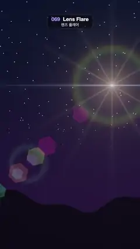

# 069 · Lens Flare · 렌즈 플레어



**EN** A bright starburst light circles a starry dusk sky while hexagonal lens ghosts and a rainbow halo swing to the opposite side.  
**KO** 별이 뜬 저녁 하늘을 밝은 별 모양 광원이 돌고, 육각형 렌즈 고스트와 무지개 헤일로가 반대편으로 따라 움직인다.

[Video (mp4)](../videos/069-lens-flare.mp4) · [Code](../effects/069-lens-flare.js) · Shaders & generative · 셰이더·제너러티브

## Prompt (English)

```text
Create a "Lens Flare" motion effect: a strong light moves around the sky and its camera-lens reflections line up on the opposite side of the frame centre.

Look
- Units: frame widths (1 = 1080 px) from the bottom left, y up. Frame centre C = (0.5, 0.889), i.e. (540, 960) px.
- Sky: #1A0D2E low → #050A1F high (smoothstep over y 0.2 → 1.6). Fixed stars: split the frame into 6 × 6 px cells and light 0.3 % of them (cell hash > 0.997) at grey 0.8, faded in over y 0.6 → 1.2. A dark mountain silhouette #08050F below y = 0.34 + 0.06 sin(6x + 1.3) + 0.025 sin(17x) (around 1550 px from the top), edge ±2 px soft.
- The light at L, with d = p − L, r = |d|, θ = angle of d, all added:
  - core #FFF2D9 × 0.012 / (r + 0.012);
  - glow #FFB266 × 0.35 · exp(−6r);
  - starburst of 12 rays: #FFD9B2 × 0.25 · |cos 6θ|^40 · exp(−5r);
  - a horizontal anamorphic streak #73A6FF × 0.6 · exp(−260 |d.y|) · exp(−2.2 |d.x|);
  - a rainbow halo ring of radius 0.26 (281 px): exp(−((r − 0.26) × 30)²) × rainbow(3r) × 0.12, rainbow(x) = 0.5 + 0.5 cos(2π(x + (0, 0.33, 0.67))).
- Ghosts: 7 hexagons on the line from L through C at L + (C − L)(1 + s), s = 0.55, 0.9, 1.25, 1.7, 0.82, 1.23, −0.25 (most beyond the centre, one between the light and the centre). Each is rotated 0.3 rad, size (inner radius) 0.025–0.075 by a hash (27–81 px), with a 0.6 fill plus a brighter 0.5 rim, soft over about 6 px, tinted rainbow(0.17i + 0.1) (magenta, violet, blue, green, lime, orange, pink) and added at × 0.3.
- A big soft ring ghost at the mirror point L + 2(C − L): radius 0.12 (130 px), #66E6B2 × 0.08 × exp(−((distance − 0.12) × 45)²).
- Everything is additive; finish with the tone curve colour = 1 − exp(−1.4 × colour) so bright parts do not clip hard.

Motion (0–5 s)
- L = C + (0.3 cos 2πφ, 0.28 + 0.22 sin 2πφ), φ = t / 5: an ellipse 648 × 475 px around (540, 658) px from the top, counter-clockwise on screen, once per loop. The ghosts swing through the centre to the opposite side and slide along the axis; the streak, rays and halo travel with the light. Smooth and constant; loops exactly.

Technique
- A WebGL2 full-screen fragment shader with time and resolution uniforms.

Output and rules
- One self-contained HTML file with no external assets (three.js from a CDN is fine if you use it), drawing on a 1080 × 1920 canvas (9:16) scaled to fit the window.
- Write a function renderFrame(t) that draws the frame for time t in seconds, and preview it with requestAnimationFrame. Everything must be a pure function of t and fixed seeds: no Math.random(), Date or state carried between frames, so frame i = renderFrame(i / 30) can be exported to a 30 fps video.
- Loop seamlessly every 5 seconds: renderFrame(5) must look exactly like renderFrame(0).
- No flicker of any kind: no noise or grain that changes from frame to frame, no strobing or blinking, no z-fighting, no shimmering 1 px lines. Any grain or texture stays fixed to the screen or to the object.
- Keep the top 280 px free of important content (a title label goes there) and fill the whole frame with a designed background.
```

## 프롬프트 (한국어)

```text
"렌즈 플레어" 모션 효과를 만들어 줘: 강한 빛이 하늘을 돌고, 그 카메라 렌즈 반사들이 화면 중심 반대편에 줄지어 움직이는 효과.

모양
- 단위는 화면 너비(1 = 1080px), 원점은 왼쪽 아래, y는 위쪽이 +. 화면 중심 C = (0.5, 0.889), 즉 (540, 960)px.
- 하늘: 아래 #1A0D2E → 위 #050A1F(y 0.2 → 1.6 smoothstep). 고정된 별: 화면을 6 × 6px 칸으로 나눠 0.3 %(칸 해시 > 0.997)를 밝기 0.8 회색으로 켜고, y 0.6 → 1.2에 걸쳐 나타나게. 위에서 약 1550px 근처, y = 0.34 + 0.06 sin(6x + 1.3) + 0.025 sin(17x) 아래에 어두운 산 실루엣 #08050F, 경계 ±2px 부드럽게.
- L에 있는 빛, d = p − L, r = |d|, θ = d의 각도. 모두 더한다:
  - 심 #FFF2D9 × 0.012 / (r + 0.012);
  - 빛무리 #FFB266 × 0.35 · exp(−6r);
  - 빛살 12개: #FFD9B2 × 0.25 · |cos 6θ|^40 · exp(−5r);
  - 가로 아나모픽 줄 #73A6FF × 0.6 · exp(−260 |d.y|) · exp(−2.2 |d.x|);
  - 반지름 0.26(281px)의 무지개 헤일로 고리: exp(−((r − 0.26) × 30)²) × rainbow(3r) × 0.12, rainbow(x) = 0.5 + 0.5 cos(2π(x + (0, 0.33, 0.67))).
- 고스트: L에서 C를 지나는 직선 위 L + (C − L)(1 + s)에 육각형 7개, s = 0.55, 0.9, 1.25, 1.7, 0.82, 1.23, −0.25(대부분 중심 너머, 하나는 빛과 중심 사이). 각각 0.3 rad 회전, 크기(내접 반지름)는 해시로 0.025–0.075(27–81px), 채움 0.6에 더 밝은 테두리 0.5, 약 6px 부드럽게, 색은 rainbow(0.17i + 0.1)(자홍, 보라, 파랑, 초록, 연두, 주황, 분홍), × 0.3으로 더한다.
- 거울 위치 L + 2(C − L)에 크고 부드러운 고리 고스트: 반지름 0.12(130px), #66E6B2 × 0.08 × exp(−((거리 − 0.12) × 45)²).
- 전부 더하기 합성. 마지막에 톤 커브 색 = 1 − exp(−1.4 × 색)로 밝은 부분이 딱딱하게 잘리지 않게.

움직임 (0–5초)
- L = C + (0.3 cos 2πφ, 0.28 + 0.22 sin 2πφ), φ = t / 5: 위에서 (540, 658)px을 중심으로 648 × 475px 타원을 화면에서 반시계 방향으로 루프마다 한 바퀴. 고스트들은 중심을 지나 반대편으로 휘돌며 축을 따라 미끄러지고, 가로 줄·빛살·헤일로는 빛을 따라간다. 일정하고 부드럽게, 정확히 반복.

기법
- WebGL2 전체 화면 프래그먼트 셰이더, 시간·해상도 유니폼.

출력과 규칙
- 외부 파일 없는 HTML 파일 하나(three.js를 쓴다면 CDN은 괜찮다). 1080 × 1920(9:16) 캔버스에 그리고 창 크기에 맞춰 보이게 한다.
- 시간 t(초)의 프레임을 그리는 renderFrame(t) 함수를 만들고, 미리보기는 requestAnimationFrame으로 돌린다. 모든 것은 t와 고정 시드만으로 정해진다: Math.random(), Date, 프레임 사이에 쌓이는 상태 금지. 그래야 i번째 프레임 = renderFrame(i / 30)으로 30fps 영상을 뽑을 수 있다.
- 5초마다 끊김 없이 반복: renderFrame(5)는 renderFrame(0)과 똑같아 보여야 한다.
- 어떤 깜빡임도 금지: 프레임마다 바뀌는 노이즈·그레인, 번쩍임·깜빡임, z-fighting, 반짝이며 떨리는 1px 선 모두 금지. 그레인·질감은 화면이나 물체에 고정한다.
- 위쪽 280px에는 중요한 내용을 두지 않고(제목 라벨 자리), 화면 전체를 디자인된 배경으로 채운다.
```
