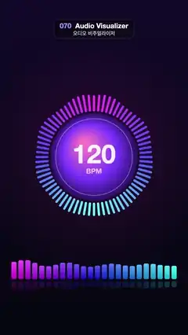

# 070 · Audio Visualizer · 오디오 비주얼라이저



**EN** A made-up 120 BPM beat pumps a neon radial spectrum around a "120 BPM" disc and a bar spectrum with a reflection below.  
**KO** 가상의 120 BPM 비트에 맞춰 "120 BPM" 원판 둘레의 네온 원형 스펙트럼과 아래의 반사된 막대 스펙트럼이 튄다.

[Video (mp4)](https://sueun-dev.github.io/motion-effects/videos/070-audio-visualizer.mp4) · [Code](../effects/070-audio-visualizer.js) · Shaders & generative · 셰이더·제너러티브

## Prompt (English)

```text
Create an "Audio Visualizer" motion effect: a radial spectrum ring and a bar spectrum that bounce to a synthetic 120 BPM beat (no audio file; the "music" is computed from t).

Look
- Background vertical gradient #120A2A → #05060F, plus a pink glow rgba(255, 60, 160, 0.12 + 0.18 · kick) as a radial gradient from radius 100 to 700 around (540, 900).
- Beat envelopes: env(k) = (1 − e^(−k / 0.045)) · e^(−k / fall), k = seconds since the last hit (a ~3-frame rise, then exponential decay). Kick every 0.5 s (fall 0.16); snare every 1 s starting at 0.5 s (fall 0.12); hi-hat every 0.25 s starting at 0.125 s (fall 0.05). That is 10 beats per 5 s loop.
- Level of band u (0 = bass, 1 = treble) = min(1, 0.1 + 0.95 · kick · e^(−4u) + 0.6 · snare · exp(−((u − 0.45) / 0.2)²) + 0.35 · hat · exp(−((u − 0.85) / 0.15)²) + 0.28 · wob · (1 − 0.5u)), wob = 0.5 + 0.5 · noise(6u + Lx, Ly), with L a point on a circle of radius 0.8 that goes round once per loop.
- Ring around (540, 900): R = 250 + 14 · kick. 72 bars starting at radius R + 18 and reaching out 24 + 210 · level px, 13 px wide with round caps. Mirrored left/right: bass at the top, treble at the bottom (u = bars from the top / 36). Colour hsl(300 − 120u, 95 %, 60 + 10u %): magenta at the top to cyan at the bottom.
- Disc of radius R: radial gradient from (480, 820) to the centre, #FF7AC8 → #7B3CFF (60 %) → #2A1466; a 4 px white ring at 35 % opacity at radius R − 30. Text "120" in a heavy (800) 150 px sans-serif, white 92 %, centred at (540, 888); "BPM" in 600 weight 40 px, white 70 %, centred at (540, 982).
- Bar spectrum: 24 bars, 30 px wide with 10 px gaps (950 px, centred), standing on y = 1600, height 20 + 300 · level, corner radius 8, vertical gradient hsl(300 − 120u, 95 %, 66 %) at the top to hsl(300 − 120u, 90 %, 40 %) at the base. Reflection: a rounded bar in hsla(300 − 120u, 90 %, 55 %, 0.18), starting 12 px below the base, 0.45 × the height.

Motion (0–5 s)
- Kicks every 0.5 s make the ring, disc, bass bars and glow pump; snares bump the mids once a second; hi-hats flick the treble. The noise wobble keeps the bars alive between hits.
- All envelopes are smooth functions of t with periods that divide 5 s, so it loops seamlessly with no strobing.

Technique
- Canvas 2D.

Output and rules
- One self-contained HTML file with no external assets (three.js from a CDN is fine if you use it), drawing on a 1080 × 1920 canvas (9:16) scaled to fit the window.
- Write a function renderFrame(t) that draws the frame for time t in seconds, and preview it with requestAnimationFrame. Everything must be a pure function of t and fixed seeds: no Math.random(), Date or state carried between frames, so frame i = renderFrame(i / 30) can be exported to a 30 fps video.
- Loop seamlessly every 5 seconds: renderFrame(5) must look exactly like renderFrame(0).
- No flicker of any kind: no noise or grain that changes from frame to frame, no strobing or blinking, no z-fighting, no shimmering 1 px lines. Any grain or texture stays fixed to the screen or to the object.
- Keep the top 280 px free of important content (a title label goes there) and fill the whole frame with a designed background.
```

## 프롬프트 (한국어)

```text
"오디오 비주얼라이저" 모션 효과를 만들어 줘: 원형 스펙트럼 고리와 막대 스펙트럼이 가상의 120 BPM 비트에 맞춰 튀는 효과(오디오 파일 없음, "음악"은 t로 계산).

모양
- 배경 세로 그라디언트 #120A2A → #05060F, 그리고 (540, 900) 둘레에 반지름 100에서 700까지 퍼지는 분홍 빛 rgba(255, 60, 160, 0.12 + 0.18 · kick).
- 비트 엔벌로프: env(k) = (1 − e^(−k / 0.045)) · e^(−k / fall), k = 마지막 타격 뒤 지난 초(약 3프레임 동안 올라갔다 지수로 줄어듦). 킥은 0.5초마다(fall 0.16), 스네어는 0.5초부터 1초마다(fall 0.12), 하이햇은 0.125초부터 0.25초마다(fall 0.05). 5초 루프에 비트 10번.
- 대역 u(0 = 저음, 1 = 고음)의 레벨 = min(1, 0.1 + 0.95 · kick · e^(−4u) + 0.6 · snare · exp(−((u − 0.45) / 0.2)²) + 0.35 · hat · exp(−((u − 0.85) / 0.15)²) + 0.28 · wob · (1 − 0.5u)), wob = 0.5 + 0.5 · noise(6u + Lx, Ly), L은 루프마다 한 바퀴 도는 반지름 0.8 원 위의 점.
- (540, 900) 둘레의 고리: R = 250 + 14 · kick. 막대 72개가 반지름 R + 18에서 시작해 24 + 210 · 레벨 px만큼 바깥으로 뻗는다, 폭 13px, 둥근 끝. 좌우 대칭: 위가 저음, 아래가 고음(u = 위에서부터 막대 수 / 36). 색 hsl(300 − 120u, 95 %, 60 + 10u %): 위 자홍에서 아래 청록으로.
- 반지름 R의 원판: (480, 820)에서 중심으로 가는 원형 그라디언트 #FF7AC8 → #7B3CFF(60 %) → #2A1466. 반지름 R − 30에 4px 흰 고리(불투명도 35 %). 글자 "120"은 굵은(800) 150px 산세리프, 흰색 92 %, (540, 888) 가운데. "BPM"은 600 굵기 40px, 흰색 70 %, (540, 982) 가운데.
- 막대 스펙트럼: 막대 24개, 폭 30px, 간격 10px(전체 950px, 가운데 정렬), y = 1600에 서 있고 높이 20 + 300 · 레벨, 모서리 반지름 8, 세로 그라디언트 위 hsl(300 − 120u, 95 %, 66 %) → 아래 hsl(300 − 120u, 90 %, 40 %). 반사: 바닥 12px 아래에서 시작하는 hsla(300 − 120u, 90 %, 55 %, 0.18) 둥근 막대, 높이의 0.45배.

움직임 (0–5초)
- 0.5초마다 킥이 고리·원판·저음 막대·배경 빛을 펌프질하고, 스네어는 1초마다 중음을, 하이햇은 고음을 톡 친다. 타격 사이에는 노이즈 흔들림이 막대를 살아 있게 한다.
- 모든 엔벌로프가 t의 부드러운 함수이고 주기가 5초를 나누어떨어지게 하므로, 번쩍임 없이 끊김 없이 반복된다.

기법
- Canvas 2D.

출력과 규칙
- 외부 파일 없는 HTML 파일 하나(three.js를 쓴다면 CDN은 괜찮다). 1080 × 1920(9:16) 캔버스에 그리고 창 크기에 맞춰 보이게 한다.
- 시간 t(초)의 프레임을 그리는 renderFrame(t) 함수를 만들고, 미리보기는 requestAnimationFrame으로 돌린다. 모든 것은 t와 고정 시드만으로 정해진다: Math.random(), Date, 프레임 사이에 쌓이는 상태 금지. 그래야 i번째 프레임 = renderFrame(i / 30)으로 30fps 영상을 뽑을 수 있다.
- 5초마다 끊김 없이 반복: renderFrame(5)는 renderFrame(0)과 똑같아 보여야 한다.
- 어떤 깜빡임도 금지: 프레임마다 바뀌는 노이즈·그레인, 번쩍임·깜빡임, z-fighting, 반짝이며 떨리는 1px 선 모두 금지. 그레인·질감은 화면이나 물체에 고정한다.
- 위쪽 280px에는 중요한 내용을 두지 않고(제목 라벨 자리), 화면 전체를 디자인된 배경으로 채운다.
```
