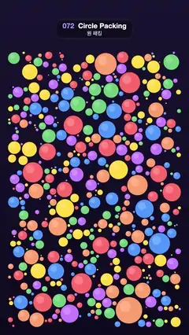

# 072 · Circle Packing · 원 패킹



**EN** Colourful circles drop in and grow until they touch, packing the frame, then shrink away from the middle out as the next round grows.  
**KO** 알록달록한 원들이 떨어져 서로 닿을 때까지 자라 화면을 빈틈없이 채우고, 가운데부터 줄어들며 다음 판이 다시 자란다.

[Video (mp4)](https://sueun-dev.github.io/motion-effects/videos/072-circle-packing.mp4) · [Code](../effects/072-circle-packing.js) · Shaders & generative · 셰이더·제너러티브

## Prompt (English)

```text
Create a "Circle Packing" motion effect: circles spawn at free spots and grow at the same speed until they touch a neighbour or the edge, filling the frame, then clear away and start again.

Look
- Background vertical gradient #1A1433 → #0E0B1F.
- Packing area: x 46–1034, y 296–1874 (clear of the title area).
- Six flat colours picked at random per circle: #FF6B6B, #FFD93D, #6BCB77, #4D96FF, #C77DFF, #FF9F6B. Each circle gets a soft highlight: a white rgba(255, 255, 255, 0.22) circle of radius 0.42 × its radius, offset (−0.28, −0.3) × its radius toward the upper left.

Simulation (run once at setup with a seeded RNG)
- Time steps of 1/60 s for 4.7 s. While time < 3.2 s, every step tries 14 random spots (at least 6 px inside the area) and keeps a spot if it lies more than (radius + 6) px from every existing circle; it becomes a new circle with radius 0 and that birth time.
- Every growing circle grows 240 px/s (4 px per step), limited by the area edges and by every other circle (centre distance − its radius − its growth this step if it is still growing − a 4 px gap). Once limited, it stops for good. Drop circles that end smaller than 4 px.
- Keep each circle's birth time and final radius. A frame then only computes radius(time) = min(final, max(0, (time − born) × 240)), with no state.

Motion (0–5 s)
- Shrink: multiply the radius by 1 − easeInOutCubic(clamp((time − 4.0 − 0.7 · out) / 0.6)), out = distance from (540, 1085) / 1000, so the circles shrink away from the middle outward.
- Loop: time = (t + 1) mod 5 (the video starts one second into the growth so frame 0 is not empty), and each circle shows max(radius(time), radius(time + 5)), so the last round finishes shrinking while the next round already grows.
- Result: 0–2.2 s new seeds keep popping into the gaps and growing until the frame is packed; about 3.0–4.25 s it empties from the centre outward; from 4.0 s the same pattern begins growing again, matching frame 0.

Technique
- Canvas 2D; the simulation runs once, and every frame is a pure function of t.

Output and rules
- One self-contained HTML file with no external assets (three.js from a CDN is fine if you use it), drawing on a 1080 × 1920 canvas (9:16) scaled to fit the window.
- Write a function renderFrame(t) that draws the frame for time t in seconds, and preview it with requestAnimationFrame. Everything must be a pure function of t and fixed seeds: no Math.random(), Date or state carried between frames, so frame i = renderFrame(i / 30) can be exported to a 30 fps video.
- Loop seamlessly every 5 seconds: renderFrame(5) must look exactly like renderFrame(0).
- No flicker of any kind: no noise or grain that changes from frame to frame, no strobing or blinking, no z-fighting, no shimmering 1 px lines. Any grain or texture stays fixed to the screen or to the object.
- Keep the top 280 px free of important content (a title label goes there) and fill the whole frame with a designed background.
```

## 프롬프트 (한국어)

```text
"원 패킹" 모션 효과를 만들어 줘: 빈자리에 원이 생겨 모두 같은 속도로 자라다가 이웃 원이나 가장자리에 닿으면 멈추고, 화면이 가득 차면 비워지고 다시 시작하는 효과.

모양
- 배경 세로 그라디언트 #1A1433 → #0E0B1F.
- 채우는 영역: x 46–1034, y 296–1874(제목 자리를 피한다).
- 원마다 무작위로 고른 단색 여섯 가지: #FF6B6B, #FFD93D, #6BCB77, #4D96FF, #C77DFF, #FF9F6B. 원마다 부드러운 하이라이트: 반지름의 0.42배인 흰 원 rgba(255, 255, 255, 0.22)를 반지름 × (−0.28, −0.3)만큼 왼쪽 위로 옮겨서.

시뮬레이션 (처음에 시드 난수로 한 번만 실행)
- 1/60초 간격으로 4.7초. 시간 < 3.2초인 동안 스텝마다 무작위 지점 14곳(영역 안쪽 6px 이상)을 시도해, 기존의 모든 원에서 (반지름 + 6)px보다 멀면 반지름 0, 그 시각을 태어난 시간으로 하는 새 원이 된다.
- 자라는 원은 모두 240px/s(스텝당 4px)로 자라되, 영역 가장자리와 다른 모든 원(중심 거리 − 그 원의 반지름 − 아직 자라는 중이면 이번 스텝 성장분 − 간격 4px)에 막힌다. 한 번 막히면 그대로 멈춘다. 최종 반지름이 4px보다 작은 원은 버린다.
- 원마다 태어난 시간과 최종 반지름을 저장한다. 프레임에서는 radius(time) = min(최종, max(0, (time − 태어난 시간) × 240))만 계산하고 상태는 없다.

움직임 (0–5초)
- 줄어들기: 반지름에 1 − easeInOutCubic(clamp((time − 4.0 − 0.7 · out) / 0.6))를 곱한다, out = (540, 1085)에서의 거리 / 1000. 그래서 원들이 가운데부터 바깥으로 줄어든다.
- 루프: time = (t + 1) mod 5(영상은 자라기 시작한 지 1초 뒤에서 시작해 0번 프레임이 비어 있지 않다). 원마다 max(radius(time), radius(time + 5))를 보여 줘서, 지난 판이 다 줄어드는 동안 다음 판이 이미 자란다.
- 결과: 0–2.2초 새 씨앗이 틈마다 톡톡 생겨 화면이 꽉 찰 때까지 자라고, 약 3.0–4.25초에 가운데부터 바깥으로 비워지며, 4.0초부터 같은 무늬가 다시 자라 0번 프레임과 이어진다.

기법
- Canvas 2D. 시뮬레이션은 한 번만 돌리고 매 프레임은 t만의 순수 함수.

출력과 규칙
- 외부 파일 없는 HTML 파일 하나(three.js를 쓴다면 CDN은 괜찮다). 1080 × 1920(9:16) 캔버스에 그리고 창 크기에 맞춰 보이게 한다.
- 시간 t(초)의 프레임을 그리는 renderFrame(t) 함수를 만들고, 미리보기는 requestAnimationFrame으로 돌린다. 모든 것은 t와 고정 시드만으로 정해진다: Math.random(), Date, 프레임 사이에 쌓이는 상태 금지. 그래야 i번째 프레임 = renderFrame(i / 30)으로 30fps 영상을 뽑을 수 있다.
- 5초마다 끊김 없이 반복: renderFrame(5)는 renderFrame(0)과 똑같아 보여야 한다.
- 어떤 깜빡임도 금지: 프레임마다 바뀌는 노이즈·그레인, 번쩍임·깜빡임, z-fighting, 반짝이며 떨리는 1px 선 모두 금지. 그레인·질감은 화면이나 물체에 고정한다.
- 위쪽 280px에는 중요한 내용을 두지 않고(제목 라벨 자리), 화면 전체를 디자인된 배경으로 채운다.
```
