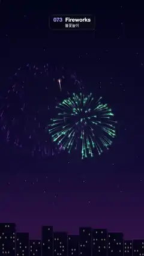

# 073 · Fireworks · 불꽃놀이



**EN** Six rockets climb over a night skyline and burst into coloured spheres of sparks that slow, droop and fade with glowing trails.  
**KO** 밤 도시 실루엣 위로 로켓 여섯 발이 차례로 솟아 색색의 불꽃으로 터지고, 불티는 느려지며 꼬리를 남기고 떨어져 사라진다.

[Video (mp4)](https://sueun-dev.github.io/motion-effects/videos/073-fireworks.mp4) · [Code](../effects/073-fireworks.js) · Particles · 파티클

## Prompt (English)

```text
Create a "Fireworks" motion effect: rockets rise over a night city and burst into glowing spheres of sparks that slow down, droop under gravity and fade, leaving tapered trails.

Look
- Background (draw once, keep fixed): vertical gradient #03051A (top) → #130E36 (65 %) → #3B1B4C (bottom); 140 fixed faint stars (radius 1.2–2.5 px, white at 15–55 % opacity) in the upper 80 %; along the bottom a skyline of near-black #06061A blocks 60–150 px wide and 90–260 px tall, with about 30 % of an 8 × 12 px window grid (one every 20 × 28 px) lit in warm rgba(255,200,120,0.5).
- Six shells with hues 350, 42, 190, 290, 135 and 25 (pink-red, gold, cyan, violet, green, orange). Burst points spread over x 300–780, y 560–1120 in golden-ratio steps so they don't pile up; launch x = 540 ± 150.
- Each shell has 150 sparks. Spark direction = a random point on a sphere seen from the side: z = 2u − 1, angle θ random, speed s = 540–600 px/s, velocity (s·√(1−z²)·cos θ, s·√(1−z²)·sin θ). This fills a disc that is denser toward the rim, like a real peony shell.
- A spark is a soft round glow sprite 24 px wide (radial gradient: hsl(hue,100%,92%) at the centre → hsl(hue,100%,65%) at 50 % opacity at 0.3 → transparent) plus a tapered trail of 5 segments.

Motion (0–5 s)
- Shell i launches at t0 = i × 5/6 s; its age = (t − t0) mod 5, so the show repeats exactly.
- Rise (first 1.0 s): the rocket eases from y 1950 (below the frame) to its burst point with e = 1 − (1 − k)², drawn as a 5 px line fading from transparent orange to rgba(255,225,180,0.95), with a 32 px glow at its head.
- Burst: a = age − 1. Sparks follow drag (K = 1.45 /s) plus gravity (G = 200 px/s²) in closed form: E = (1 − e^(−K·a))/K, offset = (vx·E, G·a/K + (vy − G/K)·E).
- Each spark lives 1.9–2.7 s; opacity = (1 − a/life)^1.3 × (0.7 + 0.3·sin(12a + φ)), a smooth twinkle that never switches on and off. Right after the burst it is white-hot: lightness mixes from 95 % to its own 60–80 % with clamp(1 − 2a).
- Burst flash: a radial glow of radius 520 px in the shell hue, opacity 0.22 × (a/0.15)·e^(1 − a/0.15), peaking 0.15 s after the burst.
- Trail: evaluate the same formula at a − 0.36·j/5 for j = 1…5 and connect the points; segment j is 4.6 − 0.5j px wide with opacity 1 − j/6, round caps.

Technique
- Canvas 2D. Draw the cached background, then everything else with globalCompositeOperation 'lighter' (additive), so overlapping sparks glow. Pre-render one glow sprite per hue.
- Streaks instead of tiny points, plus the smooth twinkle, keep the sparks from flickering.

Output and rules
- One self-contained HTML file with no external assets (three.js from a CDN is fine if you use it), drawing on a 1080 × 1920 canvas (9:16) scaled to fit the window.
- Write a function renderFrame(t) that draws the frame for time t in seconds, and preview it with requestAnimationFrame. Everything must be a pure function of t and fixed seeds: no Math.random(), Date or state carried between frames, so frame i = renderFrame(i / 30) can be exported to a 30 fps video.
- Loop seamlessly every 5 seconds: renderFrame(5) must look exactly like renderFrame(0).
- No flicker of any kind: no noise or grain that changes from frame to frame, no strobing or blinking, no z-fighting, no shimmering 1 px lines. Any grain or texture stays fixed to the screen or to the object.
- Keep the top 280 px free of important content (a title label goes there) and fill the whole frame with a designed background.
```

## 프롬프트 (한국어)

```text
"불꽃놀이" 모션 효과를 만들어 줘: 밤 도시 위로 로켓이 솟아올라 빛나는 불꽃 구로 터지고, 불티가 느려지며 중력에 처지고 사라지면서 가늘어지는 꼬리를 남기는 효과.

모양
- 배경(한 번만 그려 고정): 세로 그라디언트 #03051A(위) → #130E36(65 %) → #3B1B4C(아래). 위쪽 80 %에 고정된 흐린 별 140개(반지름 1.2–2.5 px, 흰색 불투명도 15–55 %). 아래쪽에는 거의 검은 #06061A 건물 실루엣(폭 60–150 px, 높이 90–260 px)이 이어지고, 20 × 28 px 간격의 8 × 12 px 창문 중 약 30 %에 따뜻한 rgba(255,200,120,0.5) 불이 켜져 있다.
- 불꽃 6발, 색상(hue) 350, 42, 190, 290, 135, 25(분홍빨강, 금색, 청록, 보라, 초록, 주황). 터지는 지점은 x 300–780, y 560–1120 사이에 황금비 간격으로 흩어 몰리지 않게 하고, 발사 x는 540 ± 150.
- 한 발에 불티 150개. 불티 방향 = 옆에서 본 구 위의 무작위 점: z = 2u − 1, 각도 θ 무작위, 속력 s = 540–600 px/s, 속도 (s·√(1−z²)·cos θ, s·√(1−z²)·sin θ). 가장자리로 갈수록 빽빽한 원판이 되어 진짜 국화 불꽃처럼 보인다.
- 불티 하나 = 폭 24 px의 부드러운 원형 글로 스프라이트(방사형 그라디언트: 가운데 hsl(hue,100%,92%) → 0.3 지점 hsl(hue,100%,65%) 불투명도 50 % → 투명) + 5마디로 가늘어지는 꼬리.

움직임 (0–5초)
- i번째 불꽃은 t0 = i × 5/6 초에 발사되고 나이는 (t − t0) mod 5. 그래서 쇼 전체가 정확히 반복된다.
- 상승(처음 1.0초): 로켓이 y 1950(화면 아래 밖)에서 터지는 지점까지 e = 1 − (1 − k)² 로 감속하며 올라간다. 투명한 주황에서 rgba(255,225,180,0.95)로 짙어지는 5 px 선으로 그리고, 앞머리에 32 px 글로를 붙인다.
- 폭발: a = 나이 − 1. 불티는 공기저항(K = 1.45 /s) + 중력(G = 200 px/s²)의 닫힌 식을 따른다: E = (1 − e^(−K·a))/K, 오프셋 = (vx·E, G·a/K + (vy − G/K)·E).
- 불티 수명은 1.9–2.7초. 불투명도 = (1 − a/수명)^1.3 × (0.7 + 0.3·sin(12a + φ)) — 켜졌다 꺼지지 않는 부드러운 반짝임. 터진 직후에는 하얗게 달아오른 색: 명도를 clamp(1 − 2a) 비율로 95 %에서 자기 명도 60–80 %로 섞는다.
- 폭발 섬광: 불꽃 색의 반지름 520 px 방사형 빛, 불투명도 0.22 × (a/0.15)·e^(1 − a/0.15)(터진 뒤 0.15초에 최대).
- 꼬리: 같은 식을 a − 0.36·j/5 (j = 1…5)에서 계산해 잇는다. j번째 마디는 굵기 4.6 − 0.5j px, 불투명도 1 − j/6, 둥근 끝.

기법
- Canvas 2D. 캐시한 배경을 그린 뒤 나머지는 전부 globalCompositeOperation 'lighter'(더하기)로 그려 겹친 불티가 빛나게 한다. 색마다 글로 스프라이트를 미리 만들어 둔다.
- 작은 점 대신 줄기와 부드러운 반짝임을 써서 불티가 깜빡이지 않는다.

출력과 규칙
- 외부 파일 없는 HTML 파일 하나(three.js를 쓴다면 CDN은 괜찮다). 1080 × 1920(9:16) 캔버스에 그리고 창 크기에 맞춰 보이게 한다.
- 시간 t(초)의 프레임을 그리는 renderFrame(t) 함수를 만들고, 미리보기는 requestAnimationFrame으로 돌린다. 모든 것은 t와 고정 시드만으로 정해진다: Math.random(), Date, 프레임 사이에 쌓이는 상태 금지. 그래야 i번째 프레임 = renderFrame(i / 30)으로 30fps 영상을 뽑을 수 있다.
- 5초마다 끊김 없이 반복: renderFrame(5)는 renderFrame(0)과 똑같아 보여야 한다.
- 어떤 깜빡임도 금지: 프레임마다 바뀌는 노이즈·그레인, 번쩍임·깜빡임, z-fighting, 반짝이며 떨리는 1px 선 모두 금지. 그레인·질감은 화면이나 물체에 고정한다.
- 위쪽 280px에는 중요한 내용을 두지 않고(제목 라벨 자리), 화면 전체를 디자인된 배경으로 채운다.
```
