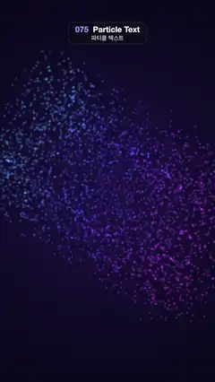

# 075 · Particle Text · 파티클 텍스트



**EN** A swirling cloud of glowing cyan-to-magenta particles spirals in to spell MAKE MAGIC, holds, then twists back out into a cloud.  
**KO** 청록에서 자홍으로 빛나는 입자 구름이 소용돌이치며 모여 MAKE MAGIC 글자가 되고, 잠시 머문 뒤 다시 비틀리며 구름으로 흩어진다.

[Video (mp4)](https://sueun-dev.github.io/motion-effects/videos/075-particle-text.mp4) · [Code](../effects/075-particle-text.js) · Particles · 파티클

## Prompt (English)

```text
Create a "Particle Text" motion effect: a swirling cloud of glowing particles spirals together into the words MAKE / MAGIC, holds, then twists back out into a cloud.

Look
- Background: radial gradient from #1C1240 at the centre to #05040F at the edges.
- Text targets: off-screen, draw "MAKE" above "MAGIC" in a heavy black font (Arial Black, weight 900), with the size chosen so MAGIC is 930 px wide (about 250 px); the two lines are centred at y = 960 ∓ 0.56 × size.
- Sample that text every 8 px in x and y; every opaque sample becomes one particle whose target is the sample point ± 4 px of jitter (a few thousand particles).
- Colour by x: 10 bands across the width, hue = 185 + 14 × band (cyan on the left, through blue and violet, to magenta on the right). Each particle is a soft round sprite: radial gradient hsl(h,100%,88%) at the centre → hsl(h,100%,62%) at 65 % opacity at 0.35 → transparent. Size 17 px in the cloud, 25 px in the word (17 + 8m).

Motion (0–5 s)
- Per particle: a delay d = 0.4 × (distance from the centre (540, 960)) / 600 s, so the middle letters settle first; a fixed cloud offset of 30–150 px in a random direction, plus a 40 px circle that goes round once per loop.
- Mix m (0 = cloud, 1 = word) = S((t − 0.05 − d)/1.65) − S((t − 3.0 − d)/1.65), with S(k) = 0.5 − 0.5·cos(π·clamp(k, 0, 1)).
- Position, with u = 1 − m: centre + (1 + 0.4u) × rotate(0.55u rad) × (target − centre) + offset × u. The cloud is the word blown up 1.4×, twisted 0.55 rad and scattered, and every particle unwinds along that spiral into place, so neighbours fly together like a vortex instead of crossing.
- Opacity = (0.4 + 0.6m) × (0.8 + 0.2·sin(3·2πt/5 + φ)).
- Timeline: cloud at 0 s, gathering 0.05–2.1 s, the word holds until 3 s, blowing back out 3.0–5 s, the same cloud again at 5 s.

Technique
- Canvas 2D, additive ('lighter') blending of pre-rendered sprites (one per hue band).
- Motion blur: also evaluate the position at t − 4/30 s and stamp n = ceil(distance / 5 px) sprites (at most 24) along that segment, each with opacity × sin(π·k)·1.57/n for k = 0…1 along the trail. Fast particles become soft streaks that fade at both ends, so they slide over pixels without stepping or flicker.

Output and rules
- One self-contained HTML file with no external assets (three.js from a CDN is fine if you use it), drawing on a 1080 × 1920 canvas (9:16) scaled to fit the window.
- Write a function renderFrame(t) that draws the frame for time t in seconds, and preview it with requestAnimationFrame. Everything must be a pure function of t and fixed seeds: no Math.random(), Date or state carried between frames, so frame i = renderFrame(i / 30) can be exported to a 30 fps video.
- Loop seamlessly every 5 seconds: renderFrame(5) must look exactly like renderFrame(0).
- No flicker of any kind: no noise or grain that changes from frame to frame, no strobing or blinking, no z-fighting, no shimmering 1 px lines. Any grain or texture stays fixed to the screen or to the object.
- Keep the top 280 px free of important content (a title label goes there) and fill the whole frame with a designed background.
```

## 프롬프트 (한국어)

```text
"파티클 텍스트" 모션 효과를 만들어 줘: 소용돌이치는 빛나는 입자 구름이 나선을 그리며 모여 MAKE / MAGIC 글자가 되고, 잠시 머문 뒤 다시 비틀리며 구름으로 흩어지는 효과.

모양
- 배경: 가운데 #1C1240에서 가장자리 #05040F로 가는 방사형 그라디언트.
- 글자 목표점: 화면 밖 캔버스에 굵은 검은 글꼴(Arial Black, 굵기 900)로 "MAKE" 위에 "MAGIC"을 쓴다. 크기는 MAGIC 폭이 930 px가 되도록(약 250 px) 정하고, 두 줄의 중심은 y = 960 ∓ 0.56 × 크기.
- 그 글자를 x, y 모두 8 px 간격으로 샘플링한다. 불투명한 샘플 하나가 입자 하나가 되고, 목표점은 그 점 ± 4 px 흔들림(입자 수천 개).
- x 위치로 색을 정한다: 폭을 10칸으로 나눠 hue = 185 + 14 × 칸(왼쪽 청록 → 파랑·보라 → 오른쪽 자홍). 입자는 부드러운 원형 스프라이트: 방사형 그라디언트 가운데 hsl(h,100%,88%) → 0.35 지점 hsl(h,100%,62%) 불투명도 65 % → 투명. 크기는 구름일 때 17 px, 글자일 때 25 px(17 + 8m).

움직임 (0–5초)
- 입자마다: 지연 d = 0.4 × (중심 (540, 960)에서의 거리) / 600 초 — 가운데 글자부터 자리 잡는다. 무작위 방향으로 30–150 px 떨어진 고정 구름 오프셋, 그리고 루프마다 한 바퀴 도는 40 px 원.
- 섞임 m(0 = 구름, 1 = 글자) = S((t − 0.05 − d)/1.65) − S((t − 3.0 − d)/1.65), S(k) = 0.5 − 0.5·cos(π·clamp(k, 0, 1)).
- 위치(u = 1 − m): 중심 + (1 + 0.4u) × 회전(0.55u rad) × (목표점 − 중심) + 오프셋 × u. 구름은 글자를 1.4배 키우고 0.55 rad 비틀고 흩뜨린 모양이고, 입자들은 그 나선을 따라 풀리며 제자리로 들어간다. 그래서 이웃 입자끼리 서로 엇갈리지 않고 소용돌이처럼 함께 난다.
- 불투명도 = (0.4 + 0.6m) × (0.8 + 0.2·sin(3·2πt/5 + φ)).
- 타임라인: 0초 구름, 0.05–2.1초 모임, 3초까지 글자 유지, 3.0–5초 다시 흩어짐, 5초에 처음과 같은 구름.

기법
- Canvas 2D, 미리 그린 스프라이트(색 칸마다 하나)를 더하기('lighter')로 찍는다.
- 모션 블러: t − 4/30 초의 위치도 계산해 그 선분을 따라 스프라이트 n = ceil(거리 / 5 px)개(최대 24)를 찍는다. 꼬리 위 k = 0…1에서 각 불투명도 × sin(π·k)·1.57/n. 빠른 입자는 양 끝이 흐려지는 부드러운 줄기가 되어 계단 현상이나 깜빡임 없이 픽셀 위를 미끄러진다.

출력과 규칙
- 외부 파일 없는 HTML 파일 하나(three.js를 쓴다면 CDN은 괜찮다). 1080 × 1920(9:16) 캔버스에 그리고 창 크기에 맞춰 보이게 한다.
- 시간 t(초)의 프레임을 그리는 renderFrame(t) 함수를 만들고, 미리보기는 requestAnimationFrame으로 돌린다. 모든 것은 t와 고정 시드만으로 정해진다: Math.random(), Date, 프레임 사이에 쌓이는 상태 금지. 그래야 i번째 프레임 = renderFrame(i / 30)으로 30fps 영상을 뽑을 수 있다.
- 5초마다 끊김 없이 반복: renderFrame(5)는 renderFrame(0)과 똑같아 보여야 한다.
- 어떤 깜빡임도 금지: 프레임마다 바뀌는 노이즈·그레인, 번쩍임·깜빡임, z-fighting, 반짝이며 떨리는 1px 선 모두 금지. 그레인·질감은 화면이나 물체에 고정한다.
- 위쪽 280px에는 중요한 내용을 두지 않고(제목 라벨 자리), 화면 전체를 디자인된 배경으로 채운다.
```
