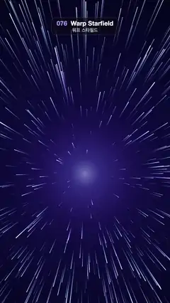

# 076 · Warp Starfield · 워프 스타필드



**EN** Blue-white star streaks rush out from a glowing violet core, growing longer and brighter as they pass, like a jump to hyperspace.  
**KO** 빛나는 보랏빛 중심에서 푸르고 흰 별빛 줄기가 사방으로 쏟아져 나오며 가까워질수록 길고 밝아지는, 초공간 점프 같은 장면.

[Video (mp4)](../videos/076-warp-starfield.mp4) · [Code](../effects/076-warp-starfield.js) · Particles · 파티클

## Prompt (English)

```text
Create a "Warp Starfield" motion effect: stars stretch into light streaks and rush out from a vanishing point, as if jumping to hyperspace.

Look
- Vanishing point at (540, 1100), a little below the centre.
- Background: radial gradient around it, #2A1C72 → #0E0B3A at 35 % → #020210 at a radius of 0.75 × frame height.
- A soft core glow of radius 320 px: rgba(210,225,255, 0.55 × pulse) → rgba(120,140,255,0.18) at 30 % → transparent, with pulse = 0.85 + 0.15·sin(2·2πt/5).
- 1300 stars, each with a fixed direction angle θ, a lateral radius R = 0.18 + 1.5·√u, a depth offset z0 and a hue 195 + 80·u² (mostly ice blue, a few violet).

Motion (0–5 s)
- Depth z = fract(z0 − 2·t/5): every star flies from far (1) to the camera (0) twice per loop, so the field repeats exactly.
- Perspective with a focal length of 420 px: the head sits r1 = R·420/(0.04 + z) px from the centre, the tail r2 = R·420/(0.04 + z + 0.15). Streak length comes straight from the projection: short and dim far away, long and fat close up. Skip a star once its tail is beyond 1400 px.
- Opacity = smoothstep(1.04, 0.6, Z) × smoothstep(0.04, 0.14, Z) with Z = 0.04 + z: it fades in far away and out just before it passes, so stars never pop in or out.
- Width = 2 + 4.5·near² px with near = 1 − z; lightness 78 % + 18 %·near, saturation 80 %.

Technique
- Canvas 2D, additive ('lighter'), round line caps. Each streak is a line from tail to head stroked with a linear gradient from transparent (tail) to the star colour (head).
- Streaks at least 2 px wide with soft gradient tails replace tiny moving points, so nothing flickers.

Output and rules
- One self-contained HTML file with no external assets (three.js from a CDN is fine if you use it), drawing on a 1080 × 1920 canvas (9:16) scaled to fit the window.
- Write a function renderFrame(t) that draws the frame for time t in seconds, and preview it with requestAnimationFrame. Everything must be a pure function of t and fixed seeds: no Math.random(), Date or state carried between frames, so frame i = renderFrame(i / 30) can be exported to a 30 fps video.
- Loop seamlessly every 5 seconds: renderFrame(5) must look exactly like renderFrame(0).
- No flicker of any kind: no noise or grain that changes from frame to frame, no strobing or blinking, no z-fighting, no shimmering 1 px lines. Any grain or texture stays fixed to the screen or to the object.
- Keep the top 280 px free of important content (a title label goes there) and fill the whole frame with a designed background.
```

## 프롬프트 (한국어)

```text
"워프 스타필드" 모션 효과를 만들어 줘: 별들이 빛줄기로 늘어나며 소실점에서 쏟아져 나와 초공간으로 점프하는 듯한 효과.

모양
- 소실점은 (540, 1100), 화면 가운데보다 조금 아래.
- 배경: 소실점 둘레의 방사형 그라디언트, #2A1C72 → 35 % 지점 #0E0B3A → 반지름 = 화면 높이 × 0.75에서 #020210.
- 반지름 320 px의 부드러운 중심 빛: rgba(210,225,255, 0.55 × pulse) → 30 % 지점 rgba(120,140,255,0.18) → 투명, pulse = 0.85 + 0.15·sin(2·2πt/5).
- 별 1300개. 별마다 고정된 방향 각 θ, 옆 반지름 R = 0.18 + 1.5·√u, 깊이 오프셋 z0, 색상 195 + 80·u²(대부분 얼음 같은 파랑, 일부 보라).

움직임 (0–5초)
- 깊이 z = fract(z0 − 2·t/5): 모든 별이 루프마다 두 번 먼 곳(1)에서 카메라(0)까지 날아온다. 그래서 별밭이 정확히 반복된다.
- 초점 거리 420 px의 원근: 머리는 중심에서 r1 = R·420/(0.04 + z) px, 꼬리는 r2 = R·420/(0.04 + z + 0.15). 줄기 길이는 투영에서 그대로 나온다: 멀면 짧고 흐리고, 가까우면 길고 굵다. 꼬리가 1400 px 밖으로 나가면 그리지 않는다.
- 불투명도 = smoothstep(1.04, 0.6, Z) × smoothstep(0.04, 0.14, Z), Z = 0.04 + z: 멀리서 서서히 나타나고 지나가기 직전에 사라져, 별이 툭 생기거나 꺼지지 않는다.
- 굵기 = 2 + 4.5·near² px, near = 1 − z. 명도 78 % + 18 %·near, 채도 80 %.

기법
- Canvas 2D, 더하기('lighter'), 둥근 선 끝. 줄기마다 꼬리에서 머리로 선을 긋고, 꼬리는 투명·머리는 별 색인 선형 그라디언트로 칠한다.
- 작은 움직이는 점 대신 2 px 이상 굵기에 꼬리가 부드럽게 사라지는 줄기를 써서 깜빡임이 없다.

출력과 규칙
- 외부 파일 없는 HTML 파일 하나(three.js를 쓴다면 CDN은 괜찮다). 1080 × 1920(9:16) 캔버스에 그리고 창 크기에 맞춰 보이게 한다.
- 시간 t(초)의 프레임을 그리는 renderFrame(t) 함수를 만들고, 미리보기는 requestAnimationFrame으로 돌린다. 모든 것은 t와 고정 시드만으로 정해진다: Math.random(), Date, 프레임 사이에 쌓이는 상태 금지. 그래야 i번째 프레임 = renderFrame(i / 30)으로 30fps 영상을 뽑을 수 있다.
- 5초마다 끊김 없이 반복: renderFrame(5)는 renderFrame(0)과 똑같아 보여야 한다.
- 어떤 깜빡임도 금지: 프레임마다 바뀌는 노이즈·그레인, 번쩍임·깜빡임, z-fighting, 반짝이며 떨리는 1px 선 모두 금지. 그레인·질감은 화면이나 물체에 고정한다.
- 위쪽 280px에는 중요한 내용을 두지 않고(제목 라벨 자리), 화면 전체를 디자인된 배경으로 채운다.
```
