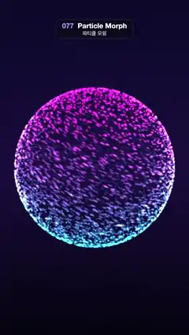

# 077 · Particle Morph · 파티클 모핑



**EN** A cloud of 5,000 glowing magenta and cyan points slowly turns while morphing from a sphere into a cube, a torus and back.  
**KO** 자홍·청록으로 빛나는 점 5,000개의 구름이 천천히 돌며 구 → 정육면체 → 토러스 → 다시 구로 모양을 바꾼다.

[Video (mp4)](../videos/077-particle-morph.mp4) · [Code](../effects/077-particle-morph.js) · Particles · 파티클

## Prompt (English)

```text
Create a "Particle Morph" motion effect: a 3D cloud of glowing points that slowly turns and morphs sphere → cube → torus → sphere.

Look
- three.js. Background: vertical gradient #0B0A2A (top) → #1B0F3F (middle) → #05040F (bottom). Perspective camera, FOV 36°, at (0, 0, 9.5) looking at the origin.
- 5,000 points. Pick a random unit direction d for every 4th point and give the next three the same direction turned 90°, 180° and 270° about the vertical axis, so the cloud is 4-fold symmetric.
- Three targets from the same direction, so neighbours stay neighbours: sphere = 1.45·d; cube = 1.1·d / max(|dx|, |dy|, |dz|) (the surface of a cube of half-size 1.1); torus: u = atan2(dz, dx), v = π(2 − dy), R = 1.1 + 0.42·cos v, point (R·cos u, 0.42·sin v, R·sin u).
- Colour by height: cyan #3EE6FF at the bottom (dy = −1) to magenta #FF4FD8 at the top (dy = +1).
- Each point is a soft round sprite: gl_PointSize = 15 × 9.5 / depth px, fragment = colour × smoothstep(0.5, 0.05, distance from the sprite centre) × 0.85, additive blending, no depth write. Depth cue: colour × (0.22 + 0.78·smoothstep(−11, −8.2, view-space z)), so the far side of the cloud is dim and the near side bright.

Motion (0–5 s)
- Three morphs of 5/3 s each: sphere → cube (0–1.67 s), cube → torus (1.67–3.33 s), torus → sphere (3.33–5 s).
- Inside a morph, with local time τ, each point eases with k = S((τ − 0.2 − 0.16·(dy + 1)) / 1.1), S(x) = 0.5 − 0.5·cos(π·clamp(x, 0, 1)). The bottom starts first and the top up to 0.32 s later, so a wave sweeps upward.
- Position = lerp(A, B, k) + d × 0.25·sin(πk): the cloud puffs outward in the middle of each morph.
- Spin: a quarter turn about y over 5 s (angle = (π/2)·t/5), which lands exactly on the start because of the 4-fold copies; tilt about x = 0.45 + 0.12·sin(2πt/5). Apply both in JavaScript when writing the positions.

Technique
- One THREE.Points with a custom ShaderMaterial; positions recomputed on the CPU every frame.
- Motion blur: store 6 copies of every point (30,000 vertices). Copy j (0–5) is evaluated at t − (j/6)·(4/30) s and its colour is scaled by 1.6/6, so fast-moving points become short soft streaks instead of sparkling dots.

Output and rules
- One self-contained HTML file with no external assets (three.js from a CDN is fine if you use it), drawing on a 1080 × 1920 canvas (9:16) scaled to fit the window.
- Write a function renderFrame(t) that draws the frame for time t in seconds, and preview it with requestAnimationFrame. Everything must be a pure function of t and fixed seeds: no Math.random(), Date or state carried between frames, so frame i = renderFrame(i / 30) can be exported to a 30 fps video.
- Loop seamlessly every 5 seconds: renderFrame(5) must look exactly like renderFrame(0).
- No flicker of any kind: no noise or grain that changes from frame to frame, no strobing or blinking, no z-fighting, no shimmering 1 px lines. Any grain or texture stays fixed to the screen or to the object.
- Keep the top 280 px free of important content (a title label goes there) and fill the whole frame with a designed background.
```

## 프롬프트 (한국어)

```text
"파티클 모핑" 모션 효과를 만들어 줘: 빛나는 3D 점 구름이 천천히 돌면서 구 → 정육면체 → 토러스 → 구로 모양을 바꾸는 효과.

모양
- three.js. 배경: 세로 그라디언트 #0B0A2A(위) → #1B0F3F(가운데) → #05040F(아래). 원근 카메라 FOV 36°, (0, 0, 9.5)에서 원점을 본다.
- 점 5,000개. 네 번째 점마다 무작위 단위 방향 d를 고르고, 다음 세 점은 같은 방향을 세로축으로 90°, 180°, 270° 돌린 것으로 한다. 그래서 구름이 4겹 대칭이다.
- 같은 방향에서 목표 모양 세 개를 만든다(그래서 이웃 점은 계속 이웃이다): 구 = 1.45·d; 정육면체 = 1.1·d / max(|dx|, |dy|, |dz|)(반변 1.1인 정육면체 표면); 토러스: u = atan2(dz, dx), v = π(2 − dy), R = 1.1 + 0.42·cos v, 점 (R·cos u, 0.42·sin v, R·sin u).
- 높이로 색을 정한다: 아래(dy = −1)는 청록 #3EE6FF, 위(dy = +1)는 자홍 #FF4FD8.
- 점은 부드러운 원형 스프라이트: gl_PointSize = 15 × 9.5 / 깊이 px, 프래그먼트 = 색 × smoothstep(0.5, 0.05, 스프라이트 중심까지 거리) × 0.85, 더하기 블렌딩, 깊이 쓰기 끔. 깊이 단서: 색 × (0.22 + 0.78·smoothstep(−11, −8.2, 뷰 공간 z)) — 구름의 먼 쪽은 어둡고 가까운 쪽은 밝다.

움직임 (0–5초)
- 5/3초씩 세 번 변한다: 구 → 정육면체(0–1.67초), 정육면체 → 토러스(1.67–3.33초), 토러스 → 구(3.33–5초).
- 한 번의 변신 안에서 지역 시간 τ에 대해 점마다 k = S((τ − 0.2 − 0.16·(dy + 1)) / 1.1), S(x) = 0.5 − 0.5·cos(π·clamp(x, 0, 1)). 아래쪽이 먼저, 위쪽은 최대 0.32초 늦게 출발해 물결이 위로 훑고 지나간다.
- 위치 = lerp(A, B, k) + d × 0.25·sin(πk): 변신 중간에 구름이 바깥으로 부풀었다가 돌아온다.
- 회전: 5초에 세로축(y)으로 4분의 1바퀴(각 = (π/2)·t/5). 4겹 복사 덕분에 정확히 처음 모습에 도착한다. x축 기울기 = 0.45 + 0.12·sin(2πt/5). 둘 다 위치를 쓸 때 자바스크립트에서 적용한다.

기법
- THREE.Points 하나와 직접 만든 ShaderMaterial. 위치는 매 프레임 CPU에서 다시 계산한다.
- 모션 블러: 점마다 복사본 6개(정점 30,000개). j번째 복사본(0–5)은 t − (j/6)·(4/30) 초에서 계산하고 색에 1.6/6을 곱한다. 빠르게 움직이는 점이 반짝이는 점 대신 짧고 부드러운 줄기가 된다.

출력과 규칙
- 외부 파일 없는 HTML 파일 하나(three.js를 쓴다면 CDN은 괜찮다). 1080 × 1920(9:16) 캔버스에 그리고 창 크기에 맞춰 보이게 한다.
- 시간 t(초)의 프레임을 그리는 renderFrame(t) 함수를 만들고, 미리보기는 requestAnimationFrame으로 돌린다. 모든 것은 t와 고정 시드만으로 정해진다: Math.random(), Date, 프레임 사이에 쌓이는 상태 금지. 그래야 i번째 프레임 = renderFrame(i / 30)으로 30fps 영상을 뽑을 수 있다.
- 5초마다 끊김 없이 반복: renderFrame(5)는 renderFrame(0)과 똑같아 보여야 한다.
- 어떤 깜빡임도 금지: 프레임마다 바뀌는 노이즈·그레인, 번쩍임·깜빡임, z-fighting, 반짝이며 떨리는 1px 선 모두 금지. 그레인·질감은 화면이나 물체에 고정한다.
- 위쪽 280px에는 중요한 내용을 두지 않고(제목 라벨 자리), 화면 전체를 디자인된 배경으로 채운다.
```
