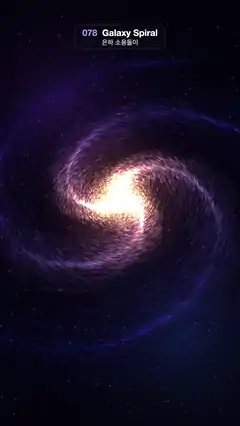

# 078 · Galaxy Spiral · 은하 소용돌이



**EN** A three-armed spiral galaxy of 60,000 stars, warm gold at the core and blue at the rim, turns slowly in a tilted view from above.  
**KO** 중심은 금빛, 가장자리는 푸른 별 6만 개로 된 세 팔 나선 은하가 비스듬히 내려다본 시점에서 천천히 돈다.

[Video (mp4)](https://sueun-dev.github.io/motion-effects/videos/078-galaxy-spiral.mp4) · [Code](../effects/078-galaxy-spiral.js) · Particles · 파티클

## Prompt (English)

```text
Create a "Galaxy Spiral" motion effect: a three-armed spiral galaxy of tens of thousands of glowing stars turning slowly, seen from above at an angle.

Look
- three.js. Perspective camera, FOV 42°, at (0, 10.5, 7.5) looking at (0, −0.6, 0), so we look down at roughly 55°. The galaxy group is tilted 0.12 rad about z.
- Background (a fixed low-res texture stretched over the screen): #03030C with three large soft nebula glows (purple rgba(90,40,140,0.35) upper left, blue rgba(30,60,140,0.35) lower right, rgba(60,30,90,0.3) in the middle) and about 220 faint fixed specks.
- 20,000 base stars, each copied 3 times at 0°, 120° and 240° about the y axis (60,000 points):
  - 12 % form the bulge: radius 0.9·u^1.5, random angle, height within ±0.35.
  - The rest form one arm: radius ρ = 0.25 + 4.6·u^1.35, angle = 1.05·ρ rad (the arm winds about 0.8 of a turn), scattered in x and z by ±u^2.2 × (0.25 + 0.22ρ), height within ±0.09 × (1.2 − ρ/4.6). The copies make the other two arms.
- Colour: lerp warm #FFD7A0 → blue #5E7BFF by min(1, 1.3·ρ/4.6); 5 % of the arm stars are pink #FF6FB5.
- Point sprites: size (3.4 + 2s)·13/depth px with s = 0.8 + 2.2·u³ (a few big stars), soft disc smoothstep(0.5, 0, r), additive, no depth write.
- Core: an additive sprite 3.6 units wide, radial gradient rgba(255,245,225,1) → rgba(255,200,140,0.7) at 15 % → rgba(255,140,90,0.15) at 45 % → transparent.

Motion (0–5 s)
- The disc turns a third of a circle about y in 5 s (angle = (t/5)·2π/3). Because of the 3-fold copies, t = 5 looks exactly like t = 0. The arms trail behind the rotation (the inner stars lead).
- Twinkle: brightness × (0.75 + 0.25·sin(2π·n·t/5 + φ)) with an integer n = 1–3 per star, so it is smooth and loops.

Technique
- One BufferGeometry with position, colour and seed (phase, rate, size) attributes, drawn with a ShaderMaterial.
- Motion blur: draw the same Points object 12 times, copy k rotated to the angle at time t − k·0.45/30 s, each at 1/12 of the brightness (fragment colour × 0.6/12). Tiny stars sliding over pixels would sparkle; this turns them into short smooth arcs.

Output and rules
- One self-contained HTML file with no external assets (three.js from a CDN is fine if you use it), drawing on a 1080 × 1920 canvas (9:16) scaled to fit the window.
- Write a function renderFrame(t) that draws the frame for time t in seconds, and preview it with requestAnimationFrame. Everything must be a pure function of t and fixed seeds: no Math.random(), Date or state carried between frames, so frame i = renderFrame(i / 30) can be exported to a 30 fps video.
- Loop seamlessly every 5 seconds: renderFrame(5) must look exactly like renderFrame(0).
- No flicker of any kind: no noise or grain that changes from frame to frame, no strobing or blinking, no z-fighting, no shimmering 1 px lines. Any grain or texture stays fixed to the screen or to the object.
- Keep the top 280 px free of important content (a title label goes there) and fill the whole frame with a designed background.
```

## 프롬프트 (한국어)

```text
"은하 소용돌이" 모션 효과를 만들어 줘: 수만 개의 빛나는 별로 된 세 팔 나선 은하를 비스듬히 위에서 내려다보며 천천히 도는 효과.

모양
- three.js. 원근 카메라 FOV 42°, (0, 10.5, 7.5)에서 (0, −0.6, 0)을 본다 — 약 55°로 내려다본다. 은하 그룹은 z축으로 0.12 rad 기울인다.
- 배경(화면에 늘려 붙인 고정 저해상도 텍스처): #03030C 바탕에 크고 부드러운 성운 빛 세 개(왼쪽 위 보라 rgba(90,40,140,0.35), 오른쪽 아래 파랑 rgba(30,60,140,0.35), 가운데 rgba(60,30,90,0.3))와 흐린 고정 점 약 220개.
- 기본 별 20,000개를 y축으로 0°, 120°, 240° 돌려 세 번씩 복사(점 60,000개):
  - 12 %는 중심 팽대부: 반지름 0.9·u^1.5, 무작위 각도, 높이 ±0.35 안.
  - 나머지는 팔 하나: 반지름 ρ = 0.25 + 4.6·u^1.35, 각도 = 1.05·ρ rad(팔이 약 0.8바퀴 감긴다), x와 z로 ±u^2.2 × (0.25 + 0.22ρ)만큼 흩어지고, 높이는 ±0.09 × (1.2 − ρ/4.6) 안. 복사본이 나머지 두 팔이 된다.
- 색: min(1, 1.3·ρ/4.6) 비율로 따뜻한 #FFD7A0 → 파랑 #5E7BFF. 팔 별의 5 %는 분홍 #FF6FB5.
- 점 스프라이트: 크기 (3.4 + 2s)·13/깊이 px, s = 0.8 + 2.2·u³(큰 별은 조금만), 부드러운 원판 smoothstep(0.5, 0, r), 더하기, 깊이 쓰기 끔.
- 중심: 폭 3.6 단위의 더하기 스프라이트, 방사형 그라디언트 rgba(255,245,225,1) → 15 % rgba(255,200,140,0.7) → 45 % rgba(255,140,90,0.15) → 투명.

움직임 (0–5초)
- 원반이 5초에 y축으로 3분의 1바퀴 돈다(각 = (t/5)·2π/3). 3겹 복사 덕분에 t = 5가 t = 0과 똑같다. 팔은 회전 방향 뒤로 끌린다(안쪽 별이 앞선다).
- 반짝임: 밝기 × (0.75 + 0.25·sin(2π·n·t/5 + φ)), n은 별마다 1–3의 정수. 부드럽고 루프가 맞는다.

기법
- 위치·색·시드(위상, 빈도, 크기) 속성을 가진 BufferGeometry 하나를 ShaderMaterial로 그린다.
- 모션 블러: 같은 Points를 12번 그린다. k번째 복사본은 t − k·0.45/30 초의 각도로 돌리고 밝기는 1/12(프래그먼트 색 × 0.6/12). 작은 별이 픽셀 위를 미끄러지면 반짝거리는데, 이렇게 하면 짧고 매끈한 호가 된다.

출력과 규칙
- 외부 파일 없는 HTML 파일 하나(three.js를 쓴다면 CDN은 괜찮다). 1080 × 1920(9:16) 캔버스에 그리고 창 크기에 맞춰 보이게 한다.
- 시간 t(초)의 프레임을 그리는 renderFrame(t) 함수를 만들고, 미리보기는 requestAnimationFrame으로 돌린다. 모든 것은 t와 고정 시드만으로 정해진다: Math.random(), Date, 프레임 사이에 쌓이는 상태 금지. 그래야 i번째 프레임 = renderFrame(i / 30)으로 30fps 영상을 뽑을 수 있다.
- 5초마다 끊김 없이 반복: renderFrame(5)는 renderFrame(0)과 똑같아 보여야 한다.
- 어떤 깜빡임도 금지: 프레임마다 바뀌는 노이즈·그레인, 번쩍임·깜빡임, z-fighting, 반짝이며 떨리는 1px 선 모두 금지. 그레인·질감은 화면이나 물체에 고정한다.
- 위쪽 280px에는 중요한 내용을 두지 않고(제목 라벨 자리), 화면 전체를 디자인된 배경으로 채운다.
```
