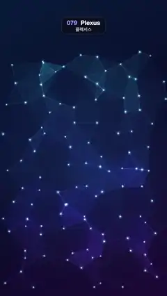

# 079 · Plexus · 플렉서스



**EN** About 110 glowing dots drift gently; nearby pairs join with fading lines and faint triangle facets, forming a shifting blue-violet web.  
**KO** 빛나는 점 110여 개가 천천히 떠다니고, 가까운 점끼리 서서히 나타나는 선과 옅은 삼각형 면으로 이어져 파랑·보라 그물이 계속 바뀐다.

[Video (mp4)](https://sueun-dev.github.io/motion-effects/videos/079-plexus.mp4) · [Code](../effects/079-plexus.js) · Particles · 파티클

## Prompt (English)

```text
Create a "Plexus" motion effect: floating glowing points that link into a constellation network whenever they come close.

Look
- Background: a diagonal linear gradient from the top-left #071A3A → #0A0C2A (55 %) → #1E0C38 at the bottom-right, plus a soft blue halo: radial at (540, 1056), radius 800 px, rgba(60,140,255,0.18) → transparent.
- Points: a jittered 10 × 12 grid covering x 40–1040 and y 300–1880 (each point at a random 0.2–0.8 position inside its cell), with 8 % of the cells left empty: about 110 points, evenly spread. Each has a depth weight z = 0.55–1.
- Each point is a glowing sprite 34·z px wide: radial white → rgba(190,240,255,0.9) at 18 % → rgba(90,200,255,0.25) at 45 % → transparent, drawn additively.
- Hue by height: 190 + 80·(y − 300)/1600, cyan at the top to violet at the bottom.

Motion (0–5 s)
- Every point moves on a Lissajous path: x = x0 + Ax·sin(fx·2πt/5 + φx), y = y0 + Ay·sin(fy·2πt/5 + φy), amplitudes 30–75 px, integer frequencies fx, fy = 1 (85 %) or 2, so everything loops.
- For each pair closer than D = 250 px, link strength s = (1 − d/D)^1.6 × min(z_i, z_j). Draw a 2 px line in hsla(hue, 90 %, 72 %, 0.72·s), hue taken at the line's mid-height.
- Every triangle whose three pairs are all linked gets a fill hsla(hue, 90 %, 60 %, 0.22 × the weakest of its three strengths).
- Because the strength falls smoothly to 0 at D, links and facets fade in and out instead of popping.

Technique
- Canvas 2D: background, facets, lines (normal blending), then the dot sprites with 'lighter'. A brute-force pair and triangle search is fine for 110 points (only look for a third point when the first two are linked).
- Lines are 2 px and move slowly, so they don't shimmer.

Output and rules
- One self-contained HTML file with no external assets (three.js from a CDN is fine if you use it), drawing on a 1080 × 1920 canvas (9:16) scaled to fit the window.
- Write a function renderFrame(t) that draws the frame for time t in seconds, and preview it with requestAnimationFrame. Everything must be a pure function of t and fixed seeds: no Math.random(), Date or state carried between frames, so frame i = renderFrame(i / 30) can be exported to a 30 fps video.
- Loop seamlessly every 5 seconds: renderFrame(5) must look exactly like renderFrame(0).
- No flicker of any kind: no noise or grain that changes from frame to frame, no strobing or blinking, no z-fighting, no shimmering 1 px lines. Any grain or texture stays fixed to the screen or to the object.
- Keep the top 280 px free of important content (a title label goes there) and fill the whole frame with a designed background.
```

## 프롬프트 (한국어)

```text
"플렉서스" 모션 효과를 만들어 줘: 떠다니는 빛나는 점들이 가까워질 때마다 선으로 이어져 별자리 같은 그물망을 이루는 효과.

모양
- 배경: 왼쪽 위 #071A3A → 55 % #0A0C2A → 오른쪽 아래 #1E0C38로 가는 대각선 선형 그라디언트, 그리고 부드러운 파란 후광: (540, 1056)에서 반지름 800 px, rgba(60,140,255,0.18) → 투명의 방사형.
- 점: x 40–1040, y 300–1880을 덮는 10 × 12 격자를 흔든 배치(각 점은 자기 칸 안 0.2–0.8의 무작위 위치), 칸의 8 %는 비운다. 그러면 점 약 110개가 고르게 퍼진다. 점마다 깊이 가중치 z = 0.55–1.
- 점은 폭 34·z px의 빛나는 스프라이트: 방사형 흰색 → 18 % rgba(190,240,255,0.9) → 45 % rgba(90,200,255,0.25) → 투명, 더하기로 그린다.
- 높이로 색상을 정한다: 190 + 80·(y − 300)/1600 — 위는 청록, 아래는 보라.

움직임 (0–5초)
- 모든 점이 리사주 경로를 따른다: x = x0 + Ax·sin(fx·2πt/5 + φx), y = y0 + Ay·sin(fy·2πt/5 + φy), 진폭 30–75 px, 정수 주파수 fx, fy = 1(85 %) 또는 2. 그래서 모두 루프가 맞는다.
- 거리 D = 250 px보다 가까운 쌍마다 연결 세기 s = (1 − d/D)^1.6 × min(z_i, z_j). 2 px 선을 hsla(색상, 90 %, 72 %, 0.72·s)로 긋는다(색상은 선 가운데 높이 기준).
- 세 쌍이 모두 이어진 삼각형은 hsla(색상, 90 %, 60 %, 0.22 × 세 세기 중 가장 약한 값)으로 채운다.
- 세기가 D에서 부드럽게 0이 되므로 선과 면이 툭 생기지 않고 서서히 나타났다 사라진다.

기법
- Canvas 2D: 배경, 삼각형 면, 선(보통 블렌딩), 마지막에 점 스프라이트를 'lighter'로. 점이 110개라 쌍·삼각형을 전부 훑어도 괜찮다(앞의 두 점이 이어졌을 때만 세 번째 점을 찾는다).
- 선은 2 px이고 천천히 움직여 떨리지 않는다.

출력과 규칙
- 외부 파일 없는 HTML 파일 하나(three.js를 쓴다면 CDN은 괜찮다). 1080 × 1920(9:16) 캔버스에 그리고 창 크기에 맞춰 보이게 한다.
- 시간 t(초)의 프레임을 그리는 renderFrame(t) 함수를 만들고, 미리보기는 requestAnimationFrame으로 돌린다. 모든 것은 t와 고정 시드만으로 정해진다: Math.random(), Date, 프레임 사이에 쌓이는 상태 금지. 그래야 i번째 프레임 = renderFrame(i / 30)으로 30fps 영상을 뽑을 수 있다.
- 5초마다 끊김 없이 반복: renderFrame(5)는 renderFrame(0)과 똑같아 보여야 한다.
- 어떤 깜빡임도 금지: 프레임마다 바뀌는 노이즈·그레인, 번쩍임·깜빡임, z-fighting, 반짝이며 떨리는 1px 선 모두 금지. 그레인·질감은 화면이나 물체에 고정한다.
- 위쪽 280px에는 중요한 내용을 두지 않고(제목 라벨 자리), 화면 전체를 디자인된 배경으로 채운다.
```
