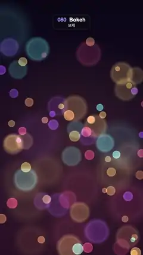

# 080 · Bokeh · 보케



**EN** Soft out-of-focus discs of gold, rose, cyan and violet light drift and overlap while a slow rack focus swaps which layer is sharp.  
**KO** 금빛·분홍·청록·보라 빛망울이 겹치며 떠다니고, 천천히 초점이 옮겨 가며 선명한 층과 흐린 층이 서로 바뀐다.

[Video (mp4)](https://sueun-dev.github.io/motion-effects/videos/080-bokeh.mp4) · [Code](../effects/080-bokeh.js) · Particles · 파티클

## Prompt (English)

```text
Create a "Bokeh" motion effect: out-of-focus light discs drifting over a dark warm background, with a slow rack focus between the near and far layers.

Look
- Background: vertical gradient #0A0716 → #1A0D26 (60 %) → #2A1224, plus a warm glow: radial at (540, 1152), radius 900 px, rgba(255,150,90,0.16) → transparent.
- 84 discs in three layers, placed at x 0–1080, y 300–1920:
  - far: 46 discs, radius 22–52 px, opacity 0.55 × (0.6–1), orbit amplitude 25 px;
  - middle: 26 discs, radius 60–110 px, opacity 0.32 × (0.6–1), amplitude 45 px;
  - near: 12 discs, radius 120–200 px, opacity 0.2 × (0.6–1), amplitude 70 px.
- Hues picked from 42, 30, 345, 180, 265, 50 (gold, orange, rose, cyan, violet, yellow).
- Each disc is a real bokeh shape drawn as one radial gradient: a flat centre hsl(h,90%,62%) at 70 % of its opacity, 80 % at (0.82 − soft), a slightly brighter rim hsl(h,95%,72%) at full opacity at (0.92 − soft), then fading to 0 at the edge; soft = 0.04 + 0.3·blur.

Motion (0–5 s)
- Orbits: x = x0 + ax·sin(f·2πt/5 + p1), y = y0 + ay·cos(2πt/5 + p2), with ax, ay = layer amplitude × (0.5–1.5) and f = 1, or 2 for 30 % of the discs.
- Rack focus: focus = 0.5 − 0.5·cos(2πt/5). Blur of the far layer = focus, of the near layer = 1 − focus, of the middle layer = 0.5. At 0 s the small far discs are crisp and the big near ones very soft; at 2.5 s it is the other way round; back again at 5 s.
- A blurrier disc is bigger (radius × (0.85 + 0.35·blur)), has a softer edge and is dimmer (opacity × (1.15 − 0.4·blur)): the same light spread thinner.

Technique
- Canvas 2D, discs drawn with additive 'lighter' so overlaps brighten. Only large soft gradients, no small or fast detail, so there is no flicker.

Output and rules
- One self-contained HTML file with no external assets (three.js from a CDN is fine if you use it), drawing on a 1080 × 1920 canvas (9:16) scaled to fit the window.
- Write a function renderFrame(t) that draws the frame for time t in seconds, and preview it with requestAnimationFrame. Everything must be a pure function of t and fixed seeds: no Math.random(), Date or state carried between frames, so frame i = renderFrame(i / 30) can be exported to a 30 fps video.
- Loop seamlessly every 5 seconds: renderFrame(5) must look exactly like renderFrame(0).
- No flicker of any kind: no noise or grain that changes from frame to frame, no strobing or blinking, no z-fighting, no shimmering 1 px lines. Any grain or texture stays fixed to the screen or to the object.
- Keep the top 280 px free of important content (a title label goes there) and fill the whole frame with a designed background.
```

## 프롬프트 (한국어)

```text
"보케" 모션 효과를 만들어 줘: 초점이 나간 빛망울이 어둡고 따뜻한 배경 위를 떠다니고, 가까운 층과 먼 층 사이로 초점이 천천히 옮겨 가는 효과.

모양
- 배경: 세로 그라디언트 #0A0716 → #1A0D26(60 %) → #2A1224, 그리고 따뜻한 빛: (540, 1152)에서 반지름 900 px, rgba(255,150,90,0.16) → 투명의 방사형.
- 빛망울 84개, 세 층, 위치는 x 0–1080, y 300–1920:
  - 먼 층: 46개, 반지름 22–52 px, 불투명도 0.55 × (0.6–1), 궤도 진폭 25 px;
  - 가운데 층: 26개, 반지름 60–110 px, 불투명도 0.32 × (0.6–1), 진폭 45 px;
  - 가까운 층: 12개, 반지름 120–200 px, 불투명도 0.2 × (0.6–1), 진폭 70 px.
- 색상은 42, 30, 345, 180, 265, 50(금색, 주황, 장밋빛, 청록, 보라, 노랑) 중에서 고른다.
- 빛망울은 진짜 보케 모양을 방사형 그라디언트 하나로 그린다: 평평한 가운데 hsl(h,90%,62%) 불투명도 70 %, (0.82 − soft) 지점 80 %, (0.92 − soft) 지점에 조금 더 밝은 테두리 hsl(h,95%,72%) 불투명도 100 %, 가장자리에서 0. soft = 0.04 + 0.3·흐림.

움직임 (0–5초)
- 궤도: x = x0 + ax·sin(f·2πt/5 + p1), y = y0 + ay·cos(2πt/5 + p2), ax, ay = 층 진폭 × (0.5–1.5), f = 1(빛망울의 30 %는 2).
- 초점 이동: focus = 0.5 − 0.5·cos(2πt/5). 먼 층의 흐림 = focus, 가까운 층 = 1 − focus, 가운데 층 = 0.5. 0초에는 작고 먼 빛망울이 또렷하고 크고 가까운 것은 아주 흐리다. 2.5초에는 반대, 5초에 다시 처음대로.
- 더 흐린 빛망울일수록 크고(반지름 × (0.85 + 0.35·흐림)) 가장자리가 부드럽고 어둡다(불투명도 × (1.15 − 0.4·흐림)): 같은 빛이 넓게 퍼진 것.

기법
- Canvas 2D, 빛망울은 더하기 'lighter'로 그려 겹친 곳이 밝아진다. 크고 부드러운 그라디언트만 쓰고 작거나 빠른 디테일이 없어서 깜빡임이 없다.

출력과 규칙
- 외부 파일 없는 HTML 파일 하나(three.js를 쓴다면 CDN은 괜찮다). 1080 × 1920(9:16) 캔버스에 그리고 창 크기에 맞춰 보이게 한다.
- 시간 t(초)의 프레임을 그리는 renderFrame(t) 함수를 만들고, 미리보기는 requestAnimationFrame으로 돌린다. 모든 것은 t와 고정 시드만으로 정해진다: Math.random(), Date, 프레임 사이에 쌓이는 상태 금지. 그래야 i번째 프레임 = renderFrame(i / 30)으로 30fps 영상을 뽑을 수 있다.
- 5초마다 끊김 없이 반복: renderFrame(5)는 renderFrame(0)과 똑같아 보여야 한다.
- 어떤 깜빡임도 금지: 프레임마다 바뀌는 노이즈·그레인, 번쩍임·깜빡임, z-fighting, 반짝이며 떨리는 1px 선 모두 금지. 그레인·질감은 화면이나 물체에 고정한다.
- 위쪽 280px에는 중요한 내용을 두지 않고(제목 라벨 자리), 화면 전체를 디자인된 배경으로 채운다.
```
