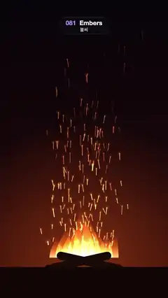

# 081 · Embers · 불씨



**EN** Glowing sparks stream up from a flickering campfire, swaying as they rise and cooling from yellow to red before they fade.  
**KO** 일렁이는 모닥불에서 빛나는 불티가 흔들리며 솟아오르고, 노랑에서 빨강으로 식어 가다 사그라든다.

[Video (mp4)](https://sueun-dev.github.io/motion-effects/videos/081-embers.mp4) · [Code](../effects/081-embers.js) · Particles · 파티클

## Prompt (English)

```text
Create an "Embers" motion effect: sparks rising from a campfire at night, swaying and cooling from yellow to red as they fade.

Look
- Background: vertical gradient #07040A → #1A0809 (60 %) → #3A1108, plus a heat glow: radial at the fire (540, 1660), radius 900 px, rgba(255,110,30, 0.42 + 0.04·sin(7·2πt/5)) → transparent.
- Flames: 9 additive teardrops side by side, flame j (0–8) at x = 540 + (j − 4)·44 on the base line y = 1660, height 380 − 55·|j − 4| px, half-width 70 − 6·|j − 4| px, each built from two cubic Béziers meeting at a pointed tip; vertical gradient rgba(255,230,150,0.75) at the base → rgba(255,130,30,0.45) at 40 % → rgba(200,40,10,0) at the tip.
- Two crossed dark logs: #1B0B07 rounded bars 440 × 52 px (radius 26) centred at (500, 1690) and (580, 1690), rotated −0.22 and +0.22 rad; dark ground #120706 below y 1720.
- 240 sparks: 70 % live 5 s and rise at 200 px/s, 30 % live 2.5 s and rise at 330 px/s (both × 0.7–1.3). Start x = 540 + 220·(u1 + u2 + u3 − 1.5) (bell-shaped around the fire), size factor 0.7–1.3.

Motion (0–5 s)
- Each spark has a birth time b in [0, life); age = (t − b) mod life and k = age/life. Lives of 5 s and 2.5 s both divide the loop, so it is seamless.
- Position: x = x0 + drift·age + sway·sin(f·age + φ)·min(1, age) (drift ±30 px/s, sway 18–58 px, f = 1–2.4 rad/s); y = 1620 − v·age·(1 + 0.1·age), slightly accelerating.
- Opacity = smoothstep(0, 0.08, k) × (1 − smoothstep(0.45, 1, k)) × (0.75 + 0.25·sin(9·age + φ)).
- Colour cools: hue 48 − 40k, lightness 82 % − 34k %, saturation 100 %.
- Flames breathe: height × (0.85 + 0.15·sin((6 + j)·2πt/5 + 1.7j)); the tip sways 30·sin((5 + j mod 3)·2πt/5 + j) px. Integer frequencies, so they loop.

Technique
- Canvas 2D. Order: background and heat glow, flames ('lighter'), logs and ground (normal), sparks ('lighter').
- Each spark is a streak from where it was 0.12 s ago to where it is now, width (4 − 1.6k)·size + 1 px with round caps, plus a soft glow sprite 34·size·(1 − 0.4k) px wide (radial rgba(255,190,90,0.9) → rgba(255,110,30,0.35) at 30 % → transparent) at 70 % of its opacity. Streaks and a smooth sine twinkle keep the sparks from flickering.

Output and rules
- One self-contained HTML file with no external assets (three.js from a CDN is fine if you use it), drawing on a 1080 × 1920 canvas (9:16) scaled to fit the window.
- Write a function renderFrame(t) that draws the frame for time t in seconds, and preview it with requestAnimationFrame. Everything must be a pure function of t and fixed seeds: no Math.random(), Date or state carried between frames, so frame i = renderFrame(i / 30) can be exported to a 30 fps video.
- Loop seamlessly every 5 seconds: renderFrame(5) must look exactly like renderFrame(0).
- No flicker of any kind: no noise or grain that changes from frame to frame, no strobing or blinking, no z-fighting, no shimmering 1 px lines. Any grain or texture stays fixed to the screen or to the object.
- Keep the top 280 px free of important content (a title label goes there) and fill the whole frame with a designed background.
```

## 프롬프트 (한국어)

```text
"불씨" 모션 효과를 만들어 줘: 밤의 모닥불에서 불티가 흔들리며 솟아오르고, 노랑에서 빨강으로 식으며 사그라드는 효과.

모양
- 배경: 세로 그라디언트 #07040A → #1A0809(60 %) → #3A1108, 그리고 열기 빛: 불 위치 (540, 1660)에서 반지름 900 px, rgba(255,110,30, 0.42 + 0.04·sin(7·2πt/5)) → 투명의 방사형.
- 불길: 더하기로 그린 물방울 모양 9개를 나란히. j번째(0–8)는 기준선 y = 1660 위 x = 540 + (j − 4)·44, 높이 380 − 55·|j − 4| px, 반폭 70 − 6·|j − 4| px. 각각 뾰족한 끝에서 만나는 3차 베지어 두 개로 만든다. 세로 그라디언트: 밑동 rgba(255,230,150,0.75) → 40 % rgba(255,130,30,0.45) → 끝 rgba(200,40,10,0).
- 엇갈린 어두운 장작 두 개: #1B0B07 둥근 막대 440 × 52 px(모서리 반지름 26), 중심 (500, 1690)과 (580, 1690), −0.22와 +0.22 rad 회전. y 1720 아래는 어두운 땅 #120706.
- 불티 240개: 70 %는 수명 5초에 200 px/s로, 30 %는 수명 2.5초에 330 px/s로 오른다(둘 다 × 0.7–1.3). 시작 x = 540 + 220·(u1 + u2 + u3 − 1.5)(불 둘레 종 모양 분포), 크기 계수 0.7–1.3.

움직임 (0–5초)
- 불티마다 태어난 시각 b ∈ [0, 수명). 나이 = (t − b) mod 수명, k = 나이/수명. 수명 5초와 2.5초가 모두 루프를 나누므로 끊김이 없다.
- 위치: x = x0 + 표류·나이 + 흔들림·sin(f·나이 + φ)·min(1, 나이)(표류 ±30 px/s, 흔들림 18–58 px, f = 1–2.4 rad/s); y = 1620 − v·나이·(1 + 0.1·나이) — 살짝 빨라진다.
- 불투명도 = smoothstep(0, 0.08, k) × (1 − smoothstep(0.45, 1, k)) × (0.75 + 0.25·sin(9·나이 + φ)).
- 색이 식는다: 색상 48 − 40k, 명도 82 % − 34k %, 채도 100 %.
- 불길이 숨 쉰다: 높이 × (0.85 + 0.15·sin((6 + j)·2πt/5 + 1.7j)), 끝은 30·sin((5 + j mod 3)·2πt/5 + j) px 흔들린다. 정수 주파수라 루프가 맞는다.

기법
- Canvas 2D. 순서: 배경과 열기 빛, 불길('lighter'), 장작과 땅(보통), 불티('lighter').
- 불티마다 0.12초 전 위치에서 지금 위치까지 줄기를 긋는다. 굵기 (4 − 1.6k)·크기 + 1 px, 둥근 끝. 여기에 폭 34·크기·(1 − 0.4k) px의 부드러운 글로 스프라이트(방사형 rgba(255,190,90,0.9) → 30 % rgba(255,110,30,0.35) → 투명)를 불티 불투명도의 70 %로 겹친다. 줄기와 부드러운 사인 반짝임 덕분에 깜빡이지 않는다.

출력과 규칙
- 외부 파일 없는 HTML 파일 하나(three.js를 쓴다면 CDN은 괜찮다). 1080 × 1920(9:16) 캔버스에 그리고 창 크기에 맞춰 보이게 한다.
- 시간 t(초)의 프레임을 그리는 renderFrame(t) 함수를 만들고, 미리보기는 requestAnimationFrame으로 돌린다. 모든 것은 t와 고정 시드만으로 정해진다: Math.random(), Date, 프레임 사이에 쌓이는 상태 금지. 그래야 i번째 프레임 = renderFrame(i / 30)으로 30fps 영상을 뽑을 수 있다.
- 5초마다 끊김 없이 반복: renderFrame(5)는 renderFrame(0)과 똑같아 보여야 한다.
- 어떤 깜빡임도 금지: 프레임마다 바뀌는 노이즈·그레인, 번쩍임·깜빡임, z-fighting, 반짝이며 떨리는 1px 선 모두 금지. 그레인·질감은 화면이나 물체에 고정한다.
- 위쪽 280px에는 중요한 내용을 두지 않고(제목 라벨 자리), 화면 전체를 디자인된 배경으로 채운다.
```
