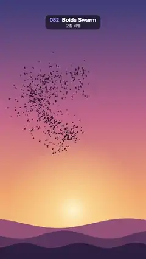

# 082 · Boids Swarm · 군집 비행



**EN** A flock of 650 dark birds sweeps across a sunset sky in a figure-eight, stretching, bunching and banking together.  
**KO** 새 650마리 떼가 노을 하늘을 8자로 휘저으며 늘어났다 뭉쳤다 하고 함께 방향을 튼다.

[Video (mp4)](../videos/082-boids-swarm.mp4) · [Code](../effects/082-boids-swarm.js) · Particles · 파티클

## Prompt (English)

```text
Create a "Boids Swarm" motion effect: a murmuration of birds sweeping across a sunset sky, stretching, bunching and banking together, made without any simulation.

Look
- Sky (draw once): vertical gradient #3B3F7A (top) → #C9708A (45 %) → #F6A86B (75 %) → #FBD38D (bottom), with a sun glow at (540, 1560), radius 520 px: rgba(255,244,210,1) → rgba(255,220,150,0.8) at 25 % → transparent.
- Three rolling hill silhouettes along the bottom: #9A5A78 (base y 1690, amplitude 70), #5E3B5E (1770, 60), #2E2140 (1840, 40); each edge y = base − amp·(0.5 + 0.5·sin(π·f·x/1080 + f)) with f = 2.1, 3.3, 5.2.
- 650 birds, each a small dark chevron filled rgba(30,20,40,0.88), size 9 × (0.7–1.3) px.

Motion (0–5 s)
- A leader flies a vertical figure-eight once per loop: L(s) = (540 + 300·sin(4πs), 1040 + 470·sin(2πs)), s = t/5.
- Every bird follows the same path a little later: s_b = t/5 − lag, lag = 0.28·u^1.3 (most birds near the head, a long thin tail).
- The offset lives in the path's own frame: tangent T = normalised L(s_b + 0.002) − L(s_b), normal N ⟂ T. Position = L(s_b) + T·along + N·side, with side = 190·g·breathe + 10·sin(6πt/5 + φ) and along = 60·g' + 10·cos(4πt/5 + φ), where g, g' are roughly gaussian in −1…1 (sum of three uniforms). breathe = 1 + 0.35·sin(4π·s_b + 3.8·g) makes the flock swell and thin.
- Because the offsets turn with the path, the whole flock banks together at the turns.
- Chevron: nose 0.7·size ahead along the heading (from the bird's position 1/30 s earlier to now), wing tips sideways by size·(0.75 + 0.35w) and swept back by size·(0.2 − 0.5w), tail notch 0.25·size behind; w = sin(n·2πt/5 + φ) with an integer n = 12–16, so the flapping is smooth and loops.

Technique
- Canvas 2D: draw the cached sky, then fill each bird as a 4-point path. Every position is a closed-form function of t; no state between frames.

Output and rules
- One self-contained HTML file with no external assets (three.js from a CDN is fine if you use it), drawing on a 1080 × 1920 canvas (9:16) scaled to fit the window.
- Write a function renderFrame(t) that draws the frame for time t in seconds, and preview it with requestAnimationFrame. Everything must be a pure function of t and fixed seeds: no Math.random(), Date or state carried between frames, so frame i = renderFrame(i / 30) can be exported to a 30 fps video.
- Loop seamlessly every 5 seconds: renderFrame(5) must look exactly like renderFrame(0).
- No flicker of any kind: no noise or grain that changes from frame to frame, no strobing or blinking, no z-fighting, no shimmering 1 px lines. Any grain or texture stays fixed to the screen or to the object.
- Keep the top 280 px free of important content (a title label goes there) and fill the whole frame with a designed background.
```

## 프롬프트 (한국어)

```text
"군집 비행" 모션 효과를 만들어 줘: 새 떼가 노을 하늘을 휩쓸며 늘어났다 뭉쳤다 하고 함께 방향을 트는 효과. 시뮬레이션 없이 만든다.

모양
- 하늘(한 번만 그림): 세로 그라디언트 #3B3F7A(위) → #C9708A(45 %) → #F6A86B(75 %) → #FBD38D(아래), 그리고 (540, 1560)에 반지름 520 px 해 빛: rgba(255,244,210,1) → 25 % rgba(255,220,150,0.8) → 투명.
- 아래쪽에 완만한 언덕 실루엣 세 겹: #9A5A78(기준 y 1690, 진폭 70), #5E3B5E(1770, 60), #2E2140(1840, 40). 윤곽은 y = 기준 − 진폭·(0.5 + 0.5·sin(π·f·x/1080 + f)), f = 2.1, 3.3, 5.2.
- 새 650마리, 각각 rgba(30,20,40,0.88)로 칠한 작은 어두운 V자(셰브런), 크기 9 × (0.7–1.3) px.

움직임 (0–5초)
- 우두머리가 루프마다 한 번 세로 8자를 그린다: L(s) = (540 + 300·sin(4πs), 1040 + 470·sin(2πs)), s = t/5.
- 모든 새가 같은 경로를 조금 늦게 따라간다: s_b = t/5 − 지연, 지연 = 0.28·u^1.3(대부분 머리 가까이, 꼬리는 길고 가늘게).
- 오프셋은 경로 자체의 좌표계에 둔다: 접선 T = 정규화한 L(s_b + 0.002) − L(s_b), 법선 N ⟂ T. 위치 = L(s_b) + T·앞뒤 + N·옆, 옆 = 190·g·숨 + 10·sin(6πt/5 + φ), 앞뒤 = 60·g' + 10·cos(4πt/5 + φ). g, g'는 −1…1의 대략 가우시안(균등 난수 세 개의 합). 숨 = 1 + 0.35·sin(4π·s_b + 3.8·g)으로 떼가 부풀었다 가늘어진다.
- 오프셋이 경로와 함께 돌기 때문에 모퉁이에서 떼 전체가 함께 기울며 방향을 튼다.
- V자 모양: 진행 방향(1/30초 전 위치 → 지금 위치)으로 0.7·크기 앞에 부리, 날개 끝은 옆으로 크기·(0.75 + 0.35w), 뒤로 크기·(0.2 − 0.5w) 젖혀지고, 0.25·크기 뒤에 꼬리 홈. w = sin(n·2πt/5 + φ), n은 12–16의 정수 — 날갯짓이 부드럽고 루프가 맞는다.

기법
- Canvas 2D: 캐시한 하늘을 그리고 새마다 점 4개짜리 경로를 채운다. 모든 위치가 t의 닫힌 식이고 프레임 사이 상태가 없다.

출력과 규칙
- 외부 파일 없는 HTML 파일 하나(three.js를 쓴다면 CDN은 괜찮다). 1080 × 1920(9:16) 캔버스에 그리고 창 크기에 맞춰 보이게 한다.
- 시간 t(초)의 프레임을 그리는 renderFrame(t) 함수를 만들고, 미리보기는 requestAnimationFrame으로 돌린다. 모든 것은 t와 고정 시드만으로 정해진다: Math.random(), Date, 프레임 사이에 쌓이는 상태 금지. 그래야 i번째 프레임 = renderFrame(i / 30)으로 30fps 영상을 뽑을 수 있다.
- 5초마다 끊김 없이 반복: renderFrame(5)는 renderFrame(0)과 똑같아 보여야 한다.
- 어떤 깜빡임도 금지: 프레임마다 바뀌는 노이즈·그레인, 번쩍임·깜빡임, z-fighting, 반짝이며 떨리는 1px 선 모두 금지. 그레인·질감은 화면이나 물체에 고정한다.
- 위쪽 280px에는 중요한 내용을 두지 않고(제목 라벨 자리), 화면 전체를 디자인된 배경으로 채운다.
```
