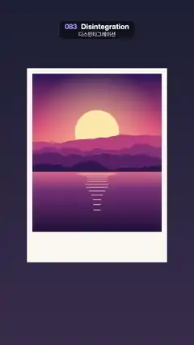

# 083 · Disintegration · 디스인티그레이션



**EN** A polaroid of a sunset lake crumbles from the right into coloured dust that blows away, then rewinds and reassembles.  
**KO** 노을 진 호수 폴라로이드 사진이 오른쪽부터 색색의 먼지로 부서져 바람에 날아갔다가, 되감기듯 다시 모여 원래대로 돌아온다.

[Video (mp4)](https://sueun-dev.github.io/motion-effects/videos/083-disintegration.mp4) · [Code](../effects/083-disintegration.js) · Particles · 파티클

## Prompt (English)

```text
Create a "Disintegration" motion effect: a photo crumbles into dust that blows away on the wind (the "Thanos snap"), then rewinds back into the picture.

Look
- Background: vertical gradient #1C2035 → #3A2F4E.
- A polaroid 780 × 1080 px at (150, 380): an off-white #FBF8F2 card with a 720 × 880 px picture inset 30 px from the top and sides (a wide border at the bottom).
- The picture (draw it once, procedurally): a sunset over layered mountains and a lake. Sky gradient over the top 62 %: #2B1B5A → #E8577A → #FFB36B; a pale sun #FFE6A8 (radius 0.17 × picture width, at x 50 %, y 37 %) with a soft warm glow; four ridge layers shaped by fractal noise, getting darker toward the front: #C2507E, #8E3B78, #5A2A68, #2E1A4A; a lake below 62 %: #E0748A → #7A3B78 → #1E1238, with 14 horizontal bars of sun reflection in rgba(255,226,160,0.7) that narrow downward.
- Cut the whole card into 6 × 6 px cells (130 × 180). Each cell stores its photo colour (sampled at its centre), a start time and a wind velocity.

Motion (0–5 s)
- A global clock c(t) = 2.4·(ramp(t, 1.2, 3.2) − S(ramp(t, 3.3, 4.85))), where ramp(t, a, b) is a clamped linear 0→1 window and S(k) = 0.5 − 0.5·cos(πk). It is still until 1.2 s, runs forward 0 → 2.4 until 3.2 s, then rewinds smoothly to 0 by 4.85 s (while the last dust is still in the air) and stays still to 5 s.
- Cell start = 1.7·clamp(0.8·(1 − column/130) + 0.25·noise(column·0.06, row·0.06) + 0.1·u): the right edge goes first and the left last, with a ragged, noisy front.
- Cell age a = c − start. Once a > 0 the cell is gone from the card. 30 % of the cells fly off as dust grains for 1.7 clock-seconds; the rest simply vanish.
- Grain: x = cellX + vx·a + 45a² + 18·sin(σ + 3a)·a, y = cellY + vy·a − 25a² + 18·cos(σ + 2a)·a, with vx = 95 + 70·noise + 20u px/s (always to the right), vy = −45 + 60·noise + 20u, and σ from noise. The noise is a smooth field over the cell grid, so neighbouring grains drift together like a gust. Size 6·(1 − 0.5·smoothstep(0, 1.7, a)) px, opacity 1 − smoothstep(0, 1.45, a).
- Everything is a function of c, so when the clock runs back the dust flies back into place (the left side returns first).

Technique
- Canvas 2D. Intact part: draw the card, then cut it with a 130 × 180 alpha mask (one pixel per cell, 0 once the cell has started) scaled up with image smoothing off and globalCompositeOperation 'destination-in', so the broken edge stays crisply pixelated; then paint the background behind it with 'destination-over'; then draw the grains as small filled squares in their photo colours.

Output and rules
- One self-contained HTML file with no external assets (three.js from a CDN is fine if you use it), drawing on a 1080 × 1920 canvas (9:16) scaled to fit the window.
- Write a function renderFrame(t) that draws the frame for time t in seconds, and preview it with requestAnimationFrame. Everything must be a pure function of t and fixed seeds: no Math.random(), Date or state carried between frames, so frame i = renderFrame(i / 30) can be exported to a 30 fps video.
- Loop seamlessly every 5 seconds: renderFrame(5) must look exactly like renderFrame(0).
- No flicker of any kind: no noise or grain that changes from frame to frame, no strobing or blinking, no z-fighting, no shimmering 1 px lines. Any grain or texture stays fixed to the screen or to the object.
- Keep the top 280 px free of important content (a title label goes there) and fill the whole frame with a designed background.
```

## 프롬프트 (한국어)

```text
"디스인티그레이션" 모션 효과를 만들어 줘: 사진이 먼지로 부서져 바람에 날아가고("타노스 핑거 스냅"), 다시 되감겨 사진으로 돌아오는 효과.

모양
- 배경: 세로 그라디언트 #1C2035 → #3A2F4E.
- (150, 380)에 780 × 1080 px 폴라로이드: 미색 #FBF8F2 카드, 위·양옆에서 30 px 안쪽에 720 × 880 px 사진(아래 여백이 넓다).
- 사진(코드로 한 번만 그림): 겹친 산과 호수 위의 노을. 위쪽 62 %의 하늘 그라디언트 #2B1B5A → #E8577A → #FFB36B; 옅은 해 #FFE6A8(반지름 = 사진 폭 × 0.17, x 50 %, y 37 %)와 부드럽고 따뜻한 빛; 프랙털 노이즈로 모양을 낸 산등성이 네 겹, 앞쪽일수록 어둡게: #C2507E, #8E3B78, #5A2A68, #2E1A4A; 62 % 아래 호수 #E0748A → #7A3B78 → #1E1238, 그 위에 아래로 갈수록 좁아지는 해 그림자 가로 막대 14개 rgba(255,226,160,0.7).
- 카드 전체를 6 × 6 px 칸(130 × 180)으로 자른다. 칸마다 사진 색(칸 중심에서 샘플), 시작 시각, 바람 속도를 저장한다.

움직임 (0–5초)
- 전체 시계 c(t) = 2.4·(ramp(t, 1.2, 3.2) − S(ramp(t, 3.3, 4.85))). ramp(t, a, b)는 0→1로 잘린 선형 구간, S(k) = 0.5 − 0.5·cos(πk). 1.2초까지 정지, 3.2초까지 0 → 2.4로 앞으로 가고, 마지막 먼지가 아직 날리는 동안 4.85초까지 부드럽게 0으로 되감은 뒤 5초까지 정지.
- 칸 시작 시각 = 1.7·clamp(0.8·(1 − 열/130) + 0.25·noise(열·0.06, 행·0.06) + 0.1·u): 오른쪽 끝이 먼저, 왼쪽이 마지막이고 경계는 노이즈로 들쭉날쭉하다.
- 칸 나이 a = c − 시작. a > 0이 되면 카드에서 그 칸이 사라진다. 칸의 30 %는 시계 1.7초 동안 먼지 알갱이로 날아가고, 나머지는 그냥 사라진다.
- 알갱이: x = 칸X + vx·a + 45a² + 18·sin(σ + 3a)·a, y = 칸Y + vy·a − 25a² + 18·cos(σ + 2a)·a. vx = 95 + 70·noise + 20u px/s(언제나 오른쪽), vy = −45 + 60·noise + 20u, σ도 노이즈에서. 노이즈는 칸 격자 위의 부드러운 장이라 이웃 알갱이가 돌풍처럼 함께 흘러간다. 크기 6·(1 − 0.5·smoothstep(0, 1.7, a)) px, 불투명도 1 − smoothstep(0, 1.45, a).
- 모든 것이 c의 함수라 시계가 거꾸로 가면 먼지가 제자리로 날아 돌아온다(왼쪽부터 먼저 돌아온다).

기법
- Canvas 2D. 남은 부분: 카드를 그린 뒤 130 × 180 알파 마스크(칸당 한 픽셀, 시작된 칸은 0)를 이미지 스무딩 없이 확대해 globalCompositeOperation 'destination-in'으로 잘라 낸다. 그래서 부서진 경계가 또렷한 픽셀 모양으로 남는다. 그다음 'destination-over'로 배경을 뒤에 칠하고, 마지막에 알갱이를 사진 색의 작은 정사각형으로 그린다.

출력과 규칙
- 외부 파일 없는 HTML 파일 하나(three.js를 쓴다면 CDN은 괜찮다). 1080 × 1920(9:16) 캔버스에 그리고 창 크기에 맞춰 보이게 한다.
- 시간 t(초)의 프레임을 그리는 renderFrame(t) 함수를 만들고, 미리보기는 requestAnimationFrame으로 돌린다. 모든 것은 t와 고정 시드만으로 정해진다: Math.random(), Date, 프레임 사이에 쌓이는 상태 금지. 그래야 i번째 프레임 = renderFrame(i / 30)으로 30fps 영상을 뽑을 수 있다.
- 5초마다 끊김 없이 반복: renderFrame(5)는 renderFrame(0)과 똑같아 보여야 한다.
- 어떤 깜빡임도 금지: 프레임마다 바뀌는 노이즈·그레인, 번쩍임·깜빡임, z-fighting, 반짝이며 떨리는 1px 선 모두 금지. 그레인·질감은 화면이나 물체에 고정한다.
- 위쪽 280px에는 중요한 내용을 두지 않고(제목 라벨 자리), 화면 전체를 디자인된 배경으로 채운다.
```
