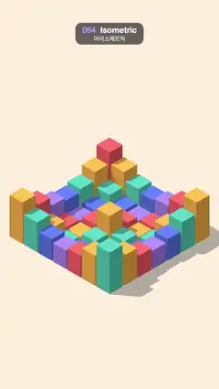

# 084 · Isometric · 아이소메트릭



★ One of the 20 effects in the original reel (#5) · 원래 릴스 20개 중 하나(5번)

**EN** A 7 × 7 grid of coloured blocks in true isometric view rises and falls in a ripple spreading out from the centre.  
**KO** 등각 투영으로 본 7 × 7 색 블록 격자가 가운데에서 퍼져 나가는 파문처럼 솟았다 꺼진다.

[Video (mp4)](../videos/084-isometric.mp4) · [Code](../effects/084-isometric.js) · 3D · 3D

## Prompt (English)

```text
Create an "Isometric" motion effect: a 7 × 7 grid of coloured blocks seen in true isometric projection, rising and falling in a ripple that spreads out from the centre.

Look
- three.js with an OrthographicCamera: half-height 9.5 world units (half-width 9.5 × 1080/1920), placed at (20, 22.5, 20) and looking at (0, 2.5, 0). The view direction is (1, 1, 1), the classic 35.264° isometric angle, so all three visible faces of a box show.
- Floor: a large 60 × 60 plane, MeshStandardMaterial #EDE5D8, at y = −0.02. It fills the whole frame and reads as a warm cream (about #FBEEDA on screen once lit). Scene background #F3EEE6.
- Blocks: 7 × 7 boxes with a 0.9 × 0.9 footprint on a 1-unit grid centred on the origin, the pivot at the bottom (shift the geometry up by 0.5 so they grow from the floor). Colour by diagonal, (i + j) mod 5: coral #FF6B6B, amber #FFB84C, teal #4ECDC4, blue #5B7CFA, lavender #A78BFA. MeshStandardMaterial, roughness 0.55.
- Lights: HemisphereLight #FFFFFF / #B9A88F, intensity 1.6; DirectionalLight #FFF6E8, intensity 2.4, from (−8, 16, 6), casting soft shadows (PCFSoftShadowMap, 2048 × 2048 map, shadow camera ±12). Blocks cast and receive shadows, the floor receives them, so long soft shadows fall to the lower right of the grid.

Motion (0–5 s)
- Block height = 0.35 + 2.6·(0.5 + 0.5·sin(2πt/5 − 0.9·d)), where d is the block's distance from the grid centre in grid units: a ripple travelling outward, one cycle per 5 s. Heights run from 0.35 to 2.95.
- The camera and lights stay still; only the heights change.

Technique
- One shared BoxGeometry, a material per block; animate mesh.scale.y only.
- The floor sits 0.02 below the block bottoms so no two faces share a plane (no z-fighting).

Output and rules
- One self-contained HTML file with no external assets (three.js from a CDN is fine if you use it), drawing on a 1080 × 1920 canvas (9:16) scaled to fit the window.
- Write a function renderFrame(t) that draws the frame for time t in seconds, and preview it with requestAnimationFrame. Everything must be a pure function of t and fixed seeds: no Math.random(), Date or state carried between frames, so frame i = renderFrame(i / 30) can be exported to a 30 fps video.
- Loop seamlessly every 5 seconds: renderFrame(5) must look exactly like renderFrame(0).
- No flicker of any kind: no noise or grain that changes from frame to frame, no strobing or blinking, no z-fighting, no shimmering 1 px lines. Any grain or texture stays fixed to the screen or to the object.
- Keep the top 280 px free of important content (a title label goes there) and fill the whole frame with a designed background.
```

## 프롬프트 (한국어)

```text
"아이소메트릭" 모션 효과를 만들어 줘: 진짜 등각 투영으로 본 7 × 7 색 블록 격자가 가운데에서 퍼져 나가는 파문처럼 솟았다 꺼지는 효과.

모양
- three.js와 OrthographicCamera: 반높이 9.5 월드 단위(반폭 9.5 × 1080/1920), (20, 22.5, 20)에 두고 (0, 2.5, 0)을 본다. 보는 방향이 (1, 1, 1)인 고전적인 35.264° 등각 각도라서 상자의 보이는 세 면이 모두 나온다.
- 바닥: 60 × 60의 큰 평면, MeshStandardMaterial #EDE5D8, y = −0.02. 화면 전체를 채우고 조명을 받으면 따뜻한 크림색(화면에서 약 #FBEEDA)으로 보인다. 장면 배경색 #F3EEE6.
- 블록: 원점 중심의 1단위 격자 위에 바닥 0.9 × 0.9인 상자 7 × 7개. 기준점은 바닥(지오메트리를 0.5 올려서 바닥에서부터 자라게). 색은 대각선 순서 (i + j) mod 5: 산호 #FF6B6B, 호박색 #FFB84C, 청록 #4ECDC4, 파랑 #5B7CFA, 라벤더 #A78BFA. MeshStandardMaterial, roughness 0.55.
- 조명: HemisphereLight #FFFFFF / #B9A88F 세기 1.6; DirectionalLight #FFF6E8 세기 2.4, (−8, 16, 6)에서, 부드러운 그림자(PCFSoftShadowMap, 2048 × 2048 맵, 그림자 카메라 ±12). 블록은 그림자를 드리우고 받으며, 바닥은 받는다. 그래서 격자 오른쪽 아래로 길고 부드러운 그림자가 진다.

움직임 (0–5초)
- 블록 높이 = 0.35 + 2.6·(0.5 + 0.5·sin(2πt/5 − 0.9·d)), d = 격자 중심에서 블록까지 거리(격자 단위). 바깥으로 퍼지는 파문이 5초에 한 번 돈다. 높이는 0.35에서 2.95까지.
- 카메라와 조명은 그대로, 높이만 바뀐다.

기법
- BoxGeometry 하나를 함께 쓰고 블록마다 재질 하나. mesh.scale.y만 움직인다.
- 바닥을 블록 밑면보다 0.02 낮게 두어 두 면이 같은 평면에 겹치지 않게 한다(z-fighting 없음).

출력과 규칙
- 외부 파일 없는 HTML 파일 하나(three.js를 쓴다면 CDN은 괜찮다). 1080 × 1920(9:16) 캔버스에 그리고 창 크기에 맞춰 보이게 한다.
- 시간 t(초)의 프레임을 그리는 renderFrame(t) 함수를 만들고, 미리보기는 requestAnimationFrame으로 돌린다. 모든 것은 t와 고정 시드만으로 정해진다: Math.random(), Date, 프레임 사이에 쌓이는 상태 금지. 그래야 i번째 프레임 = renderFrame(i / 30)으로 30fps 영상을 뽑을 수 있다.
- 5초마다 끊김 없이 반복: renderFrame(5)는 renderFrame(0)과 똑같아 보여야 한다.
- 어떤 깜빡임도 금지: 프레임마다 바뀌는 노이즈·그레인, 번쩍임·깜빡임, z-fighting, 반짝이며 떨리는 1px 선 모두 금지. 그레인·질감은 화면이나 물체에 고정한다.
- 위쪽 280px에는 중요한 내용을 두지 않고(제목 라벨 자리), 화면 전체를 디자인된 배경으로 채운다.
```
