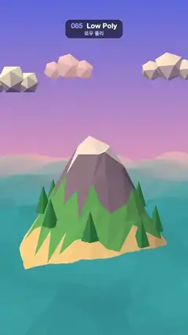

# 085 · Low Poly · 로우 폴리



★ One of the 20 effects in the original reel (#17) · 원래 릴스 20개 중 하나(17번)

**EN** A faceted island with a snowy peak and pine trees sits in a rippling faceted sea under a pastel sky with polygon clouds.  
**KO** 눈 덮인 봉우리와 소나무가 있는 각진 섬이 일렁이는 각진 바다 위에 있고, 파스텔 하늘에 다면체 구름이 떠다닌다.

[Video (mp4)](https://sueun-dev.github.io/motion-effects/videos/085-low-poly.mp4) · [Code](../effects/085-low-poly.js) · 3D · 3D

## Prompt (English)

```text
Create a "Low Poly" motion effect: a faceted island with a snowy peak in a faceted sea whose facets shimmer in the light, under a pastel sky with polygon clouds.

Look
- three.js. Background: vertical gradient #5B6EE1 (top) → #F2A6B8 (55 %) → #FFD9A8 (bottom). Fog #F6B9B5 from 22 to 48 units, so the far sea and the far cloud turn pink.
- Camera: perspective, FOV 42°, at height 6.5 on a circle of radius 19 around the island, looking at (0, 3, 0).
- Lights: HemisphereLight #FFF1E0 / #6A5A9A, intensity 1.4; DirectionalLight #FFE2B8, intensity 2.6, from (−6, 9, 5).
- Faceted grids: a subdivided plane whose interior vertices are jittered by up to ±35 % of a cell in x and z, then split into separate triangles (non-indexed) and flat shaded: one normal per face, so every facet catches the light on its own. Heights depend only on (x, z), so shared corners stay joined.
- Island: 11 × 11 units, 18 × 18 cells. Height h = max(−1.6, 5.4·e^(−q/6) − 0.9 − 0.04q + 0.8·fbm(0.4x, 0.4z)·e^(−(x² + z²)/20)), q = x² + 1.2z². Each face gets one fixed colour from its mean height: above 3.4 snow #F4F1FA, above 2.0 rock #8A7F9E, above 0.25 grass #5FAE6E, else sand #F0D79A. Roughness 0.9.
- 9 pine trees: 5-sided cones (radius 0.38, height 1.2), #2F8A5B, flat shaded, spaced around the slopes at radius 2.2–3.1 and standing on the ground.
- Sea: 48 × 48 units, 48 × 48 cells, jittered the same way, #2E9CC4, roughness 0.3, flat shaded.
- Three clouds, each three white flat-shaded icosahedra (detail 0, radii 1, 0.75 and 0.7 × scale, side by side, roughness 1), at (−4.4, 6.9, −5) scale 0.8, (4.3, 7.6, −10) scale 1.0 and (−1.8, 8.0, −20) scale 1.2.

Motion (0–5 s), a = 2πt/5
- Sea vertices: y = −0.25 + 0.3·sin(0.9x + 0.5z − 2a) + 0.22·sin(0.8z − 0.6x + a + 1.3) + 0.12·sin(1.4(x + z) − 3a). Recompute the normals every frame so the facets change shade smoothly.
- The camera sways around the island: yaw = 0.28·sin a, position (19·sin yaw, 6.5, 19·cos yaw).
- Clouds bob: x + 0.6·sin(a + 2i), y + 0.25·sin(2a + i) for cloud i.

Technique
- Build the faceted meshes once; only the sea's y values, the camera and the clouds change. All frequencies are whole multiples of the loop, so it loops seamlessly.

Output and rules
- One self-contained HTML file with no external assets (three.js from a CDN is fine if you use it), drawing on a 1080 × 1920 canvas (9:16) scaled to fit the window.
- Write a function renderFrame(t) that draws the frame for time t in seconds, and preview it with requestAnimationFrame. Everything must be a pure function of t and fixed seeds: no Math.random(), Date or state carried between frames, so frame i = renderFrame(i / 30) can be exported to a 30 fps video.
- Loop seamlessly every 5 seconds: renderFrame(5) must look exactly like renderFrame(0).
- No flicker of any kind: no noise or grain that changes from frame to frame, no strobing or blinking, no z-fighting, no shimmering 1 px lines. Any grain or texture stays fixed to the screen or to the object.
- Keep the top 280 px free of important content (a title label goes there) and fill the whole frame with a designed background.
```

## 프롬프트 (한국어)

```text
"로우 폴리" 모션 효과를 만들어 줘: 눈 덮인 봉우리가 있는 각진 섬과, 면마다 빛을 받아 일렁이는 각진 바다, 그리고 파스텔 하늘의 다면체 구름.

모양
- three.js. 배경: 세로 그라디언트 #5B6EE1(위) → #F2A6B8(55 %) → #FFD9A8(아래). 안개 #F6B9B5, 22에서 48 단위까지 — 먼 바다와 먼 구름이 분홍빛이 된다.
- 카메라: 원근, FOV 42°, 섬 둘레 반지름 19 원 위 높이 6.5에서 (0, 3, 0)을 본다.
- 조명: HemisphereLight #FFF1E0 / #6A5A9A 세기 1.4; DirectionalLight #FFE2B8 세기 2.6, (−6, 9, 5)에서.
- 각진 격자: 잘게 나눈 평면의 안쪽 정점을 x, z로 칸의 최대 ±35 %만큼 흔든 뒤, 삼각형을 서로 떼어(non-indexed) 플랫 셰이딩한다. 면마다 법선이 하나라 면 하나하나가 따로 빛을 받는다. 높이는 (x, z)로만 정하므로 맞닿은 꼭짓점은 붙어 있다.
- 섬: 11 × 11 단위, 18 × 18 칸. 높이 h = max(−1.6, 5.4·e^(−q/6) − 0.9 − 0.04q + 0.8·fbm(0.4x, 0.4z)·e^(−(x² + z²)/20)), q = x² + 1.2z². 면마다 평균 높이로 고정 색 하나: 3.4 초과 눈 #F4F1FA, 2.0 초과 바위 #8A7F9E, 0.25 초과 풀 #5FAE6E, 그 아래 모래 #F0D79A. roughness 0.9.
- 소나무 9그루: 5각 원뿔(반지름 0.38, 높이 1.2), #2F8A5B, 플랫 셰이딩, 비탈 둘레 반지름 2.2–3.1에 간격을 두고 땅 위에 세운다.
- 바다: 48 × 48 단위, 48 × 48 칸, 같은 방식으로 흔들기, #2E9CC4, roughness 0.3, 플랫 셰이딩.
- 구름 세 덩이, 각각 흰 플랫 셰이딩 정이십면체 세 개(세분 0, 반지름 1, 0.75, 0.7 × 크기, 나란히, roughness 1): (−4.4, 6.9, −5) 크기 0.8, (4.3, 7.6, −10) 크기 1.0, (−1.8, 8.0, −20) 크기 1.2.

움직임 (0–5초), a = 2πt/5
- 바다 정점: y = −0.25 + 0.3·sin(0.9x + 0.5z − 2a) + 0.22·sin(0.8z − 0.6x + a + 1.3) + 0.12·sin(1.4(x + z) − 3a). 매 프레임 법선을 다시 계산해 면의 명암이 부드럽게 바뀌게 한다.
- 카메라가 섬 둘레로 흔들린다: yaw = 0.28·sin a, 위치 (19·sin yaw, 6.5, 19·cos yaw).
- 구름 i는 둥실거린다: x + 0.6·sin(a + 2i), y + 0.25·sin(2a + i).

기법
- 각진 메시는 한 번만 만들고, 바다의 y 값·카메라·구름만 바뀐다. 모든 주파수가 루프의 정수 배라 끊김 없이 반복된다.

출력과 규칙
- 외부 파일 없는 HTML 파일 하나(three.js를 쓴다면 CDN은 괜찮다). 1080 × 1920(9:16) 캔버스에 그리고 창 크기에 맞춰 보이게 한다.
- 시간 t(초)의 프레임을 그리는 renderFrame(t) 함수를 만들고, 미리보기는 requestAnimationFrame으로 돌린다. 모든 것은 t와 고정 시드만으로 정해진다: Math.random(), Date, 프레임 사이에 쌓이는 상태 금지. 그래야 i번째 프레임 = renderFrame(i / 30)으로 30fps 영상을 뽑을 수 있다.
- 5초마다 끊김 없이 반복: renderFrame(5)는 renderFrame(0)과 똑같아 보여야 한다.
- 어떤 깜빡임도 금지: 프레임마다 바뀌는 노이즈·그레인, 번쩍임·깜빡임, z-fighting, 반짝이며 떨리는 1px 선 모두 금지. 그레인·질감은 화면이나 물체에 고정한다.
- 위쪽 280px에는 중요한 내용을 두지 않고(제목 라벨 자리), 화면 전체를 디자인된 배경으로 채운다.
```
