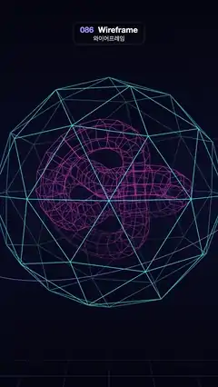

# 086 · Wireframe · 와이어프레임



**EN** A glowing cyan geodesic shell turns around a magenta wireframe torus knot and a rocking orbit ring, above a grid fading into fog.  
**KO** 빛나는 청록 측지 구 껍질이 자홍 와이어프레임 토러스 매듭과 흔들리는 궤도 고리를 감싸고 돌며, 아래 격자는 안개 속으로 사라진다.

[Video (mp4)](../videos/086-wireframe.mp4) · [Code](../effects/086-wireframe.js) · 3D · 3D

## Prompt (English)

```text
Create a "Wireframe" motion effect: glowing wireframe 3D shapes, edges only, turning slowly, with the lines fading by depth into a dark fog.

Look
- three.js. Background: vertical gradient #04050F → #0B0E26 (middle) → #04050F. Fog #0A0C22 from 9 to 15.5 units, so the far lines melt into the background.
- Camera: FOV 40°, at (0, 0.6, 12) looking at the origin.
- Every line is an anti-aliased screen-space fat line (three.js LineSegments2 + LineSegmentsGeometry + LineMaterial, linewidth in pixels, fog enabled, resolution 1080 × 1920), never 1 px GL lines.
- Outer shell: an icosahedron of radius 2.6 subdivided once (80 triangles), edges only, cyan #46E3FF, 3 px. Rotate it so that one vertex (a 5-fold axis) points straight up.
- Inside: a (2,3) torus knot (radius 1.05, tube 0.32, 60 segments along, 7 around) drawn as a quad mesh, the rings and the lengthwise lines only, no diagonals; magenta #FF5CD6, 2.2 px.
- An orbit ring: a circle of radius 3.4 (120 segments), lavender #9D8CFF, 2.2 px.
- A floor grid: lines every 1 unit from −10 to 10 in both directions at y = −4.2, #3B3F9E, 2 px, vanishing into the fog.

Motion (0–5 s), a = 2πt/5
- The shell spins about its vertical 5-fold axis by a/5, a fifth of a turn per loop, which maps the shell onto itself: the loop is seamless and the spin stays calm.
- Knot: inside a tilt group with rotation (0.75 + 0.1·sin a, 0.15·sin a, 0); the knot itself spins about its own 3-fold axis (its local z) by −a/3. Its 60 segments divide by 3, so the mesh lands exactly on itself.
- The ring rocks gently: rotation (0.35 + 0.12·sin a, 0, 0.25·cos a).
- The grid stays still.

Technique
- Build the segment lists (pairs of points) and pass them to LineSegmentsGeometry.setPositions; the shell's list comes from EdgesGeometry of the icosahedron.
- Thick lines and slow symmetric spins keep the edges from shimmering.

Output and rules
- One self-contained HTML file with no external assets (three.js from a CDN is fine if you use it), drawing on a 1080 × 1920 canvas (9:16) scaled to fit the window.
- Write a function renderFrame(t) that draws the frame for time t in seconds, and preview it with requestAnimationFrame. Everything must be a pure function of t and fixed seeds: no Math.random(), Date or state carried between frames, so frame i = renderFrame(i / 30) can be exported to a 30 fps video.
- Loop seamlessly every 5 seconds: renderFrame(5) must look exactly like renderFrame(0).
- No flicker of any kind: no noise or grain that changes from frame to frame, no strobing or blinking, no z-fighting, no shimmering 1 px lines. Any grain or texture stays fixed to the screen or to the object.
- Keep the top 280 px free of important content (a title label goes there) and fill the whole frame with a designed background.
```

## 프롬프트 (한국어)

```text
"와이어프레임" 모션 효과를 만들어 줘: 모서리 선만 남은 빛나는 3D 도형들이 천천히 돌고, 선이 깊이에 따라 어두운 안개 속으로 흐려지는 효과.

모양
- three.js. 배경: 세로 그라디언트 #04050F → #0B0E26(가운데) → #04050F. 안개 #0A0C22, 9에서 15.5 단위까지 — 먼 선이 배경에 녹아든다.
- 카메라: FOV 40°, (0, 0.6, 12)에서 원점을 본다.
- 모든 선은 안티에일리어싱된 화면 공간 굵은 선(three.js LineSegments2 + LineSegmentsGeometry + LineMaterial, 굵기는 픽셀 단위, fog 켬, resolution 1080 × 1920). 1 px GL 선은 쓰지 않는다.
- 바깥 껍질: 반지름 2.6 정이십면체를 한 번 세분(삼각형 80개), 모서리만, 청록 #46E3FF, 3 px. 꼭짓점 하나(5겹 대칭축)가 똑바로 위를 향하게 돌려 둔다.
- 안쪽: (2,3) 토러스 매듭(반지름 1.05, 관 0.32, 길이 방향 60칸, 둘레 7칸)을 사각 격자로 그린다 — 고리 선과 길이 방향 선만, 대각선 없음. 자홍 #FF5CD6, 2.2 px.
- 궤도 고리: 반지름 3.4 원(120칸), 라벤더 #9D8CFF, 2.2 px.
- 바닥 격자: y = −4.2에서 −10부터 10까지 1단위 간격으로 양방향 선, #3B3F9E, 2 px, 안개 속으로 사라진다.

움직임 (0–5초), a = 2πt/5
- 껍질은 세로 5겹 대칭축으로 a/5 돈다. 루프마다 5분의 1바퀴라 껍질이 자기 자신과 겹쳐져 끊김 없고 회전도 차분하다.
- 매듭: 회전 (0.75 + 0.1·sin a, 0.15·sin a, 0)인 기울임 그룹 안에 두고, 매듭 자체는 자기 3겹 대칭축(로컬 z)으로 −a/3 돈다. 60칸이 3으로 나뉘므로 메시가 정확히 자기 자신에 겹친다.
- 고리는 부드럽게 흔들린다: 회전 (0.35 + 0.12·sin a, 0, 0.25·cos a).
- 격자는 움직이지 않는다.

기법
- 선분 목록(점 두 개씩)을 만들어 LineSegmentsGeometry.setPositions에 넘긴다. 껍질의 목록은 정이십면체의 EdgesGeometry에서 얻는다.
- 굵은 선과 대칭을 이용한 느린 회전 덕분에 모서리가 떨리지 않는다.

출력과 규칙
- 외부 파일 없는 HTML 파일 하나(three.js를 쓴다면 CDN은 괜찮다). 1080 × 1920(9:16) 캔버스에 그리고 창 크기에 맞춰 보이게 한다.
- 시간 t(초)의 프레임을 그리는 renderFrame(t) 함수를 만들고, 미리보기는 requestAnimationFrame으로 돌린다. 모든 것은 t와 고정 시드만으로 정해진다: Math.random(), Date, 프레임 사이에 쌓이는 상태 금지. 그래야 i번째 프레임 = renderFrame(i / 30)으로 30fps 영상을 뽑을 수 있다.
- 5초마다 끊김 없이 반복: renderFrame(5)는 renderFrame(0)과 똑같아 보여야 한다.
- 어떤 깜빡임도 금지: 프레임마다 바뀌는 노이즈·그레인, 번쩍임·깜빡임, z-fighting, 반짝이며 떨리는 1px 선 모두 금지. 그레인·질감은 화면이나 물체에 고정한다.
- 위쪽 280px에는 중요한 내용을 두지 않고(제목 라벨 자리), 화면 전체를 디자인된 배경으로 채운다.
```
