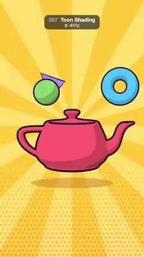

# 087 · Toon Shading · 툰 셰이딩



**EN** A red cartoon teapot with hard light bands and ink outlines spins and bobs, three toy shapes orbiting above it, on a comic sunburst.  
**KO** 딱 끊어지는 명암과 잉크 외곽선의 빨간 만화풍 주전자가 돌며 둥실거리고, 그 위로 장난감 도형 셋이 만화 햇살 배경 앞에서 돈다.

[Video (mp4)](https://sueun-dev.github.io/motion-effects/videos/087-toon-shading.mp4) · [Code](../effects/087-toon-shading.js) · 3D · 3D

## Prompt (English)

```text
Create a "Toon Shading" motion effect: a cel-shaded cartoon teapot with hard light bands and thick ink outlines, spinning in front of a comic-book sunburst.

Look
- Backdrop (a fixed texture stretched over the screen): yellow #FFD54A with 24 alternating ray wedges (#FFC93A / #FFDF6E) fanning out from (540, 940); halftone dots rgba(232,90,60,0.32) on a 32 px staggered grid that begin at 45 % of the height and grow to about 10 px radius at the bottom.
- three.js camera: FOV 34°, at (0, 1.8, 14) looking at (0, 0.35, 0). AmbientLight white 0.5; DirectionalLight white 2.6 from (−4, 6, 5).
- Teapot: the classic Utah teapot (three.js TeapotGeometry, size 0.95), #FF5C6C, MeshToonMaterial with a 3-texel gradient map [70, 150, 255] using nearest filtering, so the light falls in three hard bands.
- Ink outline by the inverted-hull trick: a copy of the geometry with merged vertices and recomputed smooth normals, rendered back faces only, every vertex pushed out along its normal by 0.055 (0.04 for the small shapes), flat colour #1C1229. The smooth normals keep the outline shell free of cracks.
- Three small toon shapes with the same outline: a torus (radius 0.42, tube 0.18) #4FC3F7, a sphere 0.38 #8BD46E and a cone (radius 0.36, height 0.8) #B48CFF.
- A flat contact shadow under the teapot: a circle of radius 1.4 squashed to 0.55 in depth, #C9791E at 45 % opacity, at y = −1.5.

Motion (0–5 s), a = 2πt/5
- Teapot: one full turn about y per loop with a little wobble, rotation (0.12·sin a, a, 0.08·sin 2a), bobbing y = 0.18·sin 2a; the shadow shrinks as it rises (scale × (1 − 0.4·bob)).
- Orbiters: angle q = a + i·2π/3, position (1.6·cos q, 1.75 + 0.2·sin 2q, 1.0·sin q), a little halo above the lid; they tumble with rotation (a·(i + 1), 2a, 0.4i).

Technique
- The nearest-filtered gradient map gives hard bands that never flicker, and the backdrop is a static texture, so the halftone never crawls.

Output and rules
- One self-contained HTML file with no external assets (three.js from a CDN is fine if you use it), drawing on a 1080 × 1920 canvas (9:16) scaled to fit the window.
- Write a function renderFrame(t) that draws the frame for time t in seconds, and preview it with requestAnimationFrame. Everything must be a pure function of t and fixed seeds: no Math.random(), Date or state carried between frames, so frame i = renderFrame(i / 30) can be exported to a 30 fps video.
- Loop seamlessly every 5 seconds: renderFrame(5) must look exactly like renderFrame(0).
- No flicker of any kind: no noise or grain that changes from frame to frame, no strobing or blinking, no z-fighting, no shimmering 1 px lines. Any grain or texture stays fixed to the screen or to the object.
- Keep the top 280 px free of important content (a title label goes there) and fill the whole frame with a designed background.
```

## 프롬프트 (한국어)

```text
"툰 셰이딩" 모션 효과를 만들어 줘: 딱 끊어지는 명암 띠와 굵은 잉크 외곽선을 가진 만화풍 주전자가 만화책 같은 햇살 배경 앞에서 도는 효과.

모양
- 배경(화면에 늘려 붙인 고정 텍스처): 노랑 #FFD54A 바탕에 (540, 940)에서 퍼지는 쐐기 모양 빛살 24개(#FFC93A / #FFDF6E 번갈아). 망점 rgba(232,90,60,0.32)을 32 px 엇갈린 격자에 찍는데, 높이 45 %부터 시작해 아래로 갈수록 커져 바닥에서 반지름 약 10 px.
- three.js 카메라: FOV 34°, (0, 1.8, 14)에서 (0, 0.35, 0)을 본다. AmbientLight 흰색 0.5; DirectionalLight 흰색 2.6, (−4, 6, 5)에서.
- 주전자: 고전적인 유타 주전자(three.js TeapotGeometry, 크기 0.95), #FF5C6C, MeshToonMaterial에 nearest 필터의 3텍셀 그라디언트 맵 [70, 150, 255]. 그래서 빛이 딱 끊어지는 세 단계로 떨어진다.
- 잉크 외곽선은 뒤집은 껍질 기법: 정점을 합치고 부드러운 법선을 다시 계산한 지오메트리 복사본을 뒷면만 그리고, 정점마다 법선 방향으로 0.055(작은 도형은 0.04) 밀어낸다. 단색 #1C1229. 부드러운 법선 덕분에 외곽선 껍질이 갈라지지 않는다.
- 같은 외곽선을 가진 작은 툰 도형 셋: 토러스(반지름 0.42, 관 0.18) #4FC3F7, 구 0.38 #8BD46E, 원뿔(반지름 0.36, 높이 0.8) #B48CFF.
- 주전자 아래 납작한 바닥 그림자: 반지름 1.4 원을 깊이 방향으로 0.55로 눌러 #C9791E 불투명도 45 %, y = −1.5.

움직임 (0–5초), a = 2πt/5
- 주전자: 루프마다 y축으로 한 바퀴, 살짝 흔들리며 회전 (0.12·sin a, a, 0.08·sin 2a), 위아래로 y = 0.18·sin 2a. 떠오를수록 그림자가 작아진다(크기 × (1 − 0.4·bob)).
- 도는 도형: 각 q = a + i·2π/3, 위치 (1.6·cos q, 1.75 + 0.2·sin 2q, 1.0·sin q) — 뚜껑 위의 작은 후광. 회전 (a·(i + 1), 2a, 0.4i)로 굴러간다.

기법
- nearest 필터 그라디언트 맵이 깜빡임 없는 딱딱한 명암 띠를 만들고, 배경은 고정 텍스처라 망점이 꿈틀거리지 않는다.

출력과 규칙
- 외부 파일 없는 HTML 파일 하나(three.js를 쓴다면 CDN은 괜찮다). 1080 × 1920(9:16) 캔버스에 그리고 창 크기에 맞춰 보이게 한다.
- 시간 t(초)의 프레임을 그리는 renderFrame(t) 함수를 만들고, 미리보기는 requestAnimationFrame으로 돌린다. 모든 것은 t와 고정 시드만으로 정해진다: Math.random(), Date, 프레임 사이에 쌓이는 상태 금지. 그래야 i번째 프레임 = renderFrame(i / 30)으로 30fps 영상을 뽑을 수 있다.
- 5초마다 끊김 없이 반복: renderFrame(5)는 renderFrame(0)과 똑같아 보여야 한다.
- 어떤 깜빡임도 금지: 프레임마다 바뀌는 노이즈·그레인, 번쩍임·깜빡임, z-fighting, 반짝이며 떨리는 1px 선 모두 금지. 그레인·질감은 화면이나 물체에 고정한다.
- 위쪽 280px에는 중요한 내용을 두지 않고(제목 라벨 자리), 화면 전체를 디자인된 배경으로 채운다.
```
