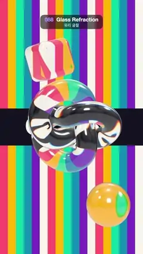

# 088 · Glass Refraction · 유리 굴절



**EN** A glass torus knot, rounded cube and ball turn over bold stripes and a GLASS banner, bending them with rainbow-fringed refraction.  
**KO** 유리로 된 토러스 매듭, 둥근 큐브, 구슬이 굵은 줄무늬와 GLASS 띠 앞에서 돌며 뒤 배경을 무지갯빛 테두리와 함께 휘어 보이게 한다.

[Video (mp4)](../videos/088-glass-refraction.mp4) · [Code](../effects/088-glass-refraction.js) · 3D · 3D

## Prompt (English)

```text
Create a "Glass Refraction" motion effect: clear glass objects turning in front of a bold graphic backdrop, bending it with real refraction and a hint of rainbow dispersion.

Look
- Backdrop (a fixed full-screen texture used as the scene background): 18 vertical stripes, 60 px wide, cycling #FF4D6D, #FFB703, #06D6A0, #118AB2, #7B2CBF, #F8F4EC; a dark band #14121F across the full width from y 820 to 1100 with the word GLASS in #F8F4EC, 190 px heavy black font (Arial Black, weight 900), centred at y 966.
- three.js camera: FOV 35°, at (0, 0, 16). No tone mapping. Environment: a room environment (three.js RoomEnvironment through PMREMGenerator), used for reflections only.
- One shared glass material: MeshPhysicalMaterial, colour white, transmission 1, roughness 0.02, thickness 1.6, ior 1.5, dispersion 3, specularIntensity 1, envMapIntensity 1.2, clearcoat 1, clearcoatRoughness 0.05.
- Objects: a torus knot (radius 1.05, tube 0.42, 220 × 40 segments) at the centre over the GLASS band; a rounded box of size 1.5 with corner radius 0.28 at (−0.9, 2.75, −0.6) above it; a sphere of radius 0.85 at (1.0, −3.0, 0.4) below it.

Motion (0–5 s), a = 2πt/5
- Knot: rotation (0.5 + 0.25·sin a, a, 0), one full turn about y.
- Cube: rotation (a, a + 0.6, 0.3), bobbing y = 2.75 + 0.15·sin a.
- Ball: slides sideways, x = 1.0 + 0.5·sin(a + 1), so the stripes swim through it like a lens.

Technique
- Use three.js physical transmission: it renders the scene behind the glass into a texture and bends it through the thickness. The backdrop must be the scene background (or opaque geometry) so it shows through the glass. Needs a recent three.js with the dispersion property (r163 or later).
- Smooth, high-segment geometry keeps the refraction clean and free of shimmer.

Output and rules
- One self-contained HTML file with no external assets (three.js from a CDN is fine if you use it), drawing on a 1080 × 1920 canvas (9:16) scaled to fit the window.
- Write a function renderFrame(t) that draws the frame for time t in seconds, and preview it with requestAnimationFrame. Everything must be a pure function of t and fixed seeds: no Math.random(), Date or state carried between frames, so frame i = renderFrame(i / 30) can be exported to a 30 fps video.
- Loop seamlessly every 5 seconds: renderFrame(5) must look exactly like renderFrame(0).
- No flicker of any kind: no noise or grain that changes from frame to frame, no strobing or blinking, no z-fighting, no shimmering 1 px lines. Any grain or texture stays fixed to the screen or to the object.
- Keep the top 280 px free of important content (a title label goes there) and fill the whole frame with a designed background.
```

## 프롬프트 (한국어)

```text
"유리 굴절" 모션 효과를 만들어 줘: 투명한 유리 물체들이 굵은 그래픽 배경 앞에서 돌며, 진짜 굴절과 은은한 무지개 분산으로 배경을 휘어 보이게 하는 효과.

모양
- 배경(장면 배경으로 쓰는 고정 전체 화면 텍스처): 폭 60 px 세로 줄무늬 18개, 색은 #FF4D6D, #FFB703, #06D6A0, #118AB2, #7B2CBF, #F8F4EC 순서로 반복. y 820부터 1100까지 가로로 꽉 찬 어두운 띠 #14121F, 그 위에 #F8F4EC 색 GLASS 글자(190 px 굵은 검은 글꼴 Arial Black, 굵기 900), 중심 y 966.
- three.js 카메라: FOV 35°, (0, 0, 16). 톤 매핑 없음. 환경: 방 환경맵(three.js RoomEnvironment을 PMREMGenerator로), 반사에만 쓴다.
- 함께 쓰는 유리 재질 하나: MeshPhysicalMaterial, 색 흰색, transmission 1, roughness 0.02, thickness 1.6, ior 1.5, dispersion 3, specularIntensity 1, envMapIntensity 1.2, clearcoat 1, clearcoatRoughness 0.05.
- 물체: 가운데 GLASS 띠 위에 토러스 매듭(반지름 1.05, 관 0.42, 220 × 40칸); 그 위 (−0.9, 2.75, −0.6)에 크기 1.5, 모서리 반지름 0.28의 둥근 상자; 그 아래 (1.0, −3.0, 0.4)에 반지름 0.85의 구.

움직임 (0–5초), a = 2πt/5
- 매듭: 회전 (0.5 + 0.25·sin a, a, 0), y축으로 한 바퀴.
- 큐브: 회전 (a, a + 0.6, 0.3), 위아래로 y = 2.75 + 0.15·sin a.
- 구슬: 옆으로 미끄러진다, x = 1.0 + 0.5·sin(a + 1). 그래서 렌즈처럼 줄무늬가 그 안을 헤엄친다.

기법
- three.js 물리 투과(transmission)를 쓴다: 유리 뒤 장면을 텍스처로 렌더한 뒤 두께만큼 휘어 보여 준다. 배경이 유리를 통해 보이려면 장면 배경(또는 불투명 지오메트리)이어야 한다. dispersion 속성이 있는 최신 three.js(r163 이상)가 필요하다.
- 칸 수가 많은 매끈한 지오메트리라 굴절이 깨끗하고 떨림이 없다.

출력과 규칙
- 외부 파일 없는 HTML 파일 하나(three.js를 쓴다면 CDN은 괜찮다). 1080 × 1920(9:16) 캔버스에 그리고 창 크기에 맞춰 보이게 한다.
- 시간 t(초)의 프레임을 그리는 renderFrame(t) 함수를 만들고, 미리보기는 requestAnimationFrame으로 돌린다. 모든 것은 t와 고정 시드만으로 정해진다: Math.random(), Date, 프레임 사이에 쌓이는 상태 금지. 그래야 i번째 프레임 = renderFrame(i / 30)으로 30fps 영상을 뽑을 수 있다.
- 5초마다 끊김 없이 반복: renderFrame(5)는 renderFrame(0)과 똑같아 보여야 한다.
- 어떤 깜빡임도 금지: 프레임마다 바뀌는 노이즈·그레인, 번쩍임·깜빡임, z-fighting, 반짝이며 떨리는 1px 선 모두 금지. 그레인·질감은 화면이나 물체에 고정한다.
- 위쪽 280px에는 중요한 내용을 두지 않고(제목 라벨 자리), 화면 전체를 디자인된 배경으로 채운다.
```
