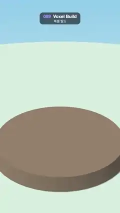

# 089 · Voxel Build · 복셀 빌드



**EN** Cubes drop one by one onto a stone pedestal, building a grass patch, a trunk and a leafy apple tree layer by layer, then pop away.  
**KO** 정육면체가 하나씩 돌 받침 위로 떨어져 잔디, 줄기, 사과 달린 잎사귀를 층층이 쌓아 나무를 완성한 뒤 톡톡 사라진다.

[Video (mp4)](https://sueun-dev.github.io/motion-effects/videos/089-voxel-build.mp4) · [Code](../effects/089-voxel-build.js) · 3D · 3D

## Prompt (English)

```text
Create a "Voxel Build" motion effect: cubes drop in one after another and stack up layer by layer into a little voxel apple tree, which then pops away so the loop can start again.

Look
- three.js. Background: vertical gradient #8FCBEA (sky blue, top) → #E6F4F1 (bottom). A large floor disc (radius 30) #CDE7E3 at y = −1.6 that receives shadows; a stone pedestal: a cylinder with top radius 5.4, bottom radius 5.8, height 1.0, #8C7B6B, roughness 0.9, its top 0.07 below the bottom of the cubes.
- Camera: FOV 34°, at height 15.5 on a circle of radius 25, looking at (0, 2.3, 0).
- Lights: HemisphereLight #FFFFFF / #8FB3C2, intensity 1.5; DirectionalLight #FFF4E0, intensity 2.4, from (−6, 14, 8) with soft shadows (PCFSoftShadowMap, 2048 × 2048, shadow camera ±8). Every cube casts and receives shadows.
- 108 cubes of size 0.96 on a 1-unit grid (MeshStandardMaterial, roughness 0.7):
  - grass at y = 0: a 7 × 7 patch without its 4 corners, randomly #6CC24A or #5DB33F (45 cubes);
  - trunk: (0, 1…3, 0), #8B5A2B;
  - leaves at y = 4…7, x and z in −2…2, kept where x² + z² + 1.3·(y − 5.4)² ≤ 6.2 (60 cubes), randomly #3FA34D, #4CB85A or #2F8F44; about 8 % of the outer ones are red apples #E8443A.
- Sort the cubes bottom-up (by y, then by x + z), so each layer fills diagonally from one corner.

Motion (0–5 s)
- Cube k (0–107): fall progress f = (t − 0.15 − 0.025k)/0.55. It appears high up by growing (scale = min(1, 4f)) and falls from 5 units above its slot: y = y0 + 5·(1 − f²), accelerating like gravity.
- A landing squash for 0.19 s after f = 1: s = 0.18·sin(π·land), land = 0→1 over that time; scale (1 + 0.6s, 1 − s, 1 + 0.6s) and lowered by 0.48s.
- The grass lands first, then the trunk, then the crown; the last cube lands at about 3.4 s and the finished tree stands until 4.3 s.
- Pop away from the top down: out = clamp((t − 4.3 − 0.0032·(108 − k))/0.22), scale × (1 − out³). Everything is gone by about 4.9 s, so t = 5 matches t = 0 (an empty pedestal).
- The camera sways: yaw = 0.7 + 0.35·sin(2πt/5), position (25·sin yaw, 15.5, 25·cos yaw).

Technique
- One shared BoxGeometry and a material per cube; hide a mesh while its scale is about 0.
- Cubes of 0.96 on a 1.0 grid leave thin gaps, so neighbouring faces never touch or share a plane (no z-fighting).

Output and rules
- One self-contained HTML file with no external assets (three.js from a CDN is fine if you use it), drawing on a 1080 × 1920 canvas (9:16) scaled to fit the window.
- Write a function renderFrame(t) that draws the frame for time t in seconds, and preview it with requestAnimationFrame. Everything must be a pure function of t and fixed seeds: no Math.random(), Date or state carried between frames, so frame i = renderFrame(i / 30) can be exported to a 30 fps video.
- Loop seamlessly every 5 seconds: renderFrame(5) must look exactly like renderFrame(0).
- No flicker of any kind: no noise or grain that changes from frame to frame, no strobing or blinking, no z-fighting, no shimmering 1 px lines. Any grain or texture stays fixed to the screen or to the object.
- Keep the top 280 px free of important content (a title label goes there) and fill the whole frame with a designed background.
```

## 프롬프트 (한국어)

```text
"복셀 빌드" 모션 효과를 만들어 줘: 정육면체가 차례로 떨어져 층층이 쌓이며 작은 복셀 사과나무가 되고, 다시 처음부터 시작할 수 있게 톡톡 사라지는 효과.

모양
- three.js. 배경: 세로 그라디언트 #8FCBEA(하늘색, 위) → #E6F4F1(아래). y = −1.6에 그림자를 받는 큰 바닥 원판(반지름 30) #CDE7E3. 돌 받침: 위 반지름 5.4, 아래 반지름 5.8, 높이 1.0인 원기둥, #8C7B6B, roughness 0.9, 윗면은 정육면체 밑면보다 0.07 아래.
- 카메라: FOV 34°, 반지름 25 원 위 높이 15.5에서 (0, 2.3, 0)을 본다.
- 조명: HemisphereLight #FFFFFF / #8FB3C2 세기 1.5; DirectionalLight #FFF4E0 세기 2.4, (−6, 14, 8)에서, 부드러운 그림자(PCFSoftShadowMap, 2048 × 2048, 그림자 카메라 ±8). 모든 정육면체가 그림자를 드리우고 받는다.
- 1단위 격자 위의 크기 0.96 정육면체 108개(MeshStandardMaterial, roughness 0.7):
  - y = 0의 잔디: 네 모서리를 뺀 7 × 7 판, #6CC24A 또는 #5DB33F 무작위(45개);
  - 줄기: (0, 1…3, 0), #8B5A2B;
  - y = 4…7, x와 z는 −2…2 중 x² + z² + 1.3·(y − 5.4)² ≤ 6.2인 자리에 잎(60개), #3FA34D, #4CB85A, #2F8F44 무작위. 바깥쪽 잎의 약 8 %는 빨간 사과 #E8443A.
- 정육면체를 아래부터(y 순, 그다음 x + z 순) 정렬해 층마다 한 모서리에서 대각선으로 채워지게 한다.

움직임 (0–5초)
- k번째 정육면체(0–107): 낙하 진행도 f = (t − 0.15 − 0.025k)/0.55. 높은 곳에서 커지며 나타나고(크기 = min(1, 4f)) 자기 자리보다 5단위 위에서 떨어진다: y = y0 + 5·(1 − f²), 중력처럼 빨라진다.
- f = 1 이후 0.19초 동안 착지 찌그러짐: s = 0.18·sin(π·land), land는 그 시간 동안 0→1. 크기 (1 + 0.6s, 1 − s, 1 + 0.6s), 위치는 0.48s 내린다.
- 잔디가 먼저, 그다음 줄기, 그다음 잎사귀. 마지막 정육면체가 약 3.4초에 내려앉고 완성된 나무가 4.3초까지 서 있다.
- 위에서부터 톡톡 사라짐: out = clamp((t − 4.3 − 0.0032·(108 − k))/0.22), 크기 × (1 − out³). 약 4.9초에 모두 사라져 t = 5가 t = 0(빈 받침)과 같다.
- 카메라가 흔들린다: yaw = 0.7 + 0.35·sin(2πt/5), 위치 (25·sin yaw, 15.5, 25·cos yaw).

기법
- BoxGeometry 하나를 함께 쓰고 정육면체마다 재질 하나. 크기가 거의 0일 때는 메시를 숨긴다.
- 1.0 격자에 0.96 크기라 얇은 틈이 생겨 이웃 면이 맞닿거나 같은 평면에 겹치지 않는다(z-fighting 없음).

출력과 규칙
- 외부 파일 없는 HTML 파일 하나(three.js를 쓴다면 CDN은 괜찮다). 1080 × 1920(9:16) 캔버스에 그리고 창 크기에 맞춰 보이게 한다.
- 시간 t(초)의 프레임을 그리는 renderFrame(t) 함수를 만들고, 미리보기는 requestAnimationFrame으로 돌린다. 모든 것은 t와 고정 시드만으로 정해진다: Math.random(), Date, 프레임 사이에 쌓이는 상태 금지. 그래야 i번째 프레임 = renderFrame(i / 30)으로 30fps 영상을 뽑을 수 있다.
- 5초마다 끊김 없이 반복: renderFrame(5)는 renderFrame(0)과 똑같아 보여야 한다.
- 어떤 깜빡임도 금지: 프레임마다 바뀌는 노이즈·그레인, 번쩍임·깜빡임, z-fighting, 반짝이며 떨리는 1px 선 모두 금지. 그레인·질감은 화면이나 물체에 고정한다.
- 위쪽 280px에는 중요한 내용을 두지 않고(제목 라벨 자리), 화면 전체를 디자인된 배경으로 채운다.
```
