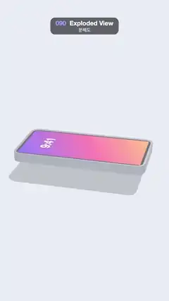

# 090 · Exploded View · 분해도



**EN** A smartphone floats apart into its layers (glass, screen, frame, board, battery and back), holds, then slides back together.  
**KO** 스마트폰이 유리·화면·프레임·기판·배터리·뒷판 층으로 위아래로 벌어졌다가 잠시 머문 뒤 다시 하나로 조립된다.

[Video (mp4)](../videos/090-exploded-view.mp4) · [Code](../effects/090-exploded-view.js) · 3D · 3D

## Prompt (English)

```text
Create an "Exploded View" motion effect: a smartphone separates into its stacked parts, holds like a product exploded diagram, then reassembles.

Look
- three.js. Background #E9ECF5. Environment: a room environment (RoomEnvironment through PMREMGenerator) so the metal frame has reflections. DirectionalLight white 2.2 from (3, 12, 4) with soft shadows (2048 × 2048, shadow camera ±6) plus AmbientLight white 0.4; an invisible shadow-catcher floor (ShadowMaterial, opacity 0.18) at y = −1.2.
- Camera: FOV 30°, at (0, 11, 23.6) looking at (0, 0.2, 0).
- The phone lies flat with its long side along z. Every part is a rounded rectangle extruded upward from its base height (ExtrudeGeometry, no bevel), MeshStandardMaterial roughness 0.45 unless noted:
  - back cover 2.8 × 5.8 × 0.12, corner radius 0.3, #9AA8FF, roughness 0.3: base y 0.02, lift 0;
  - battery 2.2 × 3.0 × 0.16, #2B2F3A, at z +0.7: base 0.16, lift 1.1;
  - logic board 2.4 × 1.6 × 0.06, green #1E8A6E, at z −1.95, carrying four dark chips #20222B (squares of 0.55, 0.4, 0.3 and 0.32, 0.08 tall): base 0.17, lift 1.1;
  - metal frame 3.0 × 6.0 × 0.42, corner radius 0.42, hollow with 0.08 walls, #C9CED8, metalness 1, roughness 0.25: base 0, lift 2.1;
  - display 2.8 × 5.8 × 0.05, #0B0D14, with a wallpaper plane just above it (diagonal gradient #7B5CFF → #FF5FA2 → #FFB36B and a white "9:41" near the top): base 0.335, lift 3.0;
  - cover glass 3.0 × 6.0 × 0.05, MeshPhysicalMaterial white, transparent, opacity 0.22, clearcoat 1: base 0.43, lift 3.9, casts no shadow.
- The inner parts are 0.04 smaller than the frame's opening and every face sits at its own height, so no two faces ever share a plane (no z-fighting).

Motion (0–5 s)
- e(t) = S(ramp(t, 0.5, 1.7)) − S(ramp(t, 3.2, 4.4)), where ramp is a clamped linear 0→1 window and S(k) = 0.5 − 0.5·cos(πk): assembled until 0.5 s, slides apart until 1.7 s, holds exploded, slides back together from 3.2 to 4.4 s, assembled again at 5 s.
- Each part's y = base + 1.7·lift·e, and the whole phone moves down by 3.3·e, so the growing stack stays centred on screen.
- The phone shows its long side across the screen and sways gently: rotation y = π/2 − 0.25 + 0.25·sin(2πt/5).

Technique
- A group of meshes with one material each; animate only the parts' y positions and the group's rotation and height.

Output and rules
- One self-contained HTML file with no external assets (three.js from a CDN is fine if you use it), drawing on a 1080 × 1920 canvas (9:16) scaled to fit the window.
- Write a function renderFrame(t) that draws the frame for time t in seconds, and preview it with requestAnimationFrame. Everything must be a pure function of t and fixed seeds: no Math.random(), Date or state carried between frames, so frame i = renderFrame(i / 30) can be exported to a 30 fps video.
- Loop seamlessly every 5 seconds: renderFrame(5) must look exactly like renderFrame(0).
- No flicker of any kind: no noise or grain that changes from frame to frame, no strobing or blinking, no z-fighting, no shimmering 1 px lines. Any grain or texture stays fixed to the screen or to the object.
- Keep the top 280 px free of important content (a title label goes there) and fill the whole frame with a designed background.
```

## 프롬프트 (한국어)

```text
"분해도" 모션 효과를 만들어 줘: 스마트폰이 겹겹이 쌓인 부품으로 벌어져 제품 분해도처럼 잠시 머문 뒤 다시 조립되는 효과.

모양
- three.js. 배경 #E9ECF5. 환경: 금속 프레임에 반사가 생기도록 방 환경맵(RoomEnvironment을 PMREMGenerator로). DirectionalLight 흰색 2.2, (3, 12, 4)에서 부드러운 그림자(2048 × 2048, 그림자 카메라 ±6)와 AmbientLight 흰색 0.4. y = −1.2에 그림자만 받는 투명 바닥(ShadowMaterial, 불투명도 0.18).
- 카메라: FOV 30°, (0, 11, 23.6)에서 (0, 0.2, 0)을 본다.
- 폰은 긴 변이 z축을 따라 눕혀져 있다. 부품은 모두 둥근 모서리 직사각형을 자기 기준 높이에서 위로 돌출시킨 것(ExtrudeGeometry, 베벨 없음), 따로 적지 않으면 MeshStandardMaterial roughness 0.45:
  - 뒷판 2.8 × 5.8 × 0.12, 모서리 반지름 0.3, #9AA8FF, roughness 0.3: 기준 y 0.02, 들림 0;
  - 배터리 2.2 × 3.0 × 0.16, #2B2F3A, z +0.7: 기준 0.16, 들림 1.1;
  - 기판 2.4 × 1.6 × 0.06, 초록 #1E8A6E, z −1.95, 그 위에 어두운 칩 4개 #20222B(한 변 0.55, 0.4, 0.3, 0.32, 높이 0.08): 기준 0.17, 들림 1.1;
  - 금속 프레임 3.0 × 6.0 × 0.42, 모서리 반지름 0.42, 벽 두께 0.08로 속이 빈 틀, #C9CED8, metalness 1, roughness 0.25: 기준 0, 들림 2.1;
  - 화면 2.8 × 5.8 × 0.05, #0B0D14, 바로 위에 배경화면 평면(대각선 그라디언트 #7B5CFF → #FF5FA2 → #FFB36B, 위쪽에 흰 "9:41"): 기준 0.335, 들림 3.0;
  - 커버 유리 3.0 × 6.0 × 0.05, MeshPhysicalMaterial 흰색, 투명, 불투명도 0.22, clearcoat 1: 기준 0.43, 들림 3.9, 그림자를 드리우지 않는다.
- 안쪽 부품은 프레임 구멍보다 0.04 작고 모든 면이 서로 다른 높이에 있어, 두 면이 같은 평면에 겹치는 일이 없다(z-fighting 없음).

움직임 (0–5초)
- e(t) = S(ramp(t, 0.5, 1.7)) − S(ramp(t, 3.2, 4.4)). ramp는 0→1로 잘린 선형 구간, S(k) = 0.5 − 0.5·cos(πk). 0.5초까지 조립 상태, 1.7초까지 벌어지고, 분해 상태로 머물다가 3.2–4.4초에 다시 모이고, 5초에 조립 상태.
- 부품마다 y = 기준 + 1.7·들림·e. 폰 전체는 3.3·e만큼 내려서 커지는 더미가 화면 가운데에 머물게 한다.
- 폰의 긴 변이 화면을 가로지르게 놓고 부드럽게 흔든다: y축 회전 = π/2 − 0.25 + 0.25·sin(2πt/5).

기법
- 부품마다 재질 하나인 메시 그룹. 부품의 y 위치와 그룹의 회전·높이만 움직인다.

출력과 규칙
- 외부 파일 없는 HTML 파일 하나(three.js를 쓴다면 CDN은 괜찮다). 1080 × 1920(9:16) 캔버스에 그리고 창 크기에 맞춰 보이게 한다.
- 시간 t(초)의 프레임을 그리는 renderFrame(t) 함수를 만들고, 미리보기는 requestAnimationFrame으로 돌린다. 모든 것은 t와 고정 시드만으로 정해진다: Math.random(), Date, 프레임 사이에 쌓이는 상태 금지. 그래야 i번째 프레임 = renderFrame(i / 30)으로 30fps 영상을 뽑을 수 있다.
- 5초마다 끊김 없이 반복: renderFrame(5)는 renderFrame(0)과 똑같아 보여야 한다.
- 어떤 깜빡임도 금지: 프레임마다 바뀌는 노이즈·그레인, 번쩍임·깜빡임, z-fighting, 반짝이며 떨리는 1px 선 모두 금지. 그레인·질감은 화면이나 물체에 고정한다.
- 위쪽 280px에는 중요한 내용을 두지 않고(제목 라벨 자리), 화면 전체를 디자인된 배경으로 채운다.
```
