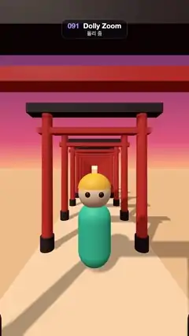

# 091 · Dolly Zoom · 돌리 줌



**EN** A small figure keeps the same size in a tunnel of red torii gates while the dolly zoom stretches the gates and swells the sun behind.  
**KO** 붉은 도리이 터널 속 작은 인형은 크기가 그대로인데, 돌리 줌으로 기둥들이 늘어났다 줄고 뒤의 해가 커졌다 작아진다.

[Video (mp4)](../videos/091-dolly-zoom.mp4) · [Code](../effects/091-dolly-zoom.js) · 3D · 3D

## Prompt (English)

```text
Create a "Dolly Zoom" motion effect: the vertigo shot. The camera slides back while it zooms in, then forward while it zooms out, so a little figure keeps exactly the same size while the tunnel of gates behind it stretches and the sun swells.

Look
- A three.js scene at sunset. Background: a vertical gradient texture, #3B2C6B at the top, #E8637A at 42 %, #FFB37A at 50 %, #FFD9A8 at the bottom. Linear fog #FFC08F from 45 to 190 units.
- Ground: a sand plane #EDC79A (600 × 400 units) at y = −0.04 and a paved path #F7DFBE 2.6 units wide at y = −0.015 on top of it, both roughness 0.95 and receiving shadows. The two floors sit 0.025 apart on purpose so they never z-fight.
- A tunnel of 26 torii gates, one every 1.7 units from z = 1.2 back to z ≈ −41. Each gate: two red #E2462E posts (cylinders, radius 0.11–0.12, 3 high) at x = ±1.05, black #2B1D24 foot caps (radius 0.15, 0.3 high), a black top beam (2.9 × 0.2 × 0.3) at y = 3.08 and a red tie beam (2.45 × 0.13 × 0.17) at y = 2.62.
- A sun far behind: an unlit disc, radius 15 (128 segments), colour #FFF3C4, at (0, 9.5, −170), not affected by fog. Tiny in the wide shot, enormous in the long lens.
- The figure at the origin: a teal #2EC4B6 capsule body (radius 0.3, length 0.55, centre y 0.6), a skin #FFE3C8 sphere head (radius 0.3, y 1.36), a yellow #FFCA3A cap (the top part of a sphere of radius 0.31 at y 1.4) and two dark #22161C eyes (radius 0.045) at x = ±0.11, z = 0.27. On screen it stands from about y 990 to 1510 px, centred.
- Lights: hemisphere #FFE9D6 / #9A6A5A at 1.5, plus a directional sun #FFF0DC at 2.2 from (−12, 30, −2) aimed at (0, 0, −20). Soft PCF shadows (4096 map, shadow box ±25 × ±50, bias −0.0004), so the posts throw long stripes across the path. Everything casts and receives shadows.

Motion (0–5 s)
- u = 0.5 − 0.5·cos(2π·t / 5): 0 at t = 0, 1 at t = 2.5 s, back to 0 at t = 5.
- Interpolate tan(fov/2) logarithmically between tan(52°) (a 104° wide lens) and tan(7.5°) (a 15° long lens) using u.
- Keep d · tan(fov/2) = 3.1 (half the visible height at the figure): camera at (0, 1.8, 3.1 / tan(fov/2)), looking at (0, 1.8, 0). The camera travels from about 2.4 units away to about 23.5 units and back.
- The figure never changes size or place on screen. Around it the gates squeeze into a dense stack and the sun grows to fill the upper frame at 2.5 s, then everything stretches back out. The motion is smooth and has no holds.

Technique
- three.js WebGLRenderer with antialiasing and default (no) tone mapping. One PerspectiveCamera (near 0.3, far 500) whose fov and position are set from t every frame, followed by updateProjectionMatrix().

Output and rules
- One self-contained HTML file with no external assets (three.js from a CDN is fine if you use it), drawing on a 1080 × 1920 canvas (9:16) scaled to fit the window.
- Write a function renderFrame(t) that draws the frame for time t in seconds, and preview it with requestAnimationFrame. Everything must be a pure function of t and fixed seeds: no Math.random(), Date or state carried between frames, so frame i = renderFrame(i / 30) can be exported to a 30 fps video.
- Loop seamlessly every 5 seconds: renderFrame(5) must look exactly like renderFrame(0).
- No flicker of any kind: no noise or grain that changes from frame to frame, no strobing or blinking, no z-fighting, no shimmering 1 px lines. Any grain or texture stays fixed to the screen or to the object.
- Keep the top 280 px free of important content (a title label goes there) and fill the whole frame with a designed background.
```

## 프롬프트 (한국어)

```text
"돌리 줌" 모션 효과를 만들어 줘: 현기증(버티고) 샷. 카메라가 뒤로 물러나며 줌인하고, 다시 다가오며 줌아웃한다. 그래서 작은 인형은 크기가 전혀 변하지 않는데, 뒤의 도리이 터널은 늘어나고 해는 부풀어 오른다.

모양
- 해 질 녘의 three.js 장면. 배경은 세로 그라디언트 텍스처: 맨 위 #3B2C6B, 42 %에 #E8637A, 50 %에 #FFB37A, 맨 아래 #FFD9A8. 선형 안개 #FFC08F, 45~190 단위.
- 바닥: 모래 평면 #EDC79A(600 × 400 단위)를 y = −0.04에, 그 위에 폭 2.6 단위의 포장 길 #F7DFBE를 y = −0.015에 둔다. 둘 다 roughness 0.95, 그림자를 받는다. 두 바닥을 일부러 0.025 띄워서 z-fighting이 절대 생기지 않게 한다.
- 도리이 26개가 터널을 이룬다: z = 1.2부터 z ≈ −41까지 1.7 단위마다 하나. 각 도리이는 x = ±1.05에 빨간 #E2462E 기둥 둘(원기둥, 반지름 0.11–0.12, 높이 3), 검은 #2B1D24 기둥 받침(반지름 0.15, 높이 0.3), y = 3.08에 검은 윗보(2.9 × 0.2 × 0.3), y = 2.62에 빨간 가로보(2.45 × 0.13 × 0.17).
- 멀리 뒤에 해: 조명을 받지 않는 원판, 반지름 15(128분할), 색 #FFF3C4, 위치 (0, 9.5, −170), 안개 영향 없음. 광각에서는 아주 작고 망원에서는 거대하다.
- 원점의 인형: 청록 #2EC4B6 캡슐 몸통(반지름 0.3, 길이 0.55, 중심 y 0.6), 살구색 #FFE3C8 구 머리(반지름 0.3, y 1.36), 노란 #FFCA3A 모자(반지름 0.31 구의 윗부분, y 1.4), 어두운 #22161C 눈 두 개(반지름 0.045, x = ±0.11, z = 0.27). 화면에서는 가운데, 대략 y 990~1510px에 선다.
- 조명: 반구광 #FFE9D6 / #9A6A5A 세기 1.5, 방향광 해 #FFF0DC 세기 2.2를 (−12, 30, −2)에서 (0, 0, −20)으로. 부드러운 PCF 그림자(4096 맵, 그림자 상자 ±25 × ±50, bias −0.0004)로 기둥 그림자가 길 위에 긴 줄무늬로 진다. 모든 물체가 그림자를 드리우고 받는다.

움직임 (0–5초)
- u = 0.5 − 0.5·cos(2π·t / 5): t = 0에서 0, 2.5초에 1, 5초에 다시 0.
- tan(fov/2)를 u에 따라 tan(52°)(104° 광각)와 tan(7.5°)(15° 망원) 사이에서 로그로 보간한다.
- d · tan(fov/2) = 3.1(인형 위치에서 보이는 높이의 절반)을 유지: 카메라를 (0, 1.8, 3.1 / tan(fov/2))에 두고 (0, 1.8, 0)을 본다. 카메라는 약 2.4 단위 거리에서 약 23.5 단위까지 갔다가 돌아온다.
- 인형은 화면에서 크기도 위치도 변하지 않는다. 주변의 도리이는 빽빽하게 압축되고 해는 2.5초에 화면 위쪽을 채울 만큼 커졌다가 다시 늘어나며 돌아온다. 멈춤 없이 부드럽게.

기법
- 안티앨리어싱을 켠 three.js WebGLRenderer, 톤 매핑은 기본값(없음). PerspectiveCamera 하나(near 0.3, far 500)의 fov와 위치를 매 프레임 t로 정하고 updateProjectionMatrix()를 호출한다.

출력과 규칙
- 외부 파일 없는 HTML 파일 하나(three.js를 쓴다면 CDN은 괜찮다). 1080 × 1920(9:16) 캔버스에 그리고 창 크기에 맞춰 보이게 한다.
- 시간 t(초)의 프레임을 그리는 renderFrame(t) 함수를 만들고, 미리보기는 requestAnimationFrame으로 돌린다. 모든 것은 t와 고정 시드만으로 정해진다: Math.random(), Date, 프레임 사이에 쌓이는 상태 금지. 그래야 i번째 프레임 = renderFrame(i / 30)으로 30fps 영상을 뽑을 수 있다.
- 5초마다 끊김 없이 반복: renderFrame(5)는 renderFrame(0)과 똑같아 보여야 한다.
- 어떤 깜빡임도 금지: 프레임마다 바뀌는 노이즈·그레인, 번쩍임·깜빡임, z-fighting, 반짝이며 떨리는 1px 선 모두 금지. 그레인·질감은 화면이나 물체에 고정한다.
- 위쪽 280px에는 중요한 내용을 두지 않고(제목 라벨 자리), 화면 전체를 디자인된 배경으로 채운다.
```
