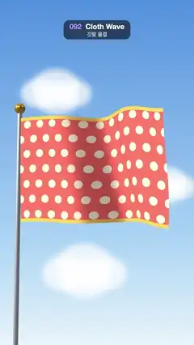

# 092 · Cloth Wave · 깃발 물결



**EN** A coral polka-dot flag on a silver pole ripples in the wind against a blue sky, its waves rolling out toward the free edge.  
**KO** 파란 하늘 아래 은색 깃대에 달린 산호색 물방울무늬 깃발이 바람에 물결치고, 물결이 끝자락 쪽으로 굴러간다.

[Video (mp4)](https://sueun-dev.github.io/motion-effects/videos/092-cloth-wave.mp4) · [Code](../effects/092-cloth-wave.js) · 3D · 3D

## Prompt (English)

```text
Create a "Cloth Wave" motion effect: a polka-dot flag on a pole that ripples and billows in the wind, with folds that catch the light.

Look
- Background: a soft sky texture (540 × 960 canvas), vertical gradient #4E8FE0 at the top, #A9D3F5 at 70 %, #E9F4FB at the bottom, with three soft clouds (each four overlapping ellipses, white at 75 %, blurred 8 px) at about (110, 260), (430, 520) and (180, 760) of that canvas.
- Camera: perspective, fov 34°, at (9, −1.2, 24) looking at (0.2, 2.3, 0), i.e. from low and to the right, looking slightly up.
- The flag: 7.6 × 5.0 units, a plane with 120 × 80 segments, shifted so local x = 0 is the pole edge, placed at (−3.7, 2.6, 0). On screen it spans about x 110–940 px and y 590–1260 px.
- Flag texture (1216 × 800 canvas): coral #FF6B5A; cream #FFF1DC polka dots of radius 30 px in 7 staggered rows (110 px apart across, 114 px down, every other row shifted 55 px); a 26 px yellow #FFC94A hem along the top and bottom edges; 160 faint seeded slubs (black at 5 %, 60–160 × 6 px) fixed in the weave. The dots make every fold readable. MeshStandardMaterial, roughness 0.85, double-sided, anisotropy 8.
- Pole: a metal cylinder (radius 0.11–0.13, 30 long, #D8DDE6, metalness 0.7, roughness 0.3) just left of the flag, running down out of frame, with a gold #F2B632 ball (radius 0.26, metalness 0.8) on top.
- Lights: a RoomEnvironment (via PMREM) as the environment at intensity 0.3, hemisphere #FFFFFF / #8FA4C0 at 0.6, and a strong sun #FFF5E6 at 3.6 from (−9, 5, 6).

Motion (0–5 s)
- Move every vertex each frame from its rest position (x, y). Let a = 2π·t / 5, u = x / 7.6 (0 at the pole, 1 at the free edge) and amp = 0.12 + 0.88·u^1.2, so the cloth is almost still at the pole and wild at the far edge.
- Depth: z = amp·(1.25·sin(1.05x − 4a + 0.25y) + 0.42·sin(2.2x − 6a + 0.5y + 1.3)). The waves travel from the pole to the free edge.
- Vertical sway: amp·(0.18·sin(1.25x − 4a + 1.2) + 0.08·sin(3a + y)); also y − 0.22·u² so the free edge sags a little.
- Horizontal pull: x − 0.25·amp² − 0.06·amp·cos(2.2x − 8a + y), so the cloth gathers toward the pole as it billows.
- Every time frequency is a whole number of cycles per 5 s (3, 4, 6 and 8), so the loop is seamless.

Technique
- three.js. Update the position attribute in place each frame, set needsUpdate and call computeVertexNormals() so the shading of the folds follows the shape. The texture and its slubs are fixed to the cloth, so nothing shimmers.

Output and rules
- One self-contained HTML file with no external assets (three.js from a CDN is fine if you use it), drawing on a 1080 × 1920 canvas (9:16) scaled to fit the window.
- Write a function renderFrame(t) that draws the frame for time t in seconds, and preview it with requestAnimationFrame. Everything must be a pure function of t and fixed seeds: no Math.random(), Date or state carried between frames, so frame i = renderFrame(i / 30) can be exported to a 30 fps video.
- Loop seamlessly every 5 seconds: renderFrame(5) must look exactly like renderFrame(0).
- No flicker of any kind: no noise or grain that changes from frame to frame, no strobing or blinking, no z-fighting, no shimmering 1 px lines. Any grain or texture stays fixed to the screen or to the object.
- Keep the top 280 px free of important content (a title label goes there) and fill the whole frame with a designed background.
```

## 프롬프트 (한국어)

```text
"깃발 물결" 모션 효과를 만들어 줘: 깃대에 달린 물방울무늬 깃발이 바람에 물결치고 부풀며, 주름마다 빛이 맺히는 효과.

모양
- 배경: 부드러운 하늘 텍스처(540 × 960 캔버스). 세로 그라디언트 맨 위 #4E8FE0, 70 %에 #A9D3F5, 맨 아래 #E9F4FB. 그 캔버스의 대략 (110, 260), (430, 520), (180, 760)에 부드러운 구름 세 개(각각 겹친 타원 넷, 흰색 75 %, 8px 블러).
- 카메라: 원근, fov 34°, (9, −1.2, 24)에서 (0.2, 2.3, 0)을 본다. 즉 오른쪽 아래에서 살짝 올려다본다.
- 깃발: 7.6 × 5.0 단위, 120 × 80분할 평면. 로컬 x = 0이 깃대 쪽 가장자리가 되도록 옮기고 (−3.7, 2.6, 0)에 둔다. 화면에서는 대략 x 110–940px, y 590–1260px.
- 깃발 텍스처(1216 × 800 캔버스): 산호색 #FF6B5A 바탕에 크림 #FFF1DC 물방울(반지름 30px) 7줄, 엇갈리게(가로 110px, 세로 114px 간격, 한 줄 걸러 55px 밀기). 위아래 가장자리에 26px 노란 #FFC94A 단. 시드 고정 옅은 결 160개(검정 5 %, 60–160 × 6px)를 천에 고정해 그린다. 물방울 덕분에 주름이 하나하나 읽힌다. MeshStandardMaterial, roughness 0.85, 양면, anisotropy 8.
- 깃대: 깃발 바로 왼쪽의 금속 원기둥(반지름 0.11–0.13, 길이 30, #D8DDE6, metalness 0.7, roughness 0.3)이 화면 아래로 빠져나가고, 꼭대기에 금색 #F2B632 공(반지름 0.26, metalness 0.8).
- 조명: PMREM으로 만든 RoomEnvironment를 환경광으로(세기 0.3), 반구광 #FFFFFF / #8FA4C0 세기 0.6, 강한 해 #FFF5E6 세기 3.6을 (−9, 5, 6)에서.

움직임 (0–5초)
- 매 프레임 모든 정점을 원래 위치 (x, y)에서 옮긴다. a = 2π·t / 5, u = x / 7.6(깃대 0, 끝자락 1), amp = 0.12 + 0.88·u^1.2. 그래서 깃대 쪽은 거의 가만있고 끝자락은 크게 펄럭인다.
- 깊이: z = amp·(1.25·sin(1.05x − 4a + 0.25y) + 0.42·sin(2.2x − 6a + 0.5y + 1.3)). 물결이 깃대에서 끝자락으로 흘러간다.
- 세로 흔들림: amp·(0.18·sin(1.25x − 4a + 1.2) + 0.08·sin(3a + y)). 또 y − 0.22·u²로 끝자락이 살짝 처진다.
- 가로 당김: x − 0.25·amp² − 0.06·amp·cos(2.2x − 8a + y). 천이 부풀 때 깃대 쪽으로 모인다.
- 시간 주파수는 모두 5초에 정수 번(3, 4, 6, 8)이라 루프가 끊김 없다.

기법
- three.js. 매 프레임 position 속성을 그 자리에서 고치고 needsUpdate를 켠 뒤 computeVertexNormals()를 불러 주름의 음영이 모양을 따라가게 한다. 텍스처와 결은 천에 붙어 있으니 아무것도 반짝이지 않는다.

출력과 규칙
- 외부 파일 없는 HTML 파일 하나(three.js를 쓴다면 CDN은 괜찮다). 1080 × 1920(9:16) 캔버스에 그리고 창 크기에 맞춰 보이게 한다.
- 시간 t(초)의 프레임을 그리는 renderFrame(t) 함수를 만들고, 미리보기는 requestAnimationFrame으로 돌린다. 모든 것은 t와 고정 시드만으로 정해진다: Math.random(), Date, 프레임 사이에 쌓이는 상태 금지. 그래야 i번째 프레임 = renderFrame(i / 30)으로 30fps 영상을 뽑을 수 있다.
- 5초마다 끊김 없이 반복: renderFrame(5)는 renderFrame(0)과 똑같아 보여야 한다.
- 어떤 깜빡임도 금지: 프레임마다 바뀌는 노이즈·그레인, 번쩍임·깜빡임, z-fighting, 반짝이며 떨리는 1px 선 모두 금지. 그레인·질감은 화면이나 물체에 고정한다.
- 위쪽 280px에는 중요한 내용을 두지 않고(제목 라벨 자리), 화면 전체를 디자인된 배경으로 채운다.
```
