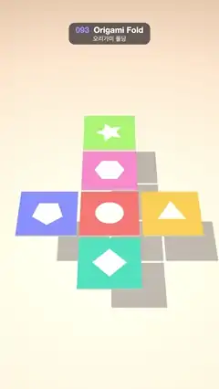

# 093 · Origami Fold · 오리가미 폴딩



**EN** A flat cross of six coloured paper squares folds up panel by panel into a cube, spins once, then unfolds flat again.  
**KO** 색종이 여섯 장으로 된 십자 전개도가 한 장씩 접혀 정육면체가 되고, 한 바퀴 돈 뒤 다시 평평하게 펼쳐진다.

[Video (mp4)](https://sueun-dev.github.io/motion-effects/videos/093-origami-fold.mp4) · [Code](../effects/093-origami-fold.js) · 3D · 3D

## Prompt (English)

```text
Create an "Origami Fold" motion effect: a cross-shaped net of six paper panels on a table folds itself, hinge by hinge, into a cube, turns around once, and unfolds back to the flat net.

Look
- Table: background #D9BFA6 and a 30 × 30 floor plane at y = −2.4 with a radial texture (#FFF6EA in the centre, #F1DDC8 at 60 %, #D9BFA6 at the edge), a soft pool of light that receives shadows.
- Camera: perspective, fov 36°, at (0, 11.2, 10.8) looking at (0, −0.15, 0), a high view looking down at the paper.
- Six panels, each a thin box 0.95 × 0.025 × 0.95 (0.05 gap between panels). Only the top face is coloured; the underside and edges are off-white #FBF7F1 (roughness 0.9). Each coloured face is a 256 × 256 canvas texture: the colour, 260 seeded white flecks at 8 % (2–12 × 2 px) as paper fibre, and a white shape at 92 %, about half the panel wide.
- Layout of the net (seen from the camera): centre coral #FF7A6B with a circle; right yellow #FFC24B with a triangle; front (nearest the camera) teal #3CC6B8 with a diamond; left blue #7C8CFF with a pentagon; back pink #FF8FC7 with a hexagon; and beyond the back panel, the lid, green #9BDB6A with a five-point star.
- Lights: hemisphere #FFFFFF / #C9B8A6 at 1.7 and a directional light #FFF7EE at 2.2 from (−3, 9, 4) with soft PCF shadows (2048 map, box ±6, radius 6). The panels cast shadows on the table.

Motion (0–5 s)
- Each hinge folds its panel down by 90° (below the centre panel) with a cubic ease-in-out over 0.7 s, starting at 0.4 s plus a delay: right 0, front 0.18, left 0.36, back 0.54, lid 0.9 s. The cube is closed by 2.0 s, coloured faces outside and the circle on top.
- Unfold in the reverse order, lid first: each hinge opens from 4.15 − delay to 4.85 − delay s (lid 3.25–3.95 … right 4.15–4.85).
- Keep it centred: offset the paper by (0, 0.5·f, 0.5·(1 − f)) where f is the average fold amount (0 flat, 1 cube).
- Outer group: scale 1.55; gentle bob y = 0.08·sin(2·2π·t/5); turn y = 2π·easeInOut((t − 1.7)/1.9, clamped 0–1) + 0.3·sin(2π·t/5), so the cube spins one full turn between 1.7 and 3.6 s and the net sways slightly.

Technique
- three.js with nested pivots: each hinge is a pivot group on the edge of its parent panel, turned (yaw) to face outward, holding a fold group rotated about its local z axis by −k·90°, holding the panel shifted so its edge sits on the hinge. The lid hangs from the far edge of the back panel, so it rides along when the back folds. All easing is cubic ease-in-out.

Output and rules
- One self-contained HTML file with no external assets (three.js from a CDN is fine if you use it), drawing on a 1080 × 1920 canvas (9:16) scaled to fit the window.
- Write a function renderFrame(t) that draws the frame for time t in seconds, and preview it with requestAnimationFrame. Everything must be a pure function of t and fixed seeds: no Math.random(), Date or state carried between frames, so frame i = renderFrame(i / 30) can be exported to a 30 fps video.
- Loop seamlessly every 5 seconds: renderFrame(5) must look exactly like renderFrame(0).
- No flicker of any kind: no noise or grain that changes from frame to frame, no strobing or blinking, no z-fighting, no shimmering 1 px lines. Any grain or texture stays fixed to the screen or to the object.
- Keep the top 280 px free of important content (a title label goes there) and fill the whole frame with a designed background.
```

## 프롬프트 (한국어)

```text
"오리가미 폴딩" 모션 효과를 만들어 줘: 탁자 위 종이 여섯 장짜리 십자 전개도가 경첩마다 하나씩 스스로 접혀 정육면체가 되고, 한 바퀴 돈 다음 다시 평평한 전개도로 펼쳐지는 효과.

모양
- 탁자: 배경 #D9BFA6, y = −2.4에 30 × 30 바닥 평면. 방사형 텍스처(가운데 #FFF6EA, 60 %에 #F1DDC8, 가장자리 #D9BFA6)로 부드러운 빛 웅덩이를 만들고 그림자를 받는다.
- 카메라: 원근, fov 36°, (0, 11.2, 10.8)에서 (0, −0.15, 0)을 본다. 종이를 높이서 내려다보는 시점.
- 종이 패널 여섯 장, 각각 얇은 상자 0.95 × 0.025 × 0.95(패널 사이 틈 0.05). 윗면만 색이 있고 아랫면·옆면은 미색 #FBF7F1(roughness 0.9). 색 면은 256 × 256 캔버스 텍스처: 바탕색, 종이 섬유처럼 시드 고정 흰 점 260개(8 %, 2–12 × 2px), 패널 폭 절반쯤 되는 흰 도형(92 %).
- 전개도 배치(카메라에서 본 방향): 가운데 산호 #FF7A6B 원, 오른쪽 노랑 #FFC24B 삼각형, 앞(카메라 쪽) 청록 #3CC6B8 마름모, 왼쪽 파랑 #7C8CFF 오각형, 뒤 분홍 #FF8FC7 육각형, 뒤 패널 너머의 뚜껑 초록 #9BDB6A 오각별.
- 조명: 반구광 #FFFFFF / #C9B8A6 세기 1.7, 방향광 #FFF7EE 세기 2.2를 (−3, 9, 4)에서, 부드러운 PCF 그림자(2048 맵, 상자 ±6, radius 6). 패널 그림자가 탁자에 진다.

움직임 (0–5초)
- 경첩마다 패널을 가운데 패널 아래쪽으로 90° 접는다. 0.7초 동안 cubic ease-in-out, 시작은 0.4초 + 지연: 오른쪽 0, 앞 0.18, 왼쪽 0.36, 뒤 0.54, 뚜껑 0.9초. 2.0초에 상자가 닫히고 색 면은 바깥, 원은 윗면에 온다.
- 펼치기는 반대 순서로, 뚜껑부터: 각 경첩이 (4.15 − 지연)초부터 (4.85 − 지연)초까지 열린다(뚜껑 3.25–3.95 … 오른쪽 4.15–4.85).
- 늘 가운데에: 종이 전체를 (0, 0.5·f, 0.5·(1 − f))만큼 옮긴다. f는 접힌 정도의 평균(평평 0, 상자 1).
- 바깥 그룹: 크기 1.55배, 살짝 떠오르기 y = 0.08·sin(2·2π·t/5), 회전 y = 2π·easeInOut((t − 1.7)/1.9, 0–1로 자름) + 0.3·sin(2π·t/5). 그래서 1.7–3.6초 사이 상자가 정확히 한 바퀴 돌고, 전개도는 살짝 흔들린다.

기법
- three.js 중첩 피벗: 경첩마다 부모 패널 가장자리에 피벗 그룹을 두고 바깥을 보도록 yaw를 돌린다. 그 안에 로컬 z축으로 −k·90° 도는 접기 그룹, 그 안에 가장자리가 경첩에 오도록 옮긴 패널. 뚜껑은 뒤 패널의 먼 쪽 가장자리에 매달려 있어 뒤 패널이 접힐 때 함께 따라간다. 이징은 cubic ease-in-out.

출력과 규칙
- 외부 파일 없는 HTML 파일 하나(three.js를 쓴다면 CDN은 괜찮다). 1080 × 1920(9:16) 캔버스에 그리고 창 크기에 맞춰 보이게 한다.
- 시간 t(초)의 프레임을 그리는 renderFrame(t) 함수를 만들고, 미리보기는 requestAnimationFrame으로 돌린다. 모든 것은 t와 고정 시드만으로 정해진다: Math.random(), Date, 프레임 사이에 쌓이는 상태 금지. 그래야 i번째 프레임 = renderFrame(i / 30)으로 30fps 영상을 뽑을 수 있다.
- 5초마다 끊김 없이 반복: renderFrame(5)는 renderFrame(0)과 똑같아 보여야 한다.
- 어떤 깜빡임도 금지: 프레임마다 바뀌는 노이즈·그레인, 번쩍임·깜빡임, z-fighting, 반짝이며 떨리는 1px 선 모두 금지. 그레인·질감은 화면이나 물체에 고정한다.
- 위쪽 280px에는 중요한 내용을 두지 않고(제목 라벨 자리), 화면 전체를 디자인된 배경으로 채운다.
```
