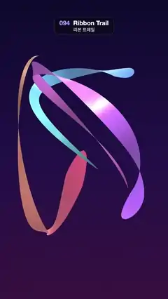

# 094 · Ribbon Trail · 리본 트레일



**EN** Three glossy gradient ribbons chase their own heads around twisting 3D loops in dark violet space, tapering into thin fading tails.  
**KO** 어두운 보라 공간에서 광택 나는 그라디언트 리본 세 개가 비틀린 3D 고리를 따라 제 머리를 쫓고, 꼬리는 가늘어지며 사라진다.

[Video (mp4)](../videos/094-ribbon-trail.mp4) · [Code](../effects/094-ribbon-trail.js) · 3D · 3D

## Prompt (English)

```text
Create a "Ribbon Trail" motion effect: three glossy ribbons fly around closed 3D loops, each one a twisting trail that follows its own head.

Look
- Background: vertical gradient #0E0B2E at the top, #24124A at 55 %, #3A1440 at the bottom.
- Camera: perspective, fov 38°, at (0, 0.4, 16.8) looking at the origin. The loops fill roughly x 100–1000 px and y 330–1640 px.
- Lights: a RoomEnvironment (via PMREM) as environment at intensity 0.7 for glossy highlights, hemisphere #B9C6FF / #3A1440 at 1.0, and a white key light at 2.2 from (3, 5, 6).
- Three paths, each a closed 3D Lissajous curve P(s) = (Ax·sin(fx·s + px), Ay·sin(fy·s + py), Az·sin(fz·s + pz)) for s in 0..2π:
  1. f = (1, 2, 3), phases (0, 0, 0.7), A = (2.3, 3.6, 1.8), 3 twists, head #FF5E8A to tail #FFB86B.
  2. f = (2, 1, 2), phases (1.2, 2.1, 0), A = (2.0, 3.3, 2.0), 2 twists, head #5B8CFF to tail #7CF2E2.
  3. f = (3, 2, 1), phases (2.4, 4.0, 1.6), A = (1.9, 3.0, 2.2), 4 twists, head #B26BFF to tail #FF8BE0.
- Each ribbon is a flat strip, half-width w = 0.42·sqrt(min(1, 14u))·(1 − u)^0.7 where u = 0 at the head and 1 at the tail: a rounded head and a needle-thin tail. Vertex colour goes from the head colour to the tail colour along u and is then mixed toward #1A1040 by 0.8·u², so the tail melts into the background. MeshStandardMaterial with vertex colours, double-sided, roughness 0.3, metalness 0.15.

Motion (0–5 s)
- The head sits at s = 2π·t / 5: one lap per loop. The strip covers the last 2.3 radians of the path behind the head (about a third of the loop).
- The whole group of ribbons turns once around the vertical axis every 5 s.

Technique
- Precompute 1024 samples per loop: position, tangent, and a rotation-minimising side vector built with the double-reflection method, started from (0, 0, 1) × tangent. When the frame comes back to the start it is off by some angle; spread that correction evenly along the loop so the frame closes exactly, then add the fixed twist (2, 3 or 4 full turns per loop) around the tangent. Without this the ribbon would flip or snap.
- Each frame rebuild one BufferGeometry per ribbon: 261 cross-sections (260 segments), two vertices each (position ± side·w), sampled by linear interpolation between the precomputed samples (wrapping around), indexed as a triangle strip; then call computeVertexNormals().
- Everything is a function of t, and the paths are closed, so the loop is seamless.

Output and rules
- One self-contained HTML file with no external assets (three.js from a CDN is fine if you use it), drawing on a 1080 × 1920 canvas (9:16) scaled to fit the window.
- Write a function renderFrame(t) that draws the frame for time t in seconds, and preview it with requestAnimationFrame. Everything must be a pure function of t and fixed seeds: no Math.random(), Date or state carried between frames, so frame i = renderFrame(i / 30) can be exported to a 30 fps video.
- Loop seamlessly every 5 seconds: renderFrame(5) must look exactly like renderFrame(0).
- No flicker of any kind: no noise or grain that changes from frame to frame, no strobing or blinking, no z-fighting, no shimmering 1 px lines. Any grain or texture stays fixed to the screen or to the object.
- Keep the top 280 px free of important content (a title label goes there) and fill the whole frame with a designed background.
```

## 프롬프트 (한국어)

```text
"리본 트레일" 모션 효과를 만들어 줘: 광택 나는 리본 세 개가 닫힌 3D 고리를 따라 날아다니고, 각 리본은 자기 머리를 따라가며 꼬이는 궤적이 되는 효과.

모양
- 배경: 세로 그라디언트, 맨 위 #0E0B2E, 55 %에 #24124A, 맨 아래 #3A1440.
- 카메라: 원근, fov 38°, (0, 0.4, 16.8)에서 원점을 본다. 고리들이 대략 x 100–1000px, y 330–1640px을 채운다.
- 조명: 광택 하이라이트용으로 PMREM으로 만든 RoomEnvironment 환경광(세기 0.7), 반구광 #B9C6FF / #3A1440 세기 1.0, 흰 키 라이트 세기 2.2를 (3, 5, 6)에서.
- 경로 셋, 각각 닫힌 3D 리사주 곡선 P(s) = (Ax·sin(fx·s + px), Ay·sin(fy·s + py), Az·sin(fz·s + pz)), s는 0..2π:
  1. f = (1, 2, 3), 위상 (0, 0, 0.7), A = (2.3, 3.6, 1.8), 비틀림 3번, 머리 #FF5E8A → 꼬리 #FFB86B.
  2. f = (2, 1, 2), 위상 (1.2, 2.1, 0), A = (2.0, 3.3, 2.0), 비틀림 2번, 머리 #5B8CFF → 꼬리 #7CF2E2.
  3. f = (3, 2, 1), 위상 (2.4, 4.0, 1.6), A = (1.9, 3.0, 2.2), 비틀림 4번, 머리 #B26BFF → 꼬리 #FF8BE0.
- 리본은 납작한 띠. 반폭 w = 0.42·sqrt(min(1, 14u))·(1 − u)^0.7, u는 머리 0, 꼬리 1. 머리는 둥글고 꼬리는 바늘처럼 가늘다. 정점 색은 u를 따라 머리색에서 꼬리색으로 가고, 다시 0.8·u²만큼 #1A1040 쪽으로 섞어 꼬리가 배경에 녹아들게 한다. 정점 색을 쓰는 MeshStandardMaterial, 양면, roughness 0.3, metalness 0.15.

움직임 (0–5초)
- 머리는 s = 2π·t / 5에 있다: 루프마다 한 바퀴. 띠는 머리 뒤로 경로의 마지막 2.3 라디안(고리의 약 1/3)을 덮는다.
- 리본 그룹 전체가 5초마다 세로축으로 한 바퀴 돈다.

기법
- 고리마다 샘플 1024개를 미리 계산한다: 위치, 접선, 그리고 이중 반사(double reflection) 방법으로 만든 회전 최소화 옆 방향 벡터((0, 0, 1) × 접선에서 시작). 한 바퀴 돌아 시작점에 오면 어떤 각도만큼 어긋나 있으니, 그 보정을 고리 전체에 고르게 나눠 프레임이 정확히 닫히게 한 다음, 접선을 축으로 고정 비틀림(루프당 2, 3, 4바퀴)을 더한다. 이걸 안 하면 리본이 뒤집히거나 툭 튄다.
- 매 프레임 리본마다 BufferGeometry 하나를 다시 만든다: 단면 261개(구간 260개), 단면마다 정점 둘(위치 ± 옆벡터·w). 미리 계산한 샘플 사이를 선형 보간(끝에서 처음으로 이어서)해 얻고, 삼각형 띠로 인덱스를 잡고, computeVertexNormals()를 부른다.
- 모든 것이 t의 함수이고 경로가 닫혀 있으니 루프가 끊김 없다.

출력과 규칙
- 외부 파일 없는 HTML 파일 하나(three.js를 쓴다면 CDN은 괜찮다). 1080 × 1920(9:16) 캔버스에 그리고 창 크기에 맞춰 보이게 한다.
- 시간 t(초)의 프레임을 그리는 renderFrame(t) 함수를 만들고, 미리보기는 requestAnimationFrame으로 돌린다. 모든 것은 t와 고정 시드만으로 정해진다: Math.random(), Date, 프레임 사이에 쌓이는 상태 금지. 그래야 i번째 프레임 = renderFrame(i / 30)으로 30fps 영상을 뽑을 수 있다.
- 5초마다 끊김 없이 반복: renderFrame(5)는 renderFrame(0)과 똑같아 보여야 한다.
- 어떤 깜빡임도 금지: 프레임마다 바뀌는 노이즈·그레인, 번쩍임·깜빡임, z-fighting, 반짝이며 떨리는 1px 선 모두 금지. 그레인·질감은 화면이나 물체에 고정한다.
- 위쪽 280px에는 중요한 내용을 두지 않고(제목 라벨 자리), 화면 전체를 디자인된 배경으로 채운다.
```
