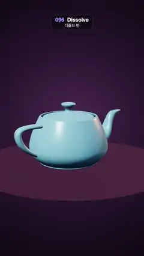

# 096 · Dissolve · 디졸브 번



**EN** A turning pale-blue teapot burns away from the top along a glowing noisy edge, shedding embers, then rebuilds itself from the bottom up.  
**KO** 돌고 있는 하늘색 찻주전자가 빛나는 노이즈 가장자리를 따라 위에서부터 타 사라지며 불씨를 날리고, 다시 아래부터 되살아난다.

[Video (mp4)](https://sueun-dev.github.io/motion-effects/videos/096-dissolve.mp4) · [Code](../effects/096-dissolve.js) · 3D · 3D

## Prompt (English)

```text
Create a "Dissolve" (burn dissolve) motion effect: a 3D teapot burns away along a ragged white-hot edge, sheds rising embers, disappears for a moment and grows back.

Look
- Background: a dim stage, radial gradient centred a little above the middle, #4A2A4E → #25142C (50 %) → #0C0710 at the edges.
- Camera: perspective, fov 36°, at (0, 2.8, 12.5) looking at (0, 0.15, 0). ACES filmic tone mapping.
- Lights: hemisphere #E9D9FF / #2A1420 at 1.2, white key light 2.6 from (−4, 6, 5), orange rim light #FF9A5A 2.0 from (5, 2, −4).
- The teapot: the three.js addon TeapotGeometry (size 1, 16 segments, with bottom, lid and body, Blinn proportions), centred. MeshStandardMaterial #7FD3E8, roughness 0.28, metalness 0.1, double-sided; inside faces darkened to 35 % so the hollow reads as a hollow. On screen it sits around y 800–1300 px.
- A plum disc floor #4A3046 (radius 3.2, roughness 0.7) 0.04 below the teapot's bottom.

Motion (0–5 s)
- Burn threshold thr(t) = −0.05 + 1.1·(clamp((t − 0.3)/1.9) − clamp((t − 2.6)/2.0)): below 0 the pot is whole, above 1 it is gone. It burns 0.3–2.2 s, stays gone until 2.6 s, then rebuilds 2.6–4.6 s and holds whole to 5 s.
- The pot turns once around y per loop, starting at 0.6 rad.

Technique
- Patch the standard material's shader (onBeforeCompile) and pass the object-space position to the fragment shader.
- burn field = 0.32·noise + 0.68·depth, where noise = 0.7·valueNoise(p·1.5) + 0.3·valueNoise(p·3.1 + 7) (smooth 3D value noise from a hash), and depth = clamp((max − p·D) / (max − min)), D = normalize(−0.55, 1, 0.35), min/max = range of p·D over the vertices. The tilt of D means no flat face burns all at once; the burn sweeps down from the upper left.
- v = field − thr. Discard the fragment if v < 0. Charred rim: mix the base colour toward rgb(0.08, 0.03, 0.02) when v is below 0.03–0.09. Glow: add emissive core·(5.0, 3.2, 1.2) + heat·(1.6, 0.35, 0.05) with core = exp(−v/0.012) and heat = exp(−v/0.05): white-hot at the edge, orange just above it.
- Embers on a 2D overlay with additive blending: 70 seeded embers, x within ±280 px of the centre, drift ±60 px, size 3–8 px, each rising 1 or 2 times per second (life = fract(seed + t·rate)). Evaluate the threshold at the ember's birth time; it is visible only while that burn value was between about 0.02 and 1.0, starts on the burning edge (screen y interpolated from the pot top to bottom by the burn value), rises 380 px over its life, sways 18 px, with alpha sin(π·life)·0.9. Draw each as a radial gradient of radius 3×size: rgba(255, 220, 140) → rgba(255, 120, 40, 0.6×) → transparent. Embers fade in and out, so none pops.

Output and rules
- One self-contained HTML file with no external assets (three.js from a CDN is fine if you use it), drawing on a 1080 × 1920 canvas (9:16) scaled to fit the window.
- Write a function renderFrame(t) that draws the frame for time t in seconds, and preview it with requestAnimationFrame. Everything must be a pure function of t and fixed seeds: no Math.random(), Date or state carried between frames, so frame i = renderFrame(i / 30) can be exported to a 30 fps video.
- Loop seamlessly every 5 seconds: renderFrame(5) must look exactly like renderFrame(0).
- No flicker of any kind: no noise or grain that changes from frame to frame, no strobing or blinking, no z-fighting, no shimmering 1 px lines. Any grain or texture stays fixed to the screen or to the object.
- Keep the top 280 px free of important content (a title label goes there) and fill the whole frame with a designed background.
```

## 프롬프트 (한국어)

```text
"디졸브 번" 모션 효과를 만들어 줘: 3D 찻주전자가 들쭉날쭉한 백열 가장자리를 따라 타 들어가며 불씨를 날리고, 잠깐 사라졌다가 다시 자라나는 효과.

모양
- 배경: 어두운 무대. 가운데보다 조금 위를 중심으로 한 방사형 그라디언트 #4A2A4E → #25142C(50 %) → 가장자리 #0C0710.
- 카메라: 원근, fov 36°, (0, 2.8, 12.5)에서 (0, 0.15, 0)을 본다. ACES filmic 톤 매핑.
- 조명: 반구광 #E9D9FF / #2A1420 세기 1.2, 흰 키 라이트 2.6을 (−4, 6, 5)에서, 주황 림 라이트 #FF9A5A 2.0을 (5, 2, −4)에서.
- 찻주전자: three.js 애드온 TeapotGeometry(크기 1, 16분할, 바닥·뚜껑·몸통 포함, Blinn 비율), 가운데 정렬. MeshStandardMaterial #7FD3E8, roughness 0.28, metalness 0.1, 양면. 안쪽 면은 35 %로 어둡게 해 속이 빈 것이 읽히게 한다. 화면에서는 대략 y 800–1300px.
- 자두색 원판 바닥 #4A3046(반지름 3.2, roughness 0.7)을 찻주전자 바닥보다 0.04 아래에.

움직임 (0–5초)
- 태우기 문턱값 thr(t) = −0.05 + 1.1·(clamp((t − 0.3)/1.9) − clamp((t − 2.6)/2.0)): 0 아래면 온전하고 1 위면 사라진다. 0.3–2.2초에 타고, 2.6초까지 없어진 채로 있다가, 2.6–4.6초에 다시 만들어지고, 5초까지 온전히 머문다.
- 찻주전자는 루프마다 y축으로 한 바퀴 돈다(시작 각 0.6 rad).

기법
- 표준 재질 셰이더를 고쳐(onBeforeCompile) 물체 공간 위치를 프래그먼트 셰이더로 넘긴다.
- 태우기 필드 = 0.32·노이즈 + 0.68·깊이. 노이즈 = 0.7·valueNoise(p·1.5) + 0.3·valueNoise(p·3.1 + 7)(해시로 만든 부드러운 3D 값 노이즈), 깊이 = clamp((max − p·D) / (max − min)), D = normalize(−0.55, 1, 0.35), min/max는 정점들의 p·D 범위. D가 기울어 있어서 평평한 면이 한꺼번에 타지 않고, 왼쪽 위에서부터 쓸어내리듯 탄다.
- v = 필드 − thr. v < 0이면 프래그먼트를 버린다(discard). 그을린 테두리: v가 0.03–0.09 아래일 때 기본색을 rgb(0.08, 0.03, 0.02) 쪽으로 섞는다. 빛: emissive에 core·(5.0, 3.2, 1.2) + heat·(1.6, 0.35, 0.05)를 더한다. core = exp(−v/0.012), heat = exp(−v/0.05). 가장자리는 백열, 그 바로 위는 주황.
- 불씨는 2D 오버레이에 더하기(additive) 합성으로: 시드 고정 불씨 70개, x는 가운데 ±280px, 옆 흐름 ±60px, 크기 3–8px, 각각 초당 1번 또는 2번 떠오른다(life = fract(seed + t·rate)). 문턱값은 불씨가 태어난 시각에서 계산한다. 그때의 태우기 값이 약 0.02–1.0 사이일 때만 보이고, 타는 가장자리(그 태우기 값으로 주전자 위에서 아래까지 보간한 화면 y)에서 시작해 수명 동안 380px 올라가며 18px 흔들리고, 알파는 sin(π·life)·0.9. 각각 반지름 3×크기의 방사형 그라디언트: rgba(255, 220, 140) → rgba(255, 120, 40, 0.6배) → 투명. 불씨는 서서히 나타나고 사라지니 툭 튀는 것이 없다.

출력과 규칙
- 외부 파일 없는 HTML 파일 하나(three.js를 쓴다면 CDN은 괜찮다). 1080 × 1920(9:16) 캔버스에 그리고 창 크기에 맞춰 보이게 한다.
- 시간 t(초)의 프레임을 그리는 renderFrame(t) 함수를 만들고, 미리보기는 requestAnimationFrame으로 돌린다. 모든 것은 t와 고정 시드만으로 정해진다: Math.random(), Date, 프레임 사이에 쌓이는 상태 금지. 그래야 i번째 프레임 = renderFrame(i / 30)으로 30fps 영상을 뽑을 수 있다.
- 5초마다 끊김 없이 반복: renderFrame(5)는 renderFrame(0)과 똑같아 보여야 한다.
- 어떤 깜빡임도 금지: 프레임마다 바뀌는 노이즈·그레인, 번쩍임·깜빡임, z-fighting, 반짝이며 떨리는 1px 선 모두 금지. 그레인·질감은 화면이나 물체에 고정한다.
- 위쪽 280px에는 중요한 내용을 두지 않고(제목 라벨 자리), 화면 전체를 디자인된 배경으로 채운다.
```
