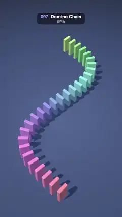

# 097 · Domino Chain · 도미노



**EN** 28 rainbow dominoes on an S-curve topple in a chain, each coming to rest on the next, then the whole run stands back up in reverse.  
**KO** S자 곡선 위 무지개색 도미노 28개가 연쇄로 넘어져 서로 기대어 멈추고, 이어서 거꾸로 감기듯 전부 다시 일어선다.

[Video (mp4)](../videos/097-domino-chain.mp4) · [Code](../effects/097-domino-chain.js) · 3D · 3D

## Prompt (English)

```text
Create a "Domino Chain" motion effect: a curving line of dominoes topples one after another without a physics engine, each one stopping exactly where it rests on its neighbour; then the chain rewinds and stands back up.

Look
- Background #1E2A44. A 26 × 26 table plane at y = −0.02 (just under the dominoes' bottoms, so they never z-fight) with a radial texture #4A5F8E → #33456E (55 %) → #1E2A44, roughness 0.85, receiving shadows.
- Camera: perspective, fov 40°, at (0, 13, 9.5) looking at (0, 0, −0.7): a high three-quarter view. The chain fills about x 150–900 px, y 320–1780 px; the first domino is at the bottom of the frame, nearest the camera.
- Path on the floor: x = −1.8·sin(2πu), z = 4.3 − 10.2u for u = 0..1 (one S-bend going away from the camera), resampled every 0.46 units of arc length: 28 dominoes.
- Each domino: a rounded box (three.js addon RoundedBoxGeometry) 0.52 wide × 1.0 tall × 0.17 thick, corner radius 0.04, roughness 0.35, casting and receiving shadows. Shift the geometry so its pivot is the bottom edge facing the next domino, and turn it (yaw) to the path tangent. Colour HSL: hue 0.98 − 0.75·(i / 28), saturation 0.75, lightness 0.6, from pink-red at the start through violet, blue and teal to green at the end.
- Lights: hemisphere #EAF0FF / #46506A at 1.6 and a directional light #FFF4E2 at 2.4 from (−5, 10, 3) with soft PCF shadows (2048 map, box ±9, bias −0.0005).

Motion (0–5 s)
- Scheduled fall: domino i starts at 0.3 + 0.075·i s and would reach 90° in 0.17 s with angle = 90°·k², k = (time − start)/0.17 clamped (it accelerates like a real fall). The last one falls by about 2.5 s.
- Stopped by the neighbour: go from the last domino back to the first. The last may lie flat (90°). Every other domino's lean is min(90°·k², rest(lean of the one in front)), where rest(φ) = φ + asin((0.46·cos φ − 0.17) / 1.0) is the exact lean at which its top edge rests on the back of a neighbour leaning at φ. So the fallen chain lies as a neat shingled row (90°, 80°, 75°, 72° …).
- Use a clock ft = t up to 3.3 s; from 3.3 to 4.7 s, ft = 3.0·(1 − easeInOut((t − 3.3)/1.4)) runs the same scene backwards, so the dominoes stand back up from the far end to the near end. After 4.7 s (and before 0.3 s) everything stands still, so the loop closes.

Technique
- three.js. Every domino's rotation is computed from ft each frame (no simulation state), back to front along the chain as described. Cubic ease-in-out for the rewind.

Output and rules
- One self-contained HTML file with no external assets (three.js from a CDN is fine if you use it), drawing on a 1080 × 1920 canvas (9:16) scaled to fit the window.
- Write a function renderFrame(t) that draws the frame for time t in seconds, and preview it with requestAnimationFrame. Everything must be a pure function of t and fixed seeds: no Math.random(), Date or state carried between frames, so frame i = renderFrame(i / 30) can be exported to a 30 fps video.
- Loop seamlessly every 5 seconds: renderFrame(5) must look exactly like renderFrame(0).
- No flicker of any kind: no noise or grain that changes from frame to frame, no strobing or blinking, no z-fighting, no shimmering 1 px lines. Any grain or texture stays fixed to the screen or to the object.
- Keep the top 280 px free of important content (a title label goes there) and fill the whole frame with a designed background.
```

## 프롬프트 (한국어)

```text
"도미노" 모션 효과를 만들어 줘: 물리 엔진 없이 곡선으로 늘어선 도미노가 차례로 넘어지고, 하나하나가 이웃에 정확히 기대는 자리에서 멈춘다. 그다음 연쇄가 거꾸로 감기며 다시 일어선다.

모양
- 배경 #1E2A44. y = −0.02(도미노 바닥 바로 아래라서 z-fighting이 없다)에 26 × 26 탁자 평면, 방사형 텍스처 #4A5F8E → #33456E(55 %) → #1E2A44, roughness 0.85, 그림자를 받는다.
- 카메라: 원근, fov 40°, (0, 13, 9.5)에서 (0, 0, −0.7)을 본다: 높은 3/4 시점. 연쇄는 대략 x 150–900px, y 320–1780px을 채우고, 첫 도미노는 화면 아래(카메라에 가장 가까운 곳)에 있다.
- 바닥 위 경로: u = 0..1에서 x = −1.8·sin(2πu), z = 4.3 − 10.2u(카메라에서 멀어지는 S자 하나). 호 길이 0.46마다 다시 샘플하면 도미노 28개.
- 도미노 하나: 둥근 상자(three.js 애드온 RoundedBoxGeometry) 폭 0.52 × 높이 1.0 × 두께 0.17, 모서리 반지름 0.04, roughness 0.35, 그림자를 드리우고 받는다. 회전축이 다음 도미노를 향한 아래 모서리가 되도록 지오메트리를 옮기고, 경로 접선 방향으로 돌린다(yaw). 색 HSL: hue 0.98 − 0.75·(i / 28), 채도 0.75, 명도 0.6. 시작은 분홍빛 빨강, 보라·파랑·청록을 지나 끝은 초록.
- 조명: 반구광 #EAF0FF / #46506A 세기 1.6, 방향광 #FFF4E2 세기 2.4를 (−5, 10, 3)에서, 부드러운 PCF 그림자(2048 맵, 상자 ±9, bias −0.0005).

움직임 (0–5초)
- 정해진 시각에 넘어짐: i번째 도미노는 0.3 + 0.075·i초에 시작해 0.17초 만에 90°에 닿으려 한다. 각도 = 90°·k², k = (시각 − 시작)/0.17을 0–1로 자름(실제로 넘어지듯 점점 빨라진다). 마지막 도미노는 약 2.5초에 다 넘어진다.
- 이웃이 막아 줌: 마지막 도미노부터 첫 도미노 쪽으로 계산한다. 마지막은 바닥에 눕는다(90°). 나머지는 기울기 = min(90°·k², rest(앞 도미노의 기울기)). rest(φ) = φ + asin((0.46·cos φ − 0.17) / 1.0)는 φ만큼 기운 이웃의 등에 윗모서리가 정확히 걸치는 기울기다. 그래서 넘어진 연쇄가 기와처럼 가지런히 눕는다(90°, 80°, 75°, 72° …).
- 시계 ft를 3.3초까지는 t로, 3.3–4.7초에는 ft = 3.0·(1 − easeInOut((t − 3.3)/1.4))로 써서 같은 장면을 거꾸로 돌린다. 도미노가 먼 쪽 끝부터 가까운 쪽 끝까지 다시 일어선다. 4.7초 뒤(그리고 0.3초 전)에는 모두 서 있어서 루프가 닫힌다.

기법
- three.js. 도미노마다 회전을 매 프레임 ft로 계산한다(시뮬레이션 상태 없음). 위에서 말한 대로 연쇄의 뒤에서 앞으로. 되감기는 cubic ease-in-out.

출력과 규칙
- 외부 파일 없는 HTML 파일 하나(three.js를 쓴다면 CDN은 괜찮다). 1080 × 1920(9:16) 캔버스에 그리고 창 크기에 맞춰 보이게 한다.
- 시간 t(초)의 프레임을 그리는 renderFrame(t) 함수를 만들고, 미리보기는 requestAnimationFrame으로 돌린다. 모든 것은 t와 고정 시드만으로 정해진다: Math.random(), Date, 프레임 사이에 쌓이는 상태 금지. 그래야 i번째 프레임 = renderFrame(i / 30)으로 30fps 영상을 뽑을 수 있다.
- 5초마다 끊김 없이 반복: renderFrame(5)는 renderFrame(0)과 똑같아 보여야 한다.
- 어떤 깜빡임도 금지: 프레임마다 바뀌는 노이즈·그레인, 번쩍임·깜빡임, z-fighting, 반짝이며 떨리는 1px 선 모두 금지. 그레인·질감은 화면이나 물체에 고정한다.
- 위쪽 280px에는 중요한 내용을 두지 않고(제목 라벨 자리), 화면 전체를 디자인된 배경으로 채운다.
```
