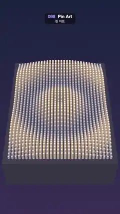

# 098 · Pin Art · 핀 아트



**EN** 1,200 metal pins rise through a dark board in ripples spreading from the centre, then push up a warm glowing heart and sink back to ripples.  
**KO** 어두운 판을 뚫고 올라온 금속 핀 1,200개가 가운데서 퍼지는 물결을 만들다가 따뜻한 빛의 하트로 솟고, 다시 물결로 돌아간다.

[Video (mp4)](https://sueun-dev.github.io/motion-effects/videos/098-pin-art.mp4) · [Code](../effects/098-pin-art.js) · 3D · 3D

## Prompt (English)

```text
Create a "Pin Art" motion effect: a pin-screen toy. A dense grid of metal pins slides up and down through a board to follow a height field: first ripples spreading from the middle, then a heart pressed up from below.

Look
- Background: vertical gradient #1B2340 → #3B2F55.
- Camera: perspective, fov 36°, at (0, 17.5, 15.5) looking at (0, 0.2, 0.2), a steep view down onto the board. The board fills about x 20–1060 px and y 560–1650 px.
- Board: a box 7.2 × 2.6 × 9.4 (the 30 × 40 grid plus 0.3 margin each side), colour #16142A, roughness 0.8, with its top face at y = 0.
- Pins: 30 columns × 40 rows, 0.22 apart, centred on the board. Each pin is a capsule (radius 0.075, length 2.2) shifted so its rounded tip is at the instance origin; the rest of the pin hides inside the board. One InstancedMesh for all 1,200 pins, MeshStandardMaterial white with metalness 0.5 and roughness 0.45, tinted per instance from #6F7BA0 (low) to #FFD9A0 (high) by min(1, h / 1.3), so raised pins glow warm.
- Lights: a RoomEnvironment (via PMREM) as environment at 0.8, a key light #FFF3E0 at 2.2 from (−4, 8, 3), hemisphere #C8D4FF / #2A2440 at 0.6. No shadows.

Motion (0–5 s)
- a = 2π·t / 5, r = distance of the pin from the board centre.
- Ripples: 0.42 + 0.38·sin(2r − 3a)·exp(−0.1r): three rings travel outward per loop.
- Heart: heart(i, j)·(1.35 + 0.08·sin 2a) + 0.05·sin(2r − 3a): the heart breathes slightly and the ripple still runs faintly across it.
- Blend: show = smoothstep(1.3, 2.1, t) − smoothstep(3.5, 4.3, t) (ripples → heart over 1.3–2.1 s, heart held, back to ripples over 3.5–4.3 s). Pin tip height h = 0.06 + (1 − show)·ripple + show·heart.

Technique
- Heart map: draw a classic white heart (four Bézier curves, point toward the camera) almost as wide as a 120 × 160 canvas with a 5 px blur filter, then read one value per pin from the centre of its 4 × 4 px cell (0..1). The blur gives the heart sloped, stepped sides instead of a cliff.
- Each frame, set every instance's matrix (a translation to (x, h, z)) and colour, then mark instanceMatrix and instanceColor as needing an update. Everything is computed from t.

Output and rules
- One self-contained HTML file with no external assets (three.js from a CDN is fine if you use it), drawing on a 1080 × 1920 canvas (9:16) scaled to fit the window.
- Write a function renderFrame(t) that draws the frame for time t in seconds, and preview it with requestAnimationFrame. Everything must be a pure function of t and fixed seeds: no Math.random(), Date or state carried between frames, so frame i = renderFrame(i / 30) can be exported to a 30 fps video.
- Loop seamlessly every 5 seconds: renderFrame(5) must look exactly like renderFrame(0).
- No flicker of any kind: no noise or grain that changes from frame to frame, no strobing or blinking, no z-fighting, no shimmering 1 px lines. Any grain or texture stays fixed to the screen or to the object.
- Keep the top 280 px free of important content (a title label goes there) and fill the whole frame with a designed background.
```

## 프롬프트 (한국어)

```text
"핀 아트" 모션 효과를 만들어 줘: 핀 스크린 장난감. 촘촘한 금속 핀 격자가 판을 뚫고 오르내리며 높이 지도를 따라간다. 처음에는 가운데서 퍼지는 물결, 그다음에는 아래에서 밀어 올린 하트.

모양
- 배경: 세로 그라디언트 #1B2340 → #3B2F55.
- 카메라: 원근, fov 36°, (0, 17.5, 15.5)에서 (0, 0.2, 0.2)을 본다. 판을 가파르게 내려다보는 시점. 판은 대략 x 20–1060px, y 560–1650px을 채운다.
- 판: 7.2 × 2.6 × 9.4 상자(30 × 40 격자에 양옆 0.3 여백), 색 #16142A, roughness 0.8, 윗면이 y = 0.
- 핀: 30열 × 40행, 간격 0.22, 판 가운데 정렬. 핀 하나는 캡슐(반지름 0.075, 길이 2.2)로, 둥근 끝이 인스턴스 원점에 오도록 옮긴다. 나머지 몸통은 판 속에 숨는다. 핀 1,200개 전부 InstancedMesh 하나로, MeshStandardMaterial 흰색 metalness 0.5, roughness 0.45. 인스턴스마다 min(1, h / 1.3)에 따라 #6F7BA0(낮음)에서 #FFD9A0(높음)으로 물들여 솟은 핀이 따뜻하게 빛나게 한다.
- 조명: PMREM으로 만든 RoomEnvironment 환경광 0.8, 키 라이트 #FFF3E0 세기 2.2를 (−4, 8, 3)에서, 반구광 #C8D4FF / #2A2440 세기 0.6. 그림자 없음.

움직임 (0–5초)
- a = 2π·t / 5, r = 판 가운데에서 핀까지의 거리.
- 물결: 0.42 + 0.38·sin(2r − 3a)·exp(−0.1r). 루프마다 고리 세 개가 바깥으로 퍼진다.
- 하트: heart(i, j)·(1.35 + 0.08·sin 2a) + 0.05·sin(2r − 3a). 하트가 살짝 숨 쉬고, 그 위로도 물결이 약하게 지나간다.
- 섞기: show = smoothstep(1.3, 2.1, t) − smoothstep(3.5, 4.3, t)(1.3–2.1초에 물결 → 하트, 하트 유지, 3.5–4.3초에 다시 물결). 핀 끝 높이 h = 0.06 + (1 − show)·물결 + show·하트.

기법
- 하트 지도: 120 × 160 캔버스에 거의 꽉 차는 고전적인 흰 하트(베지에 곡선 넷, 뾰족한 끝이 카메라 쪽)를 5px 블러 필터로 그리고, 핀마다 자기 4 × 4px 칸의 가운데 값을 하나씩 읽는다(0..1). 블러 덕분에 하트 옆면이 절벽이 아니라 계단처럼 비스듬해진다.
- 매 프레임 인스턴스마다 행렬((x, h, z)로 옮기기)과 색을 정하고, instanceMatrix와 instanceColor를 갱신 표시한다. 모든 것을 t로 계산한다.

출력과 규칙
- 외부 파일 없는 HTML 파일 하나(three.js를 쓴다면 CDN은 괜찮다). 1080 × 1920(9:16) 캔버스에 그리고 창 크기에 맞춰 보이게 한다.
- 시간 t(초)의 프레임을 그리는 renderFrame(t) 함수를 만들고, 미리보기는 requestAnimationFrame으로 돌린다. 모든 것은 t와 고정 시드만으로 정해진다: Math.random(), Date, 프레임 사이에 쌓이는 상태 금지. 그래야 i번째 프레임 = renderFrame(i / 30)으로 30fps 영상을 뽑을 수 있다.
- 5초마다 끊김 없이 반복: renderFrame(5)는 renderFrame(0)과 똑같아 보여야 한다.
- 어떤 깜빡임도 금지: 프레임마다 바뀌는 노이즈·그레인, 번쩍임·깜빡임, z-fighting, 반짝이며 떨리는 1px 선 모두 금지. 그레인·질감은 화면이나 물체에 고정한다.
- 위쪽 280px에는 중요한 내용을 두지 않고(제목 라벨 자리), 화면 전체를 디자인된 배경으로 채운다.
```
