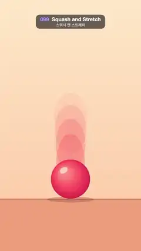

# 099 · Squash and Stretch · 스쿼시 앤 스트레치



★ One of the 20 effects in the original reel (#18) · 원래 릴스 20개 중 하나(18번)

**EN** A big glossy red ball bounces four times: it stretches tall as it rises and falls, and squashes flat for an instant on the floor.  
**KO** 커다란 광택 빨간 공이 네 번 튄다: 오르내릴 때는 길쭉하게 늘어나고, 바닥에 닿는 순간 납작하게 찌그러진다.

[Video (mp4)](https://sueun-dev.github.io/motion-effects/videos/099-squash-and-stretch.mp4) · [Code](../effects/099-squash-and-stretch.js) · Animation principles · 애니메이션 원리

## Prompt (English)

```text
Create a "Squash and Stretch" motion effect: the first principle of animation shown on one bouncing ball. It stretches along its speed in the air and squashes flat on contact, always keeping its volume (scaleX = 1 / scaleY). The viewer should feel the ball's weight and elasticity, and see that the shape change is what sells the speed.

Look
- Warm background: vertical gradient #FFE8C7 (top) → #FFC9A3 (bottom). Floor from y 1520 down, #F2A27C, with a 10 px darker edge #E4895F along its top.
- One large ball, radius R = 150 px, always centred horizontally (x 540). It moves only up and down, so it stretches vertically. Its bottom rests on y 1520 at contact; at the top of the bounce its centre is at y 560.
- Ball fill: radial gradient from (x − 0.35R, y − 0.4R) radius 0.1R to (x, y) radius 1.2R: #FF9A8B → #FF4D5E (55 %) → #C81E45. A highlight: white at 55 %, an ellipse 0.22R × 0.14R at (−0.35R, −0.45R) from the centre, rotated −0.5 rad. Highlight offset and size are multiplied by the current scaleX / scaleY so it deforms with the ball.
- Contact shadow under the ball: ellipse at y 1526, half-width R·(1.2 − 0.5·lift)·scaleX, half-height 22, rgba(120, 50, 30, 0.28 − 0.18·lift), where lift is 0 on the floor and 1 at the top.
- Four ghosts behind the ball, drawn first: the same ellipse at t − 0.05, 0.10, 0.15, 0.20 s, filled rgba(255, 90, 95, a) with a = 0.32, 0.24, 0.16, 0.08 (newest is strongest). They show the arc and the spacing (wide = fast near the floor, tight = slow at the top) and soften the fast frames.

Motion (0–5 s)
- Period 1.25 s, so exactly 4 bounces per loop. u = (t / 1.25) mod 1.
- Contact, u < 0.12 (0.15 s): scaleY = 1 − 0.48·sin(π·u / 0.12), scaleX = 1 / scaleY (up to 1.92× wide and 0.52× tall). The bottom stays on the floor: centre y = 1520 − R·scaleY.
- Flight, the remaining 1.1 s: k = (u − 0.12) / 0.88, centre y = 1370 − 4k(1 − k)·810, a true parabola (constant gravity). Stretch scaleY = 1 + 0.45·(1 − 2k)², scaleX = 1 / scaleY: 1.45× tall right after take-off and just before landing (fastest), perfectly round at the apex.
- t = 0 is the start of a contact, so the loop closes exactly.

Technique
- Canvas 2D, frame fully repainted. Draw order: background, floor, ghosts, shadow, ball, highlight. Ellipses via ctx.ellipse with radii R·scaleX and R·scaleY.

Output and rules
- One self-contained HTML file with no external assets (three.js from a CDN is fine if you use it), drawing on a 1080 × 1920 canvas (9:16) scaled to fit the window.
- Write a function renderFrame(t) that draws the frame for time t in seconds, and preview it with requestAnimationFrame. Everything must be a pure function of t and fixed seeds: no Math.random(), Date or state carried between frames, so frame i = renderFrame(i / 30) can be exported to a 30 fps video.
- Loop seamlessly every 5 seconds: renderFrame(5) must look exactly like renderFrame(0).
- No flicker of any kind: no noise or grain that changes from frame to frame, no strobing or blinking, no z-fighting, no shimmering 1 px lines. Any grain or texture stays fixed to the screen or to the object.
- Keep the top 280 px free of important content (a title label goes there) and fill the whole frame with a designed background.
```

## 프롬프트 (한국어)

```text
"스쿼시 앤 스트레치" 모션 효과를 만들어 줘: 애니메이션 제1원리를 튀는 공 하나로 보여 준다. 공중에서는 속도 방향으로 늘어나고 닿는 순간 납작해지는데, 부피는 늘 그대로다(scaleX = 1 / scaleY). 보는 사람이 공의 무게와 탄력을 느끼고, 속도감을 만드는 것이 바로 이 모양 변화라는 걸 알게 한다.

모양
- 따뜻한 배경: 세로 그라디언트 #FFE8C7(위) → #FFC9A3(아래). y 1520부터 아래는 바닥 #F2A27C, 바닥 윗선을 따라 10px 진한 테두리 #E4895F.
- 큰 공 하나, 반지름 R = 150px, 늘 가로 가운데(x 540). 위아래로만 움직이니 세로로 늘어난다. 닿을 때 공 아래쪽이 y 1520에 붙고, 가장 높이 올라갔을 때 중심이 y 560.
- 공 채우기: (x − 0.35R, y − 0.4R) 반지름 0.1R에서 (x, y) 반지름 1.2R로 가는 방사형 그라디언트 #FF9A8B → #FF4D5E(55 %) → #C81E45. 하이라이트: 흰색 55 %, 중심에서 (−0.35R, −0.45R)에 0.22R × 0.14R 타원, −0.5 rad 회전. 하이라이트 위치와 크기에도 현재 scaleX / scaleY를 곱해 공과 함께 찌그러지게 한다.
- 공 아래 접지 그림자: y 1526의 타원, 가로 반지름 R·(1.2 − 0.5·lift)·scaleX, 세로 반지름 22, rgba(120, 50, 30, 0.28 − 0.18·lift). lift는 바닥 0, 꼭대기 1.
- 공 뒤의 잔상 넷을 먼저 그린다: t − 0.05, 0.10, 0.15, 0.20초의 같은 타원을 rgba(255, 90, 95, a)로, a = 0.32, 0.24, 0.16, 0.08(최근 것이 가장 진함). 궤적과 간격(바닥 근처는 넓어서 빠름, 꼭대기는 촘촘해서 느림)을 보여 주고 빠른 프레임을 부드럽게 해 준다.

움직임 (0–5초)
- 주기 1.25초, 루프마다 정확히 네 번 튄다. u = (t / 1.25) mod 1.
- 접촉, u < 0.12(0.15초): scaleY = 1 − 0.48·sin(π·u / 0.12), scaleX = 1 / scaleY(최대 가로 1.92배, 세로 0.52배). 아래쪽은 바닥에 붙어 있다: 중심 y = 1520 − R·scaleY.
- 비행, 나머지 1.1초: k = (u − 0.12) / 0.88, 중심 y = 1370 − 4k(1 − k)·810. 진짜 포물선(일정한 중력). 늘어남 scaleY = 1 + 0.45·(1 − 2k)², scaleX = 1 / scaleY: 뜬 직후와 닿기 직전(가장 빠를 때) 세로 1.45배, 꼭대기에서는 완전히 둥글다.
- t = 0이 접촉의 시작이라 루프가 정확히 닫힌다.

기법
- Canvas 2D, 매 프레임 전체를 다시 칠한다. 그리는 순서: 배경, 바닥, 잔상, 그림자, 공, 하이라이트. 타원은 반지름 R·scaleX, R·scaleY의 ctx.ellipse로.

출력과 규칙
- 외부 파일 없는 HTML 파일 하나(three.js를 쓴다면 CDN은 괜찮다). 1080 × 1920(9:16) 캔버스에 그리고 창 크기에 맞춰 보이게 한다.
- 시간 t(초)의 프레임을 그리는 renderFrame(t) 함수를 만들고, 미리보기는 requestAnimationFrame으로 돌린다. 모든 것은 t와 고정 시드만으로 정해진다: Math.random(), Date, 프레임 사이에 쌓이는 상태 금지. 그래야 i번째 프레임 = renderFrame(i / 30)으로 30fps 영상을 뽑을 수 있다.
- 5초마다 끊김 없이 반복: renderFrame(5)는 renderFrame(0)과 똑같아 보여야 한다.
- 어떤 깜빡임도 금지: 프레임마다 바뀌는 노이즈·그레인, 번쩍임·깜빡임, z-fighting, 반짝이며 떨리는 1px 선 모두 금지. 그레인·질감은 화면이나 물체에 고정한다.
- 위쪽 280px에는 중요한 내용을 두지 않고(제목 라벨 자리), 화면 전체를 디자인된 배경으로 채운다.
```
