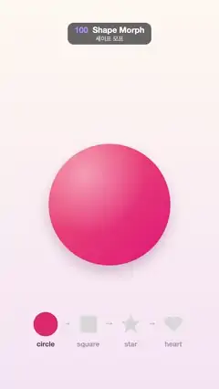

# 100 · Shape Morph · 셰이프 모프



★ One of the 20 effects in the original reel (#14) · 원래 릴스 20개 중 하나(14번)

**EN** A glossy shape morphs circle → square → star → heart and back to a circle, its colour shifting along, while a row below marks the step.  
**KO** 광택 있는 도형이 원 → 사각형 → 별 → 하트 → 원으로 매끄럽게 바뀌며 색도 함께 변하고, 아래 줄에 지금 단계가 표시된다.

[Video (mp4)](https://sueun-dev.github.io/motion-effects/videos/100-shape-morph.mp4) · [Code](../effects/100-shape-morph.js) · Animation principles · 애니메이션 원리

## Prompt (English)

```text
Create a "Shape Morph" motion effect: one big glossy shape smoothly turns from a circle into a square, a star, a heart and back into the circle. The viewer should see the outline flow continuously from one shape to the next (no cut, no crossfade), with a step row below that names where we are.

Look
- Background: vertical gradient #FFF8F0 → #F6E6F4.
- The main shape, centred at (540, 1010) with size R = 300 px.
- Fill: a diagonal linear gradient across the shape's bounding square, from hsl(h + 10, 95 %, 70 %) at the top left to hsl(h − 8, 85 %, 56 %) at the bottom right. Soft drop shadow rgba(120, 60, 90, 0.28), blur 60, offset y 34. Inner highlight: a radial white gradient (45 % → 0) centred at (420, 860), radius 300, clipped to the shape.
- Hue per shape: circle 345, square 380 (= 20), star 405 (= 45), heart 325. Blend the hue numbers linearly (circle to square goes through red, never round the wheel); the hues stay below pure yellow (60), where brightness peaks, so in-between colours stay evenly bright.
- Step row at y 1600: four small versions of the shapes at x 225, 435, 645 and 855, labels "circle", "square", "star", "heart" 110 px below (semi-bold 34 px sans-serif), and grey "→" arrows (40 px, 35 % opacity) between them. Each mini shape has on = 1 for the current shape fading to 0 as the next one takes over (on = 1 − k and k): colour hsl(hue, 80·on %, (84 − 26·on) %) (pale grey when off), size 46 + 14·on, label colour rgba(90, 60, 100, 0.45 + 0.5·on).

Motion (0–5 s)
- Four segments of 1.25 s (circle→square, square→star, star→heart, heart→circle). Each holds the current shape for 0.375 s, then morphs to the next over 0.875 s with k = cubic ease-in-out.
- While morphing, the size swells slightly: R·(1 + 0.05·sin(π·k)).

Technique
- Store every shape as its radius in 360 directions (one per degree) from the centre, so a morph is just a per-direction linear blend of two radius lists, and the outline is a closed polyline through the 360 points.
  - Circle: 1 everywhere.
  - Square: 0.9 / max(|cos θ|, |sin θ|).
  - Star: a 10-vertex polygon, outer radius 1.12 (point up) and inner 0.48; for each direction, cast a ray from the centre and take the first hit.
  - Heart: the classic curve x = 16·sin³s, y = −(13·cos s − 5·cos 2s − 2·cos 3s − cos 4s), divided by 16.5 and moved up 0.12, as a 240-point polygon, ray-cast the same way.
- Canvas 2D; the same outline function draws the big shape, its clip and the mini shapes.

Output and rules
- One self-contained HTML file with no external assets (three.js from a CDN is fine if you use it), drawing on a 1080 × 1920 canvas (9:16) scaled to fit the window.
- Write a function renderFrame(t) that draws the frame for time t in seconds, and preview it with requestAnimationFrame. Everything must be a pure function of t and fixed seeds: no Math.random(), Date or state carried between frames, so frame i = renderFrame(i / 30) can be exported to a 30 fps video.
- Loop seamlessly every 5 seconds: renderFrame(5) must look exactly like renderFrame(0).
- No flicker of any kind: no noise or grain that changes from frame to frame, no strobing or blinking, no z-fighting, no shimmering 1 px lines. Any grain or texture stays fixed to the screen or to the object.
- Keep the top 280 px free of important content (a title label goes there) and fill the whole frame with a designed background.
```

## 프롬프트 (한국어)

```text
"셰이프 모프" 모션 효과를 만들어 줘: 큰 광택 도형 하나가 원에서 사각형, 별, 하트로, 다시 원으로 매끄럽게 바뀐다. 보는 사람은 윤곽이 한 도형에서 다음 도형으로 끊김 없이 흘러가는 것(컷도 크로스페이드도 없이)을 보고, 아래 단계 줄로 지금 어디인지 안다.

모양
- 배경: 세로 그라디언트 #FFF8F0 → #F6E6F4.
- 큰 도형: 중심 (540, 1010), 크기 R = 300px.
- 채우기: 도형을 감싸는 정사각형을 가로지르는 대각선 선형 그라디언트, 왼쪽 위 hsl(h + 10, 95 %, 70 %)에서 오른쪽 아래 hsl(h − 8, 85 %, 56 %). 부드러운 그림자 rgba(120, 60, 90, 0.28), 블러 60, 아래로 34. 안쪽 하이라이트: (420, 860) 중심, 반지름 300의 흰 방사형 그라디언트(45 % → 0)를 도형 모양으로 잘라(clip) 칠한다.
- 도형별 색상(hue): 원 345, 사각형 380(= 20), 별 405(= 45), 하트 325. hue 숫자를 그대로 선형 보간한다(원→사각형은 빨강을 지나가고, 색상환을 반대로 돌지 않는다). 밝기가 튀는 순수한 노랑(60)까지 가지 않으니 중간 색도 고르게 밝다.
- 단계 줄 y 1600: x 225, 435, 645, 855에 작은 도형 넷, 110px 아래에 라벨 "circle", "square", "star", "heart"(세미볼드 34px 산세리프), 사이사이 회색 "→"(40px, 불투명도 35 %). 작은 도형마다 on 값: 지금 도형은 1에서 다음 도형으로 넘어가며 0으로(on = 1 − k와 k). 색 hsl(hue, 80·on %, (84 − 26·on) %)(꺼지면 옅은 회색), 크기 46 + 14·on, 라벨 색 rgba(90, 60, 100, 0.45 + 0.5·on).

움직임 (0–5초)
- 1.25초짜리 구간 넷(원→사각형, 사각형→별, 별→하트, 하트→원). 구간마다 지금 도형을 0.375초 머물렀다가 0.875초 동안 다음 도형으로 바뀐다. k = cubic ease-in-out.
- 바뀌는 동안 크기가 살짝 부푼다: R·(1 + 0.05·sin(π·k)).

기법
- 모든 도형을 중심에서 360방향(1°마다)의 반지름 목록으로 저장한다. 그러면 모프는 두 반지름 목록을 방향마다 선형으로 섞는 것뿐이고, 윤곽은 360개 점을 잇는 닫힌 꺾은선이다.
  - 원: 어디서나 1.
  - 사각형: 0.9 / max(|cos θ|, |sin θ|).
  - 별: 꼭짓점 10개 다각형, 바깥 반지름 1.12(뾰족한 끝이 위), 안쪽 0.48. 방향마다 중심에서 광선을 쏴 처음 닿는 거리를 쓴다.
  - 하트: 고전 곡선 x = 16·sin³s, y = −(13·cos s − 5·cos 2s − 2·cos 3s − cos 4s)를 16.5로 나누고 0.12 위로 올린 240점 다각형, 같은 방식으로 광선을 쏜다.
- Canvas 2D. 같은 윤곽 함수로 큰 도형, 그 clip, 작은 도형을 모두 그린다.

출력과 규칙
- 외부 파일 없는 HTML 파일 하나(three.js를 쓴다면 CDN은 괜찮다). 1080 × 1920(9:16) 캔버스에 그리고 창 크기에 맞춰 보이게 한다.
- 시간 t(초)의 프레임을 그리는 renderFrame(t) 함수를 만들고, 미리보기는 requestAnimationFrame으로 돌린다. 모든 것은 t와 고정 시드만으로 정해진다: Math.random(), Date, 프레임 사이에 쌓이는 상태 금지. 그래야 i번째 프레임 = renderFrame(i / 30)으로 30fps 영상을 뽑을 수 있다.
- 5초마다 끊김 없이 반복: renderFrame(5)는 renderFrame(0)과 똑같아 보여야 한다.
- 어떤 깜빡임도 금지: 프레임마다 바뀌는 노이즈·그레인, 번쩍임·깜빡임, z-fighting, 반짝이며 떨리는 1px 선 모두 금지. 그레인·질감은 화면이나 물체에 고정한다.
- 위쪽 280px에는 중요한 내용을 두지 않고(제목 라벨 자리), 화면 전체를 디자인된 배경으로 채운다.
```
