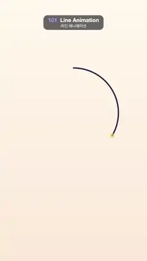

# 101 · Line Animation · 라인 애니메이션



★ One of the 20 effects in the original reel (#16) · 원래 릴스 20개 중 하나(16번)

**EN** Strokes draw on one by one, a round mountain badge with sun, lake and birds, then a handwritten "hello", before trailing tails erase it all.  
**KO** 선이 하나씩 그려지며 해·호수·새가 있는 원형 산 그림과 손글씨 "hello"가 나타나고, 뒤따르는 꼬리가 전부 지운 뒤 다시 시작한다.

[Video (mp4)](https://sueun-dev.github.io/motion-effects/videos/101-line-animation.mp4) · [Code](../effects/101-line-animation.js) · Animation principles · 애니메이션 원리

## Prompt (English)

```text
Create a "Line Animation" (stroke draw-on) motion effect: a line drawing appears as if an invisible pen draws it stroke by stroke, then a word is handwritten in one continuous script line, and finally the tail of every stroke runs after its head to erase the page. The viewer should see each line grow along its own length, in a believable drawing order.

Look
- Paper: vertical gradient #FFF8EC → #FBE9D8 with a faint dot grid (radius 3 px, rgba(45, 42, 74, 0.06)) every 48 px from x 36, y 300. Round line caps and joins everywhere.
- The drawing, in drawing order (pixel coordinates on the frame):
  1. Badge circle, centre (540, 830), radius 330, starting at the top, clockwise. 10 px, ink #2D2A4A.
  2. Mountain range polyline (286, 1022) (420, 790) (482, 862) (600, 666) (700, 822) (742, 782) (794, 1022). 10 px, ink.
  3. Snow line under the main peak, a small zigzag (560, 732) (586, 760) (606, 734) (628, 760) (646, 734). 8 px, ink.
  4. Sun: circle centre (690, 618), radius 52, starting from its left side, 10 px, orange #FF7A59.
  5. Three lake lines, 8 px, blue #3D8BD9: y 1070 from x 322 to 758, y 1110 from 380 to 700, y 1146 from 452 to 628.
  6. Two birds as tiny "^^" zigzags: x 350–414 at y 632 with peaks at 616 (7 px), and x 430–478 at y 570 with peaks at 559 (6 px).
  7. "hello" in connected cursive, 15 px, pink #E2466E: about 53 hand-placed points (tall looped h, l, l; small e and o; a flourish to the right) smoothed with Catmull-Rom (10 samples per span), starting at (150, 1570) and ending near (933, 1474); the tall letters are about 330 px high.
- A pen dot leads each stroke while it draws: a circle of radius 1.8 × the stroke width at the tip, rgba(255, 200, 80, 0.6·sin(π·progress)).

Motion (0–5 s)
- Work on an internal clock τ = (t + 0.5) mod 5, so the video opens mid-drawing and the blank page falls near the end.
- Draw windows in τ seconds: circle 0.15–0.95, mountains 0.85–1.5, snow line 1.45–1.65, sun 1.55–1.95, lake lines 1.8–2.05 / 1.9–2.15 / 2.0–2.2, birds 2.05–2.25 / 2.15–2.32, "hello" 2.25–3.55. Windows overlap slightly, like a quick sketcher.
- The visible piece of each stroke runs from length off to length on: on = easeInOut((τ − a)/(b − a))·L and off = easeInOut((τ − a′)/(b′ − a′))·L with a′ = 3.7 + 0.3·(a − 0.15), b′ = 3.9 + 0.3·(b − 0.15), so the tails erase in the same order, compressed into τ 3.7–4.12. Then the page stays blank until the circle starts again (video time about 3.6–4.65 s). Easing: cubic ease-in-out.

Technique
- Canvas 2D. Store every stroke as a list of points with its running arc length; to draw the piece between two lengths, interpolate the first and last segment and stroke the points in between as one path. No dash tricks, so caps stay round and the speed is even.

Output and rules
- One self-contained HTML file with no external assets (three.js from a CDN is fine if you use it), drawing on a 1080 × 1920 canvas (9:16) scaled to fit the window.
- Write a function renderFrame(t) that draws the frame for time t in seconds, and preview it with requestAnimationFrame. Everything must be a pure function of t and fixed seeds: no Math.random(), Date or state carried between frames, so frame i = renderFrame(i / 30) can be exported to a 30 fps video.
- Loop seamlessly every 5 seconds: renderFrame(5) must look exactly like renderFrame(0).
- No flicker of any kind: no noise or grain that changes from frame to frame, no strobing or blinking, no z-fighting, no shimmering 1 px lines. Any grain or texture stays fixed to the screen or to the object.
- Keep the top 280 px free of important content (a title label goes there) and fill the whole frame with a designed background.
```

## 프롬프트 (한국어)

```text
"라인 애니메이션"(선 그리기) 모션 효과를 만들어 줘: 보이지 않는 펜이 한 획씩 그리듯 선 그림이 나타나고, 이어서 낱말 하나를 끊기지 않는 필기체 한 줄로 쓰고, 마지막에 획마다 꼬리가 머리를 쫓아가며 종이를 지운다. 보는 사람은 선이 자기 길이를 따라 자라는 것을, 그럴듯한 그리기 순서로 본다.

모양
- 종이: 세로 그라디언트 #FFF8EC → #FBE9D8, x 36, y 300부터 48px마다 옅은 점 격자(반지름 3px, rgba(45, 42, 74, 0.06)). 모든 선은 둥근 끝, 둥근 이음.
- 그림, 그리는 순서대로(화면 픽셀 좌표):
  1. 배지 원: 중심 (540, 830), 반지름 330, 맨 위에서 시계 방향으로. 10px, 잉크색 #2D2A4A.
  2. 산 능선 꺾은선 (286, 1022) (420, 790) (482, 862) (600, 666) (700, 822) (742, 782) (794, 1022). 10px, 잉크색.
  3. 가장 높은 봉우리 아래 눈 선, 작은 지그재그 (560, 732) (586, 760) (606, 734) (628, 760) (646, 734). 8px, 잉크색.
  4. 해: 중심 (690, 618), 반지름 52의 원, 왼쪽에서 시작, 10px, 주황 #FF7A59.
  5. 호수 선 셋, 8px, 파랑 #3D8BD9: y 1070에서 x 322–758, y 1110에서 380–700, y 1146에서 452–628.
  6. 작은 "^^" 지그재그 새 두 마리: x 350–414, y 632, 꼭짓점 616(7px), 그리고 x 430–478, y 570, 꼭짓점 559(6px).
  7. 이어 쓴 필기체 "hello", 15px, 분홍 #E2466E: 손으로 찍은 점 약 53개(고리가 있는 큰 h, l, l, 작은 e와 o, 오른쪽으로 빠지는 끝맺음)를 Catmull-Rom(구간마다 10샘플)으로 부드럽게. (150, 1570)에서 시작해 (933, 1474) 근처에서 끝나고, 큰 글자 높이는 약 330px.
- 획이 그려지는 동안 펜 점이 앞장선다: 끝에 선 굵기 1.8배 반지름의 원, rgba(255, 200, 80, 0.6·sin(π·진행도)).

움직임 (0–5초)
- 내부 시계 τ = (t + 0.5) mod 5를 쓴다. 그래서 영상은 그리는 도중에 시작하고, 빈 종이는 끝 무렵에 온다.
- 그리는 구간(τ 초): 원 0.15–0.95, 산 0.85–1.5, 눈 선 1.45–1.65, 해 1.55–1.95, 호수 1.8–2.05 / 1.9–2.15 / 2.0–2.2, 새 2.05–2.25 / 2.15–2.32, "hello" 2.25–3.55. 손 빠른 스케치처럼 구간이 살짝 겹친다.
- 획마다 보이는 부분은 길이 off부터 on까지: on = easeInOut((τ − a)/(b − a))·L, off = easeInOut((τ − a′)/(b′ − a′))·L, a′ = 3.7 + 0.3·(a − 0.15), b′ = 3.9 + 0.3·(b − 0.15). 그래서 꼬리가 같은 순서로, τ 3.7–4.12에 압축되어 지운다. 그다음 원이 다시 시작할 때까지 빈 종이(영상 시각 약 3.6–4.65초). 이징은 cubic ease-in-out.

기법
- Canvas 2D. 획마다 점 목록과 누적 호 길이를 저장한다. 두 길이 사이 조각을 그릴 때는 첫 구간과 마지막 구간을 보간하고 그 사이 점들을 경로 하나로 긋는다. 대시 트릭을 쓰지 않으니 끝이 둥글고 속도가 고르다.

출력과 규칙
- 외부 파일 없는 HTML 파일 하나(three.js를 쓴다면 CDN은 괜찮다). 1080 × 1920(9:16) 캔버스에 그리고 창 크기에 맞춰 보이게 한다.
- 시간 t(초)의 프레임을 그리는 renderFrame(t) 함수를 만들고, 미리보기는 requestAnimationFrame으로 돌린다. 모든 것은 t와 고정 시드만으로 정해진다: Math.random(), Date, 프레임 사이에 쌓이는 상태 금지. 그래야 i번째 프레임 = renderFrame(i / 30)으로 30fps 영상을 뽑을 수 있다.
- 5초마다 끊김 없이 반복: renderFrame(5)는 renderFrame(0)과 똑같아 보여야 한다.
- 어떤 깜빡임도 금지: 프레임마다 바뀌는 노이즈·그레인, 번쩍임·깜빡임, z-fighting, 반짝이며 떨리는 1px 선 모두 금지. 그레인·질감은 화면이나 물체에 고정한다.
- 위쪽 280px에는 중요한 내용을 두지 않고(제목 라벨 자리), 화면 전체를 디자인된 배경으로 채운다.
```
