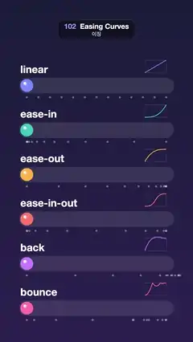

# 102 · Easing Curves · 이징



**EN** Six balls cross the same track in the same time with linear, ease-in, ease-out, ease-in-out, back and bounce easing, then go back.  
**KO** 공 여섯 개가 같은 거리를 같은 시간에 linear·ease-in·ease-out·ease-in-out·back·bounce 이징으로 갔다가 다시 돌아온다.

[Video (mp4)](https://sueun-dev.github.io/motion-effects/videos/102-easing-curves.mp4) · [Code](../effects/102-easing-curves.js) · Animation principles · 애니메이션 원리

## Prompt (English)

```text
Create an "Easing Curves" motion effect: six balls in six lanes travel the same distance in the same time, each through a different easing function, so the viewer can compare slow-in / slow-out, overshoot and bounce side by side. Each lane also shows its curve and a spacing chart.

Look
- Background: vertical gradient #1B1D3A → #2C2150.
- Six lanes, centre lines at y = 480, 730, 980, 1230, 1480, 1730. Track from x 150 to x 930 (ball centre), ball radius 36.
  1. "linear" (k), #7C8CFF
  2. "ease-in" (k³), #3CC6B8
  3. "ease-out" (1 − (1 − k)³), #FFB547
  4. "ease-in-out" (cubic: 4k³ below 0.5, else 1 − (−2k + 2)³ / 2), #FF7A6B
  5. "back" (ease-out-back: 1 + 2.70158·(k − 1)³ + 1.70158·(k − 1)²), #C77DFF
  6. "bounce" (the standard ease-out-bounce with 7.5625 and 2.75), #FF6FA8
- In each lane: the name in bold white 58 px sans-serif, left aligned at x 114, 70 px above the lane centre. To its right, a mini graph: a 120 × 70 px box (outline white at 18 %, 2 px) from x 810 to 930, ending 72 px above the lane centre, with the easing curve drawn in the lane colour, 4 px.
- A rounded track pill behind the ball: x 106–974, 88 px tall, fully rounded, white at 10 %.
- Spacing chart: 13 dots (radius 6, white at 35 %) 66 px below the lane centre, at x = 150 + 780·f(s/12) for s = 0..12 — equal time steps, so tight dots mean slow and wide gaps mean fast.
- The ball: radial gradient from a white spot at (−12, −14) through the lane colour (from 25 % on). Behind it, 4 ghosts at t − 0.035, 0.07, 0.105, 0.14 s in the lane colour with alpha 0.28, 0.21, 0.14, 0.07 (newest strongest), which show speed.

Motion (0–5 s)
- Position along the track p(t): before 2.55 s, p = f(clamp((t − 0.4)/1.8)), out from left to right during 0.4–2.2 s; after that, p = 1 − f(clamp((t − 2.9)/1.8)), back from right to left during 2.9–4.7 s with the same easing (so ease-in starts slowly again on the way back, back overshoots past the left end, bounce bounces at the left end).
- Holds at both ends (0–0.4, 2.2–2.9, 4.7–5 s), all six arrive together.

Technique
- Canvas 2D, full repaint each frame; everything computed from t, including the ghosts (sample p at earlier times rather than keeping history).

Output and rules
- One self-contained HTML file with no external assets (three.js from a CDN is fine if you use it), drawing on a 1080 × 1920 canvas (9:16) scaled to fit the window.
- Write a function renderFrame(t) that draws the frame for time t in seconds, and preview it with requestAnimationFrame. Everything must be a pure function of t and fixed seeds: no Math.random(), Date or state carried between frames, so frame i = renderFrame(i / 30) can be exported to a 30 fps video.
- Loop seamlessly every 5 seconds: renderFrame(5) must look exactly like renderFrame(0).
- No flicker of any kind: no noise or grain that changes from frame to frame, no strobing or blinking, no z-fighting, no shimmering 1 px lines. Any grain or texture stays fixed to the screen or to the object.
- Keep the top 280 px free of important content (a title label goes there) and fill the whole frame with a designed background.
```

## 프롬프트 (한국어)

```text
"이징" 모션 효과를 만들어 줘: 여섯 줄의 공 여섯 개가 같은 거리를 같은 시간에, 저마다 다른 이징 함수로 움직인다. 그래서 천천히 시작·천천히 끝내기, 넘쳤다 돌아오기, 튕기기를 나란히 비교할 수 있다. 줄마다 곡선 그래프와 간격 차트도 보여 준다.

모양
- 배경: 세로 그라디언트 #1B1D3A → #2C2150.
- 여섯 줄, 줄 중심선 y = 480, 730, 980, 1230, 1480, 1730. 트랙은 x 150에서 x 930까지(공 중심), 공 반지름 36.
  1. "linear"(k), #7C8CFF
  2. "ease-in"(k³), #3CC6B8
  3. "ease-out"(1 − (1 − k)³), #FFB547
  4. "ease-in-out"(cubic: 0.5 아래는 4k³, 위는 1 − (−2k + 2)³ / 2), #FF7A6B
  5. "back"(ease-out-back: 1 + 2.70158·(k − 1)³ + 1.70158·(k − 1)²), #C77DFF
  6. "bounce"(7.5625와 2.75를 쓰는 표준 ease-out-bounce), #FF6FA8
- 줄마다: 이름을 굵은 흰색 58px 산세리프로, x 114에 왼쪽 정렬, 줄 중심보다 70px 위. 그 오른쪽에 작은 그래프: x 810–930의 120 × 70px 상자(흰색 18 % 2px 테두리, 아래 끝이 줄 중심보다 72px 위) 안에 줄 색 4px로 이징 곡선.
- 공 뒤의 둥근 트랙: x 106–974, 높이 88px, 완전히 둥근 모서리, 흰색 10 %.
- 간격 차트: 줄 중심 66px 아래에 점 13개(반지름 6, 흰색 35 %), s = 0..12에 대해 x = 150 + 780·f(s/12). 같은 시간 간격이라 점이 촘촘하면 느리고 벌어지면 빠르다.
- 공: (−12, −14)의 흰 점에서 줄 색으로(25 %부터) 가는 방사형 그라디언트. 뒤에 t − 0.035, 0.07, 0.105, 0.14초의 잔상 넷을 줄 색, 알파 0.28, 0.21, 0.14, 0.07(최근 것이 가장 진함)로 그려 속도를 보여 준다.

움직임 (0–5초)
- 트랙 위치 p(t): 2.55초 전에는 p = f(clamp((t − 0.4)/1.8)), 0.4–2.2초에 왼쪽에서 오른쪽으로. 그 뒤에는 p = 1 − f(clamp((t − 2.9)/1.8)), 2.9–4.7초에 같은 이징으로 오른쪽에서 왼쪽으로 돌아온다(그래서 ease-in은 돌아올 때도 천천히 출발하고, back은 왼쪽 끝을 넘었다 돌아오고, bounce는 왼쪽 끝에서 튕긴다).
- 양끝에서 멈춤(0–0.4, 2.2–2.9, 4.7–5초). 여섯 개가 동시에 도착한다.

기법
- Canvas 2D, 매 프레임 전체를 다시 그린다. 잔상까지 모두 t로 계산한다(기록을 쌓지 말고 이전 시각의 p를 다시 계산).

출력과 규칙
- 외부 파일 없는 HTML 파일 하나(three.js를 쓴다면 CDN은 괜찮다). 1080 × 1920(9:16) 캔버스에 그리고 창 크기에 맞춰 보이게 한다.
- 시간 t(초)의 프레임을 그리는 renderFrame(t) 함수를 만들고, 미리보기는 requestAnimationFrame으로 돌린다. 모든 것은 t와 고정 시드만으로 정해진다: Math.random(), Date, 프레임 사이에 쌓이는 상태 금지. 그래야 i번째 프레임 = renderFrame(i / 30)으로 30fps 영상을 뽑을 수 있다.
- 5초마다 끊김 없이 반복: renderFrame(5)는 renderFrame(0)과 똑같아 보여야 한다.
- 어떤 깜빡임도 금지: 프레임마다 바뀌는 노이즈·그레인, 번쩍임·깜빡임, z-fighting, 반짝이며 떨리는 1px 선 모두 금지. 그레인·질감은 화면이나 물체에 고정한다.
- 위쪽 280px에는 중요한 내용을 두지 않고(제목 라벨 자리), 화면 전체를 디자인된 배경으로 채운다.
```
