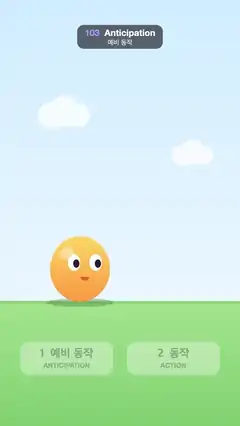

# 103 · Anticipation · 예비 동작



**EN** An orange blob crouches, leans back and squints before each hop, springs over, lands with a squash; a second hop brings it back.  
**KO** 주황 젤리 캐릭터가 뛰기 전 몸을 움츠리고 뒤로 기울며 눈을 찡그렸다가 튀어 넘어가 납작하게 착지하고, 두 번째 점프로 돌아온다.

[Video (mp4)](https://sueun-dev.github.io/motion-effects/videos/103-anticipation.mp4) · [Code](../effects/103-anticipation.js) · Animation principles · 애니메이션 원리

## Prompt (English)

```text
Create an "Anticipation" motion effect: a cute blob makes two hops (right, then back left). Before each hop it slowly squashes down, leans and pulls back the opposite way, then releases into a stretched jump. Two cards under it light up "1 예비 동작 / ANTICIPATION" and "2 동작 / ACTION", so the viewer learns that the small opposite move before an action is what makes the action readable.

Look
- Sky: vertical gradient #CDEBFF → #EAF6FF down to the ground line at y 1360; grass below, #9ED98A → #7CC46E, with a 14 px band #8BCB79 at the top edge. Two still white clouds (75 %) near (230, 520) and (820, 700), each three circles plus a rectangle in one path so overlaps don't darken.
- The blob stands on the ground: an ellipse 270·sx wide and 295·sy tall whose bottom sits on the ground point, rotated about that point; sx = sy^(−0.7). Fill: vertical gradient #FFD45E (top) → #FF9A3D (bottom), a white 35 % highlight at the upper left. Eyes: white ellipses 28 × 38 px radii at ±0.18 of the width, 60 % up, height reduced by 55 % when squinting; pupils #2A1D3A shifted toward where it looks. Mouth: a half-ellipse #E76A3A that flattens when squinting. Eyes and mouth shift up to 22 px toward the look direction.
- Ground shadow: ellipse at y 1364, half-width 150·(1 − 0.4·lift)/√sy, half-height 20, rgba(40, 90, 40, 0.3 − 0.18·lift), lift = min(1, height / 300).
- Five ghosts at t − 0.06·g (g = 1..5) in rgba(255, 150, 60), alpha 0.05·(6 − g) scaled by how far the ghost is from the blob (min(1, (height + |dx|)/60)), so there are no ghosts while it stands still.
- Cards: two rounded rectangles 420 × 150 px (radius 40) centred at x 300 and 780, y 1540–1690: white with alpha 0.35 + 0.6·on. Text: Korean "1  예비 동작" / "2  동작" in heavy 52 px, English "ANTICIPATION" / "ACTION" in bold 30 px below, both dark green rgba(40, 60, 40, 0.35 + 0.65·on).

Motion (0–5 s)
- Two hops of 2.5 s: the first from x 360 to the right (+360 px), the second from x 720 back to the left. Inside each hop (τ = 0..2.5 s, dir = ±1):
  - 0–0.4 rest.
  - 0.4–1.15 crouch (cubic ease-in-out c): sy 1 → 0.73, x pulls back 45 px against the jump, lean −0.2·c·dir rad, eyes squint.
  - 1.15–1.25 release: sy 0.73 → 1.25 (stretch), lean flips to +0.2·dir, x returns, eyes open.
  - 1.25–1.9 flight (k linear): x moves 360 px, height 1680·k(1 − k) (peak 420 px), sy = 1 + 0.25·(1 − 2k)², lean 0.2·dir·(1 − 2k).
  - 1.9–2.02 landing squash sy 1.25 → 0.76 (ease-out), then 2.02–2.4 settle 0.76 → 1 with ease-out-back overshoot; lean returns to 0 by 2.3.
  - 2.15–2.45 the eyes turn to look the other way, ready for the next hop.
- Card 1 lights up over 0.3–0.5 and dims over 1.15–1.3; card 2 lights over 1.15–1.3 and dims over 2.1–2.4, in every hop.

Technique
- Canvas 2D, full repaint; the pose is a pure function of t (ghosts are the pose at earlier times).

Output and rules
- One self-contained HTML file with no external assets (three.js from a CDN is fine if you use it), drawing on a 1080 × 1920 canvas (9:16) scaled to fit the window.
- Write a function renderFrame(t) that draws the frame for time t in seconds, and preview it with requestAnimationFrame. Everything must be a pure function of t and fixed seeds: no Math.random(), Date or state carried between frames, so frame i = renderFrame(i / 30) can be exported to a 30 fps video.
- Loop seamlessly every 5 seconds: renderFrame(5) must look exactly like renderFrame(0).
- No flicker of any kind: no noise or grain that changes from frame to frame, no strobing or blinking, no z-fighting, no shimmering 1 px lines. Any grain or texture stays fixed to the screen or to the object.
- Keep the top 280 px free of important content (a title label goes there) and fill the whole frame with a designed background.
```

## 프롬프트 (한국어)

```text
"예비 동작" 모션 효과를 만들어 줘: 귀여운 젤리 캐릭터가 두 번 뛴다(오른쪽으로, 다시 왼쪽으로). 뛰기 전마다 천천히 몸을 움츠리고, 반대쪽으로 기울며 뒤로 당겼다가, 늘어나며 튀어 오른다. 아래 카드 두 장이 "1 예비 동작 / ANTICIPATION", "2 동작 / ACTION"으로 차례로 켜져서, 동작 직전의 작은 반대 움직임이 동작을 읽히게 만든다는 것을 알려 준다.

모양
- 하늘: 땅선 y 1360까지 세로 그라디언트 #CDEBFF → #EAF6FF. 그 아래 풀밭 #9ED98A → #7CC46E, 위 가장자리에 14px 띠 #8BCB79. (230, 520)과 (820, 700) 근처에 움직이지 않는 흰 구름 둘(75 %). 각각 원 셋과 사각형 하나를 경로 하나로 칠해 겹친 곳이 진해지지 않게 한다.
- 캐릭터는 땅에 선다: 폭 270·sx, 높이 295·sy의 타원, 아래쪽이 땅의 한 점에 붙고 그 점을 축으로 기운다. sx = sy^(−0.7). 채우기: 세로 그라디언트 #FFD45E(위) → #FF9A3D(아래), 왼쪽 위에 흰색 35 % 하이라이트. 눈: 폭의 ±0.18, 높이 60 % 위치의 흰 타원(반지름 28 × 38px), 찡그리면 높이가 55 % 줄어든다. 눈동자 #2A1D3A는 보는 쪽으로 치우친다. 입: 반타원 #E76A3A, 찡그리면 납작해진다. 눈과 입은 보는 방향으로 최대 22px 옮겨진다.
- 땅 그림자: y 1364의 타원, 가로 반지름 150·(1 − 0.4·lift)/√sy, 세로 반지름 20, rgba(40, 90, 40, 0.3 − 0.18·lift), lift = min(1, 높이 / 300).
- 잔상 다섯: t − 0.06·g(g = 1..5)의 모습을 rgba(255, 150, 60)로, 알파 0.05·(6 − g)에 캐릭터와 떨어진 정도(min(1, (높이 + |dx|)/60))를 곱한다. 그래서 가만히 서 있을 때는 잔상이 없다.
- 카드: x 300과 780을 중심으로 y 1540–1690에 420 × 150px 둥근 사각형 둘(반지름 40), 흰색 알파 0.35 + 0.6·on. 글자: 한국어 "1  예비 동작" / "2  동작"은 아주 굵은 52px, 그 아래 영어 "ANTICIPATION" / "ACTION"은 굵은 30px, 둘 다 진초록 rgba(40, 60, 40, 0.35 + 0.65·on).

움직임 (0–5초)
- 2.5초짜리 점프 두 번: 첫째는 x 360에서 오른쪽으로(+360px), 둘째는 x 720에서 다시 왼쪽으로. 점프 안에서(τ = 0..2.5초, dir = ±1):
  - 0–0.4 쉬기.
  - 0.4–1.15 움츠리기(cubic ease-in-out c): sy 1 → 0.73, 뛸 방향 반대로 x를 45px 뒤로, 기울기 −0.2·c·dir rad, 눈을 찡그린다.
  - 1.15–1.25 놓기: sy 0.73 → 1.25(늘어남), 기울기가 +0.2·dir로 뒤집히고, x는 제자리로, 눈을 뜬다.
  - 1.25–1.9 비행(k 선형): x가 360px 이동, 높이 1680·k(1 − k)(최고 420px), sy = 1 + 0.25·(1 − 2k)², 기울기 0.2·dir·(1 − 2k).
  - 1.9–2.02 착지 찌그러짐 sy 1.25 → 0.76(ease-out), 이어서 2.02–2.4에 ease-out-back으로 살짝 넘치며 0.76 → 1로 자리 잡기. 기울기는 2.3초까지 0으로.
  - 2.15–2.45 눈이 반대쪽을 본다. 다음 점프 준비.
- 점프마다 카드 1은 0.3–0.5에 켜지고 1.15–1.3에 흐려지며, 카드 2는 1.15–1.3에 켜지고 2.1–2.4에 흐려진다.

기법
- Canvas 2D, 매 프레임 전체를 다시 칠한다. 자세는 t의 순수 함수다(잔상은 이전 시각의 자세).

출력과 규칙
- 외부 파일 없는 HTML 파일 하나(three.js를 쓴다면 CDN은 괜찮다). 1080 × 1920(9:16) 캔버스에 그리고 창 크기에 맞춰 보이게 한다.
- 시간 t(초)의 프레임을 그리는 renderFrame(t) 함수를 만들고, 미리보기는 requestAnimationFrame으로 돌린다. 모든 것은 t와 고정 시드만으로 정해진다: Math.random(), Date, 프레임 사이에 쌓이는 상태 금지. 그래야 i번째 프레임 = renderFrame(i / 30)으로 30fps 영상을 뽑을 수 있다.
- 5초마다 끊김 없이 반복: renderFrame(5)는 renderFrame(0)과 똑같아 보여야 한다.
- 어떤 깜빡임도 금지: 프레임마다 바뀌는 노이즈·그레인, 번쩍임·깜빡임, z-fighting, 반짝이며 떨리는 1px 선 모두 금지. 그레인·질감은 화면이나 물체에 고정한다.
- 위쪽 280px에는 중요한 내용을 두지 않고(제목 라벨 자리), 화면 전체를 디자인된 배경으로 채운다.
```
