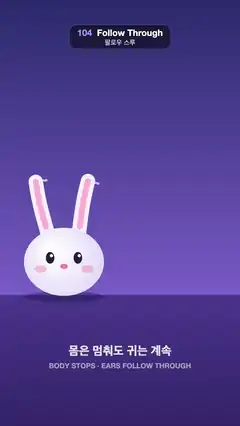

# 104 · Follow Through · 팔로우 스루



**EN** A round white bunny slides across and stops; its long ears keep swinging on a damped spring, the tips lagging most, before they settle.  
**KO** 둥근 흰 토끼가 옆으로 미끄러지다 멈춰도 긴 귀는 감쇠 스프링처럼 계속 흔들리고, 끝이 가장 늦게 따라오다 가라앉는다.

[Video (mp4)](../videos/104-follow-through.mp4) · [Code](../effects/104-follow-through.js) · Animation principles · 애니메이션 원리

## Prompt (English)

```text
Create a "Follow Through" (overlapping action) motion effect: a bunny's round body slides sideways and stops sharply, but its two long ears keep going, swing past, bounce back and settle, each part of the ear a little later than the part below it. The caption reads "몸은 멈춰도 귀는 계속" / "BODY STOPS · EARS FOLLOW THROUGH", so the viewer learns that loose parts keep moving after the main mass stops.

Look
- Background: vertical gradient #2B2D6E → #7A62C9 down to the ground line at y 1330, then floor #4B3A8E → #33276A.
- The character (everything scaled 1.2× around the ground point (540, 1330)): body ellipse 150 × 128 px radii centred 125 px above its ground point, radial gradient #FFFFFF → #D9D2F5; eyes #2A1D3A (16 × 22 radii) at ±52 px, 140 px up, with small white catchlights; blush rgba(255, 140, 170, 0.45) at ±88 px; a pink nose #FF7FA8. The face slides up to 14 px toward the direction of travel while moving. Ground shadow: ellipse 150 × 20 rgba(20, 10, 50, 0.35).
- Ears: two chains of 4 segments × 58 px, rooted at ±52 px from the body centre and 200 px above the ground (the roots rotate with the body's lean), resting 0.2 rad outward from vertical. Draw each ear as one smooth stroke through its joints (quadratic curves through the midpoints): 54 px #F4F0FF with round caps, and an inner 22 px #FFB3D1 stroke from the second joint on.
- Ear-tip trail: the tip positions over the last 1/3 s (40 steps of 1/120 s), short 8 px segments in rgba(255, 190, 230) fading from 0.5 to 0.
- Captions centred: "몸은 멈춰도 귀는 계속" heavy 54 px, white at 85 %, at y 1600; "BODY STOPS · EARS FOLLOW THROUGH" bold 32 px, white at 55 %, at y 1660.

Motion (0–5 s)
- Body x: slide from 330 to 750 during 0.3–0.85 s (cubic ease-in-out), hold; slide back to 330 during 2.8–3.35 s, hold. Lean into the move: 0.22·sin(π·progress) rad, rotating about the ground point.
- Ear swing θ(t): a damped spring pushed by the body's acceleration, θ'' = −ω²θ − 2ζωθ' − 0.011·a, with ω = 2π·1.8 Hz, ζ = 0.14, a = the body's x acceleration in px/s² (finite differences).
- Ear segment i (1..4) points at rest + lean + θ(t − (i − 1)·0.045)·(0.45 + 0.55·i/4): each segment uses a slightly older swing and a bigger share of it, so the tip lags and swings the most.

Technique
- Canvas 2D. Precompute the spring once at load time (not frame to frame): integrate at 240 Hz for three 5-second loops and keep only the third as a lookup table, so the swing at t = 5 matches t = 0. Each frame reads the table at round(t·240) mod 1200. All drawing is a pure function of t.

Output and rules
- One self-contained HTML file with no external assets (three.js from a CDN is fine if you use it), drawing on a 1080 × 1920 canvas (9:16) scaled to fit the window.
- Write a function renderFrame(t) that draws the frame for time t in seconds, and preview it with requestAnimationFrame. Everything must be a pure function of t and fixed seeds: no Math.random(), Date or state carried between frames, so frame i = renderFrame(i / 30) can be exported to a 30 fps video.
- Loop seamlessly every 5 seconds: renderFrame(5) must look exactly like renderFrame(0).
- No flicker of any kind: no noise or grain that changes from frame to frame, no strobing or blinking, no z-fighting, no shimmering 1 px lines. Any grain or texture stays fixed to the screen or to the object.
- Keep the top 280 px free of important content (a title label goes there) and fill the whole frame with a designed background.
```

## 프롬프트 (한국어)

```text
"팔로우 스루"(오버래핑 액션) 모션 효과를 만들어 줘: 토끼의 둥근 몸이 옆으로 미끄러지다 딱 멈추지만, 긴 귀 두 개는 계속 나아가 지나쳤다가 되돌아오고 가라앉는다. 귀의 각 마디는 바로 아래 마디보다 조금씩 늦다. 자막 "몸은 멈춰도 귀는 계속" / "BODY STOPS · EARS FOLLOW THROUGH"로, 몸통이 멈춘 뒤에도 느슨한 부분은 계속 움직인다는 것을 알려 준다.

모양
- 배경: 땅선 y 1330까지 세로 그라디언트 #2B2D6E → #7A62C9, 그 아래 바닥 #4B3A8E → #33276A.
- 캐릭터(전부 땅의 점 (540, 1330)을 기준으로 1.2배): 몸통은 자기 땅 점에서 125px 위를 중심으로 한 반지름 150 × 128px 타원, 방사형 그라디언트 #FFFFFF → #D9D2F5. 눈 #2A1D3A(반지름 16 × 22)는 ±52px, 140px 위, 작은 흰 반사점. 볼터치 rgba(255, 140, 170, 0.45)는 ±88px. 분홍 코 #FF7FA8. 움직이는 동안 얼굴이 진행 방향으로 최대 14px 쏠린다. 땅 그림자: 150 × 20 타원 rgba(20, 10, 50, 0.35).
- 귀: 58px 마디 4개짜리 사슬 둘. 뿌리는 몸 중심에서 ±52px, 땅에서 200px 위(뿌리는 몸의 기울기와 함께 돈다), 쉬는 자세는 수직에서 바깥으로 0.2 rad. 귀마다 관절을 지나는 매끄러운 선 하나로 그린다(중점을 지나는 2차 곡선): 54px #F4F0FF 둥근 끝, 둘째 관절부터 안쪽에 22px #FFB3D1.
- 귀 끝 자취: 최근 1/3초 동안의 귀 끝 위치(1/120초씩 40단계)를 8px 짧은 선분으로, rgba(255, 190, 230), 알파 0.5에서 0으로 옅어진다.
- 가운데 정렬 자막: "몸은 멈춰도 귀는 계속" 아주 굵은 54px, 흰색 85 %, y 1600. "BODY STOPS · EARS FOLLOW THROUGH" 굵은 32px, 흰색 55 %, y 1660.

움직임 (0–5초)
- 몸 x: 0.3–0.85초에 330에서 750으로 미끄러지고(cubic ease-in-out) 멈춤. 2.8–3.35초에 330으로 돌아오고 멈춤. 움직이는 쪽으로 기울기: 0.22·sin(π·진행도) rad, 땅 점을 축으로.
- 귀 흔들림 θ(t): 몸의 가속도에 밀리는 감쇠 스프링 θ'' = −ω²θ − 2ζωθ' − 0.011·a. ω = 2π·1.8Hz, ζ = 0.14, a = 몸 x의 가속도(px/s², 유한 차분).
- 귀 i번째 마디(1..4)의 방향 = 쉬는 각 + 기울기 + θ(t − (i − 1)·0.045)·(0.45 + 0.55·i/4). 마디마다 조금 더 예전의 흔들림을, 더 큰 비율로 쓰니 끝이 가장 늦고 가장 크게 흔들린다.

기법
- Canvas 2D. 스프링은 불러올 때 한 번만 미리 계산한다(프레임에서 프레임으로 쌓지 않는다): 240Hz로 5초 루프 세 번을 적분하고 세 번째만 조회표로 남긴다. 그러면 t = 5의 흔들림이 t = 0과 같다. 매 프레임 round(t·240) mod 1200 칸을 읽는다. 그리기는 전부 t의 순수 함수다.

출력과 규칙
- 외부 파일 없는 HTML 파일 하나(three.js를 쓴다면 CDN은 괜찮다). 1080 × 1920(9:16) 캔버스에 그리고 창 크기에 맞춰 보이게 한다.
- 시간 t(초)의 프레임을 그리는 renderFrame(t) 함수를 만들고, 미리보기는 requestAnimationFrame으로 돌린다. 모든 것은 t와 고정 시드만으로 정해진다: Math.random(), Date, 프레임 사이에 쌓이는 상태 금지. 그래야 i번째 프레임 = renderFrame(i / 30)으로 30fps 영상을 뽑을 수 있다.
- 5초마다 끊김 없이 반복: renderFrame(5)는 renderFrame(0)과 똑같아 보여야 한다.
- 어떤 깜빡임도 금지: 프레임마다 바뀌는 노이즈·그레인, 번쩍임·깜빡임, z-fighting, 반짝이며 떨리는 1px 선 모두 금지. 그레인·질감은 화면이나 물체에 고정한다.
- 위쪽 280px에는 중요한 내용을 두지 않고(제목 라벨 자리), 화면 전체를 디자인된 배경으로 채운다.
```
