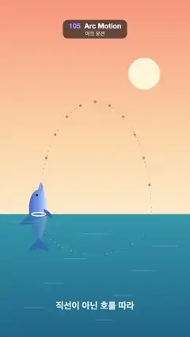

# 105 · Arc Motion · 아크 모션



**EN** A dolphin leaps out of a sunset sea on a tall arc and swims back under water on a shallow one, dots marking equal time steps.  
**KO** 돌고래가 노을 진 바다에서 높은 호를 그리며 뛰어올랐다가 물속에서 얕은 호로 돌아오고, 점들이 같은 시간 간격을 표시한다.

[Video (mp4)](https://sueun-dev.github.io/motion-effects/videos/105-arc-motion.mp4) · [Code](../effects/105-arc-motion.js) · Animation principles · 애니메이션 원리

## Prompt (English)

```text
Create an "Arc Motion" motion effect: a dolphin never moves in straight lines. It rides one closed arc, a tall half-ellipse through the air and a shallow one under water, and always turns to follow the tangent. Dots on the path mark equal time steps, and the caption reads "직선이 아닌 호를 따라" ("along arcs, not straight lines"), so the viewer learns that natural motion follows arcs and that spacing shows speed.

Look
- Sky above the waterline at y 1220: vertical gradient #FF9E7A → #FFD3A1 (60 %) → #FFEBC9. Sun disc #FFF4D9, radius 90, at (820, 420). Sea below: #3FB6C9 → #14507A.
- The path: angle a, point (540 − 320·cos a, 1220 − 640·sin a) for the air half (sin a > 0) and (540 − 320·cos a, 1220 − 230·sin a) for the water half. The dolphin leaves the water at x 220, peaks at (540, 580) and dives in at x 860, then curves back under water down to y 1450.
- Air path: a dotted line (round 4 px dots, gaps 22 px, rgba(120, 60, 90, 0.35)) and 24 time-step dots (radius 7, rgba(120, 60, 90, 0.5)) at a = k·2π/24, only above the water. They bunch up near the top (slow) and spread near the water (fast).
- Dolphin, about 400 px long, drawn with Bézier paths in its own frame (beak to the right): body gradient #3E63C9 (back) → #6F9BEA → #DCEBFF (belly), dorsal fin, two tail flukes and a flipper in #3E63C9, eye #1D2550 (radius 7) and a thin smile line rgba(29, 37, 80, 0.5). Rotate it to the path direction.
- Trail: 30 short segments along the last 0.9 rad of the path behind the dolphin, width 6 → 28 px and alpha 0 → 0.5 toward the dolphin, rgba(62, 99, 201).
- Water in front: after the dolphin, cover the sea with rgba(30, 110, 150, 0.55) so it looks submerged on the way back, add 9 faint white streaks (14 %, 6 px tall) and the underwater half of the path as a white dotted line (50 %, 3 px).
- Ripples: where it leaves (x 220, at t = 0) and enters (x 860, at t = 2.5 s), two concentric ellipses on the waterline grow over 1.1 s (radius 40 + 160k by 10 + 26k, and 0.6× that), 6 px white, fading from 0.8 to 0.
- Caption "직선이 아닌 호를 따라", heavy 52 px, white at 85 %, centred at y 1760.

Motion (0–5 s)
- a = 2π·t / 5: one full loop of the path per 5 s at a constant angular rate (the ellipse shape itself makes it fast near the water and slow at the top).
- Heading = direction from the current point to the point at a + 0.01.
- Under water it would be upside down when heading left, so it rolls: vertical scale = cos(π·(smoothstep(π + 0.2, π + 1.0, a) − smoothstep(2π − 1.0, 2π − 0.2, a))), a smooth flip to −1 after the dive and back to 1 before it leaves the water.

Technique
- Canvas 2D, full repaint. Draw order: sky, sun, sea, air path and dots, trail, dolphin, water overlay, underwater path, ripples, caption.

Output and rules
- One self-contained HTML file with no external assets (three.js from a CDN is fine if you use it), drawing on a 1080 × 1920 canvas (9:16) scaled to fit the window.
- Write a function renderFrame(t) that draws the frame for time t in seconds, and preview it with requestAnimationFrame. Everything must be a pure function of t and fixed seeds: no Math.random(), Date or state carried between frames, so frame i = renderFrame(i / 30) can be exported to a 30 fps video.
- Loop seamlessly every 5 seconds: renderFrame(5) must look exactly like renderFrame(0).
- No flicker of any kind: no noise or grain that changes from frame to frame, no strobing or blinking, no z-fighting, no shimmering 1 px lines. Any grain or texture stays fixed to the screen or to the object.
- Keep the top 280 px free of important content (a title label goes there) and fill the whole frame with a designed background.
```

## 프롬프트 (한국어)

```text
"아크 모션" 모션 효과를 만들어 줘: 돌고래는 결코 직선으로 움직이지 않는다. 공중에서는 높은 반타원, 물속에서는 얕은 반타원으로 이루어진 닫힌 호 하나를 타고, 늘 접선 방향으로 몸을 돌린다. 경로 위 점들이 같은 시간 간격을 표시하고 자막 "직선이 아닌 호를 따라"가 붙어서, 자연스러운 움직임은 호를 따르고 간격이 속도를 보여 준다는 것을 알려 준다.

모양
- 수면 y 1220 위 하늘: 세로 그라디언트 #FF9E7A → #FFD3A1(60 %) → #FFEBC9. 해 원판 #FFF4D9, 반지름 90, (820, 420). 아래 바다: #3FB6C9 → #14507A.
- 경로: 각도 a에 대해 공중 반쪽(sin a > 0)은 (540 − 320·cos a, 1220 − 640·sin a), 물속 반쪽은 (540 − 320·cos a, 1220 − 230·sin a). 돌고래는 x 220에서 물을 박차고 나와 (540, 580)에서 정점을 찍고 x 860에서 물에 들어간 뒤, 물속에서 y 1450까지 휘어 돌아온다.
- 공중 경로: 점선(둥근 4px 점, 간격 22px, rgba(120, 60, 90, 0.35))과 a = k·2π/24의 시간 간격 점 24개(반지름 7, rgba(120, 60, 90, 0.5)), 수면 위만. 꼭대기에서는 촘촘하고(느림) 수면 가까이서는 벌어진다(빠름).
- 돌고래: 길이 약 400px, 자기 좌표계(부리가 오른쪽)에서 베지에 경로로 그린다. 몸통 그라디언트 #3E63C9(등) → #6F9BEA → #DCEBFF(배), 등지느러미·꼬리지느러미 두 갈래·가슴지느러미는 #3E63C9, 눈 #1D2550(반지름 7), 가는 미소 선 rgba(29, 37, 80, 0.5). 경로 방향으로 회전한다.
- 자취: 돌고래 뒤 경로의 마지막 0.9 rad를 짧은 선분 30개로, 돌고래 쪽으로 갈수록 굵기 6 → 28px, 알파 0 → 0.5, rgba(62, 99, 201).
- 앞쪽 물: 돌고래를 그린 뒤 바다를 rgba(30, 110, 150, 0.55)로 덮어 돌아오는 길에 물속에 잠긴 것처럼 보이게 하고, 옅은 흰 줄 9개(14 %, 높이 6px)와 물속 경로를 흰 점선(50 %, 3px)으로 더한다.
- 물결: 나오는 곳(x 220, t = 0)과 들어가는 곳(x 860, t = 2.5초)에서 수면 위 동심 타원 둘이 1.1초 동안 커진다(반지름 40 + 160k × 10 + 26k, 그리고 그 0.6배). 흰색 6px, 0.8에서 0으로 옅어진다.
- 자막 "직선이 아닌 호를 따라", 아주 굵은 52px, 흰색 85 %, y 1760 가운데.

움직임 (0–5초)
- a = 2π·t / 5: 5초에 경로 한 바퀴, 각속도는 일정하다(타원 모양 자체 때문에 수면 근처는 빠르고 꼭대기는 느리다).
- 방향 = 지금 점에서 a + 0.01의 점으로 가는 방향.
- 물속에서 왼쪽으로 갈 때 그대로면 배가 위로 뒤집히므로 몸을 굴린다: 세로 배율 = cos(π·(smoothstep(π + 0.2, π + 1.0, a) − smoothstep(2π − 1.0, 2π − 0.2, a))). 잠수 뒤 부드럽게 −1로 뒤집혔다가 물 밖으로 나오기 전 1로 돌아온다.

기법
- Canvas 2D, 매 프레임 전체를 다시 칠한다. 그리는 순서: 하늘, 해, 바다, 공중 경로와 점, 자취, 돌고래, 물 덮개, 물속 경로, 물결, 자막.

출력과 규칙
- 외부 파일 없는 HTML 파일 하나(three.js를 쓴다면 CDN은 괜찮다). 1080 × 1920(9:16) 캔버스에 그리고 창 크기에 맞춰 보이게 한다.
- 시간 t(초)의 프레임을 그리는 renderFrame(t) 함수를 만들고, 미리보기는 requestAnimationFrame으로 돌린다. 모든 것은 t와 고정 시드만으로 정해진다: Math.random(), Date, 프레임 사이에 쌓이는 상태 금지. 그래야 i번째 프레임 = renderFrame(i / 30)으로 30fps 영상을 뽑을 수 있다.
- 5초마다 끊김 없이 반복: renderFrame(5)는 renderFrame(0)과 똑같아 보여야 한다.
- 어떤 깜빡임도 금지: 프레임마다 바뀌는 노이즈·그레인, 번쩍임·깜빡임, z-fighting, 반짝이며 떨리는 1px 선 모두 금지. 그레인·질감은 화면이나 물체에 고정한다.
- 위쪽 280px에는 중요한 내용을 두지 않고(제목 라벨 자리), 화면 전체를 디자인된 배경으로 채운다.
```
